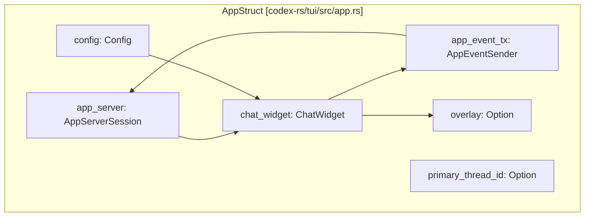
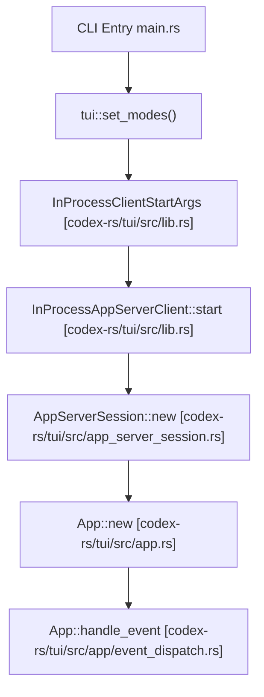
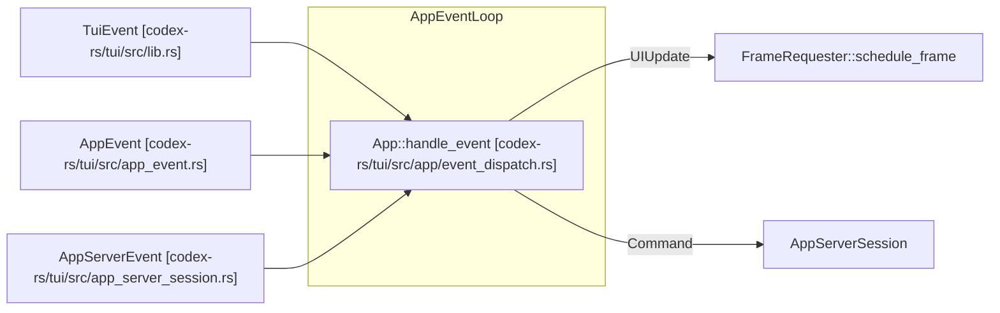
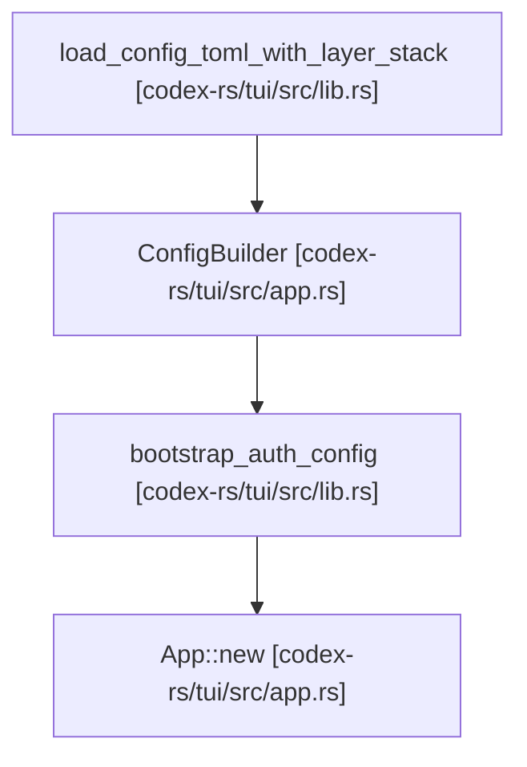

<!-- source: DeepWiki mcp.deepwiki.com · repo openai/codex · extra page App Event Loop and Initialization · fetched 2026-10-26 -->

# App Event Loop and Initialization

<details>
<summary>Relevant source files</summary>

The following files were used as context for generating this wiki page:

- [codex-rs/exec/src/lib.rs](codex-rs/exec/src/lib.rs)
- [codex-rs/exec/src/lib_tests.rs](codex-rs/exec/src/lib_tests.rs)
- [codex-rs/tui/src/app.rs](codex-rs/tui/src/app.rs)
- [codex-rs/tui/src/app/agent_center/input.rs](codex-rs/tui/src/app/agent_center/input.rs)
- [codex-rs/tui/src/app/agent_center/render.rs](codex-rs/tui/src/app/agent_center/render.rs)
- [codex-rs/tui/src/app/agent_center/rows.rs](codex-rs/tui/src/app/agent_center/rows.rs)
- [codex-rs/tui/src/app/agent_center_tests.rs](codex-rs/tui/src/app/agent_center_tests.rs)
- [codex-rs/tui/src/app/agents_overview.rs](codex-rs/tui/src/app/agents_overview.rs)
- [codex-rs/tui/src/app/agents_overview_action_progress_tests.rs](codex-rs/tui/src/app/agents_overview_action_progress_tests.rs)
- [codex-rs/tui/src/app/agents_overview_actions.rs](codex-rs/tui/src/app/agents_overview_actions.rs)
- [codex-rs/tui/src/app/agents_overview_actions_tests.rs](codex-rs/tui/src/app/agents_overview_actions_tests.rs)
- [codex-rs/tui/src/app/agents_overview_tests.rs](codex-rs/tui/src/app/agents_overview_tests.rs)
- [codex-rs/tui/src/app/agents_overview_view.rs](codex-rs/tui/src/app/agents_overview_view.rs)
- [codex-rs/tui/src/app/app_server_events.rs](codex-rs/tui/src/app/app_server_events.rs)
- [codex-rs/tui/src/app/event_dispatch.rs](codex-rs/tui/src/app/event_dispatch.rs)
- [codex-rs/tui/src/app/reconnect.rs](codex-rs/tui/src/app/reconnect.rs)
- [codex-rs/tui/src/app/session_lifecycle.rs](codex-rs/tui/src/app/session_lifecycle.rs)
- [codex-rs/tui/src/app/snapshots/codex_tui__app__agents_overview__tests__actions__hiding_tasks_keeps_selection_adjacent_in_display_order.snap](codex-rs/tui/src/app/snapshots/codex_tui__app__agents_overview__tests__actions__hiding_tasks_keeps_selection_adjacent_in_display_order.snap)
- [codex-rs/tui/src/app/snapshots/codex_tui__app__agents_overview__tests__command_center__live_center_columns.snap](codex-rs/tui/src/app/snapshots/codex_tui__app__agents_overview__tests__command_center__live_center_columns.snap)
- [codex-rs/tui/src/app/snapshots/codex_tui__app__agents_overview__tests__command_center__live_center_keeps_status_order_across_progress_refreshes.snap](codex-rs/tui/src/app/snapshots/codex_tui__app__agents_overview__tests__command_center__live_center_keeps_status_order_across_progress_refreshes.snap)
- [codex-rs/tui/src/app/snapshots/codex_tui__app__agents_overview__tests__command_center__live_center_selected_status_styles.snap](codex-rs/tui/src/app/snapshots/codex_tui__app__agents_overview__tests__command_center__live_center_selected_status_styles.snap)
- [codex-rs/tui/src/app/snapshots/codex_tui__app__agents_overview_actions__progress_tests__archive_progress.snap](codex-rs/tui/src/app/snapshots/codex_tui__app__agents_overview_actions__progress_tests__archive_progress.snap)
- [codex-rs/tui/src/app/snapshots/codex_tui__app__agents_overview_actions__progress_tests__delete_progress.snap](codex-rs/tui/src/app/snapshots/codex_tui__app__agents_overview_actions__progress_tests__delete_progress.snap)
- [codex-rs/tui/src/app/startup.rs](codex-rs/tui/src/app/startup.rs)
- [codex-rs/tui/src/app/test_support.rs](codex-rs/tui/src/app/test_support.rs)
- [codex-rs/tui/src/app/tests.rs](codex-rs/tui/src/app/tests.rs)
- [codex-rs/tui/src/app/tests/active_reconnect_tests.rs](codex-rs/tui/src/app/tests/active_reconnect_tests.rs)
- [codex-rs/tui/src/app/tests/navigation_reconnect_tests.rs](codex-rs/tui/src/app/tests/navigation_reconnect_tests.rs)
- [codex-rs/tui/src/app/tests/session_lifecycle_requests.rs](codex-rs/tui/src/app/tests/session_lifecycle_requests.rs)
- [codex-rs/tui/src/app/tests/startup.rs](codex-rs/tui/src/app/tests/startup.rs)
- [codex-rs/tui/src/app/thread_routing.rs](codex-rs/tui/src/app/thread_routing.rs)
- [codex-rs/tui/src/app_event.rs](codex-rs/tui/src/app_event.rs)
- [codex-rs/tui/src/app_server_session.rs](codex-rs/tui/src/app_server_session.rs)
- [codex-rs/tui/src/bottom_pane/chat_composer.rs](codex-rs/tui/src/bottom_pane/chat_composer.rs)
- [codex-rs/tui/src/bottom_pane/command_popup.rs](codex-rs/tui/src/bottom_pane/command_popup.rs)
- [codex-rs/tui/src/bottom_pane/mod.rs](codex-rs/tui/src/bottom_pane/mod.rs)
- [codex-rs/tui/src/bottom_pane/slash_commands.rs](codex-rs/tui/src/bottom_pane/slash_commands.rs)
- [codex-rs/tui/src/bottom_pane/textarea.rs](codex-rs/tui/src/bottom_pane/textarea.rs)
- [codex-rs/tui/src/bottom_pane/textarea/vim_commands.rs](codex-rs/tui/src/bottom_pane/textarea/vim_commands.rs)
- [codex-rs/tui/src/bottom_pane/view_stack.rs](codex-rs/tui/src/bottom_pane/view_stack.rs)
- [codex-rs/tui/src/chatwidget.rs](codex-rs/tui/src/chatwidget.rs)
- [codex-rs/tui/src/chatwidget/interaction.rs](codex-rs/tui/src/chatwidget/interaction.rs)
- [codex-rs/tui/src/chatwidget/slash_dispatch.rs](codex-rs/tui/src/chatwidget/slash_dispatch.rs)
- [codex-rs/tui/src/chatwidget/tests.rs](codex-rs/tui/src/chatwidget/tests.rs)
- [codex-rs/tui/src/chatwidget/tests/slash_commands.rs](codex-rs/tui/src/chatwidget/tests/slash_commands.rs)
- [codex-rs/tui/src/daemon_recovery.rs](codex-rs/tui/src/daemon_recovery.rs)
- [codex-rs/tui/src/lib.rs](codex-rs/tui/src/lib.rs)
- [codex-rs/tui/src/slash_command.rs](codex-rs/tui/src/slash_command.rs)
- [codex-rs/tui/tests/suite/daemon_compatibility.rs](codex-rs/tui/tests/suite/daemon_compatibility.rs)
- [codex-rs/tui/tests/suite/directory_trust.rs](codex-rs/tui/tests/suite/directory_trust.rs)
- [codex-rs/tui/tests/suite/reconnect.rs](codex-rs/tui/tests/suite/reconnect.rs)
- [codex-rs/tui/tests/suite/snapshots/all__suite__daemon_compatibility__daemon_feature_mismatch.snap](codex-rs/tui/tests/suite/snapshots/all__suite__daemon_compatibility__daemon_feature_mismatch.snap)
- [codex-rs/tui/tests/suite/snapshots/all__suite__daemon_compatibility__daemon_override_mismatch.snap](codex-rs/tui/tests/suite/snapshots/all__suite__daemon_compatibility__daemon_override_mismatch.snap)

</details>


## Purpose and Scope

This page documents the `App` struct's main event loop, initialization sequence, event dispatch mechanism, the `InProcessAppServerClient` (and its TUI facade `AppServerSession`), and the startup flow within the Terminal User Interface (TUI). The `App` is the top-level orchestrator managing the terminal UI, multiple conversation threads, and routing events between UI components and the agent core via an in-process JSON-RPC bridge.

Details on chat surface rendering and protocol event handling are in [4.1.2 ChatWidget and Conversation Display](), and input handling and composer state are documented in [4.1.3 Bottom Pane and Input System]().

---

## The App Struct

The `App` struct serves as the core owner of the TUI state. It orchestrates rendering, manages multiple conversation threads, buffers and dispatches events, and routes all inter-component messages.

### Key Fields

| Field | Type | Role |
|---|---|---|
| `app_server` | `AppServerSession`| Facade for JSON-RPC communication with the App Server backend. |
| `app_event_tx` | `AppEventSender` | Async sender for internal UI-to-App communication. |
| `chat_widget` | `ChatWidget` | The main chat surface rendering the conversation UI for the active thread. |
| `config` | `Config` | Current resolved configuration state from layered sources. |
| `primary_thread_id` | `Option<ThreadId>`| Currently active/displayed conversation thread identifier. |
| `overlay` | `Option<Overlay>` | Manages full-screen UI overlays like the transcript or resume picker. |

### Component Relationships Diagram



Sources: [codex-rs/tui/src/app.rs:1-150](), [codex-rs/tui/src/app_server_session.rs:1-148](), [codex-rs/tui/src/chatwidget.rs:1-137]()

---

## AppEvent and the Internal Message Bus

The TUI uses a centralized `AppEvent` enum to coordinate actions between the UI widgets and the top-level `App` loop. Widgets emit these events to request actions that must be handled at the app layer without needing direct access to `App` internals. This decouples widget logic from app core and centralizes side effects.

### Key `AppEvent` Variants

| Variant | Description | Typical Usage |
|---|---|---|
| `NewSession` | Trigger a fresh session initialization. | Slash command `/new`. |
| `ChangeWorkingDirectory` | Request agent's current working directory change. | Slash command `/cd`. |
| `Exit` | Requests orderly shutdown of the TUI app loop. | Slash command `/quit` or Ctrl+D. |
| `ConsolidationScrollbackReflow` | Forces a chat transcript reflow on terminal resize. | Window resize or layout change. |
| `RateLimitRefreshOrigin` | Distinguishes why rate-limit info should refresh. | Startup or status card updates. |

Sources: [codex-rs/tui/src/app_event.rs:1-187](), [codex-rs/tui/src/app/event_dispatch.rs:1-150]()

---

## Initialization and Startup Flow

The TUI initialization sequence sets up terminal modes, loads layered configuration, prepares the app server client (in-process or remote), and performs startup orchestrations, such as loading the initial conversation thread or presenting a startup draft.

### In-Process App Server Startup

To avoid IPC complexity, the TUI runs the `MessageProcessor` server logic internally within the client process using `InProcessAppServerClient`. Key points:

- **`InProcessClientStartArgs`** holds global persistent state, environment manager, and other shared objects used during server startup. [codex-rs/tui/src/lib.rs:37-37]()

- **`InProcessAppServerClient`** directly hosts the JSON-RPC server client in-process without IPC or sockets, handling message routing internally. [codex-rs/tui/src/lib.rs:36-36]()

- **`AppServerSession`** is a client-side wrapper over the app server communications, adapting JSON-RPC calls with typed method interfaces, streamed notifications, and retry semantics. [codex-rs/tui/src/app_server_session.rs:1-148]()

The startup process roughly follows:
1. CLI arguments parsed, initial feature/configuration validated.
2. Terminal raw mode established.
3. `InProcessClientStartArgs` initialized holding DB references and environment manager.
4. Internal `InProcessAppServerClient::start()` launched to run the server in-process.
5. `AppServerSession` constructed for the TUI's JSON-RPC client facade.
6. `App::new()` created, initializing TUI widgets, configuration, and internal state.
7. Enter the main event loop, processing all user, server, and internal events asynchronously.

### Initialization Sequence Diagram



Sources: [codex-rs/tui/src/lib.rs:36-40](), [codex-rs/tui/src/app_server_session.rs:1-148](), [codex-rs/tui/src/app.rs:1-150]()

---

## Main Event Loop Architecture and Dispatch

The `App` runs a primary asynchronous event loop that receives and processes events from:

- **Terminal input events** captured via Crossterm and adapted to `TuiEvent` variants. [codex-rs/tui/src/lib.rs:90-90]()
- **Internal application events** (`AppEvent`) generated by UI components requesting changes or reactions. [codex-rs/tui/src/app_event.rs:1-187]()
- **App Server Events** (`AppServerEvent`), including backend-sent notifications and status changes. [codex-rs/tui/src/app_server_session.rs:26-27]()

### Dispatch Mechanism

The core dispatcher method is:

```rust
async fn handle_event(
    &mut self,
    tui: &mut tui::Tui,
    app_server: &mut AppServerSession,
    event: AppEvent,
) -> Result<AppRunControl>
```

This handler matches against every `AppEvent` variant and performs appropriate actions (UI state changes, asynchronous RPC calls, thread navigation, etc.). It also enforces policies like offline suppression, sandbox status checks, and thread state constraints. [codex-rs/tui/src/app/event_dispatch.rs:29-144]()

### Main Event Loop Dispatch Diagram



Sources: [codex-rs/tui/src/app/event_dispatch.rs:1-150](), [codex-rs/tui/src/app_server_session.rs:1-148](), [codex-rs/tui/src/lib.rs:90-90]()

---

## Agents Overview

The app includes an Agents Overview dashboard which displays the state of conversation threads and subagents, including:
- Thread metadata such as status, usage, activity, and permissions.
- Read-only snapshots of tasks belonging to other app server instances.
- Pagination, sorting, and filtering for thread navigation.
- Lifecycle management with ability to archive, delete, or resume agents.

This dashboard allows users to navigate tasks, manage agent lifecycles, and coordinate background multi-agent workflows.

Sources: [codex-rs/tui/src/app.rs:6-6]()

---

## InProcessAppServerClient and AppServerSession

### InProcessAppServerClient

This struct implements the internal server communication client for running the app server backend logic embedded within the same process as the TUI. It directly invokes message handler routines and manages all JSON-RPC message flows without the overhead of network or IPC transports. [codex-rs/tui/src/lib.rs:36-36]()

### AppServerSession

This TUI-side facade wraps the app server client API into typed, async methods to interact with thread management, turn lifecycles, goal settings, model catalog lists, and event stream subscriptions. [codex-rs/tui/src/app_server_session.rs:1-148]()

Sources: [codex-rs/tui/src/lib.rs:36-36](), [codex-rs/tui/src/app_server_session.rs:1-148]()

---

## Daemon Startup and Background Server

Codex supports launching and connecting to a persistent local background server daemon (`app-server-daemon`) to enable shared state across multiple TUI or client sessions, multi-agent collaboration, and centralized task management.

Sources: [codex-rs/tui/src/lib.rs:81-81]()

---

# Summary Diagrams: Bridging Natural Language to Code Entities

### 1. Input to Execution Pipeline

```mermaid
graph LR
    User["User inputs command (e.g., '/new')"]
    Crossterm["crossterm::event::KeyEvent"]
    ChatComposer["ChatComposer::handle_key_event [codex-rs/tui/src/bottom_pane/chat_composer.rs]"]
    AppEventNewSession["AppEvent::NewSession [codex-rs/tui/src/app_event.rs]"]
    AppEventHandler["App::handle_event [codex-rs/tui/src/app/event_dispatch.rs]"]
    ServerSession["AppServerSession::thread_start [codex-rs/tui/src/app_server_session.rs]"]

    User --> Crossterm
    Crossterm --> ChatComposer
    ChatComposer --> AppEventNewSession
    AppEventNewSession --> AppEventHandler
    AppEventHandler --> ServerSession
```



### 2. Startup and Configuration Flow



Sources: [codex-rs/tui/src/app.rs:1-150](), [codex-rs/tui/src/app/event_dispatch.rs:1-150](), [codex-rs/tui/src/lib.rs:1-101](), [codex-rs/tui/src/app_server_session.rs:1-148]()

---

