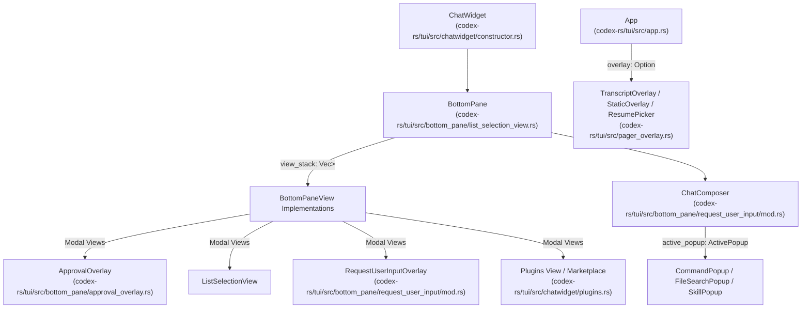
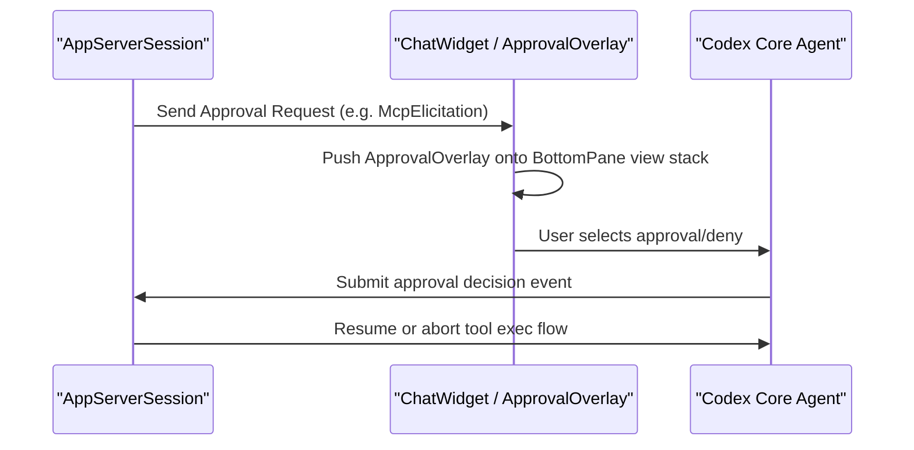
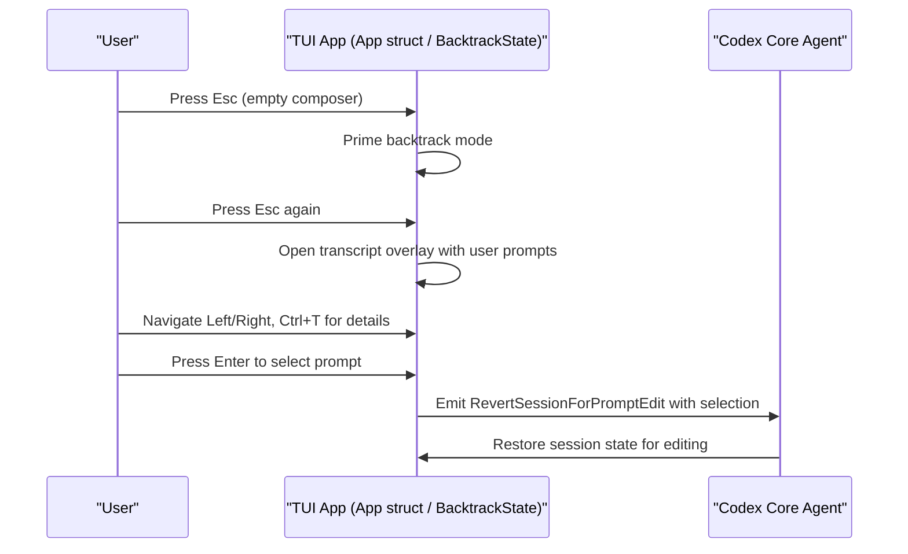
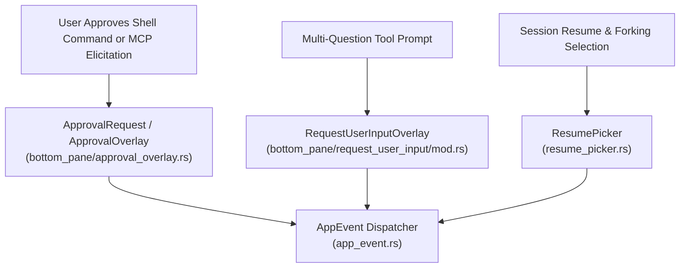
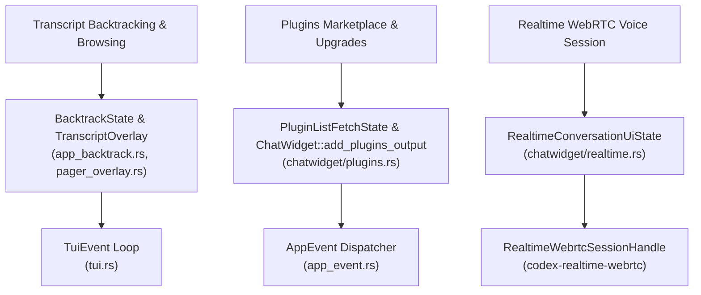

<!-- source: DeepWiki mcp.deepwiki.com · repo openai/codex · extra page Interactive Overlays and Popups · fetched 2026-10-26 -->

# Interactive Overlays and Popups

Relevant source files

The following files were used as context for generating this wiki page:

- [codex-rs/app-server/src/request_processors/feedback_log_snapshot_tests.rs](codex-rs/app-server/src/request_processors/feedback_log_snapshot_tests.rs)
- [codex-rs/app-server/src/request_processors/feedback_processor.rs](codex-rs/app-server/src/request_processors/feedback_processor.rs)
- [codex-rs/app-server/src/request_processors/feedback_thread_index.rs](codex-rs/app-server/src/request_processors/feedback_thread_index.rs)
- [codex-rs/app-server/src/request_processors/feedback_thread_index_tests.rs](codex-rs/app-server/src/request_processors/feedback_thread_index_tests.rs)
- [codex-rs/app-server/tests/suite/v2/feedback.rs](codex-rs/app-server/tests/suite/v2/feedback.rs)
- [codex-rs/config/src/tui_mouse_scroll.rs](codex-rs/config/src/tui_mouse_scroll.rs)
- [codex-rs/core/src/guardian/feedback.rs](codex-rs/core/src/guardian/feedback.rs)
- [codex-rs/feedback/Cargo.toml](codex-rs/feedback/Cargo.toml)
- [codex-rs/feedback/src/feedback_diagnostics.rs](codex-rs/feedback/src/feedback_diagnostics.rs)
- [codex-rs/feedback/src/feedback_event_tests.rs](codex-rs/feedback/src/feedback_event_tests.rs)
- [codex-rs/feedback/src/guardian.rs](codex-rs/feedback/src/guardian.rs)
- [codex-rs/feedback/src/guardian_tests.rs](codex-rs/feedback/src/guardian_tests.rs)
- [codex-rs/feedback/src/lib.rs](codex-rs/feedback/src/lib.rs)
- [codex-rs/feedback/src/metadata_tests.rs](codex-rs/feedback/src/metadata_tests.rs)
- [codex-rs/feedback/src/report_upload.rs](codex-rs/feedback/src/report_upload.rs)
- [codex-rs/feedback/src/rollout_archive.rs](codex-rs/feedback/src/rollout_archive.rs)
- [codex-rs/feedback/src/rollout_attachment_tests.rs](codex-rs/feedback/src/rollout_attachment_tests.rs)
- [codex-rs/feedback/src/upload.rs](codex-rs/feedback/src/upload.rs)
- [codex-rs/tui/src/app/config_persistence.rs](codex-rs/tui/src/app/config_persistence.rs)
- [codex-rs/tui/src/app/feedback_upload.rs](codex-rs/tui/src/app/feedback_upload.rs)
- [codex-rs/tui/src/app/history_pagination.rs](codex-rs/tui/src/app/history_pagination.rs)
- [codex-rs/tui/src/app/history_pagination_tests.rs](codex-rs/tui/src/app/history_pagination_tests.rs)
- [codex-rs/tui/src/app/input.rs](codex-rs/tui/src/app/input.rs)
- [codex-rs/tui/src/app/native_history.rs](codex-rs/tui/src/app/native_history.rs)
- [codex-rs/tui/src/app/owned_transcript.rs](codex-rs/tui/src/app/owned_transcript.rs)
- [codex-rs/tui/src/app/owned_transcript_input_tests.rs](codex-rs/tui/src/app/owned_transcript_input_tests.rs)
- [codex-rs/tui/src/app/owned_transcript_tests.rs](codex-rs/tui/src/app/owned_transcript_tests.rs)
- [codex-rs/tui/src/app/platform_actions.rs](codex-rs/tui/src/app/platform_actions.rs)
- [codex-rs/tui/src/app/snapshots/codex_tui__app__owned_transcript__input_tests__plan_prompt_scrolled.snap](codex-rs/tui/src/app/snapshots/codex_tui__app__owned_transcript__input_tests__plan_prompt_scrolled.snap)
- [codex-rs/tui/src/app/snapshots/codex_tui__app__owned_transcript__input_tests__plan_prompt_selection.snap](codex-rs/tui/src/app/snapshots/codex_tui__app__owned_transcript__input_tests__plan_prompt_selection.snap)
- [codex-rs/tui/src/app/snapshots/codex_tui__app__owned_transcript__input_tests__raw_paste_burst_render.snap](codex-rs/tui/src/app/snapshots/codex_tui__app__owned_transcript__input_tests__raw_paste_burst_render.snap)
- [codex-rs/tui/src/app/snapshots/codex_tui__app__owned_transcript__tests__fullscreen_composer_right_click_copy.snap](codex-rs/tui/src/app/snapshots/codex_tui__app__owned_transcript__tests__fullscreen_composer_right_click_copy.snap)
- [codex-rs/tui/src/app/tests/permission_selection_tests.rs](codex-rs/tui/src/app/tests/permission_selection_tests.rs)
- [codex-rs/tui/src/app/thread_goal_actions.rs](codex-rs/tui/src/app/thread_goal_actions.rs)
- [codex-rs/tui/src/app_backtrack.rs](codex-rs/tui/src/app_backtrack.rs)
- [codex-rs/tui/src/app_server_session/fs.rs](codex-rs/tui/src/app_server_session/fs.rs)
- [codex-rs/tui/src/app_server_session/history.rs](codex-rs/tui/src/app_server_session/history.rs)
- [codex-rs/tui/src/bottom_pane/feedback_view.rs](codex-rs/tui/src/bottom_pane/feedback_view.rs)
- [codex-rs/tui/src/bottom_pane/snapshots/codex_tui__bottom_pane__feedback_view__tests__feedback_upload_consent_lists_doctor_report.snap](codex-rs/tui/src/bottom_pane/snapshots/codex_tui__bottom_pane__feedback_view__tests__feedback_upload_consent_lists_doctor_report.snap)
- [codex-rs/tui/src/bottom_pane/snapshots/codex_tui__bottom_pane__feedback_view__tests__feedback_upload_consent_lists_windows_sandbox_log_when_included.snap](codex-rs/tui/src/bottom_pane/snapshots/codex_tui__bottom_pane__feedback_view__tests__feedback_upload_consent_lists_windows_sandbox_log_when_included.snap)
- [codex-rs/tui/src/chatwidget/constructor.rs](codex-rs/tui/src/chatwidget/constructor.rs)
- [codex-rs/tui/src/chatwidget/goal_menu.rs](codex-rs/tui/src/chatwidget/goal_menu.rs)
- [codex-rs/tui/src/chatwidget/input_flow.rs](codex-rs/tui/src/chatwidget/input_flow.rs)
- [codex-rs/tui/src/chatwidget/permission_discovery.rs](codex-rs/tui/src/chatwidget/permission_discovery.rs)
- [codex-rs/tui/src/chatwidget/permission_popups.rs](codex-rs/tui/src/chatwidget/permission_popups.rs)
- [codex-rs/tui/src/chatwidget/permissions_menu.rs](codex-rs/tui/src/chatwidget/permissions_menu.rs)
- [codex-rs/tui/src/chatwidget/session_flow.rs](codex-rs/tui/src/chatwidget/session_flow.rs)
- [codex-rs/tui/src/chatwidget/settings.rs](codex-rs/tui/src/chatwidget/settings.rs)
- [codex-rs/tui/src/chatwidget/snapshots/codex_tui__chatwidget__tests__feedback_good_result_consent_popup.snap](codex-rs/tui/src/chatwidget/snapshots/codex_tui__chatwidget__tests__feedback_good_result_consent_popup.snap)
- [codex-rs/tui/src/chatwidget/snapshots/codex_tui__chatwidget__tests__feedback_upload_consent_popup.snap](codex-rs/tui/src/chatwidget/snapshots/codex_tui__chatwidget__tests__feedback_upload_consent_popup.snap)
- [codex-rs/tui/src/chatwidget/tests/goal_menu.rs](codex-rs/tui/src/chatwidget/tests/goal_menu.rs)
- [codex-rs/tui/src/chatwidget/tests/goal_validation.rs](codex-rs/tui/src/chatwidget/tests/goal_validation.rs)
- [codex-rs/tui/src/chatwidget/tests/history_replay.rs](codex-rs/tui/src/chatwidget/tests/history_replay.rs)
- [codex-rs/tui/src/chatwidget/tests/permissions.rs](codex-rs/tui/src/chatwidget/tests/permissions.rs)
- [codex-rs/tui/src/chatwidget/windows_sandbox_prompts.rs](codex-rs/tui/src/chatwidget/windows_sandbox_prompts.rs)
- [codex-rs/tui/src/goal_files.rs](codex-rs/tui/src/goal_files.rs)
- [codex-rs/tui/src/history_cell/session.rs](codex-rs/tui/src/history_cell/session.rs)
- [codex-rs/tui/src/pager_overlay.rs](codex-rs/tui/src/pager_overlay.rs)
- [codex-rs/tui/src/pager_overlay/scrolling.rs](codex-rs/tui/src/pager_overlay/scrolling.rs)
- [codex-rs/tui/src/pager_overlay/scrolling_tests.rs](codex-rs/tui/src/pager_overlay/scrolling_tests.rs)
- [codex-rs/tui/src/pager_overlay/transcript.rs](codex-rs/tui/src/pager_overlay/transcript.rs)
- [codex-rs/tui/src/pager_overlay/transcript_tests.rs](codex-rs/tui/src/pager_overlay/transcript_tests.rs)
- [codex-rs/tui/src/resume_picker.rs](codex-rs/tui/src/resume_picker.rs)
- [codex-rs/tui/src/resume_picker/archive.rs](codex-rs/tui/src/resume_picker/archive.rs)
- [codex-rs/tui/src/resume_picker/archive_tests.rs](codex-rs/tui/src/resume_picker/archive_tests.rs)
- [codex-rs/tui/src/snapshots/codex_tui__resume_picker__tests__resume_picker_dense_cwd.snap](codex-rs/tui/src/snapshots/codex_tui__resume_picker__tests__resume_picker_dense_cwd.snap)
- [codex-rs/tui/src/snapshots/codex_tui__resume_picker__tests__resume_picker_dense_narrow.snap](codex-rs/tui/src/snapshots/codex_tui__resume_picker__tests__resume_picker_dense_narrow.snap)
- [codex-rs/tui/src/snapshots/codex_tui__resume_picker__tests__resume_picker_dense_no_blank_lines.snap](codex-rs/tui/src/snapshots/codex_tui__resume_picker__tests__resume_picker_dense_no_blank_lines.snap)
- [codex-rs/tui/src/snapshots/codex_tui__resume_picker__tests__resume_picker_more_indicators.snap](codex-rs/tui/src/snapshots/codex_tui__resume_picker__tests__resume_picker_more_indicators.snap)
- [codex-rs/tui/src/snapshots/codex_tui__resume_picker__tests__resume_picker_narrow_session.snap](codex-rs/tui/src/snapshots/codex_tui__resume_picker__tests__resume_picker_narrow_session.snap)
- [codex-rs/tui/src/snapshots/codex_tui__resume_picker__tests__resume_picker_screen.snap](codex-rs/tui/src/snapshots/codex_tui__resume_picker__tests__resume_picker_screen.snap)
- [codex-rs/tui/src/snapshots/codex_tui__resume_picker__tests__resume_picker_search_line_sort_filter_tabs.snap](codex-rs/tui/src/snapshots/codex_tui__resume_picker__tests__resume_picker_search_line_sort_filter_tabs.snap)
- [codex-rs/tui/src/snapshots/codex_tui__resume_picker__tests__resume_picker_table.snap](codex-rs/tui/src/snapshots/codex_tui__resume_picker__tests__resume_picker_table.snap)
- [codex-rs/tui/src/snapshots/codex_tui__resume_picker__tests__resume_picker_thread_names.snap](codex-rs/tui/src/snapshots/codex_tui__resume_picker__tests__resume_picker_thread_names.snap)
- [codex-rs/tui/src/text_selection.rs](codex-rs/tui/src/text_selection.rs)
- [codex-rs/tui/src/transcript_view.rs](codex-rs/tui/src/transcript_view.rs)
- [codex-rs/tui/src/transcript_view/input.rs](codex-rs/tui/src/transcript_view/input.rs)
- [codex-rs/tui/src/transcript_view/input_tests.rs](codex-rs/tui/src/transcript_view/input_tests.rs)
- [codex-rs/tui/src/transcript_view/layout.rs](codex-rs/tui/src/transcript_view/layout.rs)
- [codex-rs/tui/src/transcript_view/layout_tests.rs](codex-rs/tui/src/transcript_view/layout_tests.rs)
- [codex-rs/tui/src/transcript_view/prompt_header.rs](codex-rs/tui/src/transcript_view/prompt_header.rs)
- [codex-rs/tui/src/transcript_view/prompt_header_tests.rs](codex-rs/tui/src/transcript_view/prompt_header_tests.rs)
- [codex-rs/tui/src/transcript_view/select_mode.rs](codex-rs/tui/src/transcript_view/select_mode.rs)
- [codex-rs/tui/src/transcript_view/select_mode/motion.rs](codex-rs/tui/src/transcript_view/select_mode/motion.rs)
- [codex-rs/tui/src/transcript_view/select_mode_tests.rs](codex-rs/tui/src/transcript_view/select_mode_tests.rs)
- [codex-rs/tui/src/transcript_view/selection.rs](codex-rs/tui/src/transcript_view/selection.rs)
- [codex-rs/tui/src/transcript_view/snapshots/codex_tui__transcript_view__input__tests__shift_click_extends_a_double_clicked_word_in_both_directions.snap](codex-rs/tui/src/transcript_view/snapshots/codex_tui__transcript_view__input__tests__shift_click_extends_a_double_clicked_word_in_both_directions.snap)
- [codex-rs/tui/src/transcript_view/snapshots/codex_tui__transcript_view__prompt_header__tests__header_sanitizes_controls_and_truncates_by_display_width.snap](codex-rs/tui/src/transcript_view/snapshots/codex_tui__transcript_view__prompt_header__tests__header_sanitizes_controls_and_truncates_by_display_width.snap)
- [codex-rs/tui/src/transcript_view/snapshots/codex_tui__transcript_view__prompt_header__tests__prompt_header_tracks_reading_and_yields_to_visible_prompts_and_short_screens.snap](codex-rs/tui/src/transcript_view/snapshots/codex_tui__transcript_view__prompt_header__tests__prompt_header_tracks_reading_and_yields_to_visible_prompts_and_short_screens.snap)
- [codex-rs/tui/src/transcript_view/text.rs](codex-rs/tui/src/transcript_view/text.rs)
- [codex-rs/tui/src/windows_sandbox.rs](codex-rs/tui/src/windows_sandbox.rs)

This page documents the interactive overlay, modal, and popup system in the Codex Terminal User Interface (TUI). It details how interactive overlays like approval prompts, pager/transcript overlays, resume pickers, feedback views, settings popups, and the realtime voice UI are implemented and integrated. The page covers their architecture, input handling, state management, and key interactions through the `AppEvent` message bus.

For foundational TUI layout and rendering, see [codex-rs/tui/src/chatwidget/constructor.rs:1-161](). For the `BottomPane` and modal view stack, see [codex-rs/tui/src/bottom_pane/list_selection_view.rs:1-169]().

---

## Overlay Architecture and Layering

The Codex TUI organizes its interactive overlays using a strict three-tier overlay layering model. This model ensures focused input management, screen coverage, and priority dismissal.

| Overlay Layer           | Owner Component                  | Screen Scope          | Representative Examples                                               |
|------------------------|---------------------------------|-----------------------|----------------------------------------------------------------------|
| Composer Popups        | `ChatComposer.active_popup`      | Directly above input  | `CommandPopup`, `FileSearchPopup`, `SkillPopup`                     |
| Bottom-Pane View Stack | `BottomPane.view_stack`          | Replaces composer input | `ApprovalOverlay`, `ListSelectionView`, `RequestUserInputOverlay`, `PluginsView` |
| Full-Screen Overlay    | `App.overlay`                    | Covers full viewport  | `TranscriptOverlay`, `StaticOverlay`, `ResumePicker`                 |

This layering ensures clean focus management: the `active_popup` is the most ephemeral, the `view_stack` handles interactive modal views, and the full-screen `overlay` dominates for transcript browsing and session picking.

Sources: [codex-rs/tui/src/pager_overlay.rs:44-97](), [codex-rs/tui/src/bottom_pane/list_selection_view.rs:1-169](), [codex-rs/tui/src/chatwidget/constructor.rs:1-161]()

---

## The `BottomPaneView` Protocol

All modal views hosted inside the `BottomPane` implement the `BottomPaneView` trait, which defines their interaction lifecycle and cancellation semantics.

### Core Trait Methods

- `handle_key_event(&mut self, event: KeyEvent) -> Result<bool>`  
  Handles scoped keyboard input events. Returns whether the event was handled.

- `on_ctrl_c(&mut self) -> CancellationEvent`  
  Ensures consistent cancellation behavior on Ctrl+C interrupts.

- `is_complete(&self) -> bool`  
  Indicates if the view should be popped off the modal stack (closed).

- `prefer_esc_to_handle_key_event(&self) -> bool`  
  Controls whether an `Esc` key should be interpreted locally (e.g., for editing inside the view) or consume cancellation.

### Input Routing Logic

Keyboard input at runtime goes in priority order:

1. Topmost `BottomPaneView` in the `BottomPane.view_stack`.
2. If no modal views are active, the `ChatComposer.active_popup` receives input.
3. Underlying conversation history handles inputs as fallback.

This ensures modal overlays like approvals or selection views fully capture input without interference.

Sources: [codex-rs/tui/src/bottom_pane/list_selection_view.rs:1-169](), [codex-rs/tui/src/bottom_pane/approval_overlay.rs:1-172]()

---

## Approval Overlays

Approval overlays present high-risk user confirmation dialogs in response to agent tool requests requiring explicit user consent, such as:

- Executing shell commands (`Exec`)
- Applying code patches (`ApplyPatch`)
- Requesting elevated permissions (`Permissions`)
- External MCP server elicitations (`McpElicitation`)

The primary struct is `ApprovalOverlay` which renders choices and handles user decision input.

### Flow and Interaction

When the app-server dispatches an approval request:

1. The TUI pushes an `ApprovalOverlay` onto the `BottomPane.view_stack`, displaying the approval prompt.
2. User inputs select denials or explicit approvals ("Allow once").
3. On confirmation, an `AppEvent` with the decision is sent to the core agent.
4. The core resumes or aborts the tool execution flow depending on the decision.

MCP elicitation requests enforce that pressing `Esc` always cancels (no accidental silent approval).

Sources: [codex-rs/tui/src/bottom_pane/approval_overlay.rs:1-172](), [codex-rs/tui/src/chatwidget/tests/permissions.rs:1-156]()

---

## Request User Input Overlays

`RequestUserInputOverlay` manages interactive multi-question inputs that tools may request dynamically during execution. This overlay supports freeform notes, option selections, and timeouts.

### State Model

- `AnswerState` tracks current option index, drafts for questions notes (via `ComposerDraft`), commit readiness, and visibility states.
- Input focus jumps seamlessly between selecting options and typing notes.
- Typing triggers focus switch from option list to note buffer automatically.

### Auto-Resolution Countdown

An auto-resolution timer drives state transitions:

- `HiddenGrace` — brief grace period after display.
- `VisibleCountdown` — countdown timer visible to user.
- `Due` — timeout reached, auto-submitting the current selection.

This is implemented with internal timers in the overlay event loop.

Sources: [codex-rs/tui/src/bottom_pane/request_user_input/mod.rs:1-188]()

---

## Resume Picker and Transcript Backtracking

### Resume Picker

The resume picker lets users browse and select previous conversation threads to resume or fork. It fetches thread listings with paged requests to the app-server using `ThreadListParams`. Filtering by working directory and sorting by activity is supported.

The main types and flow:

- `SessionTarget` describes candidate threads with metadata (thread id, cwd, history mode).
- The picker issues async page loads (`PageLoadRequest`) and maintains selection state.
- User picks an action: resume, fork, start fresh, or exit.

Sources: [codex-rs/tui/src/resume_picker.rs:1-214](), [codex-rs/tui/src/pager_overlay.rs:44-97]()

### Transcript Browsing and Backtracking

Backtracking enables users to "rewind" conversation history to edit previous user messages.

Feature flow:

1. Pressing `Esc` with an empty composer primes backtrack mode and captures the base thread context.
2. Pressing `Esc` again opens a compact transcript overlay showing user prompts.
3. Navigate user prompts with `Left`/`Right`.
4. Use `Ctrl+T` to toggle detailed view of transcript entries.
5. Confirm with `Enter` to revert to the selected prompt for editing.

The selection is encapsulated in `BacktrackSelection` containing thread id, user message index, and prompt content.

On confirming, a `RevertSessionForPromptEdit` event is emitted to restore state for in-place editing.

Sources: [codex-rs/tui/src/app_backtrack.rs:1-165](), [codex-rs/tui/src/pager_overlay.rs:44-97]()

---

## Plugins Marketplace and Settings Popups

### Plugins Marketplace

Triggered by the `/plugins` command, the marketplace displays cached or remote plugin listings.

- Before remote resolution completes, a loading popup communicates `"Loading available plugins..."`.
- Remote errors explicitly list backend error codes (e.g., git authentication or missing manifest).
- Once loaded, users browse, filter, and select plugins for installation.

Data is backed by `PluginListResponse` caches and integrated into the `ChatWidget` rendering pipeline.

### Settings Popups and Config Persistence

Settings popups allow runtime configuration edits (e.g., collaboration modes, daybreak access, permission profiles).

- To minimize main loop blocking, config changes leverage an async `ConfigBuilder` worker pool via `build_config_on_runtime_worker()`.
- Settings changes update the in-memory `Config` instance and synchronize with the `ChatWidget` config copy.
- Permission profiles and approval policies are managed with overlays that fetch server catalogs and allow explicit user selection.

Sources: [codex-rs/tui/src/chatwidget/plugins.rs:64-88](), [codex-rs/tui/src/app/config_persistence.rs:1-29](), [codex-rs/tui/src/chatwidget/tests/popups_and_settings.rs:1-169]()

---

## Realtime Voice UI

The realtime voice user interface is handled by `RealtimeConversationUiState` in `chatwidget/realtime.rs`.

Highlights:

- The voice UI is a locally owned WebRTC voice streaming session, supporting live captioning.
- The UI state machine transitions through:
  - `Inactive`
  - `Starting`
  - `Active`
  - `Stopping`

- Transcripts are rendered with split-flap animation effects and isolate completed stable lines from interleaved partial captions.
- Voice amplitude history maintains smooth visual feedback.
- Recovery logic suppresses stale speech output while preserving fallback unspoken text on interruption.

Sources: [codex-rs/tui/src/chatwidget/realtime.rs:1-192]()

---

## Natural Language Space to Code Entity Space Mapping

We provide two bridging diagrams that map user-facing interactive overlay concepts to specific code entities in the codebase.

### Bridge Diagram 1: Approval and Modal Workflows

### Bridge Diagram 2: Pager, Plugins, and Voice UI

These diagrams demonstrate how natural language user interactions with overlays align with internal components such as `ApprovalOverlay`, `RequestUserInputOverlay`, `ResumePicker`, `BacktrackState`, the plugin listing code, and realtime voice UI state.

Sources: 
- [codex-rs/tui/src/bottom_pane/approval_overlay.rs:1-172]()
- [codex-rs/tui/src/bottom_pane/request_user_input/mod.rs:1-188]()
- [codex-rs/tui/src/resume_picker.rs:1-214]()
- [codex-rs/tui/src/app_backtrack.rs:1-165]()
- [codex-rs/tui/src/pager_overlay.rs:44-97]()
- [codex-rs/tui/src/chatwidget/plugins.rs:1-176]()
- [codex-rs/tui/src/chatwidget/realtime.rs:1-192]()

---

## References

| Concept / Subsystem                  | Source Citation                                         |
|------------------------------------|--------------------------------------------------------|
| Approval Overlay and Requests       | [codex-rs/tui/src/bottom_pane/approval_overlay.rs:1-172]() |
| Request User Input Overlay          | [codex-rs/tui/src/bottom_pane/request_user_input/mod.rs:1-188]() |
| Transcript & Static Pager Overlays | [codex-rs/tui/src/pager_overlay.rs:44-97]()            |
| Backtracking State & Revert Logic  | [codex-rs/tui/src/app_backtrack.rs:1-165]()            |
| Plugins Marketplace and Loading     | [codex-rs/tui/src/chatwidget/plugins.rs:64-88]()       |
| Settings & Config Persistence Glue | [codex-rs/tui/src/app/config_persistence.rs:1-29]()    |
| Realtime Voice UI & Split-Flap     | [codex-rs/tui/src/chatwidget/realtime.rs:1-192]()      |
| Bottom Pane View Protocol           | [codex-rs/tui/src/bottom_pane/list_selection_view.rs:1-169]() |

Sources: All cited files above.

---

