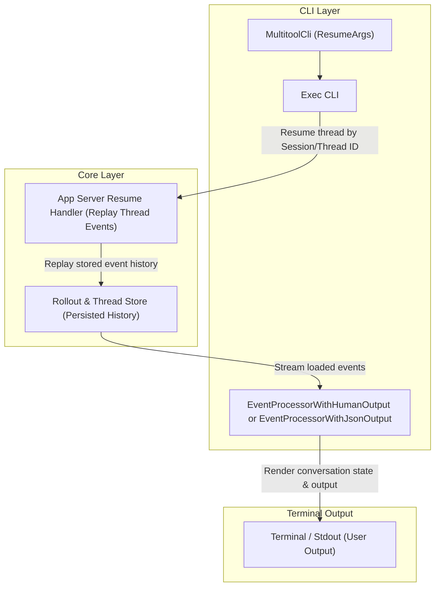
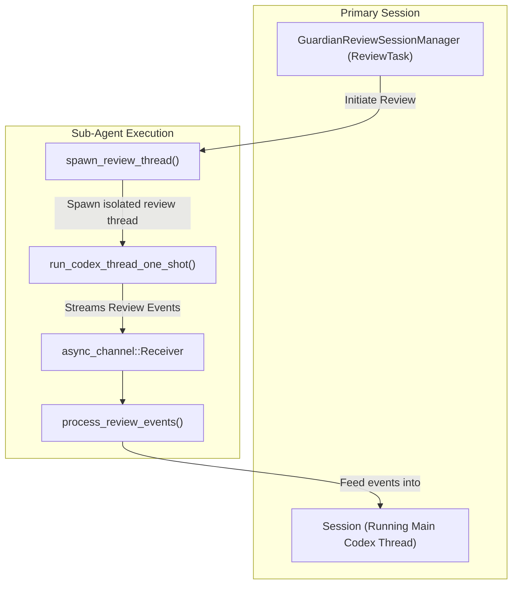
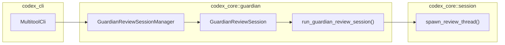

<!-- source: DeepWiki mcp.deepwiki.com · repo openai/codex · extra page Resume and Review Commands · fetched 2026-10-26 -->

# Resume and Review Commands

Relevant source files

The following files were used as context for generating this wiki page:

- [.github/actions/linux-code-sign/action.yml](.github/actions/linux-code-sign/action.yml)
- [.github/actions/windows-code-sign/action.yml](.github/actions/windows-code-sign/action.yml)
- [.github/dotslash-config.json](.github/dotslash-config.json)
- [codex-cli/scripts/README.md](codex-cli/scripts/README.md)
- [codex-cli/scripts/build_npm_package.py](codex-cli/scripts/build_npm_package.py)
- [codex-rs/app-server/tests/suite/v2/client_metadata.rs](codex-rs/app-server/tests/suite/v2/client_metadata.rs)
- [codex-rs/app-server/tests/suite/v2/turn_steer.rs](codex-rs/app-server/tests/suite/v2/turn_steer.rs)
- [codex-rs/core/src/responses_metadata.rs](codex-rs/core/src/responses_metadata.rs)
- [codex-rs/core/src/session/review.rs](codex-rs/core/src/session/review.rs)
- [codex-rs/core/src/tasks/compact.rs](codex-rs/core/src/tasks/compact.rs)
- [codex-rs/core/src/tasks/regular.rs](codex-rs/core/src/tasks/regular.rs)
- [codex-rs/core/src/tasks/review.rs](codex-rs/core/src/tasks/review.rs)
- [codex-rs/core/src/turn_metadata.rs](codex-rs/core/src/turn_metadata.rs)
- [codex-rs/core/src/turn_metadata_tests.rs](codex-rs/core/src/turn_metadata_tests.rs)
- [codex-rs/core/tests/suite/cli_stream.rs](codex-rs/core/tests/suite/cli_stream.rs)
- [codex-rs/core/tests/suite/review.rs](codex-rs/core/tests/suite/review.rs)
- [codex-rs/exec/src/cli.rs](codex-rs/exec/src/cli.rs)
- [codex-rs/exec/src/cli_tests.rs](codex-rs/exec/src/cli_tests.rs)
- [codex-rs/exec/tests/suite/mod.rs](codex-rs/exec/tests/suite/mod.rs)
- [codex-rs/exec/tests/suite/resume.rs](codex-rs/exec/tests/suite/resume.rs)
- [codex-rs/exec/tests/suite/seatbelt.rs](codex-rs/exec/tests/suite/seatbelt.rs)
- [codex-rs/tools/src/tool_config.rs](codex-rs/tools/src/tool_config.rs)
- [codex-rs/tools/src/tool_config_tests.rs](codex-rs/tools/src/tool_config_tests.rs)
- [codex-rs/tui/src/cli.rs](codex-rs/tui/src/cli.rs)
- [codex-rs/utils/cli/src/shared_options.rs](codex-rs/utils/cli/src/shared_options.rs)
- [scripts/stage_npm_packages.py](scripts/stage_npm_packages.py)
- [sdk/typescript/README.md](sdk/typescript/README.md)
- [sdk/typescript/src/codex.ts](sdk/typescript/src/codex.ts)
- [sdk/typescript/src/codexOptions.ts](sdk/typescript/src/codexOptions.ts)
- [sdk/typescript/src/exec.ts](sdk/typescript/src/exec.ts)
- [sdk/typescript/src/index.ts](sdk/typescript/src/index.ts)
- [sdk/typescript/src/thread.ts](sdk/typescript/src/thread.ts)
- [sdk/typescript/src/threadOptions.ts](sdk/typescript/src/threadOptions.ts)
- [sdk/typescript/tests/exec.test.ts](sdk/typescript/tests/exec.test.ts)
- [sdk/typescript/tests/run.test.ts](sdk/typescript/tests/run.test.ts)
- [sdk/typescript/tests/testCodex.ts](sdk/typescript/tests/testCodex.ts)

This page documents the technical implementation of session resumption in execution mode and the review command’s sub-agent delegation. These commands allow Codex to maintain conversational continuity across sessions and perform in-depth code reviews through dedicated sub-agents, supporting modularity and extensibility within the system.

---

## Overview

Codex's execution mode and multitool command-line interface offer enhanced workflows via two pivotal commands:

- **Resume Command:** Restores a previously persisted session by replaying its stored historical events to reconstruct conversation state and continues interaction from where it left off.
- **Review Command:** Spawns a sub-agent dedicated to performing code reviews which execute asynchronously and integrate results back into the main conversation.

These features build on the core session state management, thread lifecycle, and event infrastructure to provide seamless user experiences in both headless and interactive modes.

Sources: `codex-rs/cli/src/main.rs [139-208]()`

---

## Resume Command Implementation

### CLI Interface and Argument Parsing

The resume command is defined as a subcommand in the multitool CLI interface allowing users to specify either a session ID or use flags like `--last` to pick the most recent session automatically. This subcommand hooks into the session management logic to identify and restore the intended conversation context.

The CLI command and its options are implemented in the exec CLI definitions, specifically the `Resume` variant in the CLI subcommands enumeration:

- `Command::Resume(ResumeArgs)` represents the resume operation interface [codex-rs/exec/src/cli.rs:173-182]().

Sources: `codex-rs/exec/src/cli.rs [173-182]()`

### Session Resolution and Restoration Flow

The session resumption process is orchestrated through these key steps:

1. **Session Identification:**  
   The CLI or exec mode resolves the target session either by a provided UUID or by scanning the sessions directory for the most recent or matching session file using utility functions such as scanning rollout event files [codex-rs/exec/tests/suite/resume.rs:21-64]().

2. **Initialization and Restoration:**  
   Once identified, the session thread ID is used to create a request to the server or local exec environment to resume the thread. This involves initializing the session state and replaying the historical event stream from persisted rollout files or thread store storage [codex-rs/exec/src/lib.rs:1-158]().

3. **Event Playback:**  
   Historical events are replayed sequentially, rebuilding conversation state in memory and passing the reconstructed event stream through processors to restore UI or CLI output states.

4. **Prompt Injection and Continuation:**  
   Optionally, a prompt provided after resumption is injected as a new input, allowing the resumed session to continue interactively or non-interactively.

This flow primarily leverages the `EventProcessorWithHumanOutput` (or JSON output variants) to process streamed events and integrate them back into the session context.

Sources: `codex-rs/exec/src/lib.rs [1-158]()`, `codex-rs/exec/tests/suite/resume.rs [21-196]()`

### Resume Data Flow Diagram

This diagram illustrates how resume commands propagate from the CLI through the layers into event replay and terminal rendering:

Sources:  
`codex-rs/cli/src/main.rs [139-208]()`,  
`codex-rs/exec/src/lib.rs [1-158]()`,  
`codex-rs/exec/tests/suite/resume.rs [21-196]()`

---

## Review Command Architecture

### Sub-Agent Delegation and Execution

The review command initiates an isolated code review thread acting as a sub-agent. This dedicated reviewer session allows Codex to perform structured review tasks asynchronously, leveraging separate runtime contexts to maintain modularity and separation from the main conversation flow.

Key components and flow details:

- The CLI `Review` command triggers sub-agent review spawning using the core review APIs [codex-rs/cli/src/main.rs:180-182]().

- Internally, the review thread is spawned using `spawn_review_thread` in the session module, which constructs a turn context and prepares configurations tailored for code review models and features (disabling web search, collaboration tools etc.) [codex-rs/core/src/session/review.rs:4-169]().

- A per-turn client configuration is prepared with the review model, service tier, and feature flags adjusted specifically for review purposes.

- The sub-agent runs the review conversation as an isolated Codex thread via `run_codex_thread_one_shot`, passing special instructions and input prompts [codex-rs/core/src/tasks/review.rs:99-143]().

Sources:  
`codex-rs/cli/src/main.rs [180-182]()`,  
`codex-rs/core/src/session/review.rs [4-169]()`,  
`codex-rs/core/src/tasks/review.rs [99-143]()`

### Review Lifecycle and Event Processing

The review task lifecycle and event handling involve:

1. **Starting Review Conversation:**  
   Implements the sub-agent as a separate Codex thread with restricted features and custom base instructions as a review rubric. The review thread runs asynchronously and returns an event receiver stream [codex-rs/core/src/tasks/review.rs:99-143]().

2. **Processing Review Events:**  
   The primary session consumes streamed events from the sub-agent to update its state and forward structured review outputs downstream (e.g., UI or logging). It handles intermediate item lifecycle events, suppresses redundant completions, and finesses the review output contract [codex-rs/core/src/tasks/review.rs:144-186]().

3. **Structured Review Output:**  
   Outputs structured review findings as typed events (`ReviewOutputEvent`) parsed from the sub-agent's final message for downstream consumers or UI [codex-rs/core/src/tasks/review.rs:187-286]().

4. **Exit and Cleanup:**  
   Upon review completion or cancellation, the session exits review mode cleanly, emitting appropriate state change events.

Sources:  
`codex-rs/core/src/tasks/review.rs [99-186]()`,  
`codex-rs/core/src/tasks/review.rs [187-287]()`

### Review Sub-Agent Delegation Flow Diagram

This diagram captures the relationship and flow between the primary session managing the review command and the spawned sub-agent thread running the review asynchronously:

Sources: `codex-rs/core/src/session/review.rs [4-169]()`, `codex-rs/core/src/tasks/review.rs [45-186]()`

---

## Code Entity Mapping for Resume and Review

### Execution and CLI Entities

| Code Entity                     | Purpose                                     | Location                         |
|--------------------------------|---------------------------------------------|---------------------------------|
| `MultitoolCli`                 | Entry point for CLI subcommands (resume, review) | `codex-rs/cli/src/main.rs [129-144]()` |
| `Command::Resume`              | Resume command CLI variant                   | `codex-rs/exec/src/cli.rs [173-182]()`  |
| `EventProcessorWithHumanOutput`| Processes event streams in exec mode         | `codex-rs/exec/src/lib.rs [1-158]()`    |

### Review and Guardian Subsystem Entities

| Code Entity                     | Role                                        | Location                                |
|--------------------------------|---------------------------------------------|----------------------------------------|
| `GuardianReviewSessionManager` | Manages review sub-agent sessions            | `codex-rs/core/src/guardian/review_session.rs [124-134]()` |
| `GuardianReviewSession`        | Host session handle for review operation     | `codex-rs/core/src/guardian/review_session.rs [128-134]()` |
| `spawn_review_thread()`        | Constructs turn context and spawns review thread | `codex-rs/core/src/session/review.rs [4-169]()`          |
| `run_codex_thread_one_shot()` | Runs the sub-agent review thread asynchronously | `codex-rs/core/src/tasks/review.rs [99-143]()`           |
| `process_review_events()`      | Processes streamed review events to finalize output | `codex-rs/core/src/tasks/review.rs [144-186]()`          |

Sources:  
`codex-rs/cli/src/main.rs [129-144]()`,  
`codex-rs/exec/src/lib.rs [1-158]()`,  
`codex-rs/exec/src/cli.rs [173-182]()`,  
`codex-rs/core/src/session/review.rs [4-169]()`,  
`codex-rs/core/src/tasks/review.rs [45-186]()`,  
`codex-rs/core/src/guardian/review_session.rs [124-134]()`

### Code Entity Mapping Diagram: Review Subsystem

This diagram places the core review components in context with the CLI interface:

Sources:  
`codex-rs/cli/src/main.rs [129-144]()`,  
`codex-rs/core/src/guardian/review_session.rs [124-134]()`,  
`codex-rs/core/src/session/review.rs [4-169]()`

---

# Summary

- The **Resume command** enables users to restore past conversations in exec mode by replaying historical events stored in rollout files or thread stores. This preserves session continuity and supports workflows that rely on incremental session progress.

- The **Review command** implements sub-agent delegation to run isolated, feature-constrained code review threads asynchronously. This architecture enhances modularity and allows for detailed reviews without blocking or interfering with primary conversation threads.

Both commands integrate tightly with Codex's core session management, thread lifecycle control, and event streaming infrastructure to deliver reliable and extensible user experiences in command-line and headless interfaces. This separation of concerns into session resumption and sub-agent review delegation ensures scalability and maintainability for complex conversational workflows.

---

# References

- CLI Subcommands and Exec CLI: `codex-rs/cli/src/main.rs [139-208]()`, `codex-rs/exec/src/cli.rs [173-182]()`
- Exec Mode Event Processing and Resume: `codex-rs/exec/src/lib.rs [1-158]()`
- Session Review Subsystem and Task: `codex-rs/core/src/session/review.rs [4-169]()`, `codex-rs/core/src/tasks/review.rs [45-186]()`
- Guardian Review Session Manager: `codex-rs/core/src/guardian/review_session.rs [124-134]()`
- Resume Tests and Helper Utilities: `codex-rs/exec/tests/suite/resume.rs [21-196]()`

---

