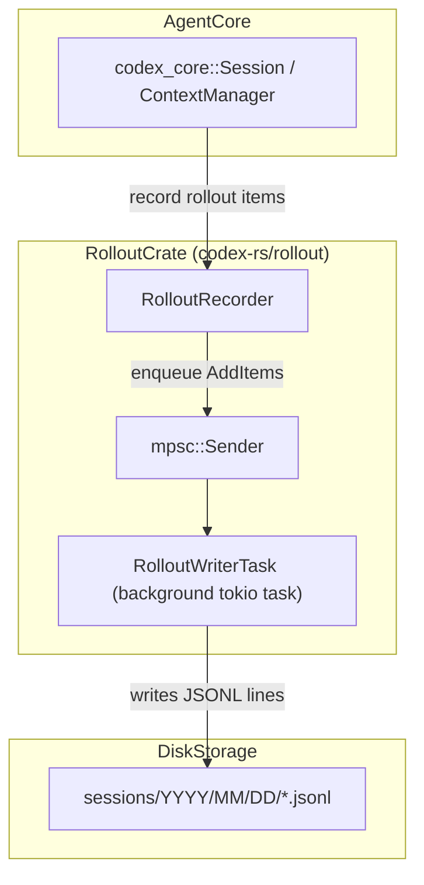
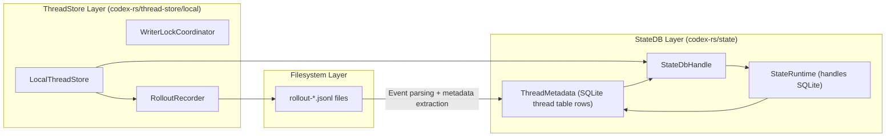
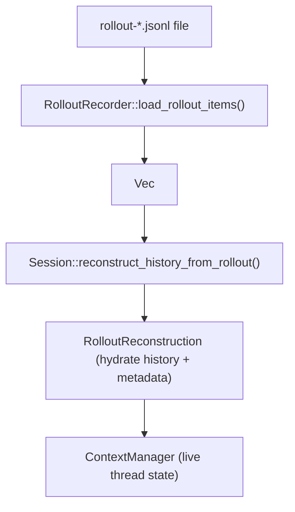

<!-- source: DeepWiki mcp.deepwiki.com · repo openai/codex · extra page Rollout Persistence and Replay · fetched 2026-10-26 -->

# Rollout Persistence and Replay

<details>
<summary>Relevant source files</summary>

The following files were used as context for generating this wiki page:

- [codex-rs/app-server/src/request_processors/rollout.rs](codex-rs/app-server/src/request_processors/rollout.rs)
- [codex-rs/app-server/tests/suite/conversation_summary.rs](codex-rs/app-server/tests/suite/conversation_summary.rs)
- [codex-rs/app-server/tests/suite/v2/remote_thread_store.rs](codex-rs/app-server/tests/suite/v2/remote_thread_store.rs)
- [codex-rs/app-server/tests/suite/v2/thread_read.rs](codex-rs/app-server/tests/suite/v2/thread_read.rs)
- [codex-rs/app-server/tests/suite/v2/thread_unarchive.rs](codex-rs/app-server/tests/suite/v2/thread_unarchive.rs)
- [codex-rs/core/src/session/rollout_reconstruction.rs](codex-rs/core/src/session/rollout_reconstruction.rs)
- [codex-rs/core/src/session/rollout_reconstruction_tests.rs](codex-rs/core/src/session/rollout_reconstruction_tests.rs)
- [codex-rs/core/tests/suite/resume_warning.rs](codex-rs/core/tests/suite/resume_warning.rs)
- [codex-rs/rollout/Cargo.toml](codex-rs/rollout/Cargo.toml)
- [codex-rs/rollout/src/compression.rs](codex-rs/rollout/src/compression.rs)
- [codex-rs/rollout/src/compression/access_metadata.rs](codex-rs/rollout/src/compression/access_metadata.rs)
- [codex-rs/rollout/src/compression/error_metrics.rs](codex-rs/rollout/src/compression/error_metrics.rs)
- [codex-rs/rollout/src/compression/read_metrics.rs](codex-rs/rollout/src/compression/read_metrics.rs)
- [codex-rs/rollout/src/compression_tests.rs](codex-rs/rollout/src/compression_tests.rs)
- [codex-rs/rollout/src/lib.rs](codex-rs/rollout/src/lib.rs)
- [codex-rs/rollout/src/list.rs](codex-rs/rollout/src/list.rs)
- [codex-rs/rollout/src/metadata.rs](codex-rs/rollout/src/metadata.rs)
- [codex-rs/rollout/src/metadata_tests.rs](codex-rs/rollout/src/metadata_tests.rs)
- [codex-rs/rollout/src/model_context.rs](codex-rs/rollout/src/model_context.rs)
- [codex-rs/rollout/src/ordinal.rs](codex-rs/rollout/src/ordinal.rs)
- [codex-rs/rollout/src/recorder.rs](codex-rs/rollout/src/recorder.rs)
- [codex-rs/rollout/src/recorder_tests.rs](codex-rs/rollout/src/recorder_tests.rs)
- [codex-rs/rollout/src/search.rs](codex-rs/rollout/src/search.rs)
- [codex-rs/rollout/src/search_tests.rs](codex-rs/rollout/src/search_tests.rs)
- [codex-rs/rollout/src/seekable_reader.rs](codex-rs/rollout/src/seekable_reader.rs)
- [codex-rs/rollout/src/seekable_reader_tests.rs](codex-rs/rollout/src/seekable_reader_tests.rs)
- [codex-rs/rollout/src/session_index.rs](codex-rs/rollout/src/session_index.rs)
- [codex-rs/rollout/src/session_index_tests.rs](codex-rs/rollout/src/session_index_tests.rs)
- [codex-rs/rollout/src/state_db.rs](codex-rs/rollout/src/state_db.rs)
- [codex-rs/rollout/src/state_db_tests.rs](codex-rs/rollout/src/state_db_tests.rs)
- [codex-rs/rollout/src/tests.rs](codex-rs/rollout/src/tests.rs)
- [codex-rs/state/src/extract.rs](codex-rs/state/src/extract.rs)
- [codex-rs/state/src/runtime/threads.rs](codex-rs/state/src/runtime/threads.rs)
- [codex-rs/thread-store/src/in_memory.rs](codex-rs/thread-store/src/in_memory.rs)
- [codex-rs/thread-store/src/lib.rs](codex-rs/thread-store/src/lib.rs)
- [codex-rs/thread-store/src/live_thread.rs](codex-rs/thread-store/src/live_thread.rs)
- [codex-rs/thread-store/src/local/compression_writer_tests.rs](codex-rs/thread-store/src/local/compression_writer_tests.rs)
- [codex-rs/thread-store/src/local/live_writer.rs](codex-rs/thread-store/src/local/live_writer.rs)
- [codex-rs/thread-store/src/local/mod.rs](codex-rs/thread-store/src/local/mod.rs)
- [codex-rs/thread-store/src/local/model_context.rs](codex-rs/thread-store/src/local/model_context.rs)
- [codex-rs/thread-store/src/local/model_context_tests.rs](codex-rs/thread-store/src/local/model_context_tests.rs)
- [codex-rs/thread-store/src/local/rollout_lineage.rs](codex-rs/thread-store/src/local/rollout_lineage.rs)
- [codex-rs/thread-store/src/local/rollout_lineage_tests.rs](codex-rs/thread-store/src/local/rollout_lineage_tests.rs)
- [codex-rs/thread-store/src/local/search_threads.rs](codex-rs/thread-store/src/local/search_threads.rs)
- [codex-rs/thread-store/src/local/thread_history.rs](codex-rs/thread-store/src/local/thread_history.rs)
- [codex-rs/thread-store/src/local/thread_history/read.rs](codex-rs/thread-store/src/local/thread_history/read.rs)
- [codex-rs/thread-store/src/local/thread_history/read_tests.rs](codex-rs/thread-store/src/local/thread_history/read_tests.rs)
- [codex-rs/thread-store/src/local/thread_history/search.rs](codex-rs/thread-store/src/local/thread_history/search.rs)
- [codex-rs/thread-store/src/local/thread_history/segment_paging.rs](codex-rs/thread-store/src/local/thread_history/segment_paging.rs)
- [codex-rs/thread-store/src/local/thread_history_materialization.rs](codex-rs/thread-store/src/local/thread_history_materialization.rs)
- [codex-rs/thread-store/src/local/thread_history_materialization_pipeline.rs](codex-rs/thread-store/src/local/thread_history_materialization_pipeline.rs)
- [codex-rs/thread-store/src/local/thread_history_materialization_tests.rs](codex-rs/thread-store/src/local/thread_history_materialization_tests.rs)
- [codex-rs/thread-store/src/store.rs](codex-rs/thread-store/src/store.rs)
- [codex-rs/thread-store/src/types.rs](codex-rs/thread-store/src/types.rs)
- [codex-rs/tui/src/worktree_startup.rs](codex-rs/tui/src/worktree_startup.rs)

</details>


## Purpose and Scope

This document describes the rollout persistence and replay subsystem in Codex. It details the rollout file format, event persistence filters, session resumption and reconstruction, and the role of the rollout and rollout-trace crates. Additionally, it explains the materialization of thread history through the thread-store crate implementations. These components ensure that conversation history and metadata are durably recorded, efficiently queried, and safely replayed for thread resumption or analysis.

---

## Rollout File Format

Codex persists conversation history and session metadata in **rollout files** that are JSON Lines (JSONL) documents. Each line encodes a `RolloutLine` wrapping a `RolloutItem`.

- **Storage layout:** Rollout files are organized hierarchically by date under the `sessions` directory. For example:  
  `~/.codex/sessions/YYYY/MM/DD/rollout-TIMESTAMP-UUID.jsonl`  
  This storage pattern is managed by the rollout crate, mainly by the `RolloutRecorder` component which writes these session files asynchronously [[codex-rs/rollout/src/recorder.rs:77-84]]().

### RolloutLine Structure

```rust
pub struct RolloutLine {
    pub timestamp: String,          // RFC3339 timestamp, e.g. "2026-07-09T00:00:00Z"
    pub ordinal: Option<u64>,       // Optional monotonic sequence number within the rollout
    pub item: RolloutItem,          // The payload item representing an event or metadata
}
```

- Each line records an exact timestamp and a monotonic ordinal to maintain a stable, ordered history inside a file.
- The `RolloutItem` enum captures all types of persisted data: metadata, events, model responses, and compacted summaries [[codex-rs/rollout/src/lib.rs:34-62]]().

### Compression and Materialization

- Older or inactive rollout files are compressed using Zstandard (`.jsonl.zst`) to economize disk storage.  
- Codex automatically **materializes** (decompresses) a compressed rollout if the session requires appending data to it, ensuring the format remains append-friendly for live persistence.  
- Reading rollout files transparently handles either compressed or plain JSONL. Brief retries on `NotFound` errors accommodate in-flight file representation transitions [[codex-rs/rollout/src/compression.rs:18-70,65-113]]().

---

## RolloutItem Types and Metadata Extraction

Below is a summary of `RolloutItem` variants and their interaction with thread metadata:

| Variant                       | Description                                               | Thread Metadata Effect                                            |
|------------------------------|-----------------------------------------------------------|------------------------------------------------------------------|
| `SessionMeta`                | Session-level metadata describing thread IDs, source info | Updates thread metadata in SQLite and in-memory models [[codex-rs/state/src/extract.rs:28-118]]() |
| `TurnContext`                | Turn environment and model configuration snapshot          | Updates metadata fields like model, sandbox policy, reasoning effort [[codex-rs/state/src/extract.rs:119-129]]() |
| `EventMsg`                   | Protocol events such as `UserMessage`, `TokenCount`, `ThreadGoalUpdated`, `ThreadSettingsApplied` | Applies updates to thread metadata (e.g., token usage, previews) when relevant [[codex-rs/state/src/extract.rs:130-159]]() |
| `ResponseItem`               | Tool/model response items                                   | Does *not* update SQLite metadata directly [[codex-rs/state/src/extract.rs:37-38]]() |
| `Compacted`, `InterAgentCommunication`, `SecurityRiskScore`, etc. | Snapshot summaries, inter-agent messages, risk scoring | No direct metadata effect [[codex-rs/state/src/extract.rs:38-45]]() |

The key function `apply_rollout_item` interprets these variants and mutates an in-memory `ThreadMetadata` structure accordingly, keeping persistent state aligned with the recorded history [[codex-rs/state/src/extract.rs:28-49]]().

- User messages and goals influence preview text — used as thread titles or contextual summaries.  
- Git info (commit, branch, repo URL) is extracted from session metadata lines and applies to thread metadata [[codex-rs/state/src/extract.rs:99-116]]().

---

## Rollout Persistence Filters

To efficiently maintain history and metadata:

- The predicate function `rollout_item_affects_thread_metadata` designates which rollout items update persistent thread metadata (e.g., `SessionMeta`, `TurnContext`, key `EventMsg` types) [[codex-rs/state/src/extract.rs:52-77]]().  
- The rollout crate only persists canonical and stable event variants to disk, filtering transient or duplicated events [[codex-rs/rollout/src/lib.rs:130-141]]().  
- Token usage events (`TokenCount`) update token counters tracked per-thread metadata [[codex-rs/state/src/extract.rs:131-135]]().

---

## RolloutRecorder Architecture

The `RolloutRecorder` provides an asynchronous, background writer interface for persisting rollout items. It decouples the main thread from expensive disk I/O:

- API exposes an asynchronous channel using `tokio::sync::mpsc::Sender<RolloutCmd>` to enqueue writes [[codex-rs/rollout/src/recorder.rs:86-143]]().
- Supports commands:
  - `AddItems(Vec<RolloutItem>)` for appending new events.
  - `Persist` to explicitly flush buffers.
  - `Flush` to await durable writing.
  - `Shutdown` to gracefully terminate the writer.
  
### Data Flow Diagram: RolloutRecorder Writing



---

## Session Metadata and SQLite Indexing

Thread metadata is simultaneously persisted in an SQLite-based index managed by the `StateRuntime` component [[codex-rs/state/src/runtime/threads.rs:8-170]]():

- Metadata includes thread creation/update timestamps, rollout paths, model identifiers, sandbox policies, originators, reasoning efforts, and archival status.
- Rollout items that affect thread metadata trigger transactional updates to this SQLite index to enable fast lookups and thread listing operations.
- Relationships between threads, such as spawned children and their status, are tracked in the SQLite schema with support for querying and updating spawn edges [[codex-rs/state/src/runtime/threads.rs:70-202]]().
- Memory-related state and multi-phase extraction/consolidation jobs tied to threads are managed in the separate state DB by the `MemoryStore` subsystem [[codex-rs/state/src/runtime/memories.rs:28-206]]().

### Metadata Storage and Query Diagram



---

## Session Resumption and Replay

Codex supports thread resumption by reconstructing conversation state through replaying rollout files:

- The `RolloutReconstruction` module interprets raw rollout JSONL and reconstructs thread history, including user messages, approvals, and model responses [[codex-rs/core/src/session/rollout_reconstruction.rs:10-163]]().
- It preserves user input ordering and sender delivery context across session resumes to maintain chronological and contextual fidelity [[codex-rs/core/src/session/rollout_reconstruction.rs:34-120]]().
- Warning layers alert when resumed session metadata, such as model versions, differ from expected values, helping visibility of deprecated or incompatible state [[codex-rs/core/tests/suite/resume_warning.rs:93-146]]().

### Replay and Reconstruction Flow Diagram



---

## Rollout-Tracing and Diagnostics

The `rollout-trace` crate provides diagnostic and indexing utilities supplementing rollout persistence:

- `ReverseJsonlScanner` supports scanning rollout JSONL files backward, enabling inspection of the latest events without loading the full file [[codex-rs/rollout/src/lib.rs:146-147]]().
- Full-text search over rollout archives is supported by facilities like `search_rollout_paths` and `search_rollout_matches`, facilitating historical event investigations [[codex-rs/rollout/src/lib.rs:150-151]]().
- The `RolloutMaintenanceGuard` coordinates exclusive access to maintenance tasks like compression and archiving during active persistence to prevent data races [[codex-rs/rollout/src/lib.rs:130-131]]().

---

## Thread-Store History Materialization

The `LocalThreadStore` in the thread-store crate implements durable thread persistence by combining JSONL rollout files and an SQLite metadata index [[codex-rs/thread-store/src/local/mod.rs:133-172]]():

- Rollout files provide an append-only durable source of all conversation events, session metadata, and user actions.
- SQLite serves as a fast, queryable index enabling thread list views, metadata retrieval, and thread filtering/scoping capabilities.
- Live writes are coordinated using per-thread writer locks managed by the `WriterLockCoordinator`. Writing appends asynchronously to rollout files is handled by `RolloutRecorder` instances held in-memory [[codex-rs/thread-store/src/local/mod.rs:149-172]]().
- When reading a thread, `LocalThreadStore::read_thread` merges SQLite metadata with replayed rollout history to reconstruct full thread state, with options to include/exclude archived threads or limit history scopes [[codex-rs/thread-store/src/local/read_thread.rs:30-158]]().

### Thread-Store Materialization Diagram

```mermaid
graph LR
    LocalThreadStore["LocalThreadStore (thread-store/local/mod.rs)"]
    WriterLocks["WriterLockCoordinator"]
    RolloutRecorder["RolloutRecorder (rollout/src/recorder.rs)"]
    SQLiteStateDB["StateDbHandle / StateRuntime (state/src/runtime/threads.rs)"]
    RolloutFile["rollout-UUID.jsonl file"]
    ThreadMetadata["ThreadMetadata (SQLite table rows)"]

    LocalThreadStore --> WriterLocks
    LocalThreadStore --> RolloutRecorder
    LocalThreadStore --> SQLiteStateDB
    RolloutRecorder --> RolloutFile
    RolloutFile --> ThreadMetadata
    SQLiteStateDB --> ThreadMetadata
    LocalThreadStore -->|read_thread() merges| RolloutFile & ThreadMetadata
```

---

# Summary

Codex's rollout persistence and replay subsystem uses a layered architecture:

- **Rollout files:** append-only JSON Lines containing rich event and metadata payloads, stored per session by date.
- **RolloutRecorder:** an async background writer abstracting file I/O from execution.
- **Compression and materialization:** reduce storage with transparent compression/decompression enabling live file appends.
- **SQLite metadata index:** fast queryable thread metadata and spawn relationships synchronizing with rollout events.
- **Session resumption:** reconstructs conversation history by replaying checkpointed rollout files.
- **rollout-trace crate:** supports deep diagnostics, reverse file scanning, and text search over rollout histories.
- **thread-store crate:** combines low-level JSONL rollouts with SQLite and locking to materialize full thread state consistently.

This subsystem guarantees durable conversation histories, efficient metadata queries, robust session resumption, and advanced diagnostic tooling to support Codex’s core AI agent functionalities.

---

**Sources:**  
- codex-rs/rollout/src/recorder.rs:[77-189]()  
- codex-rs/rollout/src/lib.rs:[34-62],[130-151]()  
- codex-rs/state/src/extract.rs:[15-162]()  
- codex-rs/state/src/runtime/threads.rs:[8-202]()  
- codex-rs/state/src/runtime/memories.rs:[28-206]()  
- codex-rs/core/src/session/rollout_reconstruction.rs:[10-163]()  
- codex-rs/core/tests/suite/resume_warning.rs:[93-146]()  
- codex-rs/rollout/src/compression.rs:[18-70,65-113]()  
- codex-rs/thread-store/src/local/mod.rs:[133-172]()  
- codex-rs/thread-store/src/local/read_thread.rs:[30-158]()

---

