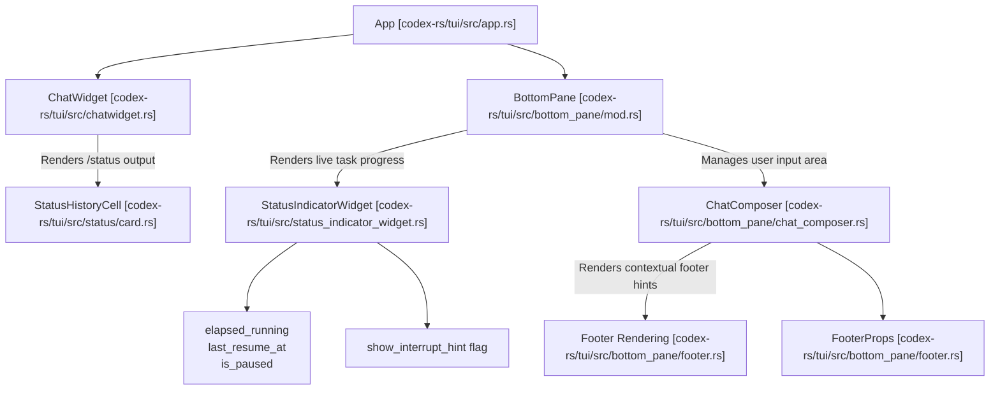
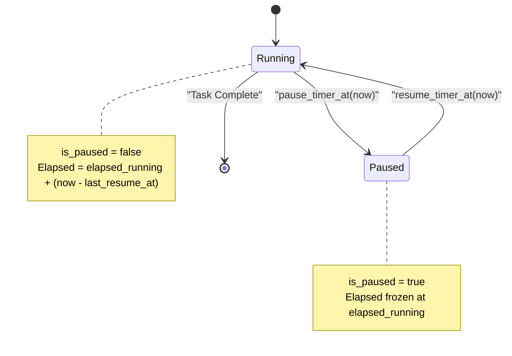
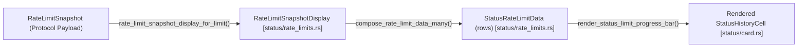
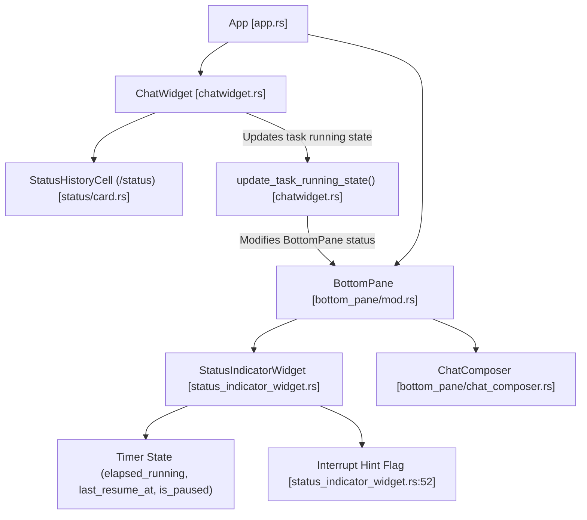

<!-- source: DeepWiki mcp.deepwiki.com · repo openai/codex · extra page Status Line and Footer Rendering · fetched 2026-10-26 -->

# Status Line and Footer Rendering

<details>
<summary>Relevant source files</summary>

The following files were used as context for generating this wiki page:

- [codex-rs/cli/src/doctor/title.rs](codex-rs/cli/src/doctor/title.rs)
- [codex-rs/models-manager/models.json](codex-rs/models-manager/models.json)
- [codex-rs/tui/src/bottom_pane/snapshots/codex_tui__bottom_pane__status_line_setup__tests__setup_view_snapshot_uses_runtime_preview_values.snap](codex-rs/tui/src/bottom_pane/snapshots/codex_tui__bottom_pane__status_line_setup__tests__setup_view_snapshot_uses_runtime_preview_values.snap)
- [codex-rs/tui/src/bottom_pane/snapshots/codex_tui__bottom_pane__title_setup__tests__terminal_title_setup_basic.snap](codex-rs/tui/src/bottom_pane/snapshots/codex_tui__bottom_pane__title_setup__tests__terminal_title_setup_basic.snap)
- [codex-rs/tui/src/bottom_pane/status_line_setup.rs](codex-rs/tui/src/bottom_pane/status_line_setup.rs)
- [codex-rs/tui/src/bottom_pane/status_line_style.rs](codex-rs/tui/src/bottom_pane/status_line_style.rs)
- [codex-rs/tui/src/bottom_pane/status_surface_preview.rs](codex-rs/tui/src/bottom_pane/status_surface_preview.rs)
- [codex-rs/tui/src/bottom_pane/title_setup.rs](codex-rs/tui/src/bottom_pane/title_setup.rs)
- [codex-rs/tui/src/chatwidget/model_popups.rs](codex-rs/tui/src/chatwidget/model_popups.rs)
- [codex-rs/tui/src/chatwidget/rate_limits.rs](codex-rs/tui/src/chatwidget/rate_limits.rs)
- [codex-rs/tui/src/chatwidget/reasoning_shortcuts.rs](codex-rs/tui/src/chatwidget/reasoning_shortcuts.rs)
- [codex-rs/tui/src/chatwidget/snapshots/codex_tui__chatwidget__tests__model_reasoning_selection_popup.snap](codex-rs/tui/src/chatwidget/snapshots/codex_tui__chatwidget__tests__model_reasoning_selection_popup.snap)
- [codex-rs/tui/src/chatwidget/snapshots/codex_tui__chatwidget__tests__model_selection_popup.snap](codex-rs/tui/src/chatwidget/snapshots/codex_tui__chatwidget__tests__model_selection_popup.snap)
- [codex-rs/tui/src/chatwidget/snapshots/codex_tui__chatwidget__tests__reasoning_shortcut_max_footer.snap](codex-rs/tui/src/chatwidget/snapshots/codex_tui__chatwidget__tests__reasoning_shortcut_max_footer.snap)
- [codex-rs/tui/src/chatwidget/snapshots/codex_tui__chatwidget__tests__reasoning_shortcut_max_plan_footer.snap](codex-rs/tui/src/chatwidget/snapshots/codex_tui__chatwidget__tests__reasoning_shortcut_max_plan_footer.snap)
- [codex-rs/tui/src/chatwidget/snapshots/codex_tui__chatwidget__tests__status_line_setup_popup_hardcoded_only.snap](codex-rs/tui/src/chatwidget/snapshots/codex_tui__chatwidget__tests__status_line_setup_popup_hardcoded_only.snap)
- [codex-rs/tui/src/chatwidget/snapshots/codex_tui__chatwidget__tests__status_line_setup_popup_live_only.snap](codex-rs/tui/src/chatwidget/snapshots/codex_tui__chatwidget__tests__status_line_setup_popup_live_only.snap)
- [codex-rs/tui/src/chatwidget/snapshots/codex_tui__chatwidget__tests__status_line_setup_popup_mixed.snap](codex-rs/tui/src/chatwidget/snapshots/codex_tui__chatwidget__tests__status_line_setup_popup_mixed.snap)
- [codex-rs/tui/src/chatwidget/snapshots/codex_tui__chatwidget__tests__terminal_title_setup_popup_hardcoded_only.snap](codex-rs/tui/src/chatwidget/snapshots/codex_tui__chatwidget__tests__terminal_title_setup_popup_hardcoded_only.snap)
- [codex-rs/tui/src/chatwidget/snapshots/codex_tui__chatwidget__tests__terminal_title_setup_popup_live_only.snap](codex-rs/tui/src/chatwidget/snapshots/codex_tui__chatwidget__tests__terminal_title_setup_popup_live_only.snap)
- [codex-rs/tui/src/chatwidget/snapshots/codex_tui__chatwidget__tests__terminal_title_setup_popup_mixed.snap](codex-rs/tui/src/chatwidget/snapshots/codex_tui__chatwidget__tests__terminal_title_setup_popup_mixed.snap)
- [codex-rs/tui/src/chatwidget/snapshots/codex_tui__chatwidget__tests__ultra_reasoning_selection_high_multi_agent_concurrency_warning.snap](codex-rs/tui/src/chatwidget/snapshots/codex_tui__chatwidget__tests__ultra_reasoning_selection_high_multi_agent_concurrency_warning.snap)
- [codex-rs/tui/src/chatwidget/status_controls.rs](codex-rs/tui/src/chatwidget/status_controls.rs)
- [codex-rs/tui/src/chatwidget/status_surfaces.rs](codex-rs/tui/src/chatwidget/status_surfaces.rs)
- [codex-rs/tui/src/chatwidget/tests/status_command_tests.rs](codex-rs/tui/src/chatwidget/tests/status_command_tests.rs)
- [codex-rs/tui/src/chatwidget/tests/status_surface_previews.rs](codex-rs/tui/src/chatwidget/tests/status_surface_previews.rs)
- [codex-rs/tui/src/status/card.rs](codex-rs/tui/src/status/card.rs)
- [codex-rs/tui/src/status/snapshots/codex_tui__status__tests__status_snapshot_local_background_server.snap](codex-rs/tui/src/status/snapshots/codex_tui__status__tests__status_snapshot_local_background_server.snap)
- [codex-rs/tui/src/status/snapshots/codex_tui__status__tests__status_snapshot_remote_server.snap](codex-rs/tui/src/status/snapshots/codex_tui__status__tests__status_snapshot_remote_server.snap)
- [codex-rs/tui/src/status/snapshots/codex_tui__status__tests__status_snapshot_uses_default_reasoning_when_config_empty.snap](codex-rs/tui/src/status/snapshots/codex_tui__status__tests__status_snapshot_uses_default_reasoning_when_config_empty.snap)
- [codex-rs/tui/src/status/tests.rs](codex-rs/tui/src/status/tests.rs)

</details>


This page documents how the Codex terminal user interface (TUI) handles rendering of the status line—a configurable information strip at the terminal bottom—and the footer area showing contextual hints, shortcuts, and live status updates. It covers core elements such as the `StatusIndicatorWidget` for ephemeral running task status, the `/status` command multi-line output rendered via the `StatusHistoryCell`, the rate limits display and its staleness handling, interactive tooltips, and snapshot tests used for visual regression.

---

## Component Architecture

Several primary components collaborate to realize the status line and footer rendering in the TUI:



- **App** orchestrates the TUI main event loop and delegates UI rendering responsibilities `[codex-rs/tui/src/app.rs:1-5]()`.
- **ChatWidget** handles chat transcript including injecting multi-line `/status` outputs via the `StatusHistoryCell`, manages agent tasks state that influence status display `[codex-rs/tui/src/chatwidget.rs:33-41]()`.
- **BottomPane** contains widgets such as the `StatusIndicatorWidget` and user input components, controlling footer layout `[codex-rs/tui/src/bottom_pane/mod.rs:1-50]()`.
- **StatusIndicatorWidget** displays a live one-line status indicator showing running task state with animated spinner, interrupt hint, and elapsed time `[codex-rs/tui/src/status_indicator_widget.rs:45-61]()`.
- **ChatComposer** provides message input UI and manages rendering of footer hints and overlays `[codex-rs/tui/src/bottom_pane/chat_composer.rs:1-8]()`.
- **Footer** renders hints, keymaps, and tooltips in the footer area `[codex-rs/tui/src/bottom_pane/footer.rs:1-50]()`. 

Sources:  
`[codex-rs/tui/src/status_indicator_widget.rs:1-61]()`, `[codex-rs/tui/src/status/card.rs:100-180]()`, `[codex-rs/tui/src/app.rs:1-5]()`, `[codex-rs/tui/src/chatwidget.rs:33-41]()`, `[codex-rs/tui/src/bottom_pane/chat_composer.rs:1-8]()`

---

## StatusIndicatorWidget

The `StatusIndicatorWidget` is the live ephemeral one-line status indicator displayed above the chat input. It renders an animated spinner, a compact elapsed timer string, optional inline messages, and an interrupt hint when user intervention is appropriate (e.g., ESC to cancel a running task) `[codex-rs/tui/src/status_indicator_widget.rs:35-61]()`.

### Key Fields and Internal State

| Field                    | Description                                                                                   |
|--------------------------|-----------------------------------------------------------------------------------------------|
| `header: String`           | Main left-side header text, often `"Working"` with spinner animation                          |
| `details: Option<String>`  | Optional multiline indented detail lines shown beneath the header line                        |
| `inline_message: Option<String>` | Optional inline message appended on the right side after the timer and interrupt hint            |
| `show_interrupt_hint: bool`| Controls display of "esc to interrupt" or similar hint                                      |
| `elapsed_running: Duration`| Accumulator tracking total elapsed time while timer is running                              |
| `last_resume_at: Instant`  | Timestamp when timer was last resumed                                                       |
| `is_paused: bool`          | Whether the timer is currently paused                                                      |
| `app_event_tx: AppEventSender` | Channel to send interrupt events back to app event loop                                  |
| `frame_requester: FrameRequester` | Allows widget to request periodic UI redraws for spinner animation                      |
| `animations_enabled: bool` | Flag indicating animation is enabled                                                      |

This structure maintains a timer model tracking elapsed time that only accumulates while unpaused, and it coordinates spinner animation frame cycling `[codex-rs/tui/src/status_indicator_widget.rs:35-61]()`.

### Elapsed Time Formatting

The helper function `fmt_elapsed_compact` formats elapsed durations compactly for the status line:

- Seconds only if under 1 minute: e.g., `"47s"`
- Minutes and seconds if under 1 hour: e.g., `"4m 07s"`
- Hours, minutes, and seconds for 1 hour or more: e.g., `"1h 02m 09s"`

This helps keep the timer output concise for limited terminal width situations `[codex-rs/tui/src/status_indicator_widget.rs:65-78]()`.

### Timer State Transitions

The timer supports explicit pause and resume semantics to calculate elapsed time correctly even with asynchronous or intermittent task activity.



- `pause_timer_at(now)` updates the `elapsed_running` by adding time since last resume and marks paused `[codex-rs/tui/src/status_indicator_widget.rs:167-173]()`.
- `resume_timer_at(now)` stores new `last_resume_at` and marks running, triggering an animation frame redraw to update spinner and timer `[codex-rs/tui/src/status_indicator_widget.rs:175-182]()`.
- While running, periodic redraws keep spinner frames cycling and elapsed time displayed accurately.

Sources:  
`[codex-rs/tui/src/status_indicator_widget.rs:35-182]()`

---

## The `/status` Command Output (`StatusHistoryCell`)

The `/status` command generates a multi-line block rendered inside the chat history area using the `StatusHistoryCell` composite type. This cell collates complex session data including model details, directory context, token usage, permission profiles, collaboration states, and rate limits `[codex-rs/tui/src/status/card.rs:120-147]()`.

### Data Aggregation in the StatusHistoryCell

Information assembled includes:

- **Model Information:** model name, reasoning effort level, and model provider identification `[codex-rs/tui/src/status/card.rs:128-134]()`.
- **Directory and Permissions:** current workspace directory or project root path, plus a high-level summary of the active permissions/sandbox profile `[codex-rs/tui/src/status/card.rs:130-133]()`.
- **Token Usage:** aggregates token counts for input, output, and total context window usage along with remaining context percentages `[codex-rs/tui/src/status/card.rs:141-144]()`.
- **Rate Limits:** renders progress bars, textual reset times or stale data notices, and optional credit balances or spend controls `[codex-rs/tui/src/status/card.rs:142-147]()`.
- **Collaboration Mode Summary and Remote Connection Status:** included when relevant, showing branch sync and connection state.

A `StatusHistoryHandle` provides methods for update tasks to asynchronously refresh rate limit state, ensuring smooth UI responsiveness `[codex-rs/tui/src/status/card.rs:81-117]()`.

### Rate Limit Rendering Pipeline

The subsystem handles rate limit data received as protocol snapshots (`RateLimitSnapshot`) that are converted into UI-friendly structures (`RateLimitSnapshotDisplay`). These are composed into aggregate display rows, each capable of rendering progress bars and textual summaries on the status card `[codex-rs/tui/src/status/rate_limits.rs:39-90]()`.



- Snapshots contain limit usage percentages, durations, reset times, and optional credit values.
- Compose functions handle aggregation of multiple rate limit windows and detect stale snapshots (e.g., older than 15 minutes).
- Staleness triggers UI warnings about outdated rate limit status `[codex-rs/tui/src/status/tests.rs:63-90]()`.
- Upon refresh, rate limit data is pushed to the status cell for update and redraw.

Sources:  
`[codex-rs/tui/src/status/card.rs:81-147]()`, `[codex-rs/tui/src/status/rate_limits.rs:1-174]()`, `[codex-rs/tui/src/status/tests.rs:60-90]()`

---

## Status Line Configuration

Users can customize the status line via an interactive picker using the `StatusLineItem` enum. Items are serialized in kebab-case strings in user local settings for persistence and parsing `[codex-rs/tui/src/bottom_pane/status_line_setup.rs:55-158]()`.

### StatusLineItem Enum Key Variants

| Variant             | Description                                                      |
|---------------------|------------------------------------------------------------------|
| `ModelName`         | Current model name                                               |
| `ModelWithReasoning`| Model name with reasoning level suffix                          |
| `Reasoning`         | Current reasoning effort level                                 |
| `CurrentDir`        | Current working directory                                       |
| `ProjectRoot`       | Project root directory folder name (hidden if unavailable)      |
| `GitBranch`         | Git branch name of current directory (if inside repo)           |
| `PullRequestNumber` | Open pull request number for current branch                     |
| `Status`            | Compact textual run-state, e.g., Ready or Working               |
| `Permissions`       | Active permission or sandbox mode summary                      |
| `ContextRemaining`  | Percentage of context window remaining                          |
| `FiveHourLimit`     | Remaining primary rate limit usage                              |
| `CodexVersion`      | Codex application version                                       |
| `ThreadName`        | Current thread/session name                                    |

The enum is also used for terminal title item selections and popup configuration UIs. Several conditional items show only if data is available or applicable.

### Terminal Title Animation

The terminal title reflects session status with:

- An ASCII Braille spinner cycling through 10 frames every 100 ms, animated to indicate live activity `[codex-rs/tui/src/chatwidget/status_surfaces.rs:29-33]()`.
- "Action required" blinking prefix shown when the agent is waiting for user input.
- Shared logic for computing spinner frames, item validity checks, and surface composition is used for both status line and terminal title strings.

Sources:  
`[codex-rs/tui/src/bottom_pane/status_line_setup.rs:55-158]()`, `[codex-rs/tui/src/chatwidget/status_surfaces.rs:25-40]()`

---

## Token Usage and Context Rendering in Status Line

Token usage display dynamically adapts based on available data:

- When context window size is unknown, the status line falls back to showing raw total tokens used instead of percentages, avoiding misleading UI `[codex-rs/tui/src/chatwidget/tests/status_and_layout.rs:160-180]()`.
- If the token usage update is `None`, context usage indicators are cleared to prevent stale data presentation `[codex-rs/tui/src/chatwidget/tests/status_and_layout.rs:60-75]()`.
- Compact formatting with suffixes (like `950K window`) is used for efficient layout `[codex-rs/tui/src/chatwidget/tests/status_and_layout.rs:170-177]()`.
- These adjustments enable accurate, clear, and stable status line displays reflecting runtime token consumption.

Sources:  
`[codex-rs/tui/src/chatwidget/tests/status_and_layout.rs:60-180]()`

---

## Tooltip Management

Tooltip hints are managed in the footer UI to provide helpful information or onboarding guidance during startup or idle times. The tooltip system imports tips from multiple contexts: user plan, keymaps, and feature flags `[codex-rs/tui/src/tooltips.rs:18-73]()`.

- Static tips include information about enabling Fast Mode, usage of OpenAI API keys, collaboration features, and keyboard shortcuts.
- Conditional display logic picks relevant tips based on the active user plan type and UI mode.
- The `get_tooltip` function selects a random or preferred tip for display.
- Tips are rendered with terminal-adapted markdown styles that handle formatting, line breaks, and masked hyperlinks gracefully `[codex-rs/tui/src/tooltips.rs:183-188]()`.

Sources:  
`[codex-rs/tui/src/tooltips.rs:1-188]()`

---

## Snapshot Testing

Snapshot tests comprehensively cover the status line, `/status` command output, and footer rendering to ensure visual regression resistance:

- Tests verify voice transcript overlay and interim status line renderings against expected snapshots `[codex-rs/tui/src/chatwidget/tests/status_and_layout.rs:15-41]()`.
- `/status` command output tests check correctness of reasoning level display, token usage, permission summaries, and rate limit progress bars `[codex-rs/tui/src/status/tests.rs:1-90]()`.
- Popup menus for status line and terminal title configuration are snapshot-tested for correctness and handling of live or hardcoded preview data `[codex-rs/tui/src/chatwidget/tests/plan_mode.rs:67-104]()` and `[codex-rs/tui/src/chatwidget/tests/status_surface_previews.rs:1-160]()`.
- Helpers normalize platform-dependent paths in snapshots for consistency `[codex-rs/tui/src/chatwidget/tests/helpers.rs:40-132]()`.
- This testing strategy guarantees UI fidelity across platforms and changes.

Sources:  
`[codex-rs/tui/src/chatwidget/tests/status_and_layout.rs:1-41]()`, `[codex-rs/tui/src/status/tests.rs:1-90]()`, `[codex-rs/tui/src/chatwidget/tests/helpers.rs:40-132]()`, `[codex-rs/tui/src/chatwidget/tests/plan_mode.rs:67-104]()`  

---

## Diagrams Bridging Natural Language Concepts to Code Entities

### Task Status Rendering to Code Entities

```mermaid
graph LR
    "Live Task Status Display" --> "StatusIndicatorWidget [status_indicator_widget.rs]"
    "Spinner Animation State" --> "StatusIndicatorWidget::elapsed_running,last_resume_at,is_paused [status_indicator_widget.rs]"
    "Interrupt Hint (e.g., 'esc to interrupt')" --> "StatusIndicatorWidget::show_interrupt_hint [status_indicator_widget.rs]"
    "Elapsed Time Formatting for Display" --> "fmt_elapsed_compact() [status_indicator_widget.rs]"

    "Multi-line /status Command Output" --> "StatusHistoryCell struct [status/card.rs]"
    "Rate Limit Status Bars" --> "StatusRateLimitData & compose_rate_limit_data_many() [status/card.rs]"
    "Snapshot-based Status Tests" --> "status/tests.rs & status_and_layout.rs [status/tests.rs]"
```

Sources:  
`[codex-rs/tui/src/status_indicator_widget.rs:35-182]()`, `[codex-rs/tui/src/status/card.rs:81-147]()`, `[codex-rs/tui/src/status/tests.rs:1-90]()`, `[codex-rs/tui/src/chatwidget/tests/status_and_layout.rs:1-41]()`

### User Interface Flow for Status and Footer Rendering



Sources:  
`[codex-rs/tui/src/status_indicator_widget.rs:35-182]()`, `[codex-rs/tui/src/status/card.rs:81-147]()`, `[codex-rs/tui/src/chatwidget.rs:33-41]()`, `[codex-rs/tui/src/bottom_pane/mod.rs:1-50]()`

---

# Summary

The Codex TUI status line and footer subsystem provides flexible, user-configurable, and richly informative session status feedback. It features:

- A live `StatusIndicatorWidget` rendering animated task status, interrupt hints, and elapsed times.
- Composable multi-line `/status` output via the `StatusHistoryCell` displaying model, token usage, permissions, rate limits, and collaboration info.
- Rate limit visualization with progress bars and staleness detection to warn on outdated data.
- An interactive status line configuration UI driven by the `StatusLineItem` enum with extensive item options.
- Terminal title animation with braille spinner frames and action-required blinks.
- Dynamic token usage rendering adapting to model context window availability.
- Tooltip hints enhancing user experience, built from multiple context tip datasets.
- Robust snapshot testing ensuring visual consistency across platforms and versions.

This modular, well-factored design cleanly separates ephemeral task status rendering from persistent command output and user configuration, enabling reactive, detail-rich UI feedback during AI coding sessions.

---

**Sources:**  
- `[codex-rs/tui/src/status_indicator_widget.rs:1-182]()`  
- `[codex-rs/tui/src/status/card.rs:80-147]()`  
- `[codex-rs/tui/src/status/rate_limits.rs:1-174]()`  
- `[codex-rs/tui/src/status/tests.rs:1-90]()`  
- `[codex-rs/tui/src/chatwidget/status_surfaces.rs:25-40]()`  
- `[codex-rs/tui/src/bottom_pane/status_line_setup.rs:55-158]()`  
- `[codex-rs/tui/src/chatwidget/tests/status_and_layout.rs:1-180]()`  
- `[codex-rs/tui/src/chatwidget/tests/helpers.rs:40-132]()`  
- `[codex-rs/tui/src/tooltips.rs:1-188]()`  
- `[codex-rs/tui/src/chatwidget.rs:33-41]()`  
- `[codex-rs/tui/src/bottom_pane/chat_composer.rs:1-8]()`  
- `[codex-rs/tui/src/app.rs:1-5]()`

---

