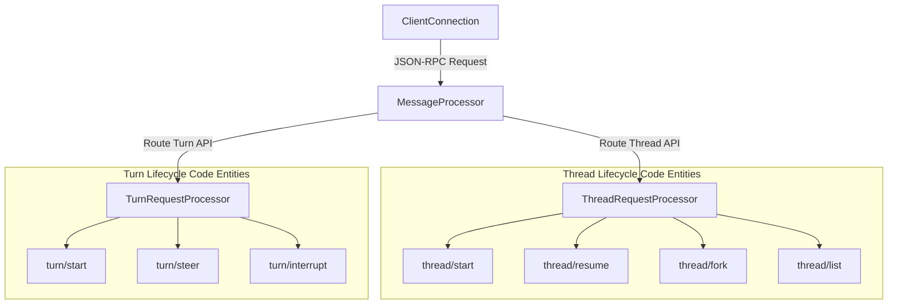
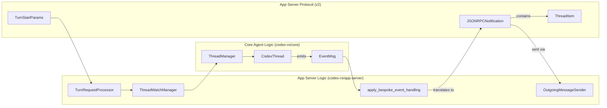
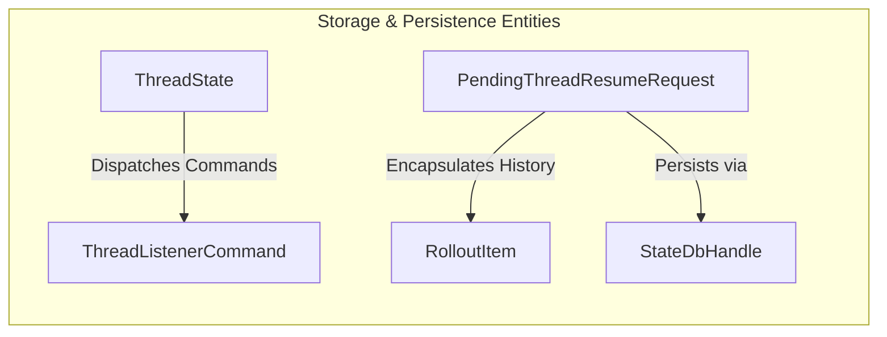
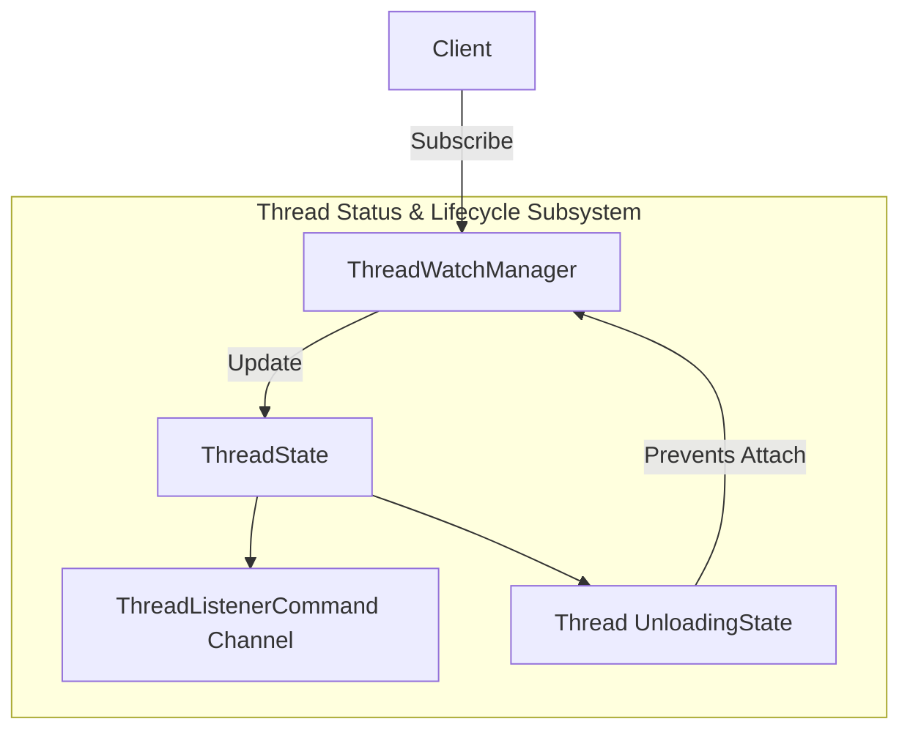

<!-- source: DeepWiki mcp.deepwiki.com · repo openai/codex · extra page Thread and Turn Management API · fetched 2026-10-26 -->

# Thread and Turn Management API

Relevant source files

The following files were used as context for generating this wiki page:

- [codex-rs/app-server-protocol/schema/json/ClientRequest.json](codex-rs/app-server-protocol/schema/json/ClientRequest.json)
- [codex-rs/app-server-protocol/schema/json/ServerNotification.json](codex-rs/app-server-protocol/schema/json/ServerNotification.json)
- [codex-rs/app-server-protocol/schema/json/codex_app_server_protocol.schemas.json](codex-rs/app-server-protocol/schema/json/codex_app_server_protocol.schemas.json)
- [codex-rs/app-server-protocol/schema/json/codex_app_server_protocol.v2.schemas.json](codex-rs/app-server-protocol/schema/json/codex_app_server_protocol.v2.schemas.json)
- [codex-rs/app-server-protocol/schema/json/v2/ThreadForkResponse.json](codex-rs/app-server-protocol/schema/json/v2/ThreadForkResponse.json)
- [codex-rs/app-server-protocol/schema/json/v2/ThreadListResponse.json](codex-rs/app-server-protocol/schema/json/v2/ThreadListResponse.json)
- [codex-rs/app-server-protocol/schema/json/v2/ThreadMetadataUpdateResponse.json](codex-rs/app-server-protocol/schema/json/v2/ThreadMetadataUpdateResponse.json)
- [codex-rs/app-server-protocol/schema/json/v2/ThreadReadResponse.json](codex-rs/app-server-protocol/schema/json/v2/ThreadReadResponse.json)
- [codex-rs/app-server-protocol/schema/json/v2/ThreadResumeResponse.json](codex-rs/app-server-protocol/schema/json/v2/ThreadResumeResponse.json)
- [codex-rs/app-server-protocol/schema/json/v2/ThreadStartResponse.json](codex-rs/app-server-protocol/schema/json/v2/ThreadStartResponse.json)
- [codex-rs/app-server-protocol/schema/json/v2/ThreadStartedNotification.json](codex-rs/app-server-protocol/schema/json/v2/ThreadStartedNotification.json)
- [codex-rs/app-server-protocol/schema/json/v2/ThreadUnarchiveResponse.json](codex-rs/app-server-protocol/schema/json/v2/ThreadUnarchiveResponse.json)
- [codex-rs/app-server-protocol/schema/precomputed/app-server-exports-experimental.json.zst](codex-rs/app-server-protocol/schema/precomputed/app-server-exports-experimental.json.zst)
- [codex-rs/app-server-protocol/schema/precomputed/app-server-exports-stable.json.zst](codex-rs/app-server-protocol/schema/precomputed/app-server-exports-stable.json.zst)
- [codex-rs/app-server-protocol/schema/typescript/ClientRequest.ts](codex-rs/app-server-protocol/schema/typescript/ClientRequest.ts)
- [codex-rs/app-server-protocol/schema/typescript/v2/index.ts](codex-rs/app-server-protocol/schema/typescript/v2/index.ts)
- [codex-rs/app-server-protocol/src/protocol/common.rs](codex-rs/app-server-protocol/src/protocol/common.rs)
- [codex-rs/app-server-protocol/src/protocol/v2/tests.rs](codex-rs/app-server-protocol/src/protocol/v2/tests.rs)
- [codex-rs/app-server-protocol/src/protocol/v2/thread.rs](codex-rs/app-server-protocol/src/protocol/v2/thread.rs)
- [codex-rs/app-server/README.md](codex-rs/app-server/README.md)
- [codex-rs/app-server/src/lib.rs](codex-rs/app-server/src/lib.rs)
- [codex-rs/app-server/src/message_processor.rs](codex-rs/app-server/src/message_processor.rs)
- [codex-rs/app-server/src/request_processors.rs](codex-rs/app-server/src/request_processors.rs)
- [codex-rs/app-server/src/request_processors/thread_lifecycle.rs](codex-rs/app-server/src/request_processors/thread_lifecycle.rs)
- [codex-rs/app-server/src/request_processors/thread_processor.rs](codex-rs/app-server/src/request_processors/thread_processor.rs)
- [codex-rs/app-server/src/thread_state.rs](codex-rs/app-server/src/thread_state.rs)
- [codex-rs/app-server/tests/suite/v2/mod.rs](codex-rs/app-server/tests/suite/v2/mod.rs)
- [codex-rs/app-server/tests/suite/v2/thread_fork.rs](codex-rs/app-server/tests/suite/v2/thread_fork.rs)
- [codex-rs/app-server/tests/suite/v2/thread_resume.rs](codex-rs/app-server/tests/suite/v2/thread_resume.rs)
- [codex-rs/app-server/tests/suite/v2/thread_start.rs](codex-rs/app-server/tests/suite/v2/thread_start.rs)
- [codex-rs/app-server/tests/suite/v2/thread_unsubscribe.rs](codex-rs/app-server/tests/suite/v2/thread_unsubscribe.rs)
- [codex-rs/app-server/tests/suite/v2/turn_start.rs](codex-rs/app-server/tests/suite/v2/turn_start.rs)
- [sdk/python/src/openai_codex/generated/v2_all.py](sdk/python/src/openai_codex/generated/v2_all.py)

This page documents the full lifecycle API for threads and turns exposed by the `codex-app-server` JSON-RPC 2.0 interface. It covers `thread/*` and `turn/*` endpoints, thread status tracking, thread lifecycle, unloading mechanisms, and subscription management.

Sources: [codex-rs/app-server/src/request_processors/thread_processor.rs:1-10](), [codex-rs/app-server/src/request_processors.rs:1-15](), [codex-rs/app-server/src/message_processor.rs:124-138]()

---

## Core Data Model

The API centers on three key primitives representing interactions between a user and the Codex AI agent:

| Object | Description | Code Definition |
|--------|-------------|-----------------|
| **Thread** | Encapsulates conversation state, history, and multiple turns. | [codex-rs/app-server-protocol/src/protocol/v2/thread.rs:6-9]() |
| **Turn** | A single interaction cycle in a thread, starting with user input and ending with agent output. | [codex-rs/app-server-protocol/src/protocol/v2/thread.rs:13-13]() |
| **Item** | Discrete data elements within turns (messages, reasoning steps, tool invocations, shell commands). | [codex-rs/app-server-protocol/src/protocol/v2/thread.rs:8-8]() |

### Thread and Turn Status Tracking

The protocol defines enums tracking thread and turn lifecycle states:

- **ThreadStatus:**
  - `idle` — Thread is loaded in memory and ready for turns [codex-rs/app-server/tests/suite/v2/thread_fork.rs:42-42]().
  - `active` — Thread is currently executing a turn.
  - `notLoaded` — Thread exists on disk but is not loaded in memory [codex-rs/app-server/tests/suite/v2/turn_start.rs:66-66]().

- **TurnStatus:**
  - `inProgress` — Turn execution underway, including model and tool processing [codex-rs/app-server/tests/suite/v2/turn_start.rs:66-66]().
  - `completed` — Turn finished normally [codex-rs/app-server/tests/suite/v2/turn_start.rs:60-60]().
  - `interrupted` — Turn was aborted via interrupt or during a fork [codex-rs/app-server/tests/suite/v2/thread_fork.rs:49-49]().

Sources: [codex-rs/app-server-protocol/src/protocol/v2/thread.rs:6-17](), [codex-rs/app-server/tests/suite/v2/thread_fork.rs:42-49](), [codex-rs/app-server/tests/suite/v2/turn_start.rs:60-66](), [codex-rs/app-server/src/request_processors.rs:14-15]()

---

## Request/Response Architecture & Validation

The app server employs modular request processors (`MessageProcessor`) for routing JSON-RPC messages, delegating requests to `ThreadRequestProcessor` and `TurnRequestProcessor` [codex-rs/app-server/src/message_processor.rs:49-51](). Before execution, requests undergo validation, including rejecting obsolete fields such as `permissionProfile` via `reject_removed_permission_profile` [codex-rs/app-server/src/message_processor.rs:124-138]().

Title: "Bridge: Natural Language Routing to Code Entity Space"

Sources: [codex-rs/app-server/src/request_processors/thread_processor.rs:1-6](), [codex-rs/app-server/src/request_processors.rs:47-132](), [codex-rs/app-server/src/message_processor.rs:124-138]()

Title: Data Flow from Protocol to Core Entities

Sources: [codex-rs/app-server/src/request_processors.rs:1-15](), [codex-rs/app-server/src/outgoing_message.rs:8-12](), [codex-rs/app-server/tests/suite/v2/turn_start.rs:32-61](), [codex-rs/app-server/src/bespoke_event_handling.rs:1-1]()

---

## Thread Lifecycle

### `thread/start`
Creates a new conversation thread using `ThreadStartParams` [codex-rs/app-server-protocol/src/protocol/v2/thread.rs:59-62](). Key configuration options include:
- `model`: Optional model override [codex-rs/app-server-protocol/src/protocol/v2/thread.rs:64-64]().
- `allowProviderModelFallback`: Fallback configuration when a model is unavailable [codex-rs/app-server-protocol/src/protocol/v2/thread.rs:67-71]().
- `ephemeral`: In-memory only flag [codex-rs/app-server-protocol/src/protocol/v2/thread.rs:114-114]().
- `historyMode`: Defines history persistence contracts (`LocalOnly`, `Paginated`) [codex-rs/app-server-protocol/src/protocol/v2/thread.rs:115-118]().

### `thread/resume`
Resumes an existing conversation by ID, loading rollout and thread store data. The function `collect_resume_override_mismatches` checks configuration consistency against active settings [codex-rs/app-server/src/request_processors/thread_processor.rs:102-162]().

### `thread/fork`
Forks an existing thread by cloning its conversation history and state, inheriting goals via `inherit_thread_goal_snapshot` [codex-rs/app-server/src/request_processors/thread_processor.rs:4-4]().

### `thread/list` and `thread/read`
- `thread/list` supports filters like `model_providers`, `cwd_filters`, `search_term`, and `archived` with default page limits (`THREAD_LIST_DEFAULT_LIMIT`) [codex-rs/app-server/src/request_processors/thread_processor.rs:37-82]().
- `thread/read` fetches detailed metadata and state snapshots [codex-rs/app-server/tests/suite/v2/thread_resume.rs:59-60]().

Sources: [codex-rs/app-server-protocol/src/protocol/v2/thread.rs:59-159](), [codex-rs/app-server/src/request_processors/thread_processor.rs:35-174](), [codex-rs/app-server/tests/suite/v2/thread_fork.rs:160-182]()

---

## Turn and Interaction Management

### `turn/start`
Clients submit user inputs (text and images) wrapped in `TurnStartParams` through `TurnRequestProcessor::turn_start` [codex-rs/app-server/tests/suite/v2/turn_start.rs:70-70](), [codex-rs/app-server/src/request_processors/turn_processor.rs:175-179](). 

### Event Streaming of Turn Execution
Execution progress emits notifications:
- `item/started` and `item/completed` track individual items.
- `turn/started` and `turn/completed` track turn-level lifecycles [codex-rs/app-server/tests/suite/v2/turn_start.rs:38-72]().

Sources: [codex-rs/app-server/src/request_processors.rs:1-15](), [codex-rs/app-server/tests/suite/v2/turn_start.rs:33-71](), [codex-rs/app-server/src/request_processors/turn_processor.rs:175-179]()

---

## Persistence and Storage Layer

### `ThreadState` and `PendingThreadResumeRequest`
`ThreadState` tracks active interrupts, turn summaries, and listener command channels [codex-rs/app-server/src/thread_state.rs:95-112](). Resumption relies on `PendingThreadResumeRequest` to bundle rollout history items and configuration snapshots [codex-rs/app-server/src/thread_state.rs:38-57]().

Title: "Bridge: Persistence Concepts to Code Entity Space"

Sources: [codex-rs/app-server/src/thread_state.rs:36-112]()

---

## Subscription, Status Management, and Unloading

### Thread Status Tracking
`ThreadWatchManager` and `resolve_thread_status` maintain live view states across active threads [codex-rs/app-server/src/request_processors.rs:14-15]().

### ThreadState Listener Commands
`ThreadState` processes commands through an unbounded channel (`mpsc::UnboundedSender<ThreadListenerCommand>`) to serialize goals, resume responses, and server request resolutions [codex-rs/app-server/src/thread_state.rs:60-89]().

### Unloading Safeguards
The server utilizes `UnloadingState` and shutdown drain waiters to ensure threads drain core events before listener replacement or unloading [codex-rs/app-server/src/thread_state.rs:103-103](), [codex-rs/app-server/src/request_processors/thread_lifecycle.rs:22-190]().

Title: Thread Unloading and Lifecycle Subscription Architecture

Sources: [codex-rs/app-server/src/request_processors.rs:1-15](), [codex-rs/app-server/src/thread_state.rs:58-157](), [codex-rs/app-server/src/request_processors/thread_lifecycle.rs:22-190]()

---

