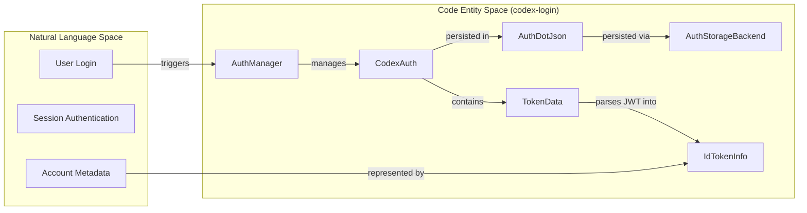
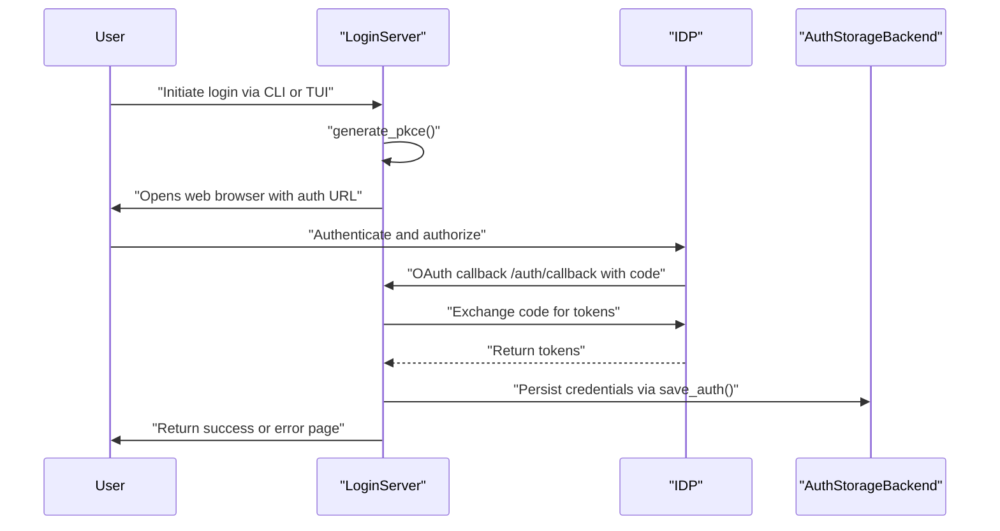
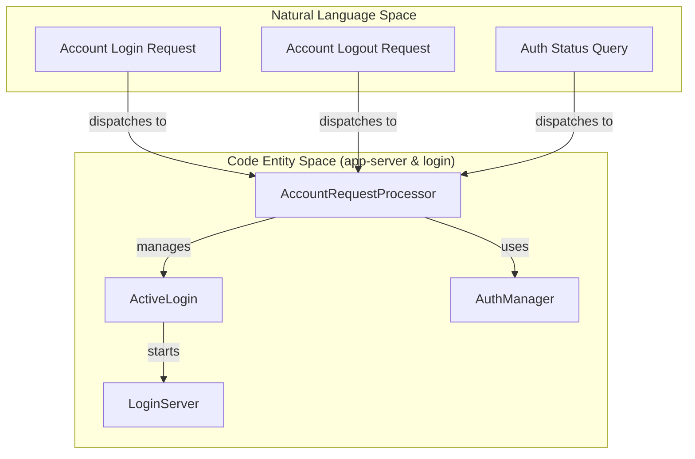

<!-- source: DeepWiki mcp.deepwiki.com · repo openai/codex · extra page Authentication Modes and Account Management · fetched 2026-10-26 -->

# Authentication Modes and Account Management

Relevant source files

The following files were used as context for generating this wiki page:

- [codex-rs/agent-identity/Cargo.toml](codex-rs/agent-identity/Cargo.toml)
- [codex-rs/agent-identity/src/lib.rs](codex-rs/agent-identity/src/lib.rs)
- [codex-rs/app-server-protocol/schema/json/v2/AccountRateLimitsUpdatedNotification.json](codex-rs/app-server-protocol/schema/json/v2/AccountRateLimitsUpdatedNotification.json)
- [codex-rs/app-server-protocol/schema/json/v2/AccountUpdatedNotification.json](codex-rs/app-server-protocol/schema/json/v2/AccountUpdatedNotification.json)
- [codex-rs/app-server-protocol/schema/json/v2/GetAccountRateLimitsResponse.json](codex-rs/app-server-protocol/schema/json/v2/GetAccountRateLimitsResponse.json)
- [codex-rs/app-server-protocol/schema/json/v2/GetAccountResponse.json](codex-rs/app-server-protocol/schema/json/v2/GetAccountResponse.json)
- [codex-rs/app-server-protocol/schema/typescript/PlanType.ts](codex-rs/app-server-protocol/schema/typescript/PlanType.ts)
- [codex-rs/app-server-protocol/src/protocol/v2/account.rs](codex-rs/app-server-protocol/src/protocol/v2/account.rs)
- [codex-rs/app-server/src/external_auth.rs](codex-rs/app-server/src/external_auth.rs)
- [codex-rs/app-server/tests/suite/v2/rate_limits.rs](codex-rs/app-server/tests/suite/v2/rate_limits.rs)
- [codex-rs/backend-client/src/client.rs](codex-rs/backend-client/src/client.rs)
- [codex-rs/backend-client/src/client/analytics.rs](codex-rs/backend-client/src/client/analytics.rs)
- [codex-rs/backend-client/src/client/analytics_tests.rs](codex-rs/backend-client/src/client/analytics_tests.rs)
- [codex-rs/backend-client/src/lib.rs](codex-rs/backend-client/src/lib.rs)
- [codex-rs/backend-client/src/types.rs](codex-rs/backend-client/src/types.rs)
- [codex-rs/cli/src/login.rs](codex-rs/cli/src/login.rs)
- [codex-rs/codex-backend-openapi-models/src/models/analytics.rs](codex-rs/codex-backend-openapi-models/src/models/analytics.rs)
- [codex-rs/codex-backend-openapi-models/src/models/config_bundle_response.rs](codex-rs/codex-backend-openapi-models/src/models/config_bundle_response.rs)
- [codex-rs/codex-backend-openapi-models/src/models/delivered_config_toml.rs](codex-rs/codex-backend-openapi-models/src/models/delivered_config_toml.rs)
- [codex-rs/codex-backend-openapi-models/src/models/delivered_managed_layers.rs](codex-rs/codex-backend-openapi-models/src/models/delivered_managed_layers.rs)
- [codex-rs/codex-backend-openapi-models/src/models/delivered_requirements_toml.rs](codex-rs/codex-backend-openapi-models/src/models/delivered_requirements_toml.rs)
- [codex-rs/codex-backend-openapi-models/src/models/delivered_toml_fragment.rs](codex-rs/codex-backend-openapi-models/src/models/delivered_toml_fragment.rs)
- [codex-rs/codex-backend-openapi-models/src/models/mod.rs](codex-rs/codex-backend-openapi-models/src/models/mod.rs)
- [codex-rs/codex-backend-openapi-models/src/models/rate_limit_status_payload.rs](codex-rs/codex-backend-openapi-models/src/models/rate_limit_status_payload.rs)
- [codex-rs/core/tests/suite/external_auth.rs](codex-rs/core/tests/suite/external_auth.rs)
- [codex-rs/login/BUILD.bazel](codex-rs/login/BUILD.bazel)
- [codex-rs/login/Cargo.toml](codex-rs/login/Cargo.toml)
- [codex-rs/login/src/assets/error.html](codex-rs/login/src/assets/error.html)
- [codex-rs/login/src/auth/account_user_id_tests.rs](codex-rs/login/src/auth/account_user_id_tests.rs)
- [codex-rs/login/src/auth/agent_identity.rs](codex-rs/login/src/auth/agent_identity.rs)
- [codex-rs/login/src/auth/auth_tests.rs](codex-rs/login/src/auth/auth_tests.rs)
- [codex-rs/login/src/auth/external_bearer.rs](codex-rs/login/src/auth/external_bearer.rs)
- [codex-rs/login/src/auth/manager.rs](codex-rs/login/src/auth/manager.rs)
- [codex-rs/login/src/auth/mod.rs](codex-rs/login/src/auth/mod.rs)
- [codex-rs/login/src/auth/revoke.rs](codex-rs/login/src/auth/revoke.rs)
- [codex-rs/login/src/auth/storage.rs](codex-rs/login/src/auth/storage.rs)
- [codex-rs/login/src/auth/storage_tests.rs](codex-rs/login/src/auth/storage_tests.rs)
- [codex-rs/login/src/callback_params.rs](codex-rs/login/src/callback_params.rs)
- [codex-rs/login/src/lib.rs](codex-rs/login/src/lib.rs)
- [codex-rs/login/src/oauth/authorization.rs](codex-rs/login/src/oauth/authorization.rs)
- [codex-rs/login/src/oauth/authorization_tests.rs](codex-rs/login/src/oauth/authorization_tests.rs)
- [codex-rs/login/src/oauth/client.rs](codex-rs/login/src/oauth/client.rs)
- [codex-rs/login/src/oauth/client_tests.rs](codex-rs/login/src/oauth/client_tests.rs)
- [codex-rs/login/src/oauth/diagnostics.rs](codex-rs/login/src/oauth/diagnostics.rs)
- [codex-rs/login/src/oauth/diagnostics_tests.rs](codex-rs/login/src/oauth/diagnostics_tests.rs)
- [codex-rs/login/src/oauth/mod.rs](codex-rs/login/src/oauth/mod.rs)
- [codex-rs/login/src/server.rs](codex-rs/login/src/server.rs)
- [codex-rs/login/src/token_data.rs](codex-rs/login/src/token_data.rs)
- [codex-rs/login/src/token_data_tests.rs](codex-rs/login/src/token_data_tests.rs)
- [codex-rs/login/tests/suite/auth_refresh.rs](codex-rs/login/tests/suite/auth_refresh.rs)
- [codex-rs/login/tests/suite/login_server_e2e.rs](codex-rs/login/tests/suite/login_server_e2e.rs)
- [codex-rs/login/tests/suite/logout.rs](codex-rs/login/tests/suite/logout.rs)
- [codex-rs/model-provider/src/auth.rs](codex-rs/model-provider/src/auth.rs)
- [codex-rs/protocol/src/account.rs](codex-rs/protocol/src/account.rs)
- [codex-rs/protocol/src/auth.rs](codex-rs/protocol/src/auth.rs)

## Purpose and Scope
This page documents how Codex authenticates users, stores credentials, refreshes tokens, and manages login state at runtime. It covers the `CodexAuth` and `AuthManager` types in `codex-login`, the OAuth/PKCE browser login server, the device-code authentication flow, API key auth, and account and rate-limit retrieval within the app server and CLI.

---

## Auth Modes

Codex supports multiple authentication modes, represented by the `AuthMode` enum in the protocol:

[codex-rs/protocol/src/auth.rs:1-30]()

| `AuthMode` variant    | Description                                                                                  |
|----------------------|----------------------------------------------------------------------------------------------|
| `ApiKey`             | Raw OpenAI API key is used, typically billed per-token.                                     |
| `Chatgpt`            | OAuth tokens obtained from a ChatGPT account.                                               |
| `AgentIdentity`      | Machine-to-machine identity for automated or enterprise environments.                       |
| `PersonalAccessToken`| Long-lived personal access token for authentication.                                       |
| `BedrockApiKey`      | AWS Bedrock API keys authentication mode.                                                  |
| `BedrockAccessKeys`  | AWS Access Key ID and Secret Access Key authentication.                                    |

The `CodexAuth` enum (defined in `codex-login`) holds concrete authentication payloads for these modes:

[codex-rs/login/src/auth/manager.rs:75-101]()

| `CodexAuth` variant            | Description                                                                                         |
|-------------------------------|---------------------------------------------------------------------------------------------------|
| `ApiKey(ApiKeyAuth)`           | Holds the raw API key string. [codex-rs/login/src/auth/manager.rs:182-185]()                      |
| `Chatgpt(ChatgptAuth)`         | Holds OAuth tokens and a reference to storage backend for persistence. [codex-rs/login/src/auth/manager.rs:186-191]() |
| `ChatgptAuthTokens`            | Holds token state for ChatGPT without direct storage reference. [codex-rs/login/src/auth/manager.rs:192-197]() |
| `Headers(AuthHeaders)`         | Raw HTTP headers to use for authentication.                                                       |
| `AgentIdentity(AgentIdentityAuth)` | Holds credentials for Agent Identity flow. [codex-rs/login/src/auth/manager.rs:33-46]()          |
| `PersonalAccessToken`          | Personal access token authentication wrapper.                                                    |
| `BedrockApiKey`                | Bedrock API key authentication.                                                                   |
| `BedrockAccessKeys`            | Bedrock AWS Access Keys authentication.                                                          |

**Diagram: Auth Mode and Code Entities (Natural Language Space to Code Entity Space)**

Sources: [codex-rs/login/src/auth/manager.rs:75-101](), [codex-rs/login/src/auth/storage.rs:37-60](), [codex-rs/login/src/token_data.rs:10-35]()

---

## Token Storage: `AuthDotJson` and `TokenData`

User credentials and tokens are serialized to an `AuthDotJson` struct and persisted to storage, typically the `auth.json` file in the `codex_home` directory.

### `TokenData` Structure

`TokenData` represents the OAuth tokens and parsed JWT claims, including:

[codex-rs/login/src/token_data.rs:10-35]()

| Field          | Type           | Description                                  |
|----------------|----------------|----------------------------------------------|
| `id_token`     | `IdTokenInfo`  | Parsed JWT claims with user and plan info. |
| `access_token` | `String`       | Active OAuth JWT access token.              |
| `refresh_token`| `String`       | Refresh token for renewing access tokens.  |
| `account_id`   | `Option<String>` | ChatGPT workspace/account identifier.     |

### `AuthCredentialsStoreMode`

The mode controls where and how credentials are persisted:

[codex-rs/login/src/lib.rs:21-21]()

| Mode      | Description                                                                                                 |
|-----------|-------------------------------------------------------------------------------------------------------------|
| `File`    | Persist `auth.json` on disk. Typical for CLI and local sessions. [codex-rs/login/src/auth/auth_tests.rs:94-126]() |
| `Ephemeral` | Store credentials only in-memory with no persistence.                                                    |
| `Keyring` | Persist credentials securely using OS-native backends like Keychain or Credential Manager. [codex-rs/login/src/auth/storage.rs:35-60]() |

Sources: [codex-rs/login/src/token_data.rs:10-35](), [codex-rs/login/src/auth/auth_tests.rs:94-126](), [codex-rs/login/src/auth/storage.rs:30-61]()

---

## ChatGPT Browser Login Flow (PKCE)

The browser OAuth login flow for ChatGPT is implemented in `codex-rs/login/src/server.rs`. It runs a short-lived local HTTP server that receives the OAuth callback and exchanges the code for tokens using the PKCE extension.

**Diagram: Browser Login Flow Sequence**

### Notes on Implementation

- Server listens on default port 1455, falling back to 1457 if occupied. [codex-rs/login/src/server.rs:77-90]()
- Uses PKCE code challenge to securely bind token requests. [codex-rs/login/src/server.rs:178-180]()
- Handles shutdown requests via `ShutdownHandle`. [codex-rs/login/src/server.rs:163-174]()
- The login server is invoked from CLI (`codex login`) or TUI setup flows. [codex-rs/cli/src/login.rs:140-168]()

Sources: [codex-rs/login/src/server.rs:1-210](), [codex-rs/cli/src/login.rs:140-182]()

---

## Device Code Login

Device code authentication supports headless or remote environments without browser interaction.

### Workflow:

1. **Request Device Code**: `request_device_code()` sends a POST to the issuer's `/deviceauth/usercode` endpoint, returning a code and verification URI. [codex-rs/login/src/lib.rs:23-31]()
2. **Prompt User**: CLI or TUI displays the verification URL and user code.
3. **Poll Token Endpoint**: `poll_for_token()` polls `/deviceauth/token` until authorization is granted or timeout occurs.

Sources: [codex-rs/login/src/device_code_auth.rs:1-208](), [codex-rs/login/src/lib.rs:23-31]()

---

## Amazon Bedrock Authentication

Codex supports AWS Bedrock authentication through several credential sources managed by `AmazonBedrockModelProvider`:

- **ManagedBearerToken**: Uses the Bedrock API key stored in `AuthManager`.
- **ManagedAccessKeys**: Uses Access Key ID, Secret Access Key, and optionally Session Token.
- **AwsSdk**: Uses the standard AWS SDK credential provider chain.

Sources: [codex-rs/model-provider/src/amazon_bedrock/mod.rs:50-140]()

---

## TUI Onboarding Screen Authentication UI

The TUI onboarding UI guides users through account setup, including authentication with an interactive state machine (`SignInState`).

Sources: [codex-rs/tui/src/onboarding/auth.rs:80-220]()

---

## App Server Account Management

The JSON-RPC app server exposes endpoints for account management, login flows, and auth status retrieval via the `AccountRequestProcessor`.

| Endpoint              | Purpose                                                   | Handler Function                                      |
|-----------------------|-----------------------------------------------------------|------------------------------------------------------|
| `account/login`       | Starts a login flow for supported modes (Browser, Device Code). | `login_account()` [codex-rs/app-server/src/request_processors/account_processor.rs:143-149]() |
| `account/logout`      | Revokes and clears stored auth credentials.               | `logout_account()` [codex-rs/app-server/src/request_processors/account_processor.rs:151-156]() |
| `account/get`         | Retrieves current account metadata such as plan type.     | `read_account()` [codex-rs/app-server/src/request_processors/account_processor.rs:138]() |
| `account/authStatus`  | Returns current auth mode and login status.                | `get_auth_status()` [codex-rs/app-server/src/request_processors/account_processor.rs:167-174]() |

**Diagram: App Server Account Management (Natural Language Space to Code Entity Space)**

Sources: [codex-rs/app-server/src/request_processors/account_processor.rs:33-140](), [codex-rs/login/src/auth/manager.rs:75-101]()

---

## CLI Entry Points for Authentication

The CLI exposes commands for login and logout, wrapping the `codex-login` API.

| Command                  | Description                                      | Handler Function                                           |
|--------------------------|-------------------------------------------------|------------------------------------------------------------|
| `codex login`            | Starts the local OAuth browser login flow.      | `run_login_with_chatgpt()` [codex-rs/cli/src/login.rs:170-182]() |
| `codex login --device-auth` | Starts the device code login flow (headless). | `run_device_code_login()` [codex-rs/cli/src/login.rs:23]()          |
| `codex login --with-api-key` | Reads API key and saves it.                    | `login_with_api_key()` [codex-rs/cli/src/login.rs:21]()             |
| `codex logout`           | Clears credentials and revokes tokens.           | `logout_with_revoke()` [codex-rs/cli/src/login.rs:22]()             |

Sources: [codex-rs/cli/src/login.rs:40-114]()

---

## Account and Rate-Limit Retrieval via Backend Client

The `backend-client` crate provides API client functionality used by the app server and frontends to retrieve account information and rate limits.

### Key API Client - `Client`

- Configured with base URL and shared authentication provider (`SharedAuthProvider`).
- Retrieves data such as rate limits, account plan types, and usage stats.
- Supports different path styles for Codex API and ChatGPT API endpoints.

Sources: [codex-rs/backend-client/src/client.rs:120-213]()

---

# Summary

This page detailed authentication modes supported in Codex, mechanisms for login including browser OAuth and device code flows, credential storage and token management, and user-facing flows in the CLI and TUI.

Key components include:
- `CodexAuth` enum for runtime auth state representation.
- `AuthManager` managing credential lifecycle.
- `LoginServer` facilitating OAuth browser login with PKCE.
- Device code auth supporting headless login.
- The `AccountRequestProcessor` in the app server handling JSON-RPC login/logout/status endpoints.
- CLI commands wrapping these flows with logging support.
- Amazon Bedrock support via managed AWS credentials.

Sources: [codex-rs/login/src/auth/manager.rs:75-101](), [codex-rs/login/src/token_data.rs:10-35](), [codex-rs/login/src/auth/storage.rs:30-61](), [codex-rs/login/src/server.rs:1-210](), [codex-rs/login/src/device_code_auth.rs:1-208](), [codex-rs/model-provider/src/amazon_bedrock/mod.rs:1-191](), [codex-rs/app-server/src/request_processors/account_processor.rs:25-60](), [codex-rs/cli/src/login.rs:40-114](), [codex-rs/backend-client/src/client.rs:130-212]()

---

