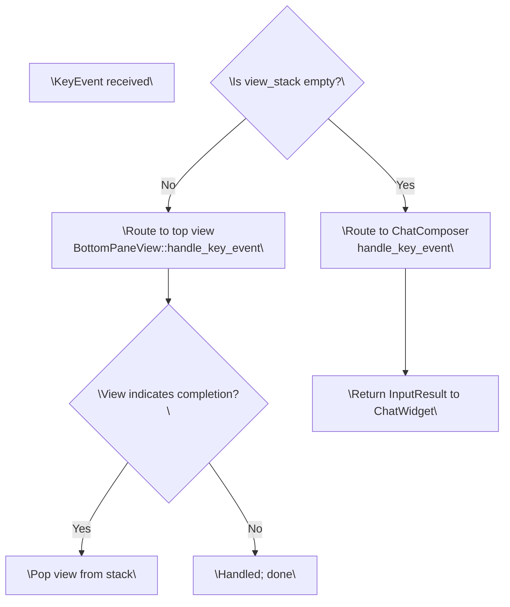

<!-- source: DeepWiki mcp.deepwiki.com · repo openai/codex · extra page BottomPane and Input System · fetched 2026-10-26 -->

# BottomPane and Input System

<details>
<summary>Relevant source files</summary>

The following files were used as context for generating this wiki page:

- [codex-rs/exec/src/lib.rs](codex-rs/exec/src/lib.rs)
- [codex-rs/exec/src/lib_tests.rs](codex-rs/exec/src/lib_tests.rs)
- [codex-rs/tui/src/app.rs](codex-rs/tui/src/app.rs)
- [codex-rs/tui/src/app/app_server_events.rs](codex-rs/tui/src/app/app_server_events.rs)
- [codex-rs/tui/src/app/event_dispatch.rs](codex-rs/tui/src/app/event_dispatch.rs)
- [codex-rs/tui/src/app/session_lifecycle.rs](codex-rs/tui/src/app/session_lifecycle.rs)
- [codex-rs/tui/src/app/startup.rs](codex-rs/tui/src/app/startup.rs)
- [codex-rs/tui/src/app/test_support.rs](codex-rs/tui/src/app/test_support.rs)
- [codex-rs/tui/src/app/tests.rs](codex-rs/tui/src/app/tests.rs)
- [codex-rs/tui/src/app/tests/session_lifecycle_requests.rs](codex-rs/tui/src/app/tests/session_lifecycle_requests.rs)
- [codex-rs/tui/src/app/tests/startup.rs](codex-rs/tui/src/app/tests/startup.rs)
- [codex-rs/tui/src/app/thread_routing.rs](codex-rs/tui/src/app/thread_routing.rs)
- [codex-rs/tui/src/app_event.rs](codex-rs/tui/src/app_event.rs)
- [codex-rs/tui/src/app_server_session.rs](codex-rs/tui/src/app_server_session.rs)
- [codex-rs/tui/src/bottom_pane/chat_composer.rs](codex-rs/tui/src/bottom_pane/chat_composer.rs)
- [codex-rs/tui/src/bottom_pane/command_popup.rs](codex-rs/tui/src/bottom_pane/command_popup.rs)
- [codex-rs/tui/src/bottom_pane/file_search_popup.rs](codex-rs/tui/src/bottom_pane/file_search_popup.rs)
- [codex-rs/tui/src/bottom_pane/list_selection_view.rs](codex-rs/tui/src/bottom_pane/list_selection_view.rs)
- [codex-rs/tui/src/bottom_pane/mod.rs](codex-rs/tui/src/bottom_pane/mod.rs)
- [codex-rs/tui/src/bottom_pane/selection_popup_common.rs](codex-rs/tui/src/bottom_pane/selection_popup_common.rs)
- [codex-rs/tui/src/bottom_pane/selection_row_layout.rs](codex-rs/tui/src/bottom_pane/selection_row_layout.rs)
- [codex-rs/tui/src/bottom_pane/selection_row_links.rs](codex-rs/tui/src/bottom_pane/selection_row_links.rs)
- [codex-rs/tui/src/bottom_pane/selection_row_links_tests.rs](codex-rs/tui/src/bottom_pane/selection_row_links_tests.rs)
- [codex-rs/tui/src/bottom_pane/skill_popup.rs](codex-rs/tui/src/bottom_pane/skill_popup.rs)
- [codex-rs/tui/src/bottom_pane/slash_commands.rs](codex-rs/tui/src/bottom_pane/slash_commands.rs)
- [codex-rs/tui/src/bottom_pane/snapshots/codex_tui__bottom_pane__chat_composer__tests__mention_popup_type_prefixes.snap](codex-rs/tui/src/bottom_pane/snapshots/codex_tui__bottom_pane__chat_composer__tests__mention_popup_type_prefixes.snap)
- [codex-rs/tui/src/bottom_pane/snapshots/codex_tui__bottom_pane__chat_composer__tests__plugin_mention_popup.snap](codex-rs/tui/src/bottom_pane/snapshots/codex_tui__bottom_pane__chat_composer__tests__plugin_mention_popup.snap)
- [codex-rs/tui/src/bottom_pane/snapshots/codex_tui__bottom_pane__selection_popup_common__hyperlinks__tests__choice_wrapped_urls.snap](codex-rs/tui/src/bottom_pane/snapshots/codex_tui__bottom_pane__selection_popup_common__hyperlinks__tests__choice_wrapped_urls.snap)
- [codex-rs/tui/src/bottom_pane/textarea.rs](codex-rs/tui/src/bottom_pane/textarea.rs)
- [codex-rs/tui/src/bottom_pane/textarea/vim_commands.rs](codex-rs/tui/src/bottom_pane/textarea/vim_commands.rs)
- [codex-rs/tui/src/chatwidget.rs](codex-rs/tui/src/chatwidget.rs)
- [codex-rs/tui/src/chatwidget/interaction.rs](codex-rs/tui/src/chatwidget/interaction.rs)
- [codex-rs/tui/src/chatwidget/skills.rs](codex-rs/tui/src/chatwidget/skills.rs)
- [codex-rs/tui/src/chatwidget/slash_dispatch.rs](codex-rs/tui/src/chatwidget/slash_dispatch.rs)
- [codex-rs/tui/src/chatwidget/tests.rs](codex-rs/tui/src/chatwidget/tests.rs)
- [codex-rs/tui/src/chatwidget/tests/slash_commands.rs](codex-rs/tui/src/chatwidget/tests/slash_commands.rs)
- [codex-rs/tui/src/lib.rs](codex-rs/tui/src/lib.rs)
- [codex-rs/tui/src/skills_helpers.rs](codex-rs/tui/src/skills_helpers.rs)
- [codex-rs/tui/src/slash_command.rs](codex-rs/tui/src/slash_command.rs)
- [codex-rs/tui/src/snapshots/codex_tui__keymap_setup__tests__keymap_action_menu.snap](codex-rs/tui/src/snapshots/codex_tui__keymap_setup__tests__keymap_action_menu.snap)
- [codex-rs/tui/src/snapshots/codex_tui__keymap_setup__tests__keymap_action_menu_responsive.snap](codex-rs/tui/src/snapshots/codex_tui__keymap_setup__tests__keymap_action_menu_responsive.snap)

</details>


This page covers the interactive input layer at the bottom of the Codex TUI: the `BottomPane` container, the `ChatComposer` text-input state machine, the `TextArea` editing buffer, the slash command handling system, popups, and footer rendering. It documents how user intent is captured, processed through an input pipeline (including paste burst detection), and dispatched as operations to the agent.

---

## Component Hierarchy

The bottom pane is a composable stack. The `ChatWidget` owns one `BottomPane`, which in turn owns the `ChatComposer` and a stack of transient overlays that temporarily replace or supplement the composer.

**Component ownership and key types diagram:**

```mermaid
graph TD
    CW["\"ChatWidget\ncodex-rs/tui/src/chatwidget.rs\""]
    BP["\"BottomPane\ncodex-rs/tui/src/bottom_pane/mod.rs\""]
    CC["\"ChatComposer\ncodex-rs/tui/src/bottom_pane/chat_composer.rs\""]
    TA["\"TextArea\ncodex-rs/tui/src/bottom_pane/textarea.rs\""]
    CCH["\"ChatComposerHistory\ncodex-rs/tui/src/bottom_pane/chat_composer_history.rs\""]
    AP["\"ActivePopup\ncodex-rs/tui/src/bottom_pane/chat_composer.rs\""]
    VP["\"view_stack\nVec[Box[dyn BottomPaneView]]\""]
    SIW["\"StatusIndicatorWidget\ncodex-rs/tui/src/status_indicator_widget.rs\""]
    UEF["\"UnifiedExecFooter\ncodex-rs/tui/src/bottom_pane/unified_exec_footer.rs\""]

    CW --> BP
    BP --> CC
    BP --> VP
    BP --> SIW
    BP --> UEF
    CC --> TA
    CC --> CCH
    CC --> AP
    AP -->|"None | Command | File | Skill"| Popups["\"CommandPopup / FileSearchPopup / SkillPopup\""]
```

Sources: `[codex-rs/tui/src/bottom_pane/mod.rs:1-26]()`, `[codex-rs/tui/src/bottom_pane/chat_composer.rs:1-104]()`, `[codex-rs/tui/src/chatwidget.rs:1-33]()`

---

## BottomPane Container and View Stack

`BottomPane` is the primary container managing all footer-level UI interactions in the Codex TUI `[codex-rs/tui/src/bottom_pane/mod.rs:1-50]()`. It orchestrates:

- The persistent `ChatComposer` input area which maintains the user's current draft, including text and attachments, even when overlaid `[codex-rs/tui/src/bottom_pane/mod.rs:3-5]`.
- A stack of transient modal/popups implementing the `BottomPaneView` trait, which visually replace or appear above the composer for focused workflows (like command pickers, skill toggles, or approvals) `[codex-rs/tui/src/bottom_pane/mod.rs:4-15]`.
- Inline banners, hints, and status indicators rendered below or within the bottom pane `[codex-rs/tui/src/bottom_pane/mod.rs:30-40]()`.

### Input Key Routing in BottomPane

Input events are dispatched hierarchically:

1. If the `view_stack` is **not empty**, the **topmost view** handles the key event via its `handle_key_event` method, allowing popups and modals to capture input or dismiss themselves `[codex-rs/tui/src/bottom_pane/mod.rs:50-75]()`.
2. If the `view_stack` is **empty**, key events route to the `ChatComposer` for text input editing and other controls `[codex-rs/tui/src/app/event_dispatch.rs:29-34]()`.

When an overlay signals completion after input handling, the `BottomPane` removes that view from the stack, restoring the underlying composer `[codex-rs/tui/src/bottom_pane/mod.rs:75-90]()`.

**Key event dispatch flowchart:**



Sources: `[codex-rs/tui/src/bottom_pane/mod.rs:7-17]()`, `[codex-rs/tui/src/app/event_dispatch.rs:29-34]()`

---

## ChatComposer and Paste Burst Detection

`ChatComposer` is the core input text state machine in the bottom pane responsible for buffer editing, interpreting user key input, popup activation, and final input submission `[codex-rs/tui/src/bottom_pane/chat_composer.rs:1-104]()`.

### Responsibilities

- Manages the prompt editing buffer via a `TextArea` which holds text along with embedded semantic elements (mentions, slash commands, attachments) `[codex-rs/tui/src/bottom_pane/textarea.rs:1-12]()`.
- Routes input keys to an active popup (command, skill, or file search popup) if present, or directly processes them within the buffer `[codex-rs/tui/src/bottom_pane/chat_composer.rs:40-60]()`.
- Detects "paste bursts" on terminals lacking bracketed paste support (e.g., Windows), consolidating rapid input sequences into atomic paste operations to improve UX `[codex-rs/tui/src/app/tests/transcript_composer.rs:1-111]()`.
- Transitions typed slash command tokens into atomic elements in the buffer that move as units during editing `[codex-rs/tui/src/bottom_pane/chat_composer.rs:23-26]()`.
- Implements history recall over multi-session typed messages for text-only entries, integrating local draft history with an app-wide `ChatComposerHistory` `[codex-rs/tui/src/bottom_pane/chat_composer.rs:90-110]()`.
- Supports Vim editing modes (Insert and Replace) with appropriate key semantics for cursor movement, undo/redo, and mode switching `[codex-rs/tui/src/bottom_pane/textarea/vim_commands.rs:1-10]()`.

### Active Popup Handling and Routing

The `ChatComposer` handles an optional active popup represented by the `ActivePopup` enum with variants like `CommandPopup`, `FileSearchPopup`, and `SkillPopup` `[codex-rs/tui/src/bottom_pane/chat_composer.rs:50-70]()`. These are triggered by typing associated characters:

| Trigger | Popup Type | Implementation File |
|---|---|---|
| `/` | Command | `CommandPopup` in `bottom_pane/command_popup.rs` `[codex-rs/tui/src/bottom_pane/command_popup.rs:35-41]()` |
| `@` | File search | `FileSearchPopup` in `bottom_pane/file_search_popup.rs` `[codex-rs/tui/src/bottom_pane/file_search_popup.rs]()` |
| `$` | Skill mention | `SkillPopup` in `bottom_pane/skill_popup.rs` `[codex-rs/tui/src/bottom_pane/skill_popup.rs:62-66]()` |

When a key event occurs, if a popup is active, the event is routed to that popup’s handler before synchronizing popup state with the buffer `[codex-rs/tui/src/bottom_pane/chat_composer.rs:65-80]()`.

Sources: `[codex-rs/tui/src/bottom_pane/chat_composer.rs:1-104]()`, `[codex-rs/tui/src/bottom_pane/command_popup.rs:35-41]()`, `[codex-rs/tui/src/bottom_pane/skill_popup.rs:62-66]()`, `[codex-rs/tui/src/app/tests/transcript_composer.rs:1-111]()`, `[codex-rs/tui/src/bottom_pane/textarea/vim_commands.rs:1-10]()`

---

## TextArea and Atomic Element System

The `TextArea` struct implements the editable text buffer underlying `ChatComposer` `[codex-rs/tui/src/bottom_pane/textarea.rs:1-12]()`. It is the core text editor managing:

- UTF-8 text content combined with special embedded elements representing semantic constructs (e.g., slash commands, mentions, local images) that move atomically with editing operations `[codex-rs/tui/src/bottom_pane/textarea.rs:1-25]()`.
- Cursor position, scroll offset, and line wrapping for proper visual text layout within the terminal UI `[codex-rs/tui/src/bottom_pane/textarea.rs:20-45]()`.
- A single-entry "kill buffer" supporting `Ctrl+K` to kill to end of line and `Ctrl+Y` to yank the last killed text `[codex-rs/tui/src/bottom_pane/textarea.rs:50-75]()`.
- Tracking of element byte ranges so that insertion and deletion correctly shift subsequent embedded elements' offsets, preserving their alignment with the text `[codex-rs/tui/src/bottom_pane/textarea.rs:80-110]()`.

Sources: `[codex-rs/tui/src/bottom_pane/textarea.rs:1-12]()`, `[codex-rs/tui/src/bottom_pane/textarea.rs:20-110]()`

---

## Slash Command System and CommandPopup

Slash commands provide a mechanism for users to enter special instructions starting with `/` `[codex-rs/tui/src/bottom_pane/slash_commands.rs:1-30]()`.

### `SlashCommand` and `SlashCommandItem`

Slash commands are enumerated in the `SlashCommand` enum with associated metadata (`[codex-rs/tui/src/slash_command.rs:1-167]()`), while service-tier model commands are wrapped via `ServiceTierCommand` inside `SlashCommandItem` `[codex-rs/tui/src/bottom_pane/slash_commands.rs:13-25]()`. They cover commands like `/model`, `/review`, `/plan`, `/resume`, and `/side`. Alias commands like `quit` and `btw` are skipped in default popup listings `[codex-rs/tui/src/bottom_pane/command_popup.rs:19-22]()`.

### Command Filtering and Dispatch

Commands are filtered and gated based on feature flags, sandbox state, and connection status via `builtins_for_input` and `commands_for_input` in `slash_commands.rs` `[codex-rs/tui/src/bottom_pane/slash_commands.rs:70-111]()`. The `CommandPopup` uses a filter string parsed from the composer input starting after the first slash token `[codex-rs/tui/src/bottom_pane/command_popup.rs:110-140]()`.

Sources: `[codex-rs/tui/src/bottom_pane/slash_commands.rs:1-111]`, `[codex-rs/tui/src/bottom_pane/command_popup.rs:1-163]`, `[codex-rs/tui/src/slash_command.rs:1-167]()`

---

## Skill Popup and File Search Popup

`SkillPopup` and `FileSearchPopup` follow similar patterns, offering filtered, selectable lists with fuzzy matching and highlight support:

- `SkillPopup` shows available skills with rich metadata (`MentionItem` with display names, descriptions, and search terms) and allows direct selection and insertion `[codex-rs/tui/src/bottom_pane/skill_popup.rs:19-58]()`.
- Both popups manage keyboard navigation, selection clamping (`clamp_selection`), and measure required height (`calculate_required_height`) to prevent terminal overflow `[codex-rs/tui/src/bottom_pane/skill_popup.rs:87-116]()`.

Sources: `[codex-rs/tui/src/bottom_pane/skill_popup.rs:1-198]()`, `[codex-rs/tui/src/bottom_pane/file_search_popup.rs]()`

---

## Status Line and Footer Rendering

The bottom pane incorporates a footer area for displaying status indicators, usage hints, and shell command execution summaries `[codex-rs/tui/src/chatwidget.rs:50-53]()`.

- The `StatusIndicatorWidget` shows spinner animations and interrupt hints when an agent turn or MCP server task runs, indicating "busy" UI state and allowing termination interrupts `[codex-rs/tui/src/chatwidget.rs:19-29]()`.
- The `unified_exec_footer` aggregates shell command execution summaries across the session `[codex-rs/tui/src/bottom_pane/mod.rs:36-36]()`.
- Footer rendering utilities compose shortcut hints, collaboration mode signals, and message banners `[codex-rs/tui/src/bottom_pane/footer.rs:1-10]()`.

Sources: `[codex-rs/tui/src/chatwidget.rs:19-29]()`, `[codex-rs/tui/src/bottom_pane/mod.rs:36-36]()`, `[codex-rs/tui/src/bottom_pane/footer.rs:1-10]()`

---

## Bridging Natural Language Space to Code Entity Space

### UI-to-Code Association: Input Surface

This diagram maps user-understandable UI concepts around the bottom pane input area to their code artifacts:

```mermaid
graph TD
    NL_InputArea["\"Natural Language: Interactive Footer\""]
    NL_Prompt["\"Natural Language: Prompt Text Box\""]
    NL_SlashCmd["\"Natural Language: /command\""]
    NL_Popup["\"Natural Language: Selection List\""]

    NL_InputArea --- code_BP["\"code: BottomPane\n(codex-rs/tui/src/bottom_pane/mod.rs)\""]
    NL_Prompt --- code_CC["\"code: ChatComposer\n(codex-rs/tui/src/bottom_pane/chat_composer.rs)\""]
    NL_SlashCmd --- code_SC["\"code: SlashCommand\n(codex-rs/tui/src/slash_command.rs)\""]
    NL_Popup --- code_CP["\"code: CommandPopup\n(codex-rs/tui/src/bottom_pane/command_popup.rs)\""]

    code_BP --> code_CC
    code_CC --> code_SC
    code_BP --> code_CP
```

Sources: `[codex-rs/tui/src/bottom_pane/mod.rs:1-50]()`, `[codex-rs/tui/src/bottom_pane/chat_composer.rs:1-104]()`, `[codex-rs/tui/src/slash_command.rs:1-167]()`, `[codex-rs/tui/src/bottom_pane/command_popup.rs:35-41]()`

### UI-to-Code Association: Input Pipeline

Shows data flow from user key events up through text buffer processing and action emission:

```mermaid
flowchart LR
    K["\"User Key Event\""]
    TA["\"code: TextArea\n(codex-rs/tui/src/bottom_pane/textarea.rs)\""]
    CC["\"code: ChatComposer\n(codex-rs/tui/src/bottom_pane/chat_composer.rs)\""]
    AE["\"code: AppEvent\n(codex-rs/tui/src/app_event.rs)\""]

    K --> CC
    CC --> TA
    TA --> CC
    CC --> AE
```

Sources: `[codex-rs/tui/src/bottom_pane/textarea.rs:1-12]()`, `[codex-rs/tui/src/bottom_pane/chat_composer.rs:1-104]()`, `[codex-rs/tui/src/app_event.rs:1-70]()`

---

