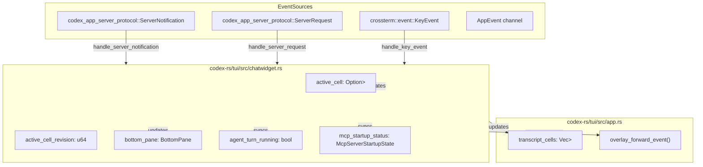
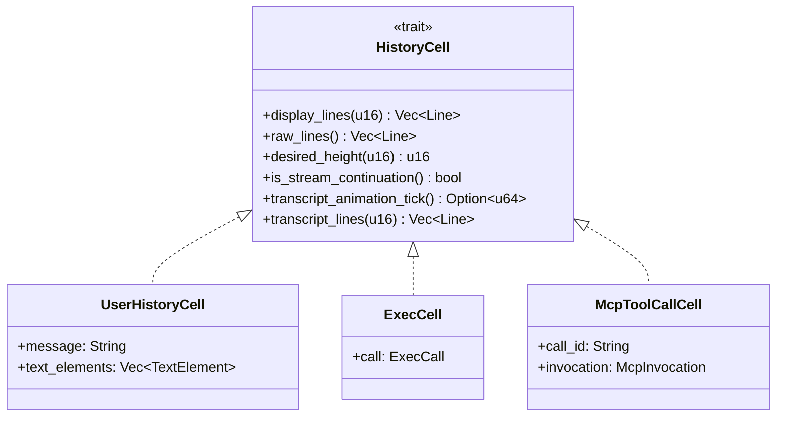

<!-- source: DeepWiki mcp.deepwiki.com · repo openai/codex · extra page ChatWidget and Conversation Display · fetched 2026-10-26 -->

# ChatWidget and Conversation Display

<details>
<summary>Relevant source files</summary>

The following files were used as context for generating this wiki page:

- [codex-rs/tui/src/app/snapshots/codex_tui__app__transcript_export__tests__markdown_transcript.snap](codex-rs/tui/src/app/snapshots/codex_tui__app__transcript_export__tests__markdown_transcript.snap)
- [codex-rs/tui/src/app/tests/streaming_interleave_e2e.rs](codex-rs/tui/src/app/tests/streaming_interleave_e2e.rs)
- [codex-rs/tui/src/app/transcript_export.rs](codex-rs/tui/src/app/transcript_export.rs)
- [codex-rs/tui/src/app/transcript_export_tests.rs](codex-rs/tui/src/app/transcript_export_tests.rs)
- [codex-rs/tui/src/chatwidget/input_restore.rs](codex-rs/tui/src/chatwidget/input_restore.rs)
- [codex-rs/tui/src/chatwidget/input_submission.rs](codex-rs/tui/src/chatwidget/input_submission.rs)
- [codex-rs/tui/src/chatwidget/protocol.rs](codex-rs/tui/src/chatwidget/protocol.rs)
- [codex-rs/tui/src/chatwidget/replay.rs](codex-rs/tui/src/chatwidget/replay.rs)
- [codex-rs/tui/src/chatwidget/streaming.rs](codex-rs/tui/src/chatwidget/streaming.rs)
- [codex-rs/tui/src/chatwidget/tests/app_server.rs](codex-rs/tui/src/chatwidget/tests/app_server.rs)
- [codex-rs/tui/src/chatwidget/tests/composer_submission.rs](codex-rs/tui/src/chatwidget/tests/composer_submission.rs)
- [codex-rs/tui/src/chatwidget/tests/exec_flow.rs](codex-rs/tui/src/chatwidget/tests/exec_flow.rs)
- [codex-rs/tui/src/chatwidget/tests/helpers.rs](codex-rs/tui/src/chatwidget/tests/helpers.rs)
- [codex-rs/tui/src/chatwidget/tests/plan_mode.rs](codex-rs/tui/src/chatwidget/tests/plan_mode.rs)
- [codex-rs/tui/src/chatwidget/tests/popups_and_settings.rs](codex-rs/tui/src/chatwidget/tests/popups_and_settings.rs)
- [codex-rs/tui/src/chatwidget/tests/review_mode.rs](codex-rs/tui/src/chatwidget/tests/review_mode.rs)
- [codex-rs/tui/src/chatwidget/tests/snapshots/codex_tui__chatwidget__tests__slash_commands__slash_copy_picker_uses_completed_commentary_during_active_turn.snap](codex-rs/tui/src/chatwidget/tests/snapshots/codex_tui__chatwidget__tests__slash_commands__slash_copy_picker_uses_completed_commentary_during_active_turn.snap)
- [codex-rs/tui/src/chatwidget/tests/status_and_layout.rs](codex-rs/tui/src/chatwidget/tests/status_and_layout.rs)
- [codex-rs/tui/src/chatwidget/transcript.rs](codex-rs/tui/src/chatwidget/transcript.rs)
- [codex-rs/tui/src/chatwidget/turn_runtime.rs](codex-rs/tui/src/chatwidget/turn_runtime.rs)
- [codex-rs/tui/src/chatwidget/user_messages.rs](codex-rs/tui/src/chatwidget/user_messages.rs)
- [codex-rs/tui/src/history_cell/mcp.rs](codex-rs/tui/src/history_cell/mcp.rs)
- [codex-rs/tui/src/history_cell/mcp_result.rs](codex-rs/tui/src/history_cell/mcp_result.rs)
- [codex-rs/tui/src/history_cell/mcp_tests.rs](codex-rs/tui/src/history_cell/mcp_tests.rs)
- [codex-rs/tui/src/history_cell/messages.rs](codex-rs/tui/src/history_cell/messages.rs)
- [codex-rs/tui/src/history_cell/messages_tests.rs](codex-rs/tui/src/history_cell/messages_tests.rs)
- [codex-rs/tui/src/history_cell/mod.rs](codex-rs/tui/src/history_cell/mod.rs)
- [codex-rs/tui/src/history_cell/plans.rs](codex-rs/tui/src/history_cell/plans.rs)
- [codex-rs/tui/src/history_cell/plans_tests.rs](codex-rs/tui/src/history_cell/plans_tests.rs)
- [codex-rs/tui/src/history_cell/snapshots/codex_tui__history_cell__mcp__tests__mcp_preview_shares_one_limit_across_blocks_and_preserves_transcript.snap](codex-rs/tui/src/history_cell/snapshots/codex_tui__history_cell__mcp__tests__mcp_preview_shares_one_limit_across_blocks_and_preserves_transcript.snap)
- [codex-rs/tui/src/history_cell/snapshots/codex_tui__history_cell__messages__tests__user_prompt_urls_keep_destinations_across_widths.snap](codex-rs/tui/src/history_cell/snapshots/codex_tui__history_cell__messages__tests__user_prompt_urls_keep_destinations_across_widths.snap)
- [codex-rs/tui/src/history_cell/snapshots/codex_tui__history_cell__tests__completed_mcp_tool_call_wrapped_outputs_snapshot.snap](codex-rs/tui/src/history_cell/snapshots/codex_tui__history_cell__tests__completed_mcp_tool_call_wrapped_outputs_snapshot.snap)
- [codex-rs/tui/src/history_cell/snapshots/codex_tui__history_cell__tests__mcp_tools_output_from_statuses_renders_status_only_servers.snap](codex-rs/tui/src/history_cell/snapshots/codex_tui__history_cell__tests__mcp_tools_output_from_statuses_renders_status_only_servers.snap)
- [codex-rs/tui/src/history_cell/snapshots/codex_tui__history_cell__tests__mcp_tools_output_from_statuses_renders_verbose_inventory.snap](codex-rs/tui/src/history_cell/snapshots/codex_tui__history_cell__tests__mcp_tools_output_from_statuses_renders_verbose_inventory.snap)
- [codex-rs/tui/src/history_cell/snapshots/codex_tui__history_cell__tests__ran_cell_multiline_with_stderr_snapshot.snap](codex-rs/tui/src/history_cell/snapshots/codex_tui__history_cell__tests__ran_cell_multiline_with_stderr_snapshot.snap)
- [codex-rs/tui/src/history_cell/snapshots/codex_tui__history_cell__tests__stderr_tail_more_than_five_lines_snapshot.snap](codex-rs/tui/src/history_cell/snapshots/codex_tui__history_cell__tests__stderr_tail_more_than_five_lines_snapshot.snap)
- [codex-rs/tui/src/history_cell/tests.rs](codex-rs/tui/src/history_cell/tests.rs)
- [codex-rs/tui/src/inline_visualization.rs](codex-rs/tui/src/inline_visualization.rs)
- [codex-rs/tui/src/inline_visualization/viewer.rs](codex-rs/tui/src/inline_visualization/viewer.rs)
- [codex-rs/tui/src/inline_visualization_tests.rs](codex-rs/tui/src/inline_visualization_tests.rs)
- [codex-rs/tui/src/markdown.rs](codex-rs/tui/src/markdown.rs)
- [codex-rs/tui/src/markdown_render.rs](codex-rs/tui/src/markdown_render.rs)
- [codex-rs/tui/src/markdown_render/snapshots/codex_tui__markdown_render__web_links__tests__bare_urls_are_styled_without_coloring_surrounding_prose.snap](codex-rs/tui/src/markdown_render/snapshots/codex_tui__markdown_render__web_links__tests__bare_urls_are_styled_without_coloring_surrounding_prose.snap)
- [codex-rs/tui/src/markdown_render/snapshots/codex_tui__markdown_render__web_links__tests__bare_urls_keep_link_style_when_wrapped_in_tables.snap](codex-rs/tui/src/markdown_render/snapshots/codex_tui__markdown_render__web_links__tests__bare_urls_keep_link_style_when_wrapped_in_tables.snap)
- [codex-rs/tui/src/markdown_render/snapshots/codex_tui__markdown_render__web_links__tests__label_only_and_fallback_presentations_snapshot.snap](codex-rs/tui/src/markdown_render/snapshots/codex_tui__markdown_render__web_links__tests__label_only_and_fallback_presentations_snapshot.snap)
- [codex-rs/tui/src/markdown_render/streaming.rs](codex-rs/tui/src/markdown_render/streaming.rs)
- [codex-rs/tui/src/markdown_render/web_links.rs](codex-rs/tui/src/markdown_render/web_links.rs)
- [codex-rs/tui/src/markdown_render/web_links_tests.rs](codex-rs/tui/src/markdown_render/web_links_tests.rs)
- [codex-rs/tui/src/markdown_render_tests.rs](codex-rs/tui/src/markdown_render_tests.rs)
- [codex-rs/tui/src/markdown_stream.rs](codex-rs/tui/src/markdown_stream.rs)
- [codex-rs/tui/src/snapshots/codex_tui__markdown_render__markdown_render_tests__ordered_list_markers_use_terminal_palette_snapshot.snap](codex-rs/tui/src/snapshots/codex_tui__markdown_render__markdown_render_tests__ordered_list_markers_use_terminal_palette_snapshot.snap)
- [codex-rs/tui/src/snapshots/codex_tui__markdown_render__markdown_render_tests__web_link_labels_have_a_visible_underline_snapshot.snap](codex-rs/tui/src/snapshots/codex_tui__markdown_render__markdown_render_tests__web_link_labels_have_a_visible_underline_snapshot.snap)
- [codex-rs/tui/src/snapshots/codex_tui__terminal_hyperlinks__tests__buffer_hyperlinks_follow_scrolled_wrapped_rows.snap](codex-rs/tui/src/snapshots/codex_tui__terminal_hyperlinks__tests__buffer_hyperlinks_follow_scrolled_wrapped_rows.snap)
- [codex-rs/tui/src/snapshots/codex_tui__terminal_hyperlinks__tests__forced_width_hyperlinks_render_wide_and_halfwidth_cells.snap](codex-rs/tui/src/snapshots/codex_tui__terminal_hyperlinks__tests__forced_width_hyperlinks_render_wide_and_halfwidth_cells.snap)
- [codex-rs/tui/src/snapshots/codex_tui__tooltips__tests__desktop_app_tip_linux.snap](codex-rs/tui/src/snapshots/codex_tui__tooltips__tests__desktop_app_tip_linux.snap)
- [codex-rs/tui/src/snapshots/codex_tui__tooltips__tests__desktop_app_tip_macos.snap](codex-rs/tui/src/snapshots/codex_tui__tooltips__tests__desktop_app_tip_macos.snap)
- [codex-rs/tui/src/snapshots/codex_tui__tooltips__tests__desktop_app_tip_windows.snap](codex-rs/tui/src/snapshots/codex_tui__tooltips__tests__desktop_app_tip_windows.snap)
- [codex-rs/tui/src/streaming/controller.rs](codex-rs/tui/src/streaming/controller.rs)
- [codex-rs/tui/src/streaming/mod.rs](codex-rs/tui/src/streaming/mod.rs)
- [codex-rs/tui/src/streaming/render.rs](codex-rs/tui/src/streaming/render.rs)
- [codex-rs/tui/src/streaming/render_tests.rs](codex-rs/tui/src/streaming/render_tests.rs)
- [codex-rs/tui/src/streaming/snapshots/codex_tui__streaming__controller__tests__completed_table_reference.snap](codex-rs/tui/src/streaming/snapshots/codex_tui__streaming__controller__tests__completed_table_reference.snap)
- [codex-rs/tui/src/streaming/snapshots/codex_tui__streaming__controller__tests__completed_table_scrollback.snap](codex-rs/tui/src/streaming/snapshots/codex_tui__streaming__controller__tests__completed_table_scrollback.snap)
- [codex-rs/tui/src/streaming/snapshots/codex_tui__streaming__render__tests__incremental_file_citations.snap](codex-rs/tui/src/streaming/snapshots/codex_tui__streaming__render__tests__incremental_file_citations.snap)
- [codex-rs/tui/src/streaming/snapshots/codex_tui__streaming__render__tests__incremental_render_representative_stream.snap](codex-rs/tui/src/streaming/snapshots/codex_tui__streaming__render__tests__incremental_render_representative_stream.snap)
- [codex-rs/tui/src/streaming/snapshots/codex_tui__streaming__render__tests__inline_visualizations_without_context_use_canonical_full_render.snap](codex-rs/tui/src/streaming/snapshots/codex_tui__streaming__render__tests__inline_visualizations_without_context_use_canonical_full_render.snap)
- [codex-rs/tui/src/streaming/table_holdback.rs](codex-rs/tui/src/streaming/table_holdback.rs)
- [codex-rs/tui/src/terminal_hyperlinks.rs](codex-rs/tui/src/terminal_hyperlinks.rs)
- [codex-rs/tui/src/thread_transcript.rs](codex-rs/tui/src/thread_transcript.rs)
- [codex-rs/tui/src/wrapping.rs](codex-rs/tui/src/wrapping.rs)

</details>


## Purpose and Scope

This page documents the `ChatWidget` component in the Codex Terminal User Interface (TUI). `ChatWidget` is responsible for rendering the conversation history and managing the display of both committed and active transcript cells. It coordinates streaming outputs from the conversation, such as agent responses and tool executions, and supports markdown and unified diff rendering with syntax highlighting. It also integrates with the streaming controller for incremental updates.

Input handling and prompt editing are managed separately in the Bottom Pane component ([4.1.3 BottomPane and Input System]()). Core app event loop and initialization are covered in ([4.1.1 App Event Loop and Initialization]()).

Sources: `[codex-rs/tui/src/chatwidget.rs:1-33]()`, `[codex-rs/tui/src/chatwidget/streaming.rs:1-10]()`

---

## ChatWidget Architecture

### Core Structure

At its core, `ChatWidget` encapsulates the UI state and logic for the conversation viewport. It handles user interaction events, server notifications, and manages an active streaming cell along with a list of committed transcript cells.

Key data members include:
- **Active Cell**: Optionally holds a boxed dynamic `HistoryCell` representing the currently streaming or active content (e.g., in-progress agent message or tool output). It is mutable to allow updates during streaming `[codex-rs/tui/src/chatwidget/tests/status_and_layout.rs:21-24]()`.
- **Committed Transcript Cells**: The finalized history of conversation turns stored as an immutable vector of `Arc<dyn HistoryCell>` instances `[codex-rs/tui/src/app.rs:130-136]()`.
- **Synchronization Fields**: Tracks flags such as `agent_turn_running` and `mcp_startup_status` to indicate whether an agent turn or MCP startup is in progress `[codex-rs/tui/src/chatwidget/turn_runtime.rs:34-47]()`.


Sources: `[codex-rs/tui/src/chatwidget.rs:1-33]`, `[codex-rs/tui/src/app.rs:130-136]`, `[codex-rs/tui/src/chatwidget/turn_runtime.rs:34-47]()`, `[codex-rs/tui/src/chatwidget/tests/status_and_layout.rs:21-24]()`

### State Management Overview

| Category | Fields | Description |
|---|---|---|
| **Active Cell State** | `active_cell`, `active_cell_revision` | The currently active streaming cell and its revision counter |
| **Committed History** | `transcript_cells` | Vector holding committed conversation cells |
| **Input & View State** | `bottom_pane` | Manages prompt input, slash commands, and modal views |
| **Turn Lifecycle** | `agent_turn_running`, `mcp_startup_status` | UI indicators for agent turn and MCP server startup |

Sources: `[codex-rs/tui/src/chatwidget.rs:6-23]`, `[codex-rs/tui/src/chatwidget/turn_runtime.rs:34-47]()`

---

## HistoryCell Trait and Implementation

### Overview

`HistoryCell` is a key abstraction representing any renderable unit within the conversation transcript `[codex-rs/tui/src/history_cell/mod.rs:1-5]`. Each `HistoryCell` implements methods to produce display lines adapted to terminal width and supports animation ticks for transient visuals.

### Key Methods and Implementations

| Method | Purpose |
|---|---|
| `display_lines(width)` | Returns wrapped, styled lines for rendering in the main chat view |
| `raw_lines()` | Returns plain lines suitable for copy/paste or scrollback |
| `desired_height(width)` | Returns height in rows needed at given width |
| `transcript_lines(width)` | Lines for the transcript overlay, potentially with animation effects |

Concrete implementations include `UserHistoryCell` `[codex-rs/tui/src/history_cell/messages.rs:16-22]()`, `ExecCell` `[codex-rs/tui/src/history_cell/tests.rs:5-6]()`, and `McpToolCallCell` `[codex-rs/tui/src/history_cell/mcp.rs:51-58]()`.


Sources: `[codex-rs/tui/src/history_cell/mod.rs:1-196]`, `[codex-rs/tui/src/history_cell/messages.rs:16-22]()`, `[codex-rs/tui/src/history_cell/tests.rs:5-6]()`, `[codex-rs/tui/src/history_cell/mcp.rs:51-58]()`

---

## Exec Cells: Command Execution Display

`ExecCell` is a specialized `HistoryCell` representing tool or shell command execution with rich output and streaming support `[codex-rs/tui/src/history_cell/tests.rs:5-6]()`.

- Displays command previews, outputs, and exit statuses `[codex-rs/tui/src/chatwidget/tests/exec_flow.rs:126-128]()`.
- Interprets ANSI escape sequences for terminal coloring and styling `[codex-rs/tui/src/exec_cell/render.rs:186-192]()`.
- Handles truncation and omitted line summaries for large output payloads `[codex-rs/tui/src/exec_cell/render.rs:118-184]()`.

Sources: `[codex-rs/tui/src/exec_cell/render.rs:1-212]()`, `[codex-rs/tui/src/history_cell/tests.rs:5-6]()`, `[codex-rs/tui/src/chatwidget/tests/exec_flow.rs:126-128]()`

---

## Streaming Controller and Active Cell Updates

The streaming model uses `active_cell` to hold currently in-flight content. The `StreamingController` manages incremental text deltas, plan updates, and reasoning streams `[codex-rs/tui/src/chatwidget/streaming.rs:1-158]()`.

- **Deltas & Buffering**: Incremental updates append text to the stream buffer without triggering full re-parsing until a commit tick or finalization `[codex-rs/tui/src/chatwidget/streaming.rs:82-144]()`.
- **Stream Finalization**: `flush_answer_stream` and `flush_answer_and_plan_streams` convert active stream controllers into committed history cells or push them into consolidation queues `[codex-rs/tui/src/chatwidget/streaming.rs:65-152]()`.

Sources: `[codex-rs/tui/src/chatwidget/streaming.rs:1-158]()`, `[codex-rs/tui/src/chatwidget/turn_runtime.rs:1-160]()`

---

## Markdown and Diff Rendering with Syntax Highlighting

### Markdown Rendering

The markdown renderer consumes `pulldown-cmark` events and emits styled `ratatui` lines `[codex-rs/tui/src/markdown_render.rs:1-42]()`.
- Supports table normalization, task lists, Mermaid previews, math blocks, and local file links `[codex-rs/tui/src/markdown_render.rs:11-42]()`.
- Syntax highlighting integrates with `syntect` and the active theme configuration `[codex-rs/tui/src/markdown_render.rs:43-50]()`.

### Diff Rendering and Syntax Highlighting

- Renders unified diffs with gutter indicators (`+`, `-`) and syntax-highlighted hunks `[codex-rs/tui/src/history_cell/mod.rs:16-17]()`.
- Uses `highlight_code_to_lines` or general syntect wrappers to color code blocks and diff contents `[codex-rs/tui/src/markdown_render.rs:49-50]()`.

Sources: `[codex-rs/tui/src/markdown_render.rs:1-188]()`, `[codex-rs/tui/src/history_cell/mod.rs:16-17]()`

---

## Event Processing in ChatWidget

`ChatWidget` processes server notifications via `handle_server_notification` to synchronize conversation state `[codex-rs/tui/src/chatwidget/protocol.rs:4-151]()`.

| Notification Variant | Handler Behavior |
|---|---|
| `TurnStarted` | Initializes turn timing, clears error states, and calls `on_task_started()` `[codex-rs/tui/src/chatwidget/protocol.rs:89-107]()` |
| `TurnCompleted` | Restores transcripts and finalizes turn items `[codex-rs/tui/src/chatwidget/protocol.rs:108-111]()` |
| `AgentMessageDelta` | Updates the active streaming agent message content `[codex-rs/tui/src/chatwidget/protocol.rs:118-129]()` |
| `PlanDelta` | Updates the current proposed plan stream `[codex-rs/tui/src/chatwidget/protocol.rs:130-133]()` |

Sources: `[codex-rs/tui/src/chatwidget/protocol.rs:1-151]()`

---

## Natural Language to Code Entity Mappings

### Bridge Diagram 1: User Message Flow to Code Entities

```mermaid
graph LR
    UserPrompt["User Input Prompt"] -->|submit_user_message [codex-rs/tui/src/chatwidget/input_submission.rs]| ChatWidgetCode["ChatWidget::submit_user_message()"]
    ChatWidgetCode -->|creates| UserCell["UserHistoryCell [codex-rs/tui/src/history_cell/messages.rs]"]
    UserCell -->|implements| HistoryCellTrait["HistoryCell trait [codex-rs/tui/src/history_cell/mod.rs]"]
    HistoryCellTrait -->|display_lines| TranscriptView["Transcript Display Buffer"]
```
Sources: `[codex-rs/tui/src/chatwidget/tests/app_server.rs:150-160]()`, `[codex-rs/tui/src/history_cell/messages.rs:16-22]()`, `[codex-rs/tui/src/history_cell/mod.rs:1-196]()`, `[codex-rs/tui/src/chatwidget/input_submission.rs:1-10]()`

### Bridge Diagram 2: Assistant Streaming to Code Entities

```mermaid
graph LR
    ServerStream["ServerNotification::AgentMessageDelta [codex-rs/tui/src/chatwidget/protocol.rs]"] -->|on_agent_message_delta| ChatWidgetStream["ChatWidget::on_agent_message_delta()"]
    ChatWidgetStream -->|updates| StreamCtrl["StreamingMarkdownRender [codex-rs/tui/src/markdown_render/streaming.rs]"]
    StreamCtrl -->|flush_answer_stream [codex-rs/tui/src/chatwidget/streaming.rs]| ConsolidateEvt["AppEvent::ConsolidateAgentMessage"]
    ConsolidateEvt -->|renders via| MarkdownEngine["pulldown-cmark parser"]
```
Sources: `[codex-rs/tui/src/chatwidget/protocol.rs:118-129]()`, `[codex-rs/tui/src/chatwidget/streaming.rs:82-144]()`, `[codex-rs/tui/src/markdown_render.rs:1-65]()`, `[codex-rs/tui/src/markdown_render/streaming.rs:1-10]()`

---

