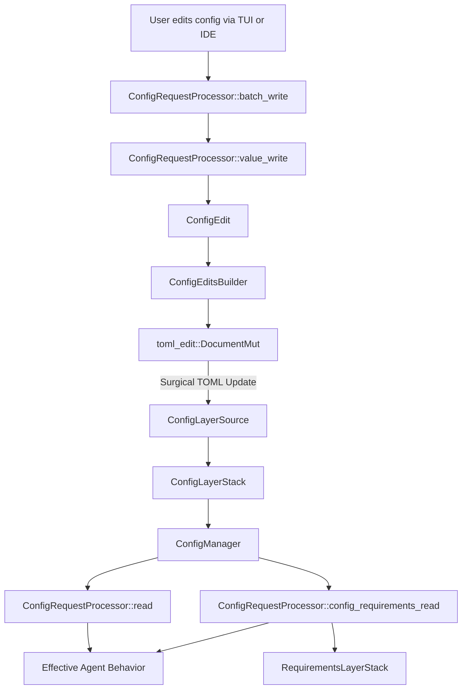
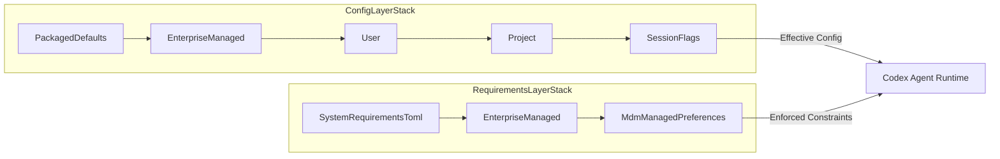

<!-- source: DeepWiki mcp.deepwiki.com · repo openai/codex · extra page Config API and Layer System · fetched 2026-10-26 -->

# Config API and Layer System

Relevant source files

The following files were used as context for generating this wiki page:

- [codex-rs/app-server-protocol/schema/json/v2/ConfigReadResponse.json](codex-rs/app-server-protocol/schema/json/v2/ConfigReadResponse.json)
- [codex-rs/app-server-protocol/schema/json/v2/ConfigRequirementsReadResponse.json](codex-rs/app-server-protocol/schema/json/v2/ConfigRequirementsReadResponse.json)
- [codex-rs/app-server-protocol/schema/typescript/v2/Config.ts](codex-rs/app-server-protocol/schema/typescript/v2/Config.ts)
- [codex-rs/app-server-protocol/schema/typescript/v2/ConfigRequirements.ts](codex-rs/app-server-protocol/schema/typescript/v2/ConfigRequirements.ts)
- [codex-rs/app-server-protocol/src/protocol/v2/config.rs](codex-rs/app-server-protocol/src/protocol/v2/config.rs)
- [codex-rs/app-server/src/request_processors/config_processor.rs](codex-rs/app-server/src/request_processors/config_processor.rs)
- [codex-rs/app-server/tests/suite/strict_config.rs](codex-rs/app-server/tests/suite/strict_config.rs)
- [codex-rs/app-server/tests/suite/v2/config_rpc.rs](codex-rs/app-server/tests/suite/v2/config_rpc.rs)
- [codex-rs/cli/tests/features.rs](codex-rs/cli/tests/features.rs)
- [codex-rs/cli/tests/snapshots/features__mcp_list_reports_invalid_keybinding_reason.snap](codex-rs/cli/tests/snapshots/features__mcp_list_reports_invalid_keybinding_reason.snap)
- [codex-rs/config/src/config_requirements.rs](codex-rs/config/src/config_requirements.rs)
- [codex-rs/config/src/host_name.rs](codex-rs/config/src/host_name.rs)
- [codex-rs/config/src/lib.rs](codex-rs/config/src/lib.rs)
- [codex-rs/config/src/requirements_layers/layer.rs](codex-rs/config/src/requirements_layers/layer.rs)
- [codex-rs/config/src/requirements_layers/mod.rs](codex-rs/config/src/requirements_layers/mod.rs)
- [codex-rs/config/src/requirements_layers/stack.rs](codex-rs/config/src/requirements_layers/stack.rs)
- [codex-rs/config/src/requirements_layers/stack_tests.rs](codex-rs/config/src/requirements_layers/stack_tests.rs)
- [codex-rs/config/src/strict_config.rs](codex-rs/config/src/strict_config.rs)
- [codex-rs/config/src/strict_config_tests.rs](codex-rs/config/src/strict_config_tests.rs)
- [codex-rs/config/src/tui_keymap_chord_tests.rs](codex-rs/config/src/tui_keymap_chord_tests.rs)
- [codex-rs/tui/src/bottom_pane/snapshots/codex_tui__bottom_pane__status_line_setup__tests__setup_view_snapshot_includes_hostname.snap](codex-rs/tui/src/bottom_pane/snapshots/codex_tui__bottom_pane__status_line_setup__tests__setup_view_snapshot_includes_hostname.snap)
- [codex-rs/tui/src/debug_config.rs](codex-rs/tui/src/debug_config.rs)

## Purpose and Scope

This page documents the configuration API exposed by the `app-server` and the layered configuration system that underpins Codex's runtime behavior. The Config API provides JSON-RPC endpoints for reading and writing configuration values, while the layer system determines how settings from multiple sources (MDM, system files, user files, project files, and session flags) are merged with specific precedence rules.

Sources: [codex-rs/app-server-protocol/src/protocol/v2/config.rs:29-134](), [codex-rs/app-server/src/request_processors/config_processor.rs:82-174]()

---

## System Overview

The Codex configuration system operates on two distinct planes:

1. **Layer System (Load-time)**: Merges configuration from multiple sources. Each source is assigned a precedence level; higher precedence layers override lower ones (e.g., `SessionFlags` override `User` config) [codex-rs/app-server-protocol/src/protocol/v2/config.rs:113-134](). The core logic is managed by `RequirementsLayerStack` and `ConfigLayerStack` which maintain ordered lists of config and requirement entries [codex-rs/tui/src/debug_config.rs:122-133](), [codex-rs/config/src/requirements_layers/stack.rs:120-144]().

2. **Config API (Runtime)**: Provides JSON-RPC endpoints (`config/read`, `config/requirements/read`, `config/value_write`, `config/batch_write`) for inspecting effective configuration and persisting changes [codex-rs/app-server/src/request_processors/config_processor.rs:108-168]().

### Configuration Data Flow and Entity Mapping

Title: Configuration Data Flow and Code Entity Mapping

Sources: [codex-rs/app-server/src/request_processors/config_processor.rs:82-174](), [codex-rs/app-server-protocol/src/protocol/v2/config.rs:29-134](), [codex-rs/config/src/lib.rs:10-50](), [codex-rs/config/src/requirements_layers/stack.rs:120-144]()

---

## Configuration Layer System

### Layer Sources and Precedence

The `ConfigLayerSource` enum defines the origin of configuration data [codex-rs/app-server-protocol/src/protocol/v2/config.rs:29-110](). Precedence determines how settings from different layers override one another [codex-rs/app-server-protocol/src/protocol/v2/config.rs:113-134](). The layer precedence is defined by `ConfigLayerSource::precedence`:

| Source Type            | Precedence | Description                                                      |
|-----------------------|------------|------------------------------------------------------------------|
| `PackagedDefaults`     | -10        | Default configuration supplied with the Codex package          |
| `Mdm`                 | 0          | Managed preferences delivered by MDM (macOS only)              |
| `System`              | 10         | Managed config file (e.g., `/etc/codex/config.toml` or Windows equivalent) |
| `EnterpriseManaged`   | 15         | Cloud-delivered enterprise config bundles                       |
| `User`                | 20         | User's main config at `$CODEX_HOME/config.toml`                 |
| `User (Profile)`      | 21         | Profile-v2 layered on top of user config                        |
| `Project`             | 25         | `.codex/` folders in the workspace/repo tree                    |
| `SessionFlags`        | 30         | Runtime overrides via CLI (`-c` flags)                          |
| `LegacyManagedConfig` | 40-50      | Legacy managed config files for backwards compatibility         |

This order ensures more specific or runtime settings take precedence over system or enterprise defaults.

Sources: [codex-rs/app-server-protocol/src/protocol/v2/config.rs:29-134]()

### Details of ConfigLayerStack and RequirementsLayerStack

- `ConfigLayerEntry` represents each configuration layer with metadata such as its source (`ConfigLayerSource`), the parsed TOML document, and optionally a disabled reason if the layer is ignored [codex-rs/app-server-protocol/src/protocol/v2/config.rs:29-110]().
- `ConfigLayerStack` maintains an ordered collection of configuration layers, from lowest to highest precedence [codex-rs/tui/src/debug_config.rs:122-133]().
- `RequirementsLayerStack` accumulates requirements layers, composing regular TOML fields low-to-high while applying domain-specific merges (such as deny-read patterns and hook directories) high-to-low [codex-rs/config/src/requirements_layers/stack.rs:120-175]().

Sources: [codex-rs/app-server-protocol/src/protocol/v2/config.rs:29-110](), [codex-rs/tui/src/debug_config.rs:122-133](), [codex-rs/config/src/requirements_layers/stack.rs:120-175]()

---

## Config API Endpoints

### `config/read` Endpoint

- Implemented in `ConfigRequestProcessor::read` [codex-rs/app-server/src/request_processors/config_processor.rs:108-135]().
- Returns the effective merged configuration as JSON, including metadata about each layer [codex-rs/app-server/src/request_processors/config_processor.rs:113-134]().
- Automatically includes feature enablement flags for supported experimental features by querying the feature registry [codex-rs/app-server/src/request_processors/config_processor.rs:115-133]().
- Accepts optional `cwd` to scope config resolution contextually by the current working directory [codex-rs/app-server/src/request_processors/config_processor.rs:112-114]().

Sources: [codex-rs/app-server/src/request_processors/config_processor.rs:108-135]()

### `config/requirements/read` Endpoint

- Implemented in `ConfigRequestProcessor::config_requirements_read` [codex-rs/app-server/src/request_processors/config_processor.rs:137-154]().
- Returns administrator-enforced configuration requirements loaded from requirements layers (`requirements.toml`, MDM, cloud bundles) [codex-rs/app-server/src/request_processors/config_processor.rs:137-144]().
- Requirements are read-only and enforce constraints like allowed sandbox modes, network domain allow/deny policies, approval policies, and managed hooks [codex-rs/config/src/config_requirements.rs:163-183]().
- Includes sources of restrictions (`RequirementSource`) such as system managed config files or enterprise cloud policies [codex-rs/config/src/config_requirements.rs:44-70]().

Sources: [codex-rs/app-server/src/request_processors/config_processor.rs:137-154](), [codex-rs/config/src/config_requirements.rs:44-70, 163-183]()

### `config/batch_write` and `config/value_write` Endpoints

- Implemented in `ConfigRequestProcessor::batch_write` and `ConfigRequestProcessor::value_write` [codex-rs/app-server/src/request_processors/config_processor.rs:156-174]().
- Accepts atomic config mutations (`ConfigValueWriteParams` or `ConfigBatchWriteParams`) that modify or replace specific config paths [codex-rs/app-server/src/request_processors/config_processor.rs:22-27]().
- Uses surgical TOML mutation via `toml_edit` to preserve user formatting and comments on disk.

Sources: [codex-rs/app-server/src/request_processors/config_processor.rs:22-29, 156-174]()

---

## Requirements Layers and Profile Scoping

### Requirements Layers

- Requirements layers enforce mandatory policies overriding user settings via system files (`/etc/codex/requirements.toml`), enterprise managed cloud bundles, legacy managed configs, and MDM preferences [codex-rs/config/src/config_requirements.rs:44-70]().
- Requirements specify security policies, login restrictions, managed hooks, sandbox modes, network constraints, and approval policies [codex-rs/config/src/config_requirements.rs:163-183]().
- Each constrained requirement is associated with a `RequirementSource` for diagnostic tracing [codex-rs/config/src/config_requirements.rs:44-70]().

Sources: [codex-rs/config/src/config_requirements.rs:44-70, 163-183]()

### Profile Scoping

- `User` config layers may include named profiles (Profile v2) [codex-rs/app-server-protocol/src/protocol/v2/config.rs:78-86]().
- Profiles are specialized named overlay configs layered on top of the base user config [codex-rs/app-server-protocol/src/protocol/v2/config.rs:121-127]().
- Edits via the Config API may specify a `profile` when targeting a profile-specific config [codex-rs/app-server-protocol/src/protocol/v2/config.rs:78-86]().

Sources: [codex-rs/app-server-protocol/src/protocol/v2/config.rs:78-86, 121-127]()

---

## Debugging the Config Stack

The TUI command `/debug-config` displays a detailed visualization of the config layer stack, showing each layer, its source, enabled/disabled status, and applied requirements [codex-rs/tui/src/debug_config.rs:24-54, 122-154]().

### Config Layer Precedence Architecture

Title: ConfigLayerStack and RequirementsLayerStack Architecture

Sources: [codex-rs/tui/src/debug_config.rs:24-54](), [codex-rs/app-server-protocol/src/protocol/v2/config.rs:29-134](), [codex-rs/config/src/requirements_layers/stack.rs:120-144]()

---

## Key Structures

| Structure              | Role                                                                                           |
|------------------------|------------------------------------------------------------------------------------------------|
| `ConfigRequirements`   | Represents enforced administrative constraints derived from requirements layers.              |
| `RequirementSource`    | Describes origin of enforced requirement (e.g., MDM, System Config, Enterprise Managed).       |
| `ConfigLayerSource`    | Enum identifying the origin and precedence of each config layer.                              |
| `ConfigLayerStack`     | Aggregated ordered list of all config layers, supports merging and diagnostics.               |
| `RequirementsLayerStack` | Manages composition and precedence of requirement layers (`requirements.toml`, MDM, cloud).   |
| `ConfigRequestProcessor` | Implements app server handlers for config-related JSON-RPC methods (`read`, `batch_write`, etc). |

Sources: [codex-rs/config/src/config_requirements.rs:44-183](), [codex-rs/app-server-protocol/src/protocol/v2/config.rs:29-134](), [codex-rs/app-server/src/request_processors/config_processor.rs:82-174](), [codex-rs/config/src/requirements_layers/stack.rs:120-144]()

---

# Summary

The Codex config system operates on a richly layered configuration where multiple sources combine in a precedence order to produce the effective agent runtime configuration. The `app-server` exposes JSON-RPC endpoints (`config/read`, `config/requirements/read`, `config/value_write`, `config/batch_write`) implemented by `ConfigRequestProcessor` to read the full merged config and write mutations atomically back to disk. Administrator-enforced requirements layers (`RequirementsLayerStack`) ensure mandatory security, sandboxing, and approval policies are correctly enforced.

Sources: [codex-rs/app-server/src/request_processors/config_processor.rs:82-174](), [codex-rs/app-server-protocol/src/protocol/v2/config.rs:29-134](), [codex-rs/config/src/requirements_layers/stack.rs:120-175]()

---

