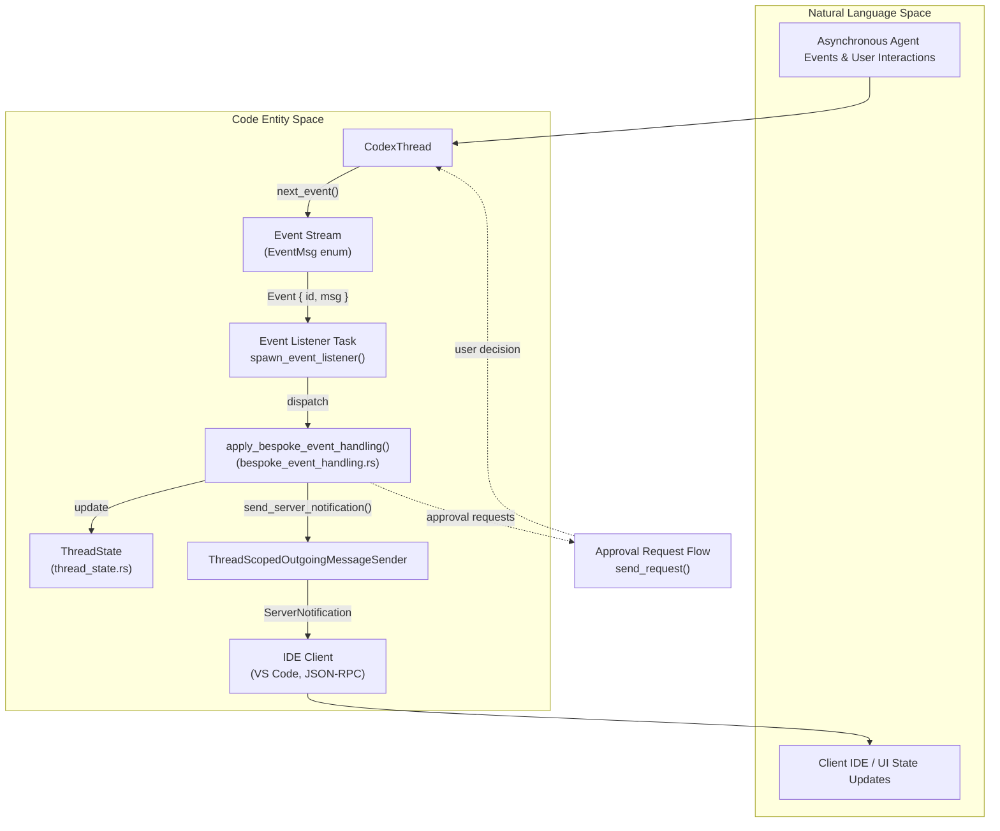
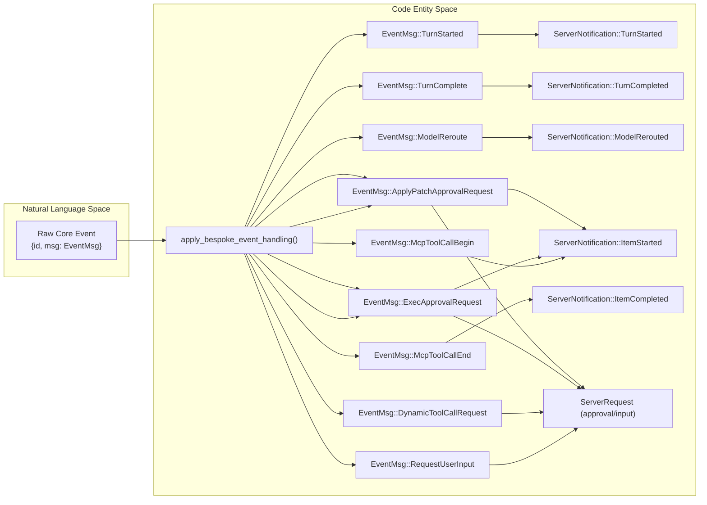
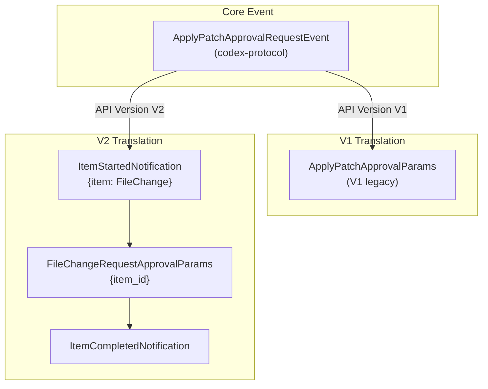
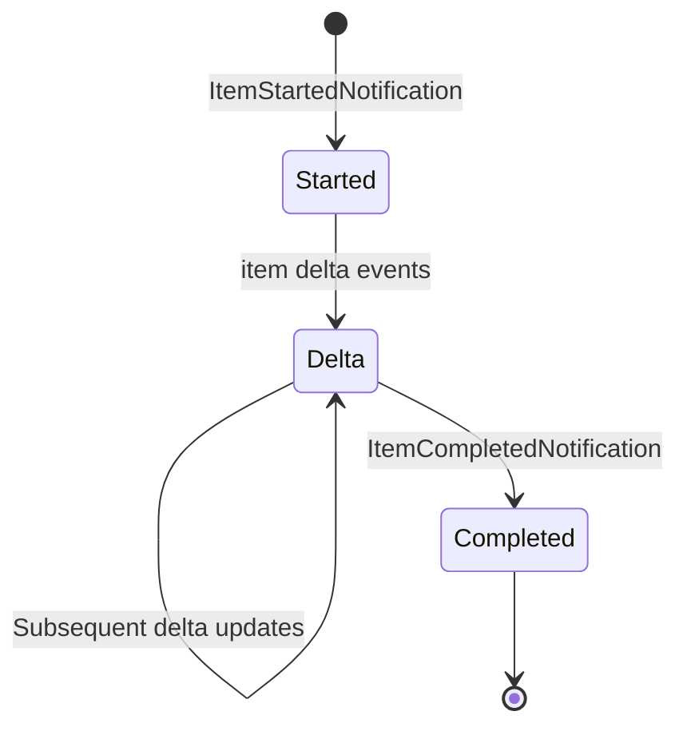
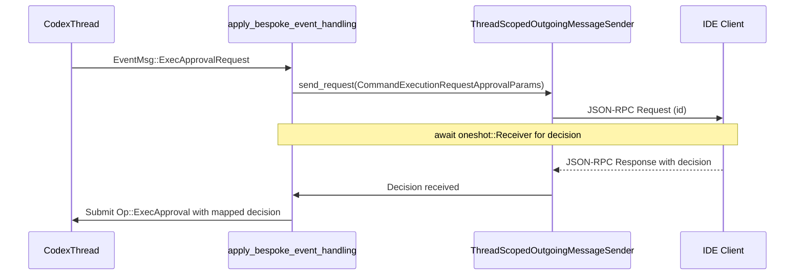
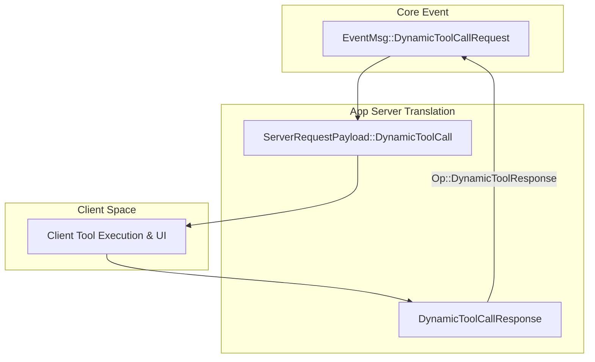
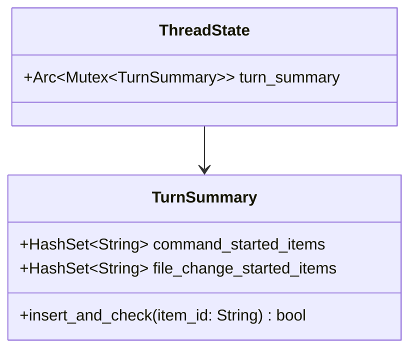
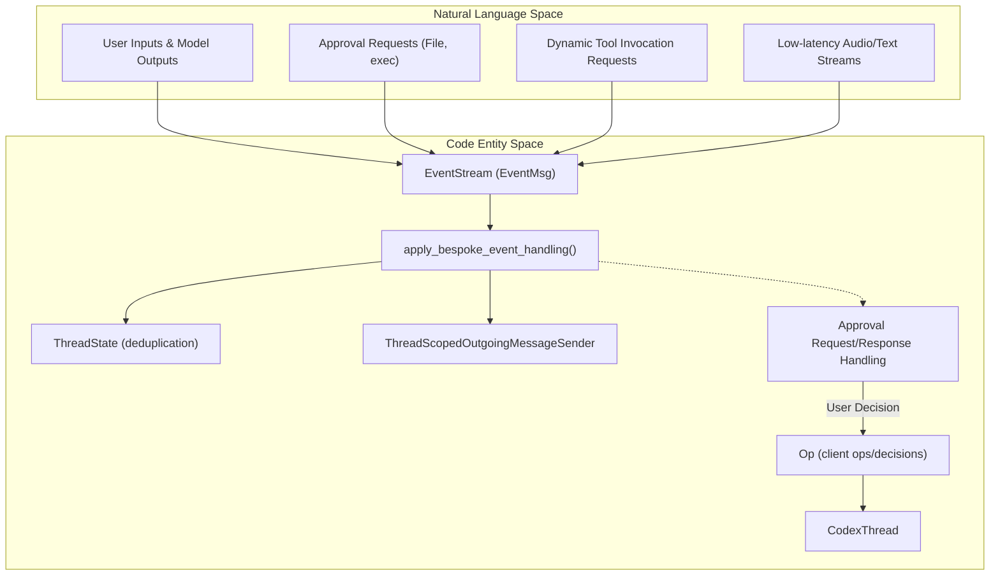

<!-- source: DeepWiki mcp.deepwiki.com · repo openai/codex · extra page Event Translation and Streaming · fetched 2026-10-26 -->

# Event Translation and Streaming

<details>
<summary>Relevant source files</summary>

The following files were used as context for generating this wiki page:

- [codex-rs/app-server-protocol/src/protocol/thread_history.rs](codex-rs/app-server-protocol/src/protocol/thread_history.rs)
- [codex-rs/app-server-protocol/src/protocol/v2/item.rs](codex-rs/app-server-protocol/src/protocol/v2/item.rs)
- [codex-rs/app-server/src/bespoke_event_handling.rs](codex-rs/app-server/src/bespoke_event_handling.rs)
- [codex-rs/core/src/codex_delegate.rs](codex-rs/core/src/codex_delegate.rs)
- [codex-rs/core/src/codex_delegate_tests.rs](codex-rs/core/src/codex_delegate_tests.rs)
- [codex-rs/core/src/codex_thread.rs](codex-rs/core/src/codex_thread.rs)
- [codex-rs/core/src/compact.rs](codex-rs/core/src/compact.rs)
- [codex-rs/core/src/compact_remote_v2.rs](codex-rs/core/src/compact_remote_v2.rs)
- [codex-rs/core/src/compact_remote_v2_attempt.rs](codex-rs/core/src/compact_remote_v2_attempt.rs)
- [codex-rs/core/src/compact_tests.rs](codex-rs/core/src/compact_tests.rs)
- [codex-rs/core/src/context/token_budget_context.rs](codex-rs/core/src/context/token_budget_context.rs)
- [codex-rs/core/src/environment_selection.rs](codex-rs/core/src/environment_selection.rs)
- [codex-rs/core/src/event_mapping.rs](codex-rs/core/src/event_mapping.rs)
- [codex-rs/core/src/event_mapping_tests.rs](codex-rs/core/src/event_mapping_tests.rs)
- [codex-rs/core/src/session/environment.rs](codex-rs/core/src/session/environment.rs)
- [codex-rs/core/src/session/handlers.rs](codex-rs/core/src/session/handlers.rs)
- [codex-rs/core/src/session/mod.rs](codex-rs/core/src/session/mod.rs)
- [codex-rs/core/src/session/session.rs](codex-rs/core/src/session/session.rs)
- [codex-rs/core/src/session/tests.rs](codex-rs/core/src/session/tests.rs)
- [codex-rs/core/src/session/tests/guardian_tests.rs](codex-rs/core/src/session/tests/guardian_tests.rs)
- [codex-rs/core/src/session/token_budget.rs](codex-rs/core/src/session/token_budget.rs)
- [codex-rs/core/src/session/turn.rs](codex-rs/core/src/session/turn.rs)
- [codex-rs/core/src/session/turn_context.rs](codex-rs/core/src/session/turn_context.rs)
- [codex-rs/core/src/state/auto_compact_window.rs](codex-rs/core/src/state/auto_compact_window.rs)
- [codex-rs/core/src/state/mod.rs](codex-rs/core/src/state/mod.rs)
- [codex-rs/core/src/state/turn.rs](codex-rs/core/src/state/turn.rs)
- [codex-rs/core/src/tasks/mod.rs](codex-rs/core/src/tasks/mod.rs)
- [codex-rs/core/src/thread_manager.rs](codex-rs/core/src/thread_manager.rs)
- [codex-rs/core/src/thread_manager_tests.rs](codex-rs/core/src/thread_manager_tests.rs)
- [codex-rs/core/tests/common/test_codex.rs](codex-rs/core/tests/common/test_codex.rs)
- [codex-rs/core/tests/suite/compact.rs](codex-rs/core/tests/suite/compact.rs)
- [codex-rs/core/tests/suite/compact_remote.rs](codex-rs/core/tests/suite/compact_remote.rs)
- [codex-rs/core/tests/suite/mod.rs](codex-rs/core/tests/suite/mod.rs)
- [codex-rs/core/tests/suite/remote_env.rs](codex-rs/core/tests/suite/remote_env.rs)
- [codex-rs/core/tests/suite/snapshots/all__suite__token_budget__token_budget_new_context_window_tool_full_context.snap](codex-rs/core/tests/suite/snapshots/all__suite__token_budget__token_budget_new_context_window_tool_full_context.snap)
- [codex-rs/core/tests/suite/token_budget.rs](codex-rs/core/tests/suite/token_budget.rs)
- [codex-rs/protocol/src/environment.rs](codex-rs/protocol/src/environment.rs)
- [codex-rs/protocol/src/items.rs](codex-rs/protocol/src/items.rs)
- [codex-rs/protocol/src/legacy_events.rs](codex-rs/protocol/src/legacy_events.rs)
- [codex-rs/protocol/src/protocol.rs](codex-rs/protocol/src/protocol.rs)

</details>


## Purpose and Scope

This page documents the event translation system in the `codex-app-server` component of the Codex project (`codex-rs/app-server`) [codex-rs/app-server/src/lib.rs:1-145](). The system acts as a bridge between the core agent internal event model (`codex-protocol`) and the JSON-RPC client-facing protocol (`codex-app-server-protocol`). During conversation thread execution—which includes model interactions, tool calls, patch applications, and more—the core emits various events asynchronously. The app server translates these core events into structured notifications and interactive server requests for clients such as IDE extensions or the Codex TUI.

This leaf page covers:
- The core translation flow and data pipeline bridging events and client JSON-RPC messages.
- Implementation details of the key function `apply_bespoke_event_handling` [codex-rs/app-server/src/bespoke_event_handling.rs:1-120]().
- Event-to-notification mapping including approval and tool call flows.
- Server request lifecycle patterns.
- Thread state management for event deduplication.
- Streaming patterns for realtime conversation events.

For request handling and thread APIs, see [4.5.2 Thread and Turn Management API](). For overall message processing architecture, see [4.5.1 CodexMessageProcessor and Request Handling]().

Sources: [codex-rs/app-server/src/bespoke_event_handling.rs:1-120](), [codex-rs/app-server/src/lib.rs:1-145]()

---

## Overview of Event Translation Flow

The app server hosts an event translation pipeline that listens to core `CodexThread` events and dispatches equivalent server notifications or requests to clients via JSON-RPC.

Title: Event Translation Pipeline Architecture


- `CodexThread` produces asynchronous `Event` objects wrapping `EventMsg` variants [codex-rs/app-server/src/bespoke_event_handling.rs:90-104]().
- The event listener consumes these from the stream and calls `apply_bespoke_event_handling` [codex-rs/app-server/src/bespoke_event_handling.rs:1-120]().
- This function interprets and translates events into server notifications or interactive server requests.
- `ThreadState` is updated for local state reflecting events seen and items emitted [codex-rs/app-server/src/thread_state.rs:1-50]().
- Outgoing notifications/requests are sent via the `ThreadScopedOutgoingMessageSender` [codex-rs/app-server/src/outgoing_message.rs:1-40]().
- User input or approval requests trigger interactive server requests that eventually map user decisions back into core operations [codex-rs/app-server/src/bespoke_event_handling.rs:20-112]().

Sources: [codex-rs/app-server/src/bespoke_event_handling.rs:87-145](), [codex-rs/app-server/src/outgoing_message.rs:1-40]()

---

## Core Translation Function: `apply_bespoke_event_handling`

This async function is the centerpiece of event translation. It matches on the core `EventMsg` enum and performs structured translation into protocol-level server notifications or requests.

Title: Event Translation Dispatch Map


### Key `EventMsg` to Server Message Mappings

| EventMsg Variant                | Server Messages                            | Notes                                               |
|-------------------------------|------------------------------------------|-----------------------------------------------------|
| `TurnStarted`                  | `TurnStartedNotification`                 | Snapshot emitted on turn start [codex-rs/app-server/src/bespoke_event_handling.rs:84-112]() |
| `TurnComplete`                 | `TurnCompletedNotification`               | Finalizes turn and streams full turn data           |
| `ModelReroute`                 | `ModelReroutedNotification`               | Model switching notification                         |
| `ApplyPatchApprovalRequest`    | `ItemStartedNotification` + ServerRequest| Requests user approval for patch application        |
| `ExecApprovalRequest`          | `ItemStartedNotification` + ServerRequest| Requests user approval for command execution        |
| `McpToolCallBegin`             | `ItemStartedNotification`                  | Marks start of MCP tool call                         |
| `McpToolCallEnd`               | `ItemCompletedNotification`                | Marks completion of MCP tool call                    |
| `DynamicToolCallRequest`       | ServerRequest                              | Interactive client tool call                         |
| `RequestUserInput`             | ServerRequest                              | Interactive user input requests                      |

Sources: [codex-rs/app-server/src/bespoke_event_handling.rs:1-120](), [codex-rs/app-server-protocol/schema/json/codex_app_server_protocol.schemas.json:1-100]()

---

## API Versioning and Item Lifecycle Differences

The app server supports multiple protocol versions, notably V1 (legacy) and V2 (modern). V2 introduces explicit "Item" lifecycle tracking, enabling finer-grained UI streaming.

### Version-specific Translation Example for Patch Approval

Title: Patch Approval Version Branching


The V2 model separates item lifecycle events from approval requests, associating approvals with specific item IDs to support streaming updates and consistent UI state [codex-rs/app-server/src/bespoke_event_handling.rs:33-40]().

Sources: [codex-rs/app-server/src/bespoke_event_handling.rs:33-40]()

---

## Item Lifecycle Pattern (V2 Protocol)

V2 protocol clients handle items with explicit state transitions, enabling incremental streaming updates.

Title: V2 Item State Machine


| Item Type         | Started Event               | Delta Events Streaming                  | Completed Event              |
|-------------------|-----------------------------|----------------------------------------|------------------------------|
| AgentMessage      | `item/started`               | `item/agentMessage/delta`               | `item/completed`             |
| CommandExecution  | `item/started`               | `item/commandExecution/outputDelta`     | `item/completed`             |

This pattern enables clients to show live progress and partial outputs for long-running tasks. The lifecycle is managed in `apply_bespoke_event_handling` [codex-rs/app-server/src/bespoke_event_handling.rs:35-40]().

Sources: [codex-rs/app-server/src/thread_state.rs:1-50]()

---

## Approval Request and Interactive Server Requests

Some events initiate operations requiring explicit human approval (e.g., patch application, command execution). These cause the app server to send a `ServerRequestPayload` message to the client and await an approval decision before proceeding.

### Approval Flow Sequence

Title: Approval Sequence Diagram


| Client Decision         | Mapped Core `ReviewDecision`          |
|------------------------|--------------------------------------|
| Accept                 | `Approved`                           |
| AcceptForSession       | `ApprovedForSession`                 |
| Decline                | `Denied`                            |
| Cancel                 | `Abort`                             |

This workflow uses channels to send approval requests and receive asynchronous user responses [codex-rs/app-server/src/bespoke_event_handling.rs:20-112]().

Sources: [codex-rs/app-server/src/bespoke_event_handling.rs:20-112]()

---

## Dynamic Tool Call Handling

Dynamic tool calls are events that instruct the client to invoke external tools with interactive dialogs. The app server translates `DynamicToolCallRequest` events into `ServerRequestPayload::DynamicToolCall` notifications sent to the client.

Title: Dynamic Tool Call Routing


This round-trip allows a seamless interactive tool invocation outside the core [codex-rs/app-server/src/bespoke_event_handling.rs:1-120]().

Sources: [codex-rs/app-server/src/bespoke_event_handling.rs:1-120]()

---

## Thread State and Item Deduplication

To prevent duplicate "item/started" notifications during event replay or repeated event appearances, the app server maintains a per-thread state with item deduplication using `TurnSummary`.

Title: ThreadState and TurnSummary Class Structure


- `TurnSummary` tracks started item IDs to omit repeated notifications [codex-rs/app-server/src/thread_state.rs:1-30]().
- Deduplication ensures consistent client view during session resumptions and replay [codex-rs/app-server/src/thread_state.rs:1-30]().

Sources: [codex-rs/app-server/src/thread_state.rs:1-30]()

---

## Realtime Conversation Streaming

The app server supports low-latency streaming of conversation data via `RealtimeEvent` notifications, delivering incremental outputs like transcript deltas or audio streams [codex-rs/app-server/src/bespoke_event_handling.rs:57-67]().

| Core Event Subtype                  | Server Notification                           |
|-----------------------------------|-----------------------------------------------|
| `Started`                         | `ThreadRealtimeStartedNotification`            |
| `OutputAudioDelta`                | `ThreadRealtimeOutputAudioDeltaNotification`   |
| `ItemAdded`                      | `ThreadRealtimeItemAddedNotification`           |
| `Error`                         | `ThreadRealtimeErrorNotification`                |
| `Closed`                        | `ThreadRealtimeClosedNotification`               |

These allow UI clients to render conversation progress live with minimal delay [codex-rs/app-server/src/bespoke_event_handling.rs:57-67]().

Sources: [codex-rs/app-server/src/bespoke_event_handling.rs:57-67]()

---

## Summary Diagram: Domain to Code Entity Bridging

Title: End-to-End Domain to Code Entity Mapping


This diagram maps user interactions and core agent events directly to the corresponding code entities within the app server event translation pipeline.

Sources: [codex-rs/app-server/src/bespoke_event_handling.rs:1-120]()

---

## Key Implementation Artifacts

| Artifact                        | Description                                           | Location & Lines                          |
|--------------------------------|-------------------------------------------------------|-------------------------------------------|
| `apply_bespoke_event_handling` | Main core event dispatcher translating events         | [codex-rs/app-server/src/bespoke_event_handling.rs:1-120]() |
| `ThreadState`                  | Manages per-thread state for item deduplication       | [codex-rs/app-server/src/thread_state.rs:1-30]() |
| `ThreadScopedOutgoingMessageSender` | Sends notifications/requests via JSON-RPC to clients | [codex-rs/app-server/src/outgoing_message.rs:1-40]() |
| `EventMsg` enum                | Defines core event message variants                    | [codex-rs/app-server/src/bespoke_event_handling.rs:100-120]() |

Sources: [codex-rs/app-server/src/bespoke_event_handling.rs:1-120](), [codex-rs/app-server/src/thread_state.rs:1-30]()

---

# Appendix: Code Reference Snippets

### EventMsg Variants Handling Outline (simplified)
```rust
async fn apply_bespoke_event_handling(
    thread_state: Arc<ThreadState>,
    outgoing_sender: ThreadScopedOutgoingMessageSender,
    event: &Event,
) {
    match &event.msg {
        EventMsg::TurnStarted(data) => {
            // emit TurnStartedNotification
        }
        EventMsg::TurnComplete(data) => {
            // emit TurnCompletedNotification
        }
        EventMsg::ApplyPatchApprovalRequest(data) => {
            // emit ItemStartedNotification + send approval ServerRequestPayload
        }
        EventMsg::ExecApprovalRequest(data) => {
            // emit ItemStartedNotification + send exec approval ServerRequestPayload
        }
        EventMsg::DynamicToolCallRequest(data) => {
            // send dynamic tool server request
        }
        EventMsg::RequestUserInput(data) => {
            // send user input server request
        }
        // additional cases...
    }
}
```

Sources: [codex-rs/app-server/src/bespoke_event_handling.rs:87-145]()

---

