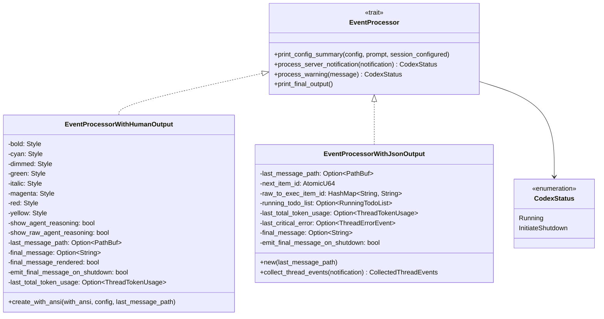
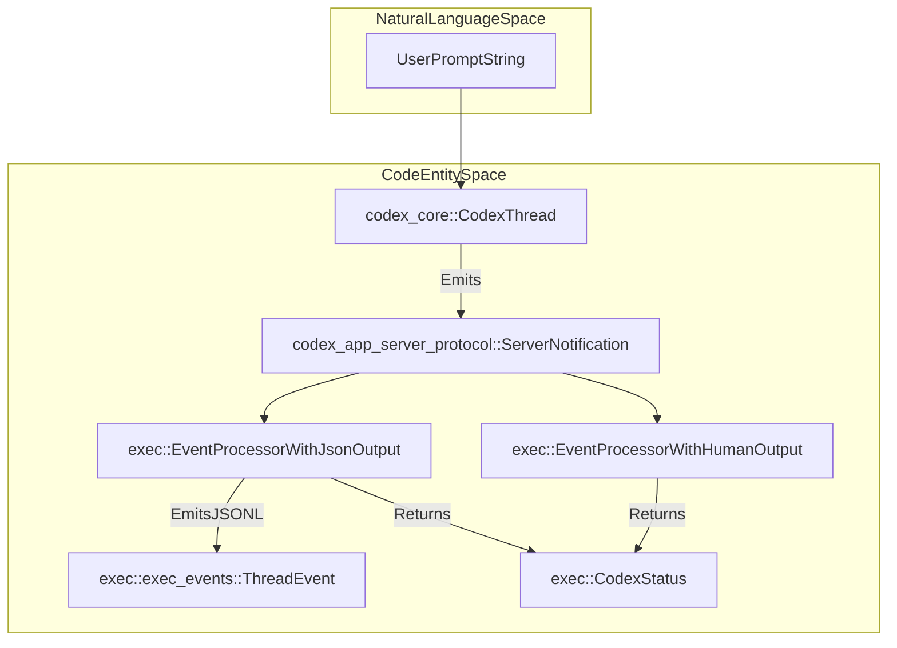
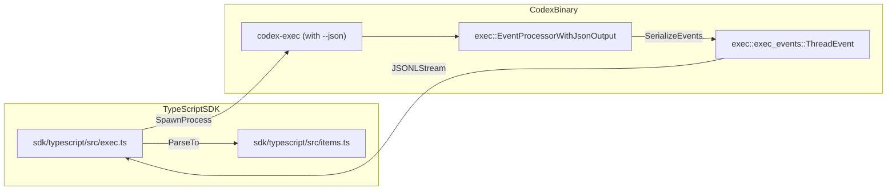
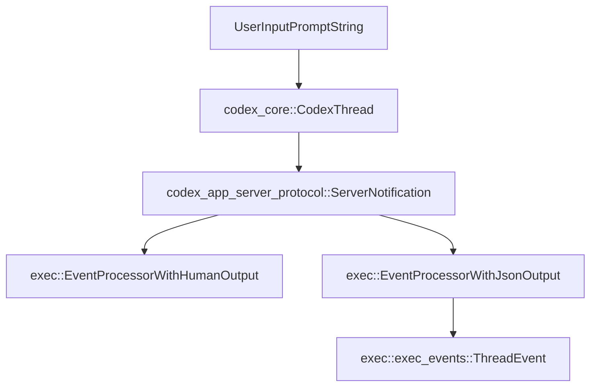

<!-- source: DeepWiki mcp.deepwiki.com · repo openai/codex · extra page Exec Mode Event Processing · fetched 2026-10-26 -->

# Exec Mode Event Processing

<details>
<summary>Relevant source files</summary>

The following files were used as context for generating this wiki page:

- [codex-rs/exec/Cargo.toml](codex-rs/exec/Cargo.toml)
- [codex-rs/exec/src/event_processor_with_human_output.rs](codex-rs/exec/src/event_processor_with_human_output.rs)
- [codex-rs/exec/src/event_processor_with_human_output_tests.rs](codex-rs/exec/src/event_processor_with_human_output_tests.rs)
- [codex-rs/exec/src/event_processor_with_jsonl_output.rs](codex-rs/exec/src/event_processor_with_jsonl_output.rs)
- [codex-rs/exec/src/event_processor_with_jsonl_output_tests.rs](codex-rs/exec/src/event_processor_with_jsonl_output_tests.rs)
- [codex-rs/exec/src/exec_events.rs](codex-rs/exec/src/exec_events.rs)
- [codex-rs/exec/src/main.rs](codex-rs/exec/src/main.rs)
- [codex-rs/exec/tests/event_processor_with_json_output.rs](codex-rs/exec/tests/event_processor_with_json_output.rs)
- [codex-rs/exec/tests/suite/apply_patch.rs](codex-rs/exec/tests/suite/apply_patch.rs)
- [codex-rs/tui/src/main.rs](codex-rs/tui/src/main.rs)
- [sdk/typescript/samples/basic_streaming.ts](sdk/typescript/samples/basic_streaming.ts)
- [sdk/typescript/src/events.ts](sdk/typescript/src/events.ts)
- [sdk/typescript/tests/runStreamed.test.ts](sdk/typescript/tests/runStreamed.test.ts)

</details>


## Purpose and Scope

This page documents the **Exec Mode** event processing within the Codex codebase, focusing on the `EventProcessorWithHumanOutput` struct for terminal output formatting, approval handling, JSONL output mode via `EventProcessorWithJsonOutput`, and serialization of events in the `exec_events` format [codex-rs/exec/src/event_processor_with_human_output.rs:24-65]() [codex-rs/exec/src/event_processor_with_jsonl_output.rs:58-92]() [codex-rs/exec/src/exec_events.rs:9-37]().

Exec Mode supports running Codex in a non-interactive, CLI-driven manner (`codex exec`), emitting user-friendly terminal output or structured JSON events consumable by downstream tools such as the TypeScript SDK.

The event processor system translates events emitted by the core Codex engine (`codex_core`)—expressed as `ServerNotification`s—to appropriate execution mode outputs, managing sessions, approvals, and message persistence [codex-rs/exec/src/event_processor_with_human_output.rs:68-174]() [codex-rs/exec/src/event_processor_with_jsonl_output.rs:12-16]().

Sources:  
[codex-rs/exec/src/event_processor_with_human_output.rs:24-65]()  
[codex-rs/exec/src/event_processor_with_jsonl_output.rs:58-92]()  
[codex-rs/exec/src/exec_events.rs:9-37]()

---

## EventProcessor Architecture

The exec mode event processing system uses a trait-based design pattern supporting multiple output formats.

### Core Trait and Implementations

**Class Hierarchy**



- The **`EventProcessor`** trait defines the interface for processing `ServerNotification` events, printing configuration summaries, managing warnings, and controlling final output lifecycle [codex-rs/exec/src/event_processor_with_human_output.rs:20-23]().
- **`EventProcessorWithHumanOutput`** implements a terminal-oriented processor with colored/ANSI output for interactive CLI feedback and approval visualization [codex-rs/exec/src/event_processor_with_human_output.rs:24-65]().
- **`EventProcessorWithJsonOutput`** serializes events to JSON Lines (JSONL) format for use with the SDK or other automated tools, managing internal IDs and tracking token usage, errors, and todo lists [codex-rs/exec/src/event_processor_with_jsonl_output.rs:59-92]().
- The **`CodexStatus`** enum signals the control flow status: continue running or initiate shutdown [codex-rs/exec/src/event_processor_with_jsonl_output.rs:22-80]().

Sources:  
[codex-rs/exec/src/event_processor_with_human_output.rs:20-65]()  
[codex-rs/exec/src/event_processor_with_jsonl_output.rs:22-92]()

---

### Event Data Flow in Exec Mode

The event processing pipeline bridges user inputs in natural language to structured event data shapes emitted back to user or tools.



- The natural language user prompt is received and processed by the core Codex engine [`codex_core::CodexThread`] [codex-rs/exec/src/event_processor_with_human_output.rs:24-65]().
- The core emits a stream of `ServerNotification` events [codex-rs/exec/src/event_processor_with_jsonl_output.rs:12-16]() to describe the internal agent activity.
- Both human-readable and structured JSON processors receive these notifications in parallel:
  - `EventProcessorWithHumanOutput` converts them to colored terminal output [codex-rs/exec/src/event_processor_with_human_output.rs:67-96]().
  - `EventProcessorWithJsonOutput` maps them into `ThreadEvent` enum instances which are serialized as JSONL [codex-rs/exec/src/event_processor_with_jsonl_output.rs:58-178]().
- Both processors send back a `CodexStatus` indicating either running or requesting shutdown [codex-rs/exec/src/event_processor_with_jsonl_output.rs:77-80]().

Sources:  
[codex-rs/exec/src/exec_events.rs:11-37]()  
[codex-rs/exec/src/event_processor_with_human_output.rs:67-96]()  
[codex-rs/exec/src/event_processor_with_jsonl_output.rs:58-178]()

---

## EventProcessorWithHumanOutput — Terminal Formatting

The `EventProcessorWithHumanOutput` struct is the primary executor output processor in terminal mode, producing ANSI-styled outputs suitable for CLI interaction and human readability.

### ANSI Styling and Configuration

The constructor factory `create_with_ansi` initializes a set of color and font style objects, switching off ANSI if disabled (e.g., non-tty) and reflecting user config flags controlling agent reasoning display:

| Style Field  | Terminal Use Case                                     |
|--------------|-----------------------------------------------------|
| `bold`       | Commands, tool calls, headers                        |
| `cyan`       | MCP tool server and tool names                       |
| `dimmed`     | Agent reasoning, "started" labels, file paths       |
| `green`      | Success (commands, patches)                          |
| `italic`     | Labels like "exec", "codex"                          |
| `magenta`    | Agent response header and exec mode output          |
| `red`        | Failures, error exit codes                           |
| `yellow`     | Declined commands or actions                         |

Flags:

- `show_agent_reasoning` enables internal agent reasoning summaries.
- `show_raw_agent_reasoning` when enabled shows full detailed reasoning content instead of summaries.

This setup balances rich terminal output with user-configurable verbosity [codex-rs/exec/src/event_processor_with_human_output.rs:43-65]() [codex-rs/exec/src/event_processor_with_human_output.rs:73-148]().

Sources:  
[codex-rs/exec/src/event_processor_with_human_output.rs:43-65]()  
[codex-rs/exec/src/event_processor_with_human_output.rs:73-148]()

---

### Event Rendering Details

The processor maps `ThreadItem` events from the core into terminal output, displaying state transitions of items that begin and complete during execution [codex-rs/exec/src/event_processor_with_human_output.rs:68-174]().

#### Item Started Rendering

`render_item_started` matches the `ThreadItem` variant and writes a related header line:

- **CommandExecution:** Prints `"exec"` in italic/magenta plus the command in bold and the current working directory [codex-rs/exec/src/event_processor_with_human_output.rs:69-75]().
- **McpToolCall:** Prints `"mcp:"` in bold, followed by `<server>/<tool>` in cyan, and "started" in dimmed [codex-rs/exec/src/event_processor_with_human_output.rs:76-83]().
- **WebSearch:** Logs `"web search:"` label in bold followed by the query string [codex-rs/exec/src/event_processor_with_human_output.rs:84-86]().
- **FileChange:** Prints `"apply patch"` in bold [codex-rs/exec/src/event_processor_with_human_output.rs:87-90]().
- **CollabAgentToolCall:** Prints `"collab:"` in bold with debug info on tool call [codex-rs/exec/src/event_processor_with_human_output.rs:91-93]().

Other item types do not trigger start output.

#### Item Completed Rendering

`render_item_completed` prints a completion summary and details:

- **AgentMessage:** Prints `"codex"` in italic/magenta, then outputs the text response, storing it as the final message for potential persistence [codex-rs/exec/src/event_processor_with_human_output.rs:99-107]().
- **Reasoning:** Depending on config, prints summarized or raw agent reasoning in dimmed style if non-empty [codex-rs/exec/src/event_processor_with_human_output.rs:108-118]().
- **CommandExecution:** Prints colored status with duration if available (green = success, red = failure, yellow = declined, dimmed = in progress), followed by aggregated command output [codex-rs/exec/src/event_processor_with_human_output.rs:119-162]().
- **FileChange:** Outputs patch apply status (completed, failed, declined) with a summary list of changed file paths in dimmed style [codex-rs/exec/src/event_processor_with_human_output.rs:163-174]().

Other `ThreadItem` variants can have additional customized output as configured by flags.

Sources:  
[codex-rs/exec/src/event_processor_with_human_output.rs:68-174]()

---

## JSONL Output Mode and `exec_events`

When the `--json` CLI flag is used, Codex switches to emitting structured JSON Lines (JSONL) format events via the `EventProcessorWithJsonOutput` to provide a machine-parsable stream for SDKs and automation tools [codex-rs/exec/src/event_processor_with_jsonl_output.rs:59-116]().

### `ThreadEvent` Serialization Format

Events are represented as the tagged enum `ThreadEvent` defined in `exec_events.rs`, encapsulating all major state changes and item lifecycle events [codex-rs/exec/src/exec_events.rs:9-37]():

| Event Variant        | Description                                                                                  |
|----------------------|----------------------------------------------------------------------------------------------|
| `ThreadStarted`      | First event signaling thread/session start with `thread_id` [codex-rs/exec/src/exec_events.rs:11-14]().                              |
| `TurnStarted`        | Marks start of a processing turn by the language model [codex-rs/exec/src/exec_events.rs:15-18]().                               |
| `TurnCompleted`      | Marks turn completion with token usage statistics [codex-rs/exec/src/exec_events.rs:19-21]().                                       |
| `TurnFailed`         | Indicates turn failure with error details [codex-rs/exec/src/exec_events.rs:22-24]().                                                |
| `ItemStarted`        | Signals start of a thread item such as command or tool invocation [codex-rs/exec/src/exec_events.rs:25-27]().                       |
| `ItemUpdated`        | Reports updates to an in-progress item [codex-rs/exec/src/exec_events.rs:28-30]().                                                     |
| `ItemCompleted`      | Marks an item reaching a terminal state (success or failure) [codex-rs/exec/src/exec_events.rs:31-33]().                             |
| `Error`              | Fatal error emitted by the event stream with a message [codex-rs/exec/src/exec_events.rs:34-36]().                                    |

Specialized detailed payloads are represented under `ThreadItemDetails`, enabling rich typed data for commands, MCP calls, patches, reasoning, and agent messages [codex-rs/exec/src/exec_events.rs:97-133]().

### Usage Statistics

The `Usage` struct carries detailed token usage statistics per turn:

- `input_tokens` — tokens sent as new input to the model.
- `cached_input_tokens` — tokens reused from prompt cache.
- `cache_write_input_tokens` — tokens written to prompt cache.
- `output_tokens` — tokens produced by the model.
- `reasoning_output_tokens` — tokens generated from internal agent reasoning.

This enables detailed accounting for compute consumption and optimization [codex-rs/exec/src/exec_events.rs:60-73]().

### Internal Item ID Mapping and Todo Lists

`EventProcessorWithJsonOutput` remaps raw thread item IDs to sanitized sequential IDs (`item_0`, `item_1`, ...) to avoid leaking internal identifiers, ensuring stable serialized IDs [codex-rs/exec/src/event_processor_with_jsonl_output.rs:59-92]().

The processor also tracks the live todo list as the agent updates its planned steps in the turn, emitting structured updates in JSONL form [codex-rs/exec/src/event_processor_with_jsonl_output.rs:131-141]().

Sources:  
[codex-rs/exec/src/exec_events.rs:9-73]()  
[codex-rs/exec/src/exec_events.rs:97-133]()  
[codex-rs/exec/src/event_processor_with_jsonl_output.rs:59-92]()

---

## SDK Integration

The TypeScript SDK directly consumes the JSONL event stream emitted by `EventProcessorWithJsonOutput`. The SDK event types mirror the Rust event structs exactly, ensuring compatibility and strong typing [sdk/typescript/src/events.ts:1-84]().

### SDK and CLI Integration Flow



- SDK's `ThreadItem` union and related types correspond to Rust's `ThreadItemDetails` enum discriminants, allowing typed, structured representation of agent output including commands, tool results, patches, and messages [sdk/typescript/src/events.ts:1-84]() [codex-rs/exec/src/exec_events.rs:105-133]().
- This enables downstream IDEs, scripts, or UIs to consume agent progress programmatically with event granularity including token usage and error reporting [codex-rs/exec/src/exec_events.rs:159-166]().

Sources:  
[sdk/typescript/src/events.ts:1-84]()  
[codex-rs/exec/src/exec_events.rs:105-133]()  
[codex-rs/exec/src/exec_events.rs:159-166]()

---

## Approval Handling in Exec Mode

While approval workflow logic mainly resides in the `execpolicy` and core layers, the human output processor visually reflects approval states:

- Declined commands or patches print in yellow text to indicate rejected actions.
- The system can prompt the user visually via terminal output when approval is requested or needed, enhancing UX transparency.
- This is managed primarily inside `render_item_completed` in human output for command and patch events where status can be `Declined` [codex-rs/exec/src/event_processor_with_human_output.rs:145-150]().

Sources:  
[codex-rs/exec/src/event_processor_with_human_output.rs:145-150]()

---

## Last Message Persistence

Exec mode supports persisting the last full agent message text to a file specified by the CLI `--last` path:

- Both `EventProcessorWithHumanOutput` and `EventProcessorWithJsonOutput` store the text of the last `AgentMessage` item internally.
- On graceful shutdown or turn completion, if configured, they write this text to the specified file path atomically.
- This enables integration scenarios where external processes monitor the latest output in a filesystem location [codex-rs/exec/src/event_processor_with_human_output.rs:35-65]() [codex-rs/exec/src/event_processor_with_jsonl_output.rs:59-92]().

Sources:  
[codex-rs/exec/src/event_processor_with_human_output.rs:35-65]()  
[codex-rs/exec/src/event_processor_with_jsonl_output.rs:59-92]()

---

## Bridging Natural Language to Code Entities: Exec Mode Components

### High-Level Architecture Mapping

This diagram links the user-facing natural language input prompt through processing entities in the Rust codebase into structured events.



- User prompt string flows to the core agent thread.
- The core emits protocol notifications.
- These are ingested by both human and JSON output processors.
- JSON output is serialized as `ThreadEvent` for SDK consumption.

Sources:  
[codex-rs/exec/src/event_processor_with_human_output.rs:24-65]()  
[codex-rs/exec/src/event_processor_with_jsonl_output.rs:59-92]()

---

### EventProcessor Domain Detail

This class diagram shows key Rust entities and their interactions centered on event processing.

```mermaid
classDiagram
    class CodexThread {
        +process_prompt()
        +emit_notifications()
    }
    class ServerNotification {
        <<enum>>
        +TurnStarted
        +ItemCompleted
        +Warning
    }
    class EventProcessorWithHumanOutput {
        +process_server_notification()
        +render_item_started()
        +render_item_completed()
    }
    class EventProcessorWithJsonOutput {
        +collect_thread_events()
        +emit()
        +map_todo_items()
    }
    class ThreadEvent {
        <<enum>>
        +ThreadStarted
        +TurnStarted
        +ItemStarted
        +ItemCompleted
        +Error
    }
    
    CodexThread --> ServerNotification
    ServerNotification --> EventProcessorWithHumanOutput
    ServerNotification --> JsonProcessorViaNotification["EventProcessorWithJsonOutput"]
    JsonProcessorViaNotification --> ThreadEvent
```

- The core `CodexThread` produces `ServerNotification` variants during turn progression.
- Two distinct concrete event processors independently consume these notifications.
- The JSON processor maps them into the `ThreadEvent` serialization format for output.

Sources:  
[codex-rs/exec/src/event_processor_with_human_output.rs:24-174]()  
[codex-rs/exec/src/event_processor_with_jsonl_output.rs:59-178]()  
[codex-rs/exec/src/exec_events.rs:11-37]()

---

