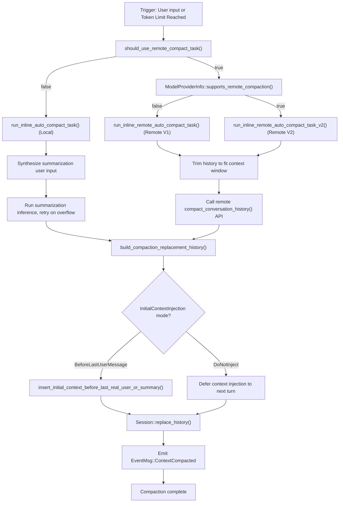
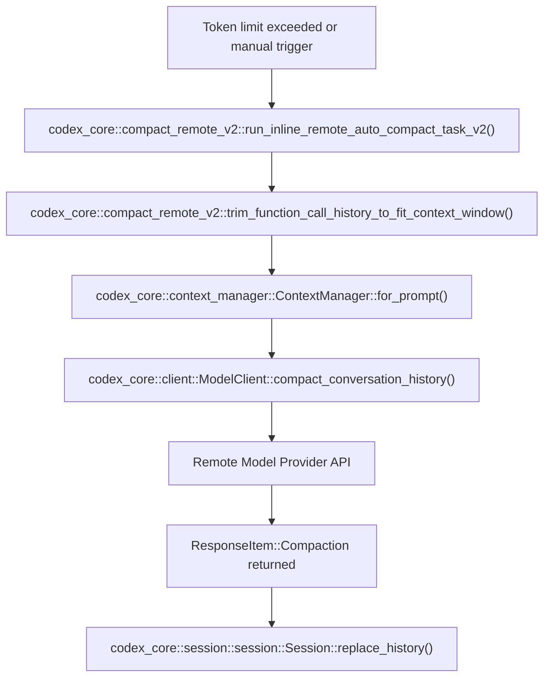

<!-- source: DeepWiki mcp.deepwiki.com · repo openai/codex · extra page History Compaction System · fetched 2026-10-26 -->

# History Compaction System

Relevant source files

The following files were used as context for generating this wiki page:

- [codex-rs/app-server/src/bespoke_event_handling.rs](codex-rs/app-server/src/bespoke_event_handling.rs)
- [codex-rs/core/src/codex_delegate.rs](codex-rs/core/src/codex_delegate.rs)
- [codex-rs/core/src/codex_delegate_tests.rs](codex-rs/core/src/codex_delegate_tests.rs)
- [codex-rs/core/src/codex_thread.rs](codex-rs/core/src/codex_thread.rs)
- [codex-rs/core/src/compact.rs](codex-rs/core/src/compact.rs)
- [codex-rs/core/src/compact_remote_v2.rs](codex-rs/core/src/compact_remote_v2.rs)
- [codex-rs/core/src/compact_remote_v2_attempt.rs](codex-rs/core/src/compact_remote_v2_attempt.rs)
- [codex-rs/core/src/compact_tests.rs](codex-rs/core/src/compact_tests.rs)
- [codex-rs/core/src/environment_selection.rs](codex-rs/core/src/environment_selection.rs)
- [codex-rs/core/src/session/environment.rs](codex-rs/core/src/session/environment.rs)
- [codex-rs/core/src/session/handlers.rs](codex-rs/core/src/session/handlers.rs)
- [codex-rs/core/src/session/mod.rs](codex-rs/core/src/session/mod.rs)
- [codex-rs/core/src/session/session.rs](codex-rs/core/src/session/session.rs)
- [codex-rs/core/src/session/tests.rs](codex-rs/core/src/session/tests.rs)
- [codex-rs/core/src/session/tests/guardian_tests.rs](codex-rs/core/src/session/tests/guardian_tests.rs)
- [codex-rs/core/src/session/turn.rs](codex-rs/core/src/session/turn.rs)
- [codex-rs/core/src/session/turn_context.rs](codex-rs/core/src/session/turn_context.rs)
- [codex-rs/core/src/state/mod.rs](codex-rs/core/src/state/mod.rs)
- [codex-rs/core/src/state/turn.rs](codex-rs/core/src/state/turn.rs)
- [codex-rs/core/src/tasks/mod.rs](codex-rs/core/src/tasks/mod.rs)
- [codex-rs/core/src/thread_manager.rs](codex-rs/core/src/thread_manager.rs)
- [codex-rs/core/src/thread_manager_tests.rs](codex-rs/core/src/thread_manager_tests.rs)
- [codex-rs/core/tests/common/test_codex.rs](codex-rs/core/tests/common/test_codex.rs)
- [codex-rs/core/tests/suite/compact.rs](codex-rs/core/tests/suite/compact.rs)
- [codex-rs/core/tests/suite/compact_remote.rs](codex-rs/core/tests/suite/compact_remote.rs)
- [codex-rs/core/tests/suite/mod.rs](codex-rs/core/tests/suite/mod.rs)
- [codex-rs/core/tests/suite/remote_env.rs](codex-rs/core/tests/suite/remote_env.rs)
- [codex-rs/protocol/src/environment.rs](codex-rs/protocol/src/environment.rs)
- [codex-rs/protocol/src/protocol.rs](codex-rs/protocol/src/protocol.rs)

## Purpose and Scope

The History Compaction System manages conversation history within Codex sessions by condensing older conversation turns into summaries. This preserves essential context required for model coherence while controlling token usage to fit within model context window limits.

Key objectives of the system include:

- Maintaining conversational continuity with bounded token budgets.
- Supporting both **local** and **remote** compaction workflows.
- Handling manual and automatic compaction triggers.
- Incorporating initial context injection strategies to maintain context integrity after compaction.
- Integrating tightly with token usage tracking, truncation policies, and event emissions indicating history replacements.

The system distinguishes three main compaction workflows:

- **Local Compaction:** Runs client-side summarization using a summarization prompt and model inference to generate condensed assistant summaries.
- **Remote Compaction (v1):** Uses specialized remote API endpoints of certain model providers to receive compacted histories directly from the server.
- **Remote Compaction (v2):** An advanced remote compaction variant with streaming incremental responses, retry logic, and improved token budget control.

**Sources:** [codex-rs/core/src/compact.rs:1-63](), [codex-rs/core/src/compact_remote_v2.rs:1-105](), [codex-rs/core/tests/suite/compact.rs:1-185]()

---

## Compaction Types Comparison

| Aspect | Local Compaction | Remote Compaction (v1 & v2) |
| :---------------------------- | :---------------------------------------------------- | :------------------------------------------------------------- |
| Provider Support | General via standard model API | Requires `supports_remote_compaction` capability on provider |
| Entry Point | `run_compact_task_inner_impl()` | `run_remote_compact_task_inner_impl()` |
| Trigger | Synthesized summarization prompt user input | Remote API request for compacted conversation history |
| Output | Assistant message summary in conversation | `ResponseItem::Compaction` with pre-compacted history |
| Retry Logic | Manual retry loop dropping oldest messages on overflow | Automatic retries (v2) with fallback model support |

**Sources:** [codex-rs/core/src/compact.rs:110-175](), [codex-rs/core/src/compact_remote_v2.rs:80-140](), [codex-rs/core/tests/suite/compact.rs:160-185]()

---

## Compaction Decision Flow

The compaction system chooses a workflow based on provider support and configuration:

- Checks if remote compaction should be used via `should_use_remote_compact_task()` based on the model provider's declared capabilities.
- If supported, decides between Remote V1 or V2 compaction depending on `supports_remote_compaction()` on the `ModelProviderInfo`.
- If remote compaction is not supported or disabled, falls back to local compaction.
- Compaction results in a replacement conversation history containing a condensed summary.
- Injects initial context either immediately during replacement or defers it to the next turn via initial context injection modes.

### Execution Flow Diagram

**Sources:** [codex-rs/core/src/compact.rs:118-151](), [codex-rs/core/src/compact.rs:155-175](), [codex-rs/core/src/compact_remote_v2.rs:12-13](), [codex-rs/core/src/compact_remote_v2.rs:134-180]()

---

## Token Budget and History Management Interaction

The conversation history and token accounting uses the `ContextManager` as the core structure:

- Holds an immutable vector of `ResponseItemEnvelope` representing conversation history items.
- Maintains a `token_info` struct with `TokenUsageInfo` to track token counts on conversation items as they are recorded or mutated.
- On destructive edits such as compaction or rollback, increments a `history_version` counter to coordinate safe snapshots.
- Normalizes conversation history by validating tool call pairs and removing orphan outputs before replacement.
- Truncates textual content (including function outputs) according to policy rules to meet token limits efficiently.

**Sources:** [codex-rs/core/src/session/mod.rs:146-146](), [codex-rs/core/src/session/mod.rs:107-107]()

---

## Trigger Conditions

### Manual Compaction

- Triggered by explicit user command that sends an `Op::Compact` operation (e.g., slash command).
- Calls `run_compact_task()` which emits a `TurnStarted` event then calls `run_compact_task_inner()` to start compaction.
- Uses `InitialContextInjection::DoNotInject` to omit immediate context reinjection, deferring to the next turn to re-inject full context.
- Emits a warning about potential accuracy degradation with multiple compactions.

### Automatic (Mid-Turn) Compaction

- Triggered automatically within conversation turns when token limits are approached or exceeded.
- Uses `run_inline_auto_compact_task()` (local) or `run_inline_remote_auto_compact_task_v2()` (remote).
- Uses `InitialContextInjection::BeforeLastUserMessage` so injected initial context is placed before the last user message or summary in replacement history, preserving conversation flow mid-turn.

**Sources:** [codex-rs/core/src/compact.rs:118-151](), [codex-rs/core/src/compact.rs:155-175](), [codex-rs/core/src/session/turn.rs:10-12]()

---

## Local Compaction Implementation

### Summarization Prompt

- Uses a base prompt `SUMMARIZATION_PROMPT` that instructs the model to summarize conversation history.
- Optionally prepends a `SUMMARY_PREFIX` system message to frame the summarization behavior.
- The synthesized prompt is transformed into a user input used for summarization inference.

### Execution Loop

- The local compaction invokes `ModelClientSession::drain_to_completed()` to run the summarization request.
- If inference fails due to context window overflow during token sampling, the oldest conversation messages are removed iteratively using `ContextManager::remove_first_item()`.
- The summarization is retried until success or failure conditions are met.
- This ensures the summarization prompt fits within the model's token window, producing a valid summary assistant message.

**Sources:** [codex-rs/core/src/compact.rs:62-63](), [codex-rs/core/src/compact.rs:127-136](), [codex-rs/core/src/compact.rs:210-270]()

---

## Remote Compaction Implementation

### History Trimming

- Remote compaction APIs require history trimmed to fit a fixed token budget of approximately 64,000 tokens (`RETAINED_MESSAGE_TOKEN_BUDGET`).
- Calls `trim_function_call_history_to_fit_context_window()` to remove oldest function calls and internal reasoning items.
- Ensures the remaining history fits provider-context constraints before remote compaction calls.

### Remote Streaming and Retry (V2)

- The v2 remote compaction method supports streaming incremental responses.
- It incorporates retry logic on fallback model scenarios for resilience.
- Remote compaction returns fully compacted `ResponseItem::Compaction` items that directly replace conversation history.

**Sources:** [codex-rs/core/src/compact_remote_v2.rs:40-80]()

---

## Initial Context Injection Strategies

Compaction replacement history handling supports two modes via the enum `InitialContextInjection`:

| Mode | Behavior | Typical Use Case |
| :---------------------- | :--------------------------------------------------------------------------------------------- | :---------------------------------------------- |
| `BeforeLastUserMessage` | Injects the initial context (world state, step context, etc.) right before the last user message or summary item in replacement history. | Mid-turn automatic compaction preserving flow. |
| `DoNotInject` | Skips injecting initial context during replacement; expects full reinjection context to occur on the next conversation turn. | Manual or standalone compaction replacing the entire history immediately. |

These modes influence history mutation and model context reconstruction strategies in subsequent turns.

**Sources:** [codex-rs/core/src/compact.rs:107-116]()

---

## History Replacement Logic

After compaction content is produced (local or remote):

1. `build_compaction_replacement_history()` assembles the full replacement conversation history — a vector of `ResponseItemEnvelope`.
2. Keeps recent user messages up to a token budget of 20,000 tokens (`COMPACT_USER_MESSAGE_MAX_TOKENS`) to maintain immediate context.
3. Inserts the compaction summary as an assistant message (local) or a `ResponseItem::Compaction` variant (remote).
4. Calls `Session::replace_history()` to atomically replace the live session and `ContextManager` conversation history.
5. Emits `EventMsg::ContextCompacted` to notify frontends and other subsystems about the compacted context.

This process guarantees coherent conversation continuation with efficient token usage.

**Sources:** [codex-rs/core/src/compact.rs:85-100](), [codex-rs/core/src/compact.rs:64-64](), [codex-rs/core/src/session/session.rs:60-60]()

---

## Bridging Natural Language System to Code Entities

### Local Compaction Data Flow

**Explanation:**

- Triggered by user input or automatic token limit detection during a turn run.
- Compaction task synthesizes summarization prompt user input and records it to the history context.
- Model client session runs inference to produce a summarized assistant message.
- Compacted history is assembled and atomically replaces current session history.

**Sources:** [codex-rs/core/src/session/turn.rs:1-3409](), [codex-rs/core/src/compact.rs:118-151](), [codex-rs/core/src/compact.rs:85-100]()

---

### Remote Compaction Data Flow

**Explanation:**

- Compaction triggered on token limit or user request.
- History is trimmed to meet token constraints.
- Model client calls the remote compaction API.
- Receives fully compacted history items.
- Replaces session history atomically.

**Sources:** [codex-rs/core/src/compact_remote_v2.rs:12-13](), [codex-rs/core/src/compact_remote_v2.rs:40-80](), [codex-rs/core/src/session/session.rs:60-60]()

---

## Summary

The History Compaction System is critical in maintaining the Codex conversation transcript within the model's token window, crucial for coherent AI responses. By supporting both local and remote compaction mechanisms, Codex adapts to provider capabilities and operational contexts. Careful token management, truncation policies, and initial context injection ensure natural conversational flow and accuracy post-compaction. Manual and automatic compaction routes afford flexibility, robustness, and observability for developers and users alike.

---

# References

- `codex-rs/core/src/compact.rs`
- `codex-rs/core/src/compact_remote.rs`
- `codex-rs/core/src/compact_remote_v2.rs`
- `codex-rs/core/src/context_manager/history.rs`
- `codex-rs/core/src/context_manager/normalize.rs`
- `codex-rs/core/tests/suite/compact.rs`

**Sources:** All above files as cited throughout the page

---

