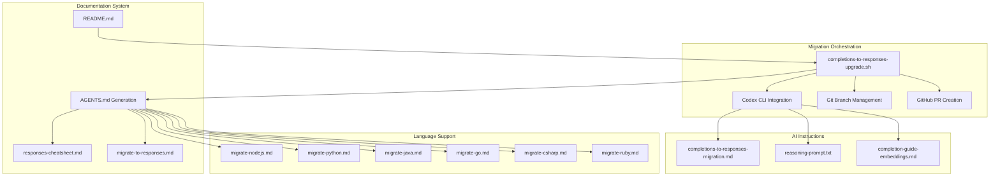
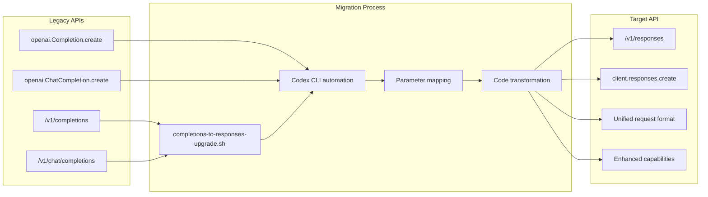

<!-- source: DeepWiki mcp.deepwiki.com · repo openai/completions-responses-migration-pack · page 1 Overview · fetched 2026-10-26 -->

# Overview

Relevant source files

The following files were used as context for generating this wiki page:

- [README.md](README.md)

This document provides a comprehensive overview of the OpenAI Completions → Responses Migration Pack, an AI-powered toolkit for transitioning codebases from legacy OpenAI APIs to the unified Responses API. The migration pack combines automated code transformation through the Codex CLI with extensive documentation and safety mechanisms to ensure reliable API migrations across multiple programming languages.

For specific migration instructions by programming language, see [Language-Specific Migration Guides](#4). For detailed script configuration and execution options, see [Migration Script Reference](#5). For complete API parameter mappings and examples, see [Responses API Reference](#6).

## System Architecture

The migration pack is built around a central orchestration script that coordinates AI-powered code transformation with comprehensive safety mechanisms and multi-language support.

### Core Component Relationships

Sources: [README.md:1-185](), [scripts/completions-to-responses-upgrade.sh]()

### API Transformation Pipeline

Sources: [README.md:96-103](), [docs/responses-cheatsheet.md]()

## Key System Components

### Main Orchestration Script

The `completions-to-responses-upgrade.sh` script serves as the primary entry point and orchestrates the entire migration process. It handles prerequisite validation, Codex CLI installation, authentication, Git branch management, and optional PR creation.

**Core Functions:**
- Repository detection and validation
- Codex CLI installation and updates
- OpenAI API authentication
- Git branch creation with timestamp-based naming (`migrate/openai-responses-<timestamp>`)
- Documentation kit preparation and embedding
- Automated code transformation execution
- Test running and result summarization
- Optional GitHub PR creation

Sources: [README.md:104-109](), [README.md:85-94]()

### AI-Powered Code Transformation

The migration leverages the Codex CLI as an AI-powered code agent to perform intelligent transformations across multiple programming languages. The system uses structured prompts and language-specific instructions to ensure accurate API migrations.

**Transformation Capabilities:**
- Endpoint migration: `/v1/completions` → `/v1/responses`
- Parameter mapping: `prompt` → `input`, `max_tokens` → `max_output_tokens`
- SDK updates: Legacy completion methods → `client.responses.create()`
- Streaming preservation where originally implemented
- Tool calling migration to unified `tools` parameter with JSON Schema
- Multi-turn conversation handling

Sources: [README.md:96-103](), [docs/completions-to-responses-migration.md]()

### Safety and Validation System

The migration pack implements multiple layers of safety to ensure reliable code transformations:

**Approval Policies:**
- `untrusted`: Sandbox mode only, no file writes
- `on-failure`: Apply changes automatically, ask for approval only on failures
- `on-request`: Interactive approval for all changes
- `never`: Apply all changes without approval (requires `--dangerous` flag)

**Git Integration:**
- Automatic branch creation with timestamped names
- Clean separation of migration changes
- Optional PR creation via GitHub CLI
- Rollback capabilities through Git

**Testing Integration:**
- Automatic test execution when test runners are detected
- Linting validation
- Summary reporting of test results
- Failure handling and reporting

Sources: [README.md:67-75](), [README.md:111-115]()

### Multi-Language Support

The system provides comprehensive support for migrating codebases across different programming languages and frameworks:

| Language | Migration Guide | Key Transformations |
|----------|----------------|-------------------|
| Node.js | `migrate-nodejs.md` | OpenAI SDK client initialization, async/await patterns |
| Python | `migrate-python.md` | `openai.Completion.create` → `client.responses.create` |
| Java | `migrate-java.md` | HTTP client updates, JSON payload construction |
| Go | `migrate-go.md` | HTTP client migration, struct definitions |
| C# | `migrate-csharp.md` | HttpClient usage, JSON serialization |
| Ruby | `migrate-ruby.md` | Net::HTTP implementation, response parsing |

Sources: [docs/migrate-nodejs.md](), [docs/migrate-python.md](), [docs/migrate-java.md](), [docs/migrate-go.md](), [docs/migrate-csharp.md](), [docs/migrate-ruby.md]()

## Migration Benefits and Motivation

### Technical Advantages

The migration from legacy APIs to the Responses API provides several technical benefits:

**GPT-5 Optimization:**
- Enhanced reasoning capabilities with encrypted reasoning tokens
- Improved performance and lower latency
- Better tool orchestration as part of reasoning process
- Cost optimization through improved cache utilization

**API Unification:**
- Single `/v1/responses` endpoint for all text generation needs
- Consistent request/response format across use cases
- Simplified client code and reduced API surface area

**Enhanced Features:**
- Stateful conversations with `store: true` and `previous_response_id`
- Built-in tools: `web_search_preview`, `file_search`, custom functions
- Flexible input formats: single string or items array
- Event-driven streaming model with semantic events

Sources: [README.md:15-25]()

### State and Security Policy

The migration toolkit enforces a security-first approach to API transitions:

- Always sets `store: false` on Responses requests for stateless operation
- Avoids using previous message IDs or server-stored context
- Maintains conversation state locally with minimal logged metadata
- No API keys written to disk, honors existing environment configuration
- Encrypted reasoning tokens included by default for enhanced privacy

Sources: [README.md:81-84](), [README.md:117-120]()

---

