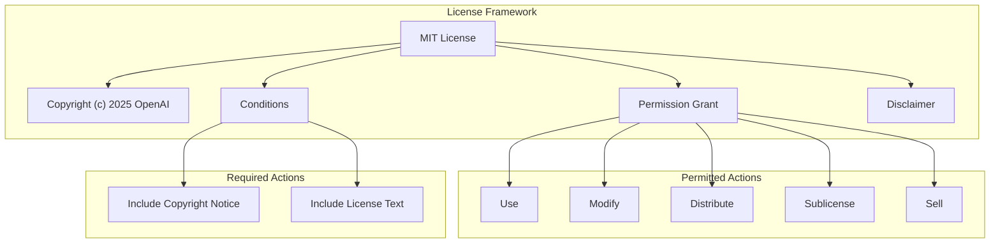
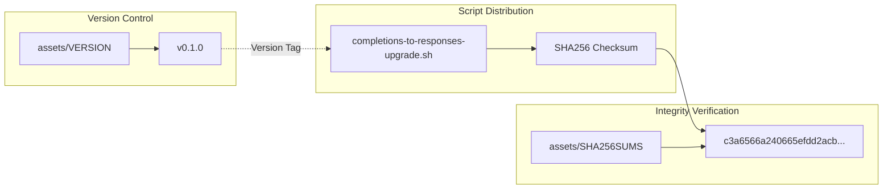
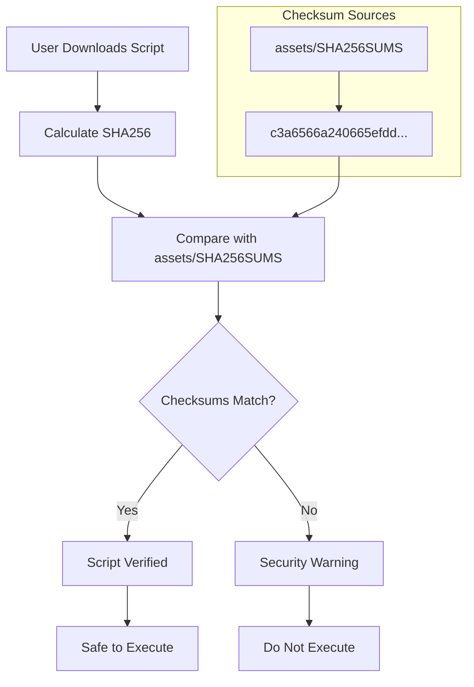
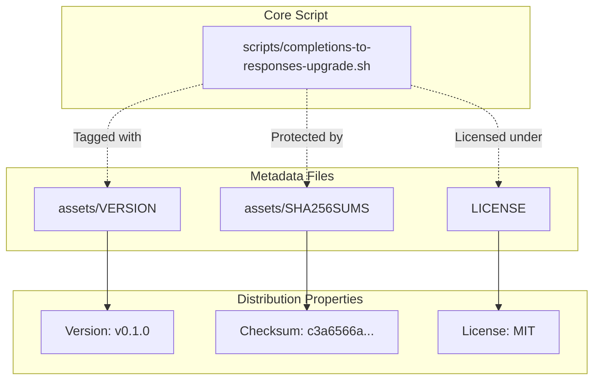

<!-- source: DeepWiki mcp.deepwiki.com · repo openai/completions-responses-migration-pack · page 10 Project Information · fetched 2026-10-26 -->

# Project Information

<details>
<summary>Relevant source files</summary>

The following files were used as context for generating this wiki page:

- [LICENSE](LICENSE)
- [assets/SHA256SUMS](assets/SHA256SUMS)
- [assets/VERSION](assets/VERSION)

</details>


This document provides essential project metadata for the completions-responses-migration-pack repository, including licensing terms, version information, security checksums, and release management details. This information is primarily used for compliance, security verification, and project governance purposes.

For detailed usage instructions, see [Getting Started](#2). For technical implementation details, see [Migration Script Reference](#5).

## License

The completions-responses-migration-pack is distributed under the MIT License, providing broad permissions for use, modification, and distribution with minimal restrictions.

### License Terms

| Aspect | Details |
|--------|---------|
| License Type | MIT License |
| Copyright Holder | OpenAI |
| Copyright Year | 2025 |
| Permissions | Use, modify, distribute, sublicense, sell |
| Conditions | Include copyright notice and license text |
| Limitations | No warranty, no liability |

The complete license text specifies that the software is provided "as is" without any warranty, and OpenAI shall not be liable for any claims or damages arising from the software's use [LICENSE:15-21]().

**Project License Structure**



Sources: [LICENSE:1-24]()

## Version Information

The project follows semantic versioning principles for release management and compatibility tracking.

### Current Version

| Component | Version |
|-----------|---------|
| Release Version | v0.1.0 |
| Version File | `assets/VERSION` |
| Status | Initial Release |

The version identifier `v0.1.0` indicates this is an initial release in the 0.x series, suggesting the API and features may still be subject to breaking changes [assets/VERSION:1]().

**Version Management Architecture**



Sources: [assets/VERSION:1]()

## Security and Integrity

The project implements cryptographic verification to ensure script integrity and prevent tampering during distribution.

### Checksum Verification

| File | SHA256 Hash |
|------|-------------|
| `scripts/completions-to-responses-upgrade.sh` | `c3a6566a240665efdd2acb806963300249012822ca8cd138c9041d92dfc64803` |

The SHA256 checksum provides a cryptographic fingerprint that users can verify to ensure the script has not been modified or corrupted [assets/SHA256SUMS:1]().

### Verification Process

Users can verify script integrity using standard cryptographic tools:

```bash
# Verify checksum against distributed script
sha256sum scripts/completions-to-responses-upgrade.sh
# Compare output with assets/SHA256SUMS
```

**Security Verification Flow**



Sources: [assets/SHA256SUMS:1-2]()

## Project Structure

The project metadata is organized across specific asset files that support distribution, verification, and compliance requirements.

### Asset Organization

| File | Purpose | Content Type |
|------|---------|--------------|
| `assets/VERSION` | Version tracking | Semantic version string |
| `assets/SHA256SUMS` | Integrity verification | Cryptographic checksums |
| `LICENSE` | Legal compliance | MIT license text |

**Project Metadata Dependencies**



Sources: [assets/VERSION:1](), [assets/SHA256SUMS:1](), [LICENSE:1-3]()

## Release Management

The current v0.1.0 release represents the initial public version of the migration toolkit, establishing the foundation for the completions-to-responses migration process.

### Release Characteristics

- **Initial Release**: First public version of the migration toolkit
- **Alpha Status**: Version 0.x indicates potential for breaking changes
- **Core Functionality**: Complete migration workflow implementation
- **Security Ready**: Cryptographic integrity verification included

### Future Versioning

The semantic versioning approach suggests:
- **Patch versions (0.1.x)**: Bug fixes and minor improvements
- **Minor versions (0.x.0)**: New features and enhancements
- **Major versions (1.0.0)**: API stability and production readiness

Sources: [assets/VERSION:1](), [assets/SHA256SUMS:1-2](), [LICENSE:1-24]()