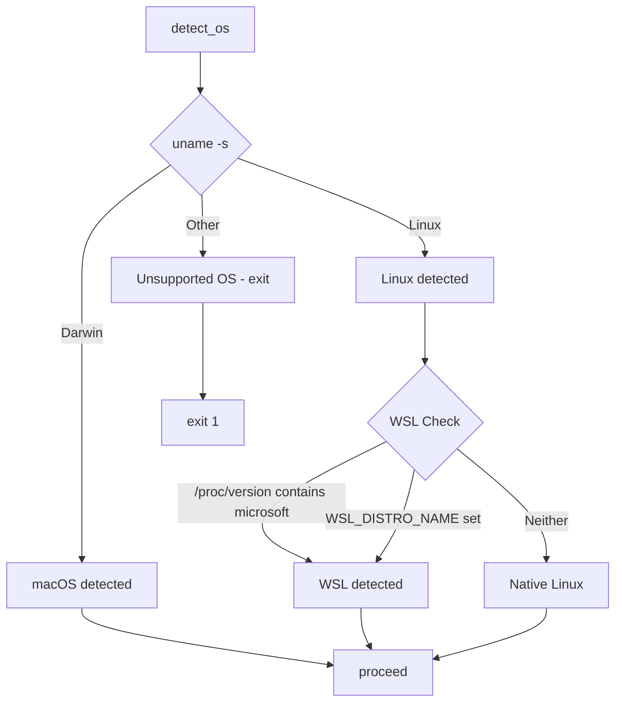
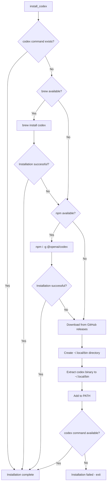
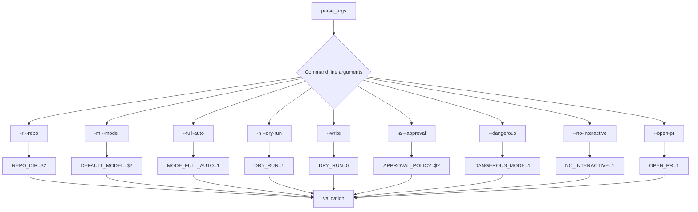
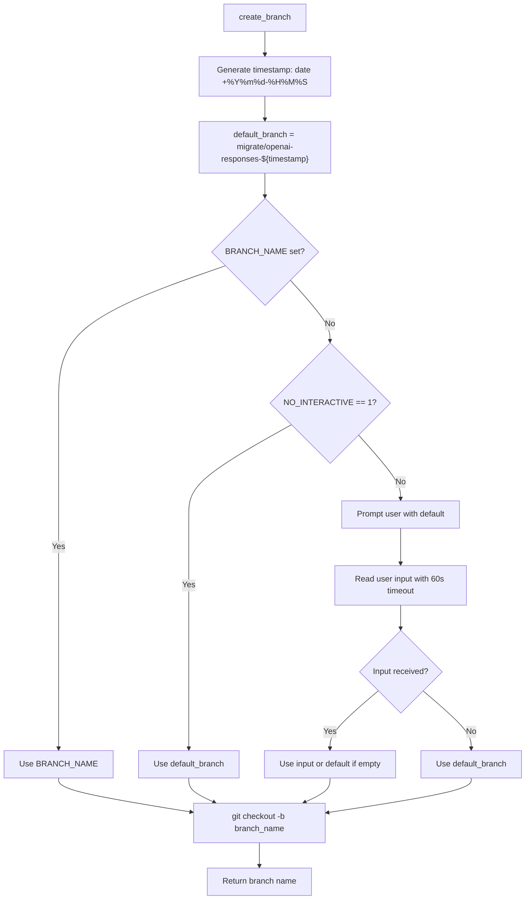

<!-- source: DeepWiki mcp.deepwiki.com · repo openai/completions-responses-migration-pack · page 2 Getting Started · fetched 2026-10-26 -->

# Getting Started

<details>
<summary>Relevant source files</summary>

The following files were used as context for generating this wiki page:

- [README.md](README.md)
- [scripts/completions-to-responses-upgrade.sh](scripts/completions-to-responses-upgrade.sh)

</details>


This document provides step-by-step instructions for setting up and executing the migration script to transition from OpenAI's legacy Completions/Chat Completions APIs to the unified Responses API. It covers prerequisites, installation, basic execution modes, and initial run configuration.

For detailed information about the migration script's configuration options and advanced features, see [Script Configuration](#5.1). For language-specific migration examples and best practices, see [Language-Specific Migration Guides](#4).

## Prerequisites

The migration toolkit requires a Unix-like environment and several core dependencies to function properly.

### System Requirements

| Requirement | Supported Versions | Notes |
|-------------|-------------------|--------|
| Operating System | macOS, Linux, Windows (WSL2) | Windows requires WSL2 environment |
| Git | Any recent version | Used for branch creation and repository management |
| curl | Any recent version | Required for downloading components |
| OpenAI API Access | Active API key | Can be set via `OPENAI_API_KEY` or interactive login |

The script automatically detects WSL environments and adjusts behavior accordingly. Windows users must run the script within WSL2 rather than native Windows.

**System Detection Workflow**


Sources: [scripts/completions-to-responses-upgrade.sh:90-100]()

### Authentication Setup

The script requires OpenAI API access through one of two methods:

1. **Environment Variable**: Set `OPENAI_API_KEY` with your API key
2. **Interactive Login**: Use `codex login` command during execution

The `ensure_auth()` function handles authentication by first checking for the environment variable, then falling back to interactive login if needed.

Sources: [scripts/completions-to-responses-upgrade.sh:153-160]()

## Installation Workflow

The migration toolkit uses the Codex CLI as its core engine. The script automatically handles Codex installation through multiple fallback methods.

**Codex Installation Process**


Sources: [scripts/completions-to-responses-upgrade.sh:121-151]()

The installation function `install_codex()` implements a robust fallback strategy:
1. Check if `codex` command already exists
2. Try Homebrew installation (`brew install codex`)
3. Try npm installation (`npm i -g @openai/codex`)
4. Download binary from GitHub releases as last resort

## Execution Modes

The script supports multiple execution modes to accommodate different use cases and safety requirements.

### Quick Start Options

**One-liner execution (GitHub-hosted)**:
```bash
/bin/bash -c "$(curl -fsSL https://raw.githubusercontent.com/openai/completions-responses-migration-pack/main/scripts/completions-to-responses-upgrade.sh)"
```

**Interactive mode** (prompts for repository and model preferences):
```bash
bash scripts/completions-to-responses-upgrade.sh
```

**Non-interactive mode** (requires explicit repository path):
```bash
bash scripts/completions-to-responses-upgrade.sh --repo /path/to/repo --no-interactive
```

### Safety and Control Modes

| Mode | Command | Behavior | Use Case |
|------|---------|----------|----------|
| Dry Run | `--dry-run` | Plans changes without writing | Preview migration impact |
| Write Mode | `--write` | Applies changes to files | Standard migration |
| Full Auto | `--full-auto` | No approval prompts | CI/CD environments |

**Command Line Flag Processing**


Sources: [scripts/completions-to-responses-upgrade.sh:69-87]()

### Approval Policies

The script implements several approval policies controlled by the `--approval` flag:

- `untrusted`: Sandbox mode only, no file modifications
- `on-failure`: Apply changes directly, ask for approval only on failures
- `on-request`: Prompt for approval on each significant change
- `never`: Apply all changes without prompts (dangerous)

Sources: [scripts/completions-to-responses-upgrade.sh:90]()

## First Run Walkthrough

A typical first-time execution involves several automated steps managed by the `main()` function.

### Repository Selection and Validation

The `choose_repo()` function handles repository selection through two paths:

1. **Explicit path**: When `--repo` flag is provided
2. **Interactive prompt**: When running in interactive mode

```bash
# Example: Interactive repository selection
[?] Path to the repository to migrate: /path/to/my-project
```

The function validates that the target directory exists and contains a valid Git repository using `git rev-parse --is-inside-work-tree`.

Sources: [scripts/completions-to-responses-upgrade.sh:162-175]()

### Model Migration Preference

The `ask_model_preference()` function determines whether to migrate model references to GPT-5:

```bash
[?] Migrate model references to gpt-5? [Y/n]: 
```

This setting affects:
- Model parameter updates in API calls
- Temperature validation (GPT-5 requires temperature unset or equal to 1)
- Model reference consistency across the codebase

Sources: [scripts/completions-to-responses-upgrade.sh:177-195]()

### Branch Creation

The script creates a dedicated migration branch using the `create_branch()` function:

**Branch Creation Logic**


Sources: [scripts/completions-to-responses-upgrade.sh:202-221]()

### Migration Kit Preparation

The `prep_kit()` function sets up the documentation and guidance files that Codex uses during migration:

1. Creates temporary kit directory with embedded documentation
2. Copies local documentation if script is run from the repository
3. Creates or augments `AGENTS.md` with migration instructions
4. Sets environment variables for Codex integration

The function embeds essential documentation including `responses-cheatsheet.md` and migration prompts directly in the script, ensuring availability even when run remotely.

Sources: [scripts/completions-to-responses-upgrade.sh:242-335]()

## Execution Summary

After repository setup and configuration, the script proceeds to:

1. **Codex Execution**: Launch the AI migration agent with configured parameters
2. **Safety Validation**: Apply approval policies and sandbox restrictions
3. **Post-processing**: Handle commits, cleanup, and optional PR creation

The `run_codex()` function coordinates the AI-powered migration with extensive safety controls and validation logic.

For detailed information about the Codex execution process and advanced configuration options, see [Execution Modes](#5.2).

Sources: [scripts/completions-to-responses-upgrade.sh:552-574]()

---

