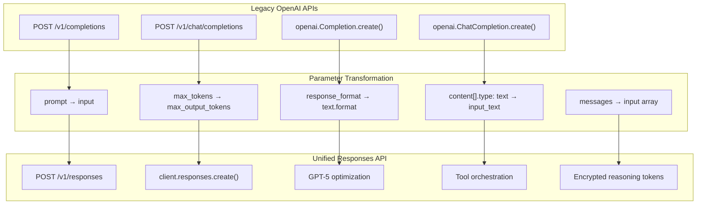
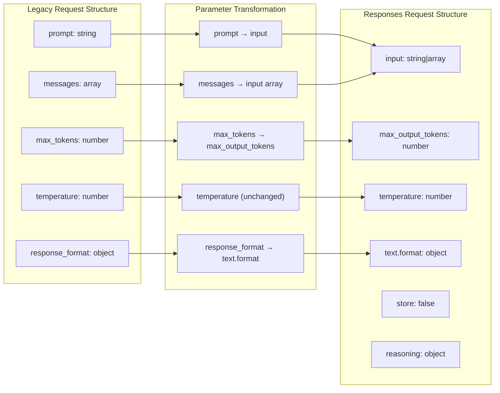
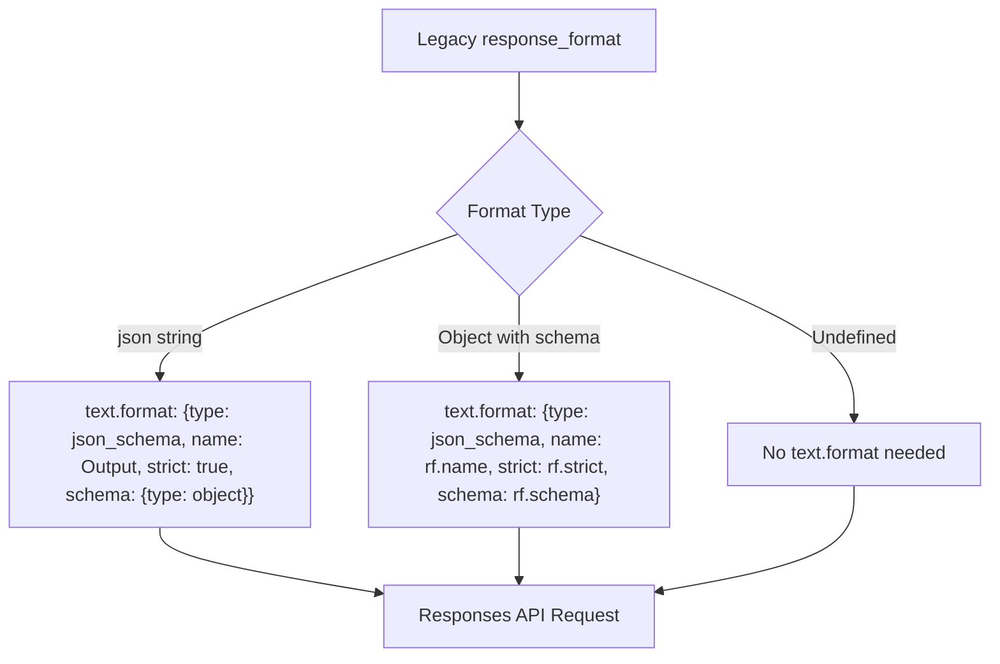
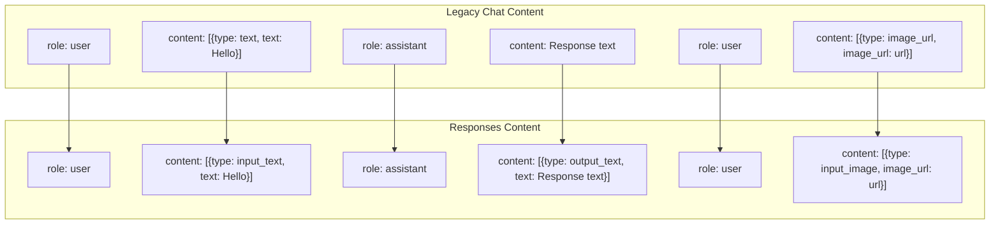
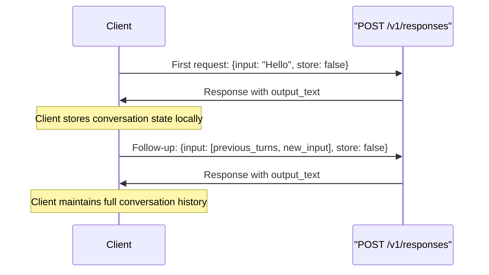

<!-- source: DeepWiki mcp.deepwiki.com · repo openai/completions-responses-migration-pack · page 3 Understanding the Migration · fetched 2026-10-26 -->

# Understanding the Migration

Relevant source files

The following files were used as context for generating this wiki page:

- [docs/migration-notes.md](docs/migration-notes.md)
- [docs/responses-cheatsheet.md](docs/responses-cheatsheet.md)

This document explains the fundamental changes between OpenAI's legacy APIs (Completions and Chat Completions) and the new unified Responses API. It covers the key architectural differences, parameter mappings, and benefits that drive the migration process.

For specific implementation guidance in different programming languages, see [Language-Specific Migration Guides](#4). For detailed API parameter documentation, see [Responses API Reference](#6).

## Migration Overview and Benefits

The migration from legacy OpenAI APIs to the Responses API represents a shift from multiple specialized endpoints to a single unified interface optimized for GPT-5 and future models.

### Why Migrate

The Responses API serves as the unified interface for text generation, tool orchestration, and streaming capabilities. Legacy Completions and Chat Completions endpoints are deprecated and cause performance degradation with GPT-5. Specifically, GPT-5 orchestrates tool calls as part of its internal reasoning process and relies on the Responses API's structured tool flow. Using legacy endpoints can degrade intelligence and cause repeated tool calls because they don't preserve the model's tool context.

**Core Migration Diagram**

Sources: [docs/migration-notes.md:1-14]()

## API Endpoint Transformation

The migration consolidates multiple endpoints into a single unified interface with enhanced capabilities.

### Endpoint Changes

| Legacy API | New API | Purpose |
|------------|---------|---------|
| `POST /v1/completions` | `POST /v1/responses` | Text completion |
| `POST /v1/chat/completions` | `POST /v1/responses` | Conversational AI |

**Request Structure Comparison**

Sources: [docs/migration-notes.md:4-5](), [docs/responses-cheatsheet.md:3-22]()

## Parameter Mapping Changes

### Core Parameter Transformations

The migration involves systematic parameter renaming and restructuring:

| Legacy Parameter | Responses Parameter | Notes |
|------------------|-------------------|-------|
| `prompt` | `input` | Accepts string or array format |
| `max_tokens` | `max_output_tokens` | Clearer naming convention |
| `temperature` | `temperature` | Unchanged |
| `response_format` | `text.format` | Structured object required |
| `stop` | `stop` | Supported as relevant |
| `frequency_penalty` | `frequency_penalty` | Supported as relevant |
| `presence_penalty` | `presence_penalty` | Supported as relevant |

### Response Format Transformation

Legacy `response_format` handling requires specific transformation logic:

The transformation logic is implemented in the migration helper function:

Sources: [docs/migration-notes.md:49-58](), [docs/responses-cheatsheet.md:14-17]()

## Content Type Changes

### Message Content Structure

The Responses API introduces specific content type identifiers for different input and output scenarios:

| Legacy Content Type | Responses Content Type | Usage |
|-------------------|----------------------|-------|
| `content[].type: "text"` | `content[].type: "input_text"` | User/system input |
| Assistant responses | `content[].type: "output_text"` | Assistant/tool outputs |
| `content[].type: "image_url"` | `content[].type: "input_image"` | Image inputs |

**Content Type Transformation Flow**

Sources: [docs/migration-notes.md:7-8](), [docs/responses-cheatsheet.md:169]()

## GPT-5 Reasoning Integration

### Reasoning Effort Configuration

The Responses API introduces reasoning capabilities optimized for different model families:

| Source Model Family | Reasoning Configuration | Example Models |
|-------------------|------------------------|----------------|
| o-series models | `reasoning: { effort: "medium" }` | o3, o4-mini, o1, o1-preview |
| GPT-series models | `reasoning: { effort: "minimal" }` | gpt-4, gpt-4.1, gpt-4o, gpt-3.5 |

The migration process includes automatic reasoning effort detection based on the original model string, defaulting to minimal effort unless the model clearly starts with "o".

### Encrypted Reasoning Tokens

All reasoning operations use encrypted reasoning tokens rather than plaintext chain-of-thought output, ensuring security while maintaining reasoning capabilities.

Sources: [docs/migration-notes.md:10-14](), [docs/responses-cheatsheet.md:92-96]()

## SDK and Client Changes

### Client Initialization

Legacy SDK patterns are replaced with unified client methods:

| Legacy Pattern | Responses Pattern |
|----------------|------------------|
| `openai.Completion.create()` | `client.responses.create()` |
| `openai.ChatCompletion.create()` | `client.responses.create()` |

### Required SDK Versions

Migration requires upgrading to compatible SDK versions:
- Node.js: `openai@latest`
- Python: `pip install -U openai`

Sources: [docs/migration-notes.md:71-72]()

## Data Retention and State Management

### Storage Configuration

The Responses API requires explicit state management:

- **Default setting**: `store: false` for all requests
- **State management**: Client-side conversation state handling
- **No server retention**: Eliminates dependency on server-stored context
- **Explicit input**: All conversation history passed in `input` array

### Multi-turn Conversation Pattern

Sources: [docs/migration-notes.md:75-80](), [docs/responses-cheatsheet.md:127-131]()

## Tool Integration Changes

### Function Calling Migration

Legacy Chat Completions function-calling is replaced with structured tool definitions:

- **Tool definition**: JSON Schema-based parameter specification
- **Tool choice**: `tool_choice` parameter for execution control
- **Tool results**: Returned via follow-up requests with `tool` role items
- **Built-in tools**: Support for integrated tools like `web_search_preview`

### Tool Orchestration Benefits

GPT-5's internal tool orchestration provides:
- Reduced repeated tool calls
- Maintained tool context across interactions
- Improved reasoning about tool usage
- Stateless request handling with tool state management

Sources: [docs/migration-notes.md:74](), [docs/responses-cheatsheet.md:77-90]()

---

