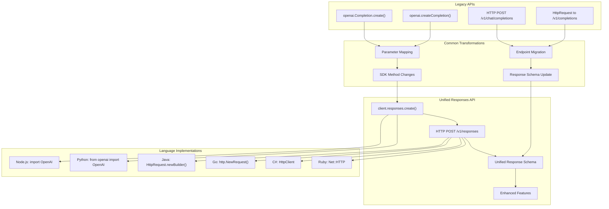
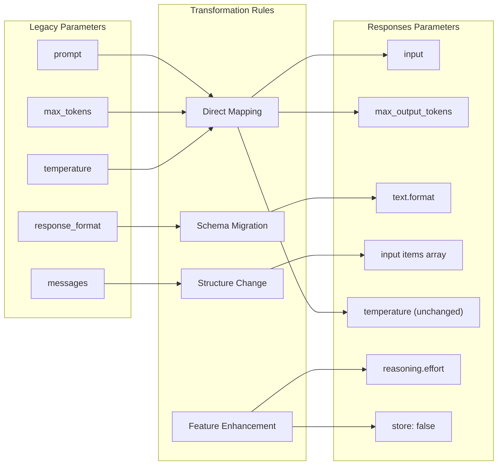
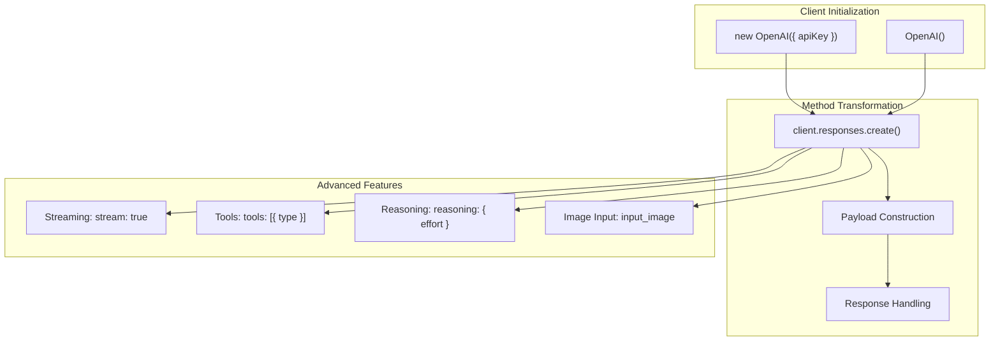
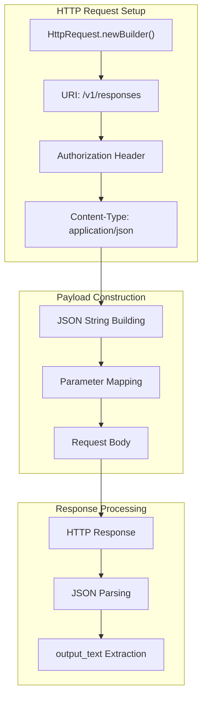

<!-- source: DeepWiki mcp.deepwiki.com · repo openai/completions-responses-migration-pack · page 4 Language-Specific Migration Guides · fetched 2026-10-26 -->

# Language-Specific Migration Guides

Relevant source files

The following files were used as context for generating this wiki page:

- [docs/language-recipes/java.md](docs/language-recipes/java.md)
- [docs/language-recipes/node.md](docs/language-recipes/node.md)
- [docs/language-recipes/python.md](docs/language-recipes/python.md)

This document provides comprehensive migration instructions for transitioning from OpenAI's legacy Completions and Chat APIs to the unified Responses API across multiple programming languages and environments. Each language guide includes practical examples, parameter mappings, and platform-specific implementation details.

For information about the overall migration process and script execution, see [Getting Started](#2). For detailed API reference documentation, see [Responses API Reference](#6).

## Overview of Language Support

The migration toolkit supports transformation of legacy OpenAI API calls across six major programming languages and environments. Each language follows the same core transformation pattern while accommodating language-specific idioms and SDK differences.

### Supported Environments

| Language | Primary Interface | Migration Focus |
|----------|------------------|-----------------|
| Node.js | OpenAI SDK v4+ | Client method transformation |
| Python | OpenAI Python SDK | Library method migration |
| Java | HTTP Client | Direct HTTP API calls |
| Go | HTTP Client | Request/response handling |
| C# | HttpClient | JSON payload construction |
| Ruby | Net::HTTP | HTTP endpoint migration |

**Sources:** [docs/language-recipes/node.md:1-148](), [docs/language-recipes/python.md:1-44](), [docs/language-recipes/java.md:1-31]()

## Migration Transformation Flow

The following diagram illustrates how legacy API calls transform to the unified Responses API across different programming languages:

**Sources:** [docs/language-recipes/node.md:6-21](), [docs/language-recipes/python.md:5-19](), [docs/language-recipes/java.md:3-16]()

## Parameter Mapping Patterns

All languages follow consistent parameter transformations when migrating from legacy APIs to the Responses API:

### Core Parameter Transformations

| Legacy Parameter | Responses Parameter | Notes |
|------------------|-------------------|-------|
| `prompt` | `input` | String or structured input items |
| `max_tokens` | `max_output_tokens` | Same value, different name |
| `temperature` | `temperature` | Unchanged |
| `response_format` | `text.format` | JSON schema structure |
| `messages` | `input` | Array of input items with role/content |

**Sources:** [docs/language-recipes/node.md:69-88](), [docs/language-recipes/python.md:36-40](), [docs/language-recipes/java.md:3-5]()

## Language-Specific Implementation Patterns

### SDK-Based Languages (Node.js, Python)

These languages use the official OpenAI SDK and follow object-oriented patterns:

**Sources:** [docs/language-recipes/node.md:16-35](), [docs/language-recipes/python.md:14-34]()

### HTTP-Based Languages (Java, Go, C#, Ruby)

These languages work directly with HTTP clients and require manual request construction:

**Sources:** [docs/language-recipes/java.md:10-28]()

## Detailed Language Guides

For comprehensive migration instructions specific to each programming language:

- **Node.js Applications**: See [Node.js Migration](#4.1) for SDK client usage, streaming, and TypeScript examples
- **Python Projects**: See [Python Migration](#4.2) for library method transformations and async patterns  
- **Java HTTP Clients**: See [Java Migration](#4.3) for HTTP request construction and response parsing
- **Go Applications**: See [Go Migration](#4.4) for HTTP client implementation and error handling
- **C# Projects**: See [C# Migration](#4.5) for HttpClient usage and JSON serialization
- **Ruby Scripts**: See [Ruby Migration](#4.6) for Net::HTTP implementation and stateless requests

Each guide includes before/after code examples, parameter mapping tables, and language-specific best practices for implementing the Responses API.

**Sources:** [docs/language-recipes/node.md:1-148](), [docs/language-recipes/python.md:1-44](), [docs/language-recipes/java.md:1-31]()

---

