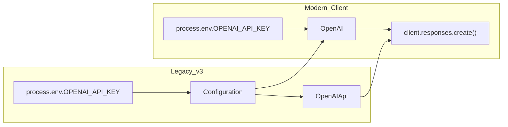
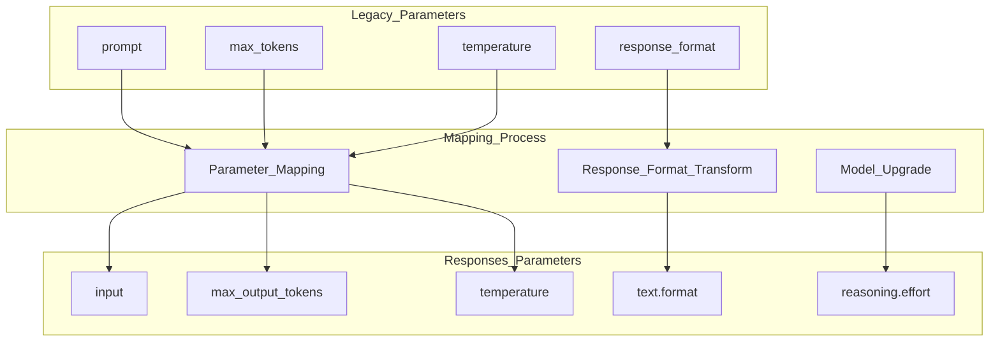
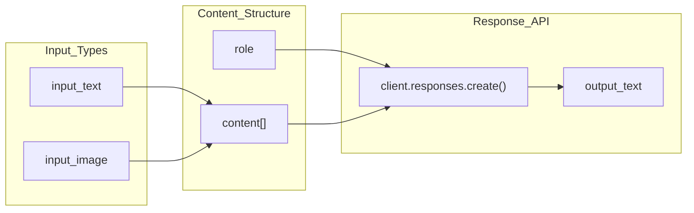
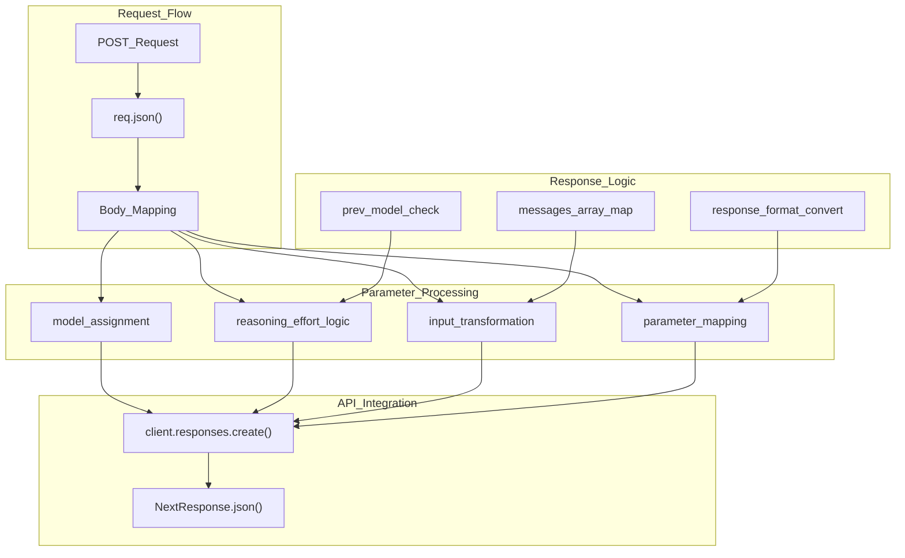

<!-- source: DeepWiki mcp.deepwiki.com · repo openai/completions-responses-migration-pack · page 4.1 Node.js Migration · fetched 2026-10-26 -->

# Node.js Migration

Relevant source files

The following files were used as context for generating this wiki page:

- [docs/language-recipes/node.md](docs/language-recipes/node.md)

This page provides detailed guidance for migrating Node.js applications from legacy OpenAI APIs (Completions and Chat) to the unified Responses API. This covers client initialization, parameter mapping, streaming, and framework integration patterns.

For general migration concepts and API differences, see [Understanding the Migration](#3). For migration script automation, see [Migration Script Reference](#5).

## Client Initialization Changes

The migration involves updating from the legacy openai v3 SDK pattern to the modern client initialization approach.

**Legacy Pattern**
The old approach used `Configuration` and `OpenAIApi` classes with separate instantiation steps, as shown in [docs/language-recipes/node.md:6-8]().

**Modern Pattern** 
The new approach uses direct `OpenAI` client instantiation with simplified configuration, as demonstrated in [docs/language-recipes/node.md:16-17]().

### Client Initialization Transformation

Sources: [docs/language-recipes/node.md:6-20]()

## Method and Parameter Mapping

The core API method calls undergo significant changes in both naming and parameter structure.

| Legacy API | Modern API | Key Changes |
|------------|------------|-------------|
| `openai.createCompletion()` | `client.responses.create()` | Unified endpoint |
| `prompt` | `input` | Parameter rename |
| `max_tokens` | `max_output_tokens` | Parameter rename |
| `model: "text-davinci-003"` | `model: "gpt-5"` | Model update |
| `res.data.choices[0].text` | `res.output_text` | Response structure |

### Parameter Transformation Flow

Sources: [docs/language-recipes/node.md:69-88]()

## Advanced Features Integration

### Reasoning and Stateless Requests

The new API introduces reasoning capabilities with encrypted tokens by default, as shown in [docs/language-recipes/node.md:22-35](). The `store: false` parameter ensures stateless operation, while `reasoning.effort` controls computational intensity.

### Streaming Implementation

Streaming maintains similar patterns but with updated method calls and event handling, demonstrated in [docs/language-recipes/node.md:37-44](). The `stream: true` parameter enables real-time response processing through async iteration.

### Built-in Tools Integration

The Responses API includes native tool support without requiring separate function definitions, as exemplified in [docs/language-recipes/node.md:45-54]() with the `web_search_preview` tool.

## Multi-Modal Input Handling

### Image Input Structure

The new API supports mixed content types within the same request, as demonstrated in [docs/language-recipes/node.md:56-67](), enabling seamless multi-modal interactions.

Sources: [docs/language-recipes/node.md:56-99]()

## Framework Integration Patterns

### Next.js Route Handler Implementation

The migration includes comprehensive framework integration examples, particularly for Next.js API routes. The implementation in [docs/language-recipes/node.md:101-145]() demonstrates:

- Request body mapping from legacy to modern parameters
- Conditional reasoning effort assignment based on model family
- Message array transformation to input format
- Response format conversion from `response_format` to `text.format`

### Integration Architecture

Sources: [docs/language-recipes/node.md:101-145]()

## Migration Checklist

### Required Changes
- [ ] Update import statements from `require("openai")` to `import OpenAI from "openai"`
- [ ] Replace `Configuration` and `OpenAIApi` with direct `OpenAI` instantiation
- [ ] Change `createCompletion()` calls to `client.responses.create()`
- [ ] Map `prompt` parameter to `input`
- [ ] Update `max_tokens` to `max_output_tokens`
- [ ] Modify response access from `res.data.choices[0].text` to `res.output_text`

### Optional Enhancements
- [ ] Add reasoning configuration for GPT-5 optimization
- [ ] Implement stateless requests with `store: false`
- [ ] Integrate built-in tools for enhanced capabilities
- [ ] Update streaming implementations for new event structure
- [ ] Convert response format configurations to `text.format`

Sources: [docs/language-recipes/node.md:1-148]()

---

