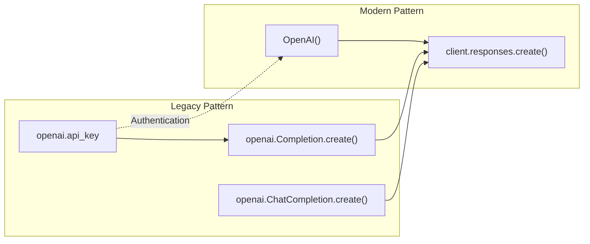
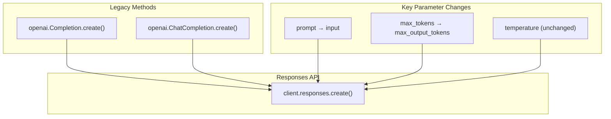
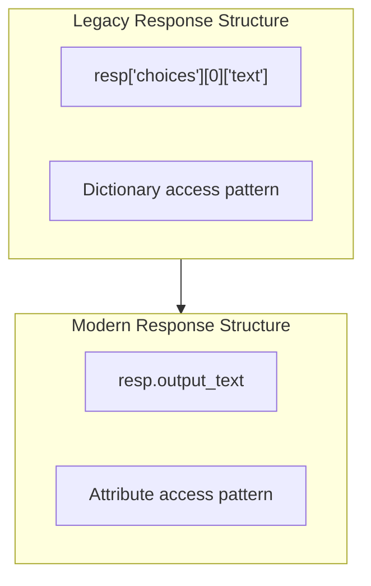
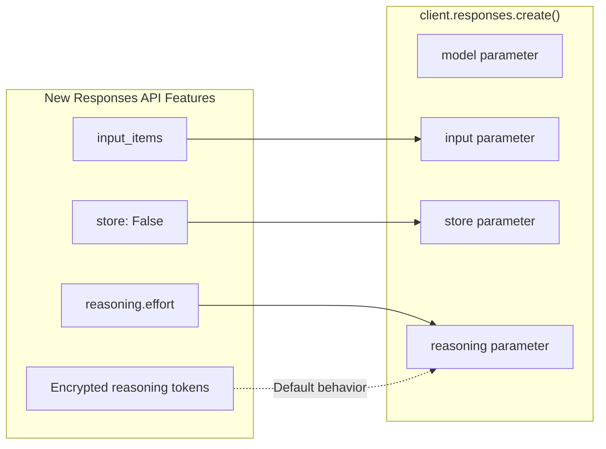

<!-- source: DeepWiki mcp.deepwiki.com · repo openai/completions-responses-migration-pack · page 4.2 Python Migration · fetched 2026-10-26 -->

# Python Migration

Relevant source files

The following files were used as context for generating this wiki page:

- [docs/language-recipes/python.md](docs/language-recipes/python.md)

## Purpose and Scope

This document provides comprehensive guidance for migrating Python applications from OpenAI's legacy Completions and Chat APIs to the unified Responses API. It covers client initialization patterns, parameter mappings, response handling, and advanced features specific to Python implementations using the OpenAI Python SDK.

For general migration concepts and API differences, see [Understanding the Migration](#3). For script automation of Python migrations, see [Migration Script Reference](#5).

## Migration Overview

The Python migration involves transitioning from the legacy `openai.Completion.create()` and `openai.ChatCompletion.create()` methods to the new `client.responses.create()` pattern. This change introduces a more modern client-based approach with enhanced capabilities.

### Legacy to Modern Client Pattern

Sources: [docs/language-recipes/python.md:1-44]()

## API Method Transformations

The core transformation involves replacing multiple legacy endpoints with a single unified method:

Sources: [docs/language-recipes/python.md:36-40]()

## Client Initialization Migration

### Legacy Authentication Pattern

The legacy approach used global API key configuration:

| Legacy Pattern | New Pattern |
|---|---|
| `openai.api_key = os.getenv("OPENAI_API_KEY")` | `client = OpenAI()` |
| Global state management | Instance-based client |
| Manual key assignment | Automatic environment detection |

Sources: [docs/language-recipes/python.md:6-7](), [docs/language-recipes/python.md:15-16]()

### Modern Client Initialization

The new pattern uses the `OpenAI()` constructor which automatically handles authentication through environment variables or explicit configuration.

Sources: [docs/language-recipes/python.md:15-16]()

## Parameter Mapping Reference

### Core Parameter Transformations

| Legacy Parameter | Responses API Parameter | Notes |
|---|---|---|
| `prompt` | `input` | String input becomes `input` |
| `max_tokens` | `max_output_tokens` | Output length control |
| `temperature` | `temperature` | Unchanged |
| `model` | `model` | Typically migrates to `"gpt-5"` |

Sources: [docs/language-recipes/python.md:36-40]()

### Response Handling Changes

Sources: [docs/language-recipes/python.md:9](), [docs/language-recipes/python.md:18]()

## Advanced Features

### Reasoning and Stateless Requests

The new Responses API introduces reasoning capabilities with encrypted reasoning tokens by default:

The `reasoning.effort` parameter accepts values like `"minimal"` to control computational effort for reasoning tasks.

Sources: [docs/language-recipes/python.md:21-34]()

### Stateless Operation

Setting `store=False` ensures stateless requests where no conversation history or reasoning tokens are persisted on OpenAI's servers, enhancing privacy and security.

Sources: [docs/language-recipes/python.md:30]()

## Streaming Considerations

For applications that previously used streaming with the legacy APIs, the migration requires following the updated streaming patterns in the OpenAI Python library. The specific streaming implementation details are covered in the library's streaming documentation.

Sources: [docs/language-recipes/python.md:41]()

## Migration Code Examples

### Basic Migration Pattern

The simplest migration transforms a basic completion call:

**Before (Legacy):** [docs/language-recipes/python.md:5-9]()
**After (Responses API):** [docs/language-recipes/python.md:14-18]()

### Advanced Migration with Reasoning

For applications requiring reasoning capabilities:

**Advanced Pattern:** [docs/language-recipes/python.md:23-33]()

This pattern demonstrates the integration of reasoning parameters and stateless operation mode available in the new API.

Sources: [docs/language-recipes/python.md:1-44]()

---

