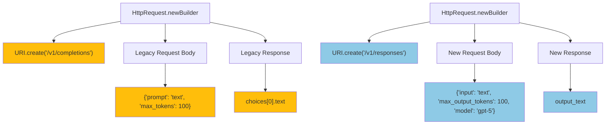
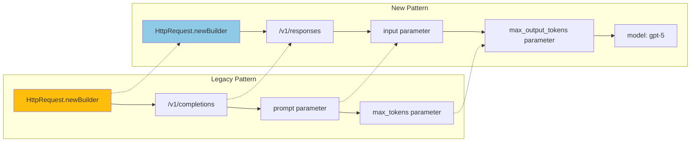
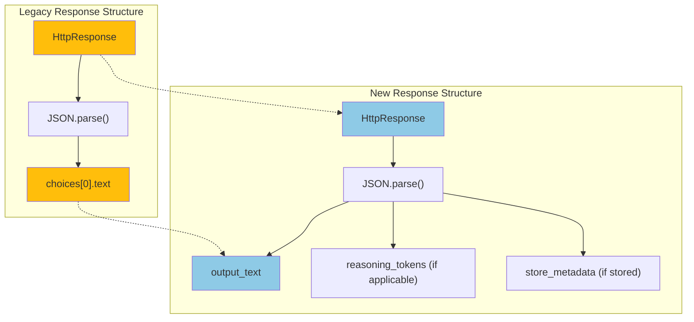

<!-- source: DeepWiki mcp.deepwiki.com · repo openai/completions-responses-migration-pack · page 4.3 Java Migration · fetched 2026-10-26 -->

# Java Migration

<details>
<summary>Relevant source files</summary>

The following files were used as context for generating this wiki page:

- [docs/language-recipes/java.md](docs/language-recipes/java.md)

</details>


This document provides detailed instructions for migrating Java applications from OpenAI's legacy APIs (`/v1/completions` and `/v1/chat/completions`) to the unified `/v1/responses` API. It covers HTTP client migration, parameter mapping, request construction, and response handling patterns specific to Java development environments.

For general migration concepts and API differences, see [Understanding the Migration](#3). For automated migration using the toolkit script, see [Migration Script Reference](#5).

## Migration Overview

The Java migration process involves updating HTTP client code to target the new `/v1/responses` endpoint with transformed request parameters and updated response parsing logic.

### API Transformation Flow



*Sources: docs/language-recipes/java.md:1-5*

### Java HTTP Client Migration Pattern



*Sources: docs/language-recipes/java.md:3-4*

## HTTP Client Migration

### Basic Request Construction

The primary migration involves updating the URI endpoint and transforming the request body parameters. Java applications typically use `HttpRequest.newBuilder()` for API calls.

| Legacy Implementation | New Implementation |
|----------------------|-------------------|
| `URI.create("https://api.openai.com/v1/completions")` | `URI.create("https://api.openai.com/v1/responses")` |
| `"prompt": "text"` | `"input": "text"` |
| `"max_tokens": 100` | `"max_output_tokens": 100` |
| Optional `model` parameter | Required `"model": "gpt-5"` |

The basic HTTP request pattern is demonstrated in [docs/language-recipes/java.md:10-16](), showing the complete `HttpRequest` construction with proper headers and JSON payload.

*Sources: docs/language-recipes/java.md:7-16*

## Parameter Mapping

### Core Parameter Transformations

| Legacy Parameter | Responses Parameter | Description |
|-----------------|-------------------|-------------|
| `prompt` | `input` | Text input for completion |
| `max_tokens` | `max_output_tokens` | Maximum tokens in response |
| `model` (optional) | `model` (required) | Must specify "gpt-5" |
| N/A | `store` | Set to `false` for stateless requests |
| N/A | `reasoning.effort` | Control reasoning computation |

*Sources: docs/language-recipes/java.md:3-4*

### Request Body Construction

Java applications construct JSON request bodies as strings when using the standard `HttpRequest.BodyPublishers.ofString()` method. The new format requires:

1. **Model specification**: Always include `"model": "gpt-5"`
2. **Input transformation**: Replace `prompt` with `input`
3. **Token limit adjustment**: Use `max_output_tokens` instead of `max_tokens`

*Sources: docs/language-recipes/java.md:14, 21*

## Advanced Features

### Stateless Requests with Reasoning

The Responses API supports enhanced features like reasoning control and stateless operation. The example in [docs/language-recipes/java.md:20-28]() demonstrates:

```java
String payload = "{\"model\":\"gpt-5\",\"input\":\"Hello\",\"store\":false,\"reasoning\":{\"effort\":\"minimal\"}}";
```

This payload includes:
- **`store: false`**: Ensures stateless request processing
- **`reasoning.effort`**: Controls computational effort for reasoning ("minimal", "standard", "extended")

### HTTP Request Headers

Both legacy and new implementations require identical authentication and content-type headers:
- `Authorization: Bearer ${OPENAI_API_KEY}`
- `Content-Type: application/json`

*Sources: docs/language-recipes/java.md:18-28*

## Response Handling

### Response Schema Changes

The Responses API returns a different response structure that requires updated parsing logic:



*Sources: docs/language-recipes/java.md:5*

### Response Processing

When using Java HTTP clients, response parsing should be updated to:

1. **Extract text content**: Access `output_text` instead of `choices[0].text`
2. **Handle reasoning data**: Process `reasoning_tokens` if reasoning was requested
3. **Validate model response**: Ensure the response matches the expected GPT-5 format

The migration toolkit automatically handles these transformations when processing Java codebases that use standard HTTP client patterns.

*Sources: docs/language-recipes/java.md:5*

---

