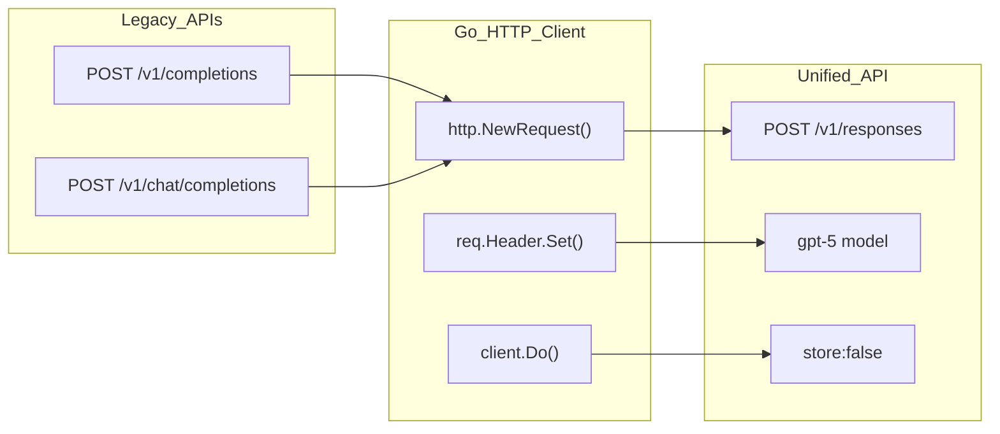
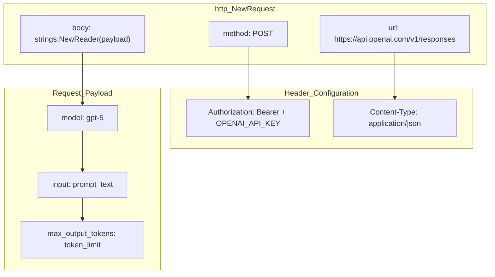
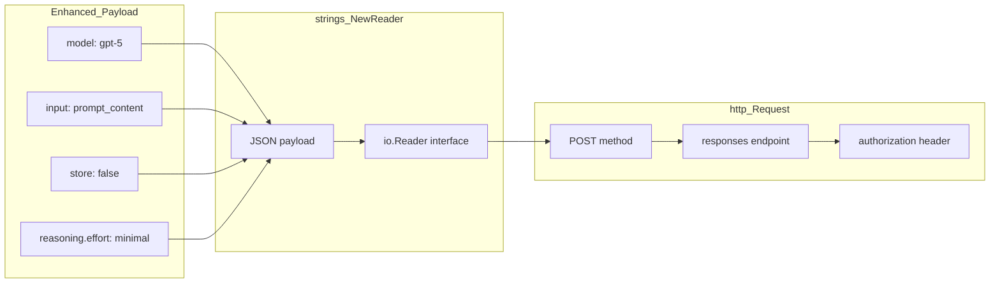
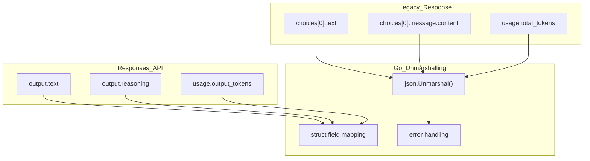

<!-- source: DeepWiki mcp.deepwiki.com · repo openai/completions-responses-migration-pack · page 4.4 Go Migration · fetched 2026-10-26 -->

# Go Migration

Relevant source files

The following files were used as context for generating this wiki page:

- [docs/language-recipes/go.md](docs/language-recipes/go.md)

This document provides comprehensive guidance for migrating Go applications from OpenAI's legacy Completions and Chat APIs to the unified Responses API. It covers HTTP client implementation, request construction, parameter mapping, and response handling patterns specific to Go.

For general migration concepts and API differences, see [Understanding the Migration](#3). For script automation of Go codebases, see [Migration Script Reference](#5).

## Migration Overview

The Go migration process involves updating HTTP clients to use the new `/v1/responses` endpoint while transforming request parameters and response handling logic.

### API Endpoint Transformation

**Sources:** [docs/language-recipes/go.md:1-27]()

## HTTP Client Implementation

Go applications typically use the `net/http` package to interact with OpenAI APIs. The migration involves updating the endpoint URL and request construction patterns.

### Basic Request Structure

The fundamental HTTP request structure changes from multiple endpoints to a single `/v1/responses` endpoint:

**Sources:** [docs/language-recipes/go.md:7-14]()

## Parameter Mapping

The migration requires transforming legacy parameters to match the Responses API schema:

| Legacy Parameter | Responses API Parameter | Go Implementation |
|------------------|------------------------|-------------------|
| `prompt` | `input` | String field in JSON payload |
| `max_tokens` | `max_output_tokens` | Integer field in JSON payload |
| `response_format` | `text.format` | Nested object structure |
| `model` | `model` | Set to `gpt-5` |

**Sources:** [docs/language-recipes/go.md:4]()

## Request Construction Patterns

### Standard Request

The basic migration pattern involves constructing a JSON payload with the new parameter structure:

**Sources:** [docs/language-recipes/go.md:9-14]()

### Enhanced Request with Reasoning

For applications requiring reasoning capabilities, the request includes additional parameters:

**Sources:** [docs/language-recipes/go.md:16-24]()

## Response Handling Migration

Go applications must update their JSON unmarshalling logic to handle the new response structure from the Responses API.

### Response Structure Changes

**Sources:** [docs/language-recipes/go.md:5]()

## Complete Migration Example

The migration process transforms a typical Go HTTP client implementation from legacy endpoints to the unified Responses API while maintaining the same HTTP client patterns and adding support for new features like stateless requests and reasoning capabilities.

**Sources:** [docs/language-recipes/go.md:1-27]()

---

