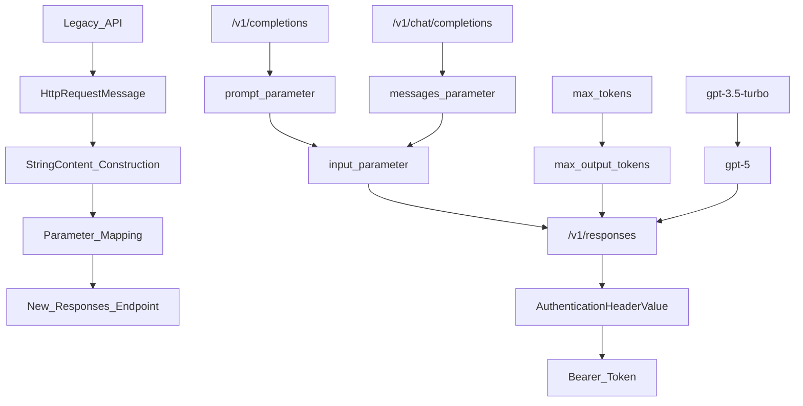
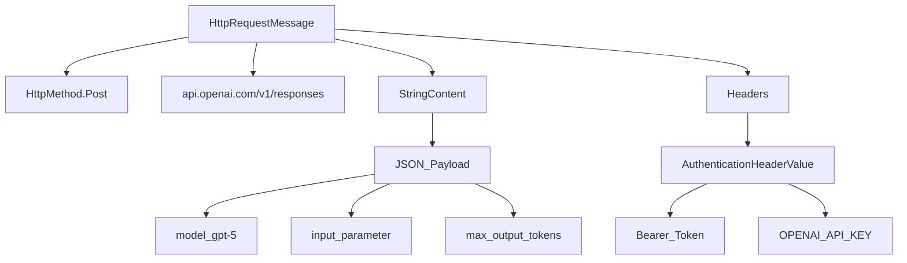
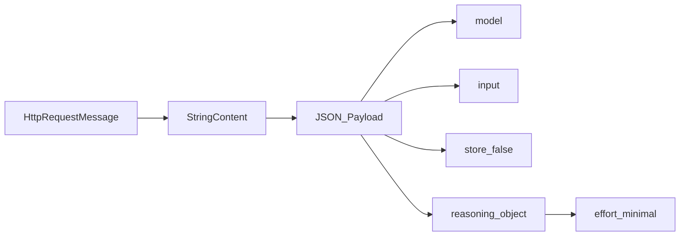
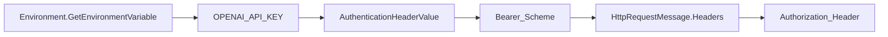

<!-- source: DeepWiki mcp.deepwiki.com · repo openai/completions-responses-migration-pack · page 4.5 C# Migration · fetched 2026-10-26 -->

# C# Migration

<details>
<summary>Relevant source files</summary>

The following files were used as context for generating this wiki page:

- [docs/language-recipes/csharp.md](docs/language-recipes/csharp.md)

</details>


This document provides comprehensive guidance for migrating C# applications from OpenAI's legacy Completions and Chat APIs to the unified Responses API. It covers HTTP client usage, parameter mapping, request construction, and advanced features specific to C# implementations.

For general migration concepts and API differences, see [Understanding the Migration](#3). For automated migration using the script, see [Migration Script Reference](#5).

## Migration Overview

The C# migration involves transitioning from multiple legacy endpoints to the single `/v1/responses` endpoint while updating HTTP request construction and parameter names.

### C# API Migration Flow



Sources: [docs/language-recipes/csharp.md:1-25]()

## HTTP Client Migration

C# applications typically use `HttpRequestMessage` and `StringContent` classes to construct API requests. The migration updates the endpoint URL and JSON payload structure.

### Request Construction Components



Sources: [docs/language-recipes/csharp.md:7-13]()

## Parameter Mapping

The migration requires updating parameter names and values in the JSON payload:

| Legacy Parameter | Responses Parameter | Notes |
|-----------------|-------------------|-------|
| `prompt` | `input` | Text input field |
| `max_tokens` | `max_output_tokens` | Token limit |
| `gpt-3.5-turbo` | `gpt-5` | Model upgrade |
| `messages` | `input` | Chat format conversion |

Sources: [docs/language-recipes/csharp.md:4-5]()

## Basic Request Construction

The basic HTTP request uses `HttpRequestMessage` with `StringContent` for the JSON payload and `AuthenticationHeaderValue` for authentication:

```
HttpRequestMessage → POST https://api.openai.com/v1/responses
StringContent → {"model":"gpt-5","input":"Hello"}
AuthenticationHeaderValue → Bearer [OPENAI_API_KEY]
```

The request construction follows the pattern shown in [docs/language-recipes/csharp.md:10-13](), using `Encoding.UTF8` and `application/json` content type.

Sources: [docs/language-recipes/csharp.md:7-13]()

## Advanced Features

### Reasoning and Stateless Requests

Advanced features include reasoning capabilities and stateless request configuration:



The reasoning feature uses an object with an `effort` parameter, while `store: false` ensures stateless operation as demonstrated in [docs/language-recipes/csharp.md:18-21]().

Sources: [docs/language-recipes/csharp.md:15-22]()

## Request Headers and Authentication

C# applications use `AuthenticationHeaderValue` with the "Bearer" scheme and retrieve the API key from environment variables using `Environment.GetEnvironmentVariable("OPENAI_API_KEY")`.

### Authentication Flow



Sources: [docs/language-recipes/csharp.md:12-13](), [docs/language-recipes/csharp.md:21-21]()

## Complete Migration Pattern

The complete migration follows this code entity pattern:

1. Create `HttpRequestMessage` with `HttpMethod.Post`
2. Set endpoint to `https://api.openai.com/v1/responses`
3. Construct `StringContent` with updated JSON payload
4. Apply `AuthenticationHeaderValue` with Bearer token
5. Use `Encoding.UTF8` and `application/json` content type

This pattern applies to both basic requests and advanced requests with reasoning capabilities, maintaining consistent HTTP client usage across all C# applications.

Sources: [docs/language-recipes/csharp.md:1-25]()

---

