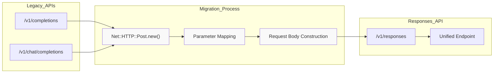
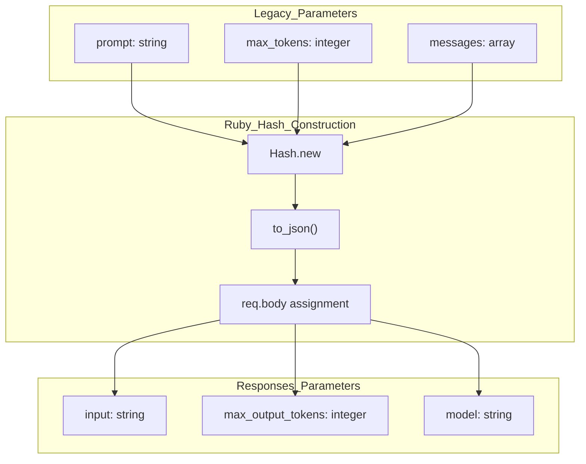
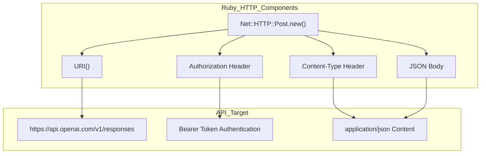
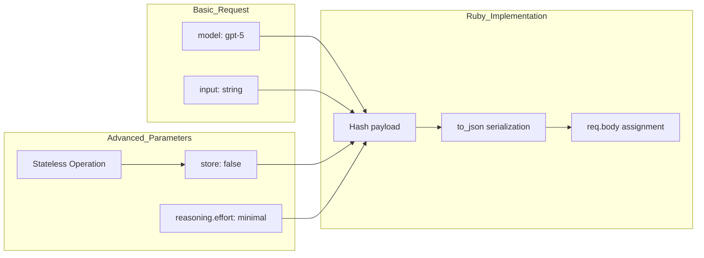
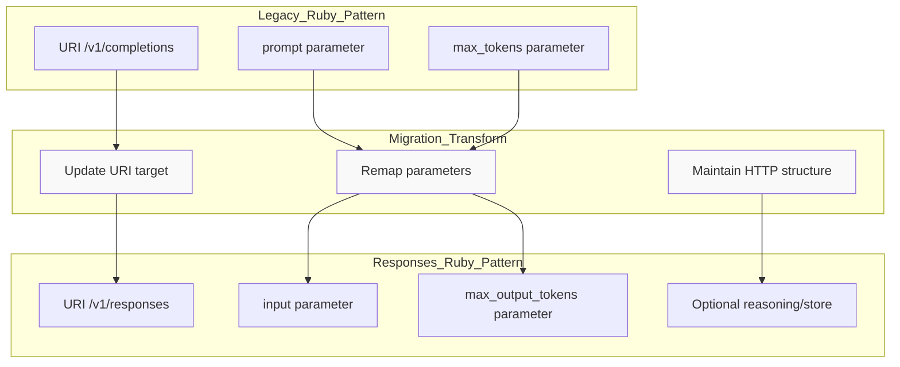

<!-- source: DeepWiki mcp.deepwiki.com · repo openai/completions-responses-migration-pack · page 4.6 Ruby Migration · fetched 2026-10-26 -->

# Ruby Migration

Relevant source files

The following files were used as context for generating this wiki page:

- [docs/language-recipes/ruby.md](docs/language-recipes/ruby.md)

This document provides Ruby-specific migration instructions for transitioning from legacy OpenAI APIs to the unified Responses API using Ruby's built-in `Net::HTTP` library. It covers HTTP client configuration, parameter mapping, and request construction patterns for stateless API calls.

For general migration concepts and API differences, see [Understanding the Migration](#3). For migration script automation, see [Migration Script Reference](#5).

## API Endpoint Migration

Ruby applications must migrate from legacy endpoints to the unified `/v1/responses` endpoint. The core transformation involves updating the URI target and remapping request parameters to align with the new API specification.

**Ruby HTTP Endpoint Transformation**

Sources: [docs/language-recipes/ruby.md:1-14]()

## Parameter Mapping

The migration requires specific parameter transformations when constructing JSON payloads for Ruby HTTP requests.

| Legacy Parameter | Responses API Parameter | Ruby Implementation |
|-----------------|------------------------|-------------------|
| `prompt` | `input` | `{ input: "Hello" }` |
| `max_tokens` | `max_output_tokens` | `{ max_output_tokens: 100 }` |
| `messages` | `input` | `{ input: conversation_text }` |

**Parameter Transformation Flow**

Sources: [docs/language-recipes/ruby.md:3-4]()

## HTTP Client Configuration

Ruby applications use `Net::HTTP` and `URI` classes to construct requests to the Responses API. The standard pattern involves URI parsing, request object creation, and header configuration.

**Net::HTTP Request Structure**

The basic HTTP configuration pattern is demonstrated in [docs/language-recipes/ruby.md:9-13](), which shows URI construction, request initialization, and header assignment for authentication and content type specification.

Sources: [docs/language-recipes/ruby.md:6-14]()

## Basic Request Implementation

Ruby applications construct requests using `Net::HTTP::Post` objects with proper authorization headers and JSON payloads. The implementation requires `URI` parsing and request body serialization.

The standard request pattern follows the structure shown in [docs/language-recipes/ruby.md:9-14]():
- `URI("https://api.openai.com/v1/responses")` for endpoint targeting
- `Net::HTTP::Post.new(uri)` for request object creation  
- `req["Authorization"] = "Bearer #{ENV["OPENAI_API_KEY"]}"` for API authentication
- `req.body = { model: "gpt-5", input: "Hello" }.to_json` for payload construction

Sources: [docs/language-recipes/ruby.md:8-14]()

## Advanced Features

The Responses API supports additional parameters for reasoning control and stateless operation. Ruby implementations can include these features through expanded JSON payload construction.

**Reasoning and Stateless Configuration**

The advanced implementation pattern in [docs/language-recipes/ruby.md:19-23]() demonstrates payload construction with `store: false` for stateless requests and `reasoning: { effort: "minimal" }` for reasoning control.

Sources: [docs/language-recipes/ruby.md:16-24]()

## Migration Patterns

Ruby migrations typically follow a consistent pattern of replacing legacy API calls with Responses API equivalents while maintaining the same `Net::HTTP` infrastructure.

**Ruby Migration Transformation**

The migration maintains Ruby's `Net::HTTP` request patterns while updating endpoint URLs and parameter names to align with the unified Responses API specification.

Sources: [docs/language-recipes/ruby.md:1-27]()

---

