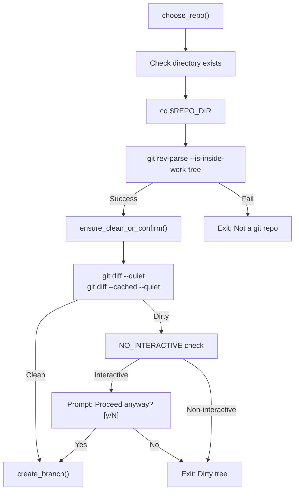

<!-- source: DeepWiki mcp.deepwiki.com · repo openai/completions-responses-migration-pack · page 5 Migration Script Reference · fetched 2026-10-26 -->

# Migration Script Reference

<details>
<summary>Relevant source files</summary>

The following files were used as context for generating this wiki page:

- [scripts/completions-to-responses-upgrade.sh](scripts/completions-to-responses-upgrade.sh)

</details>


This document provides comprehensive reference documentation for the `completions-to-responses-upgrade.sh` script, the main orchestration tool in the migration toolkit. This script automates the process of migrating codebases from legacy OpenAI APIs to the unified Responses API using AI-powered code transformations.

For information about specific execution modes and their use cases, see [Script Configuration](#5.1) and [Execution Modes](#5.2). For language-specific migration examples that the script can generate, see [Language-Specific Migration Guides](#4).

## Script Overview

The migration script serves as the primary entry point for automated code migrations. It orchestrates the entire migration workflow from initial setup through final validation, leveraging the Codex CLI as an AI-powered coding agent to perform the actual code transformations.

### Core Architecture

**Script Architecture and Function Flow**

```mermaid
flowchart TD
    main["main()"] --> parse_args["parse_args()"]
    main --> preflight["preflight()"]
    main --> install_codex["install_codex()"]
    main --> ensure_auth["ensure_auth()"]
    main --> choose_repo["choose_repo()"]
    main --> ask_model_preference["ask_model_preference()"]
    
    main --> ensure_clean_or_confirm["ensure_clean_or_confirm()"]
    main --> create_branch["create_branch()"]
    main --> prep_kit["prep_kit()"]
    main --> run_codex["run_codex()"]
    main --> post_run["post_run()"]
    
    parse_args --> |"Sets global variables"| vars["REPO_DIR<br/>DEFAULT_MODEL<br/>DRY_RUN<br/>APPROVAL_POLICY<br/>MODE_FULL_AUTO"]
    
    preflight --> need["need()"]
    preflight --> detect_os["detect_os()"]
    
    install_codex --> |"Homebrew"| brew_install["brew install codex"]
    install_codex --> |"NPM"| npm_install["npm i -g @openai/codex"]
    install_codex --> |"Fallback"| github_release["GitHub release download"]
    
    ensure_auth --> codex_login["codex login"]
    
    prep_kit --> copy_local_kit_if_available["copy_local_kit_if_available()"]
    prep_kit --> agents_md["AGENTS.md creation/augmentation"]
    prep_kit --> kit_dir["$CODEX_KIT_DIR setup"]
    
    run_codex --> detect_tests["detect_tests()"]
    run_codex --> detect_build_cmds["detect_build_cmds()"]
    run_codex --> detect_sdk_upgrade_hints["detect_sdk_upgrade_hints()"]
    run_codex --> codex_exec["codex exec"]
    
    post_run --> auto_commit_logic["Auto-commit logic"]
    post_run --> open_pr_logic["GitHub PR creation"]
```



**Configuration Variables and Dependencies**

```mermaid
graph TB
    subgraph "Environment Variables"
        env_model["DEFAULT_MODEL"]
        env_full_auto["MODE_FULL_AUTO"]
        env_dry_run["DRY_RUN"]
        env_no_interactive["NO_INTERACTIVE"]
        env_open_pr["OPEN_PR"]
        env_approval["APPROVAL_POLICY"]
        env_dangerous["DANGEROUS_MODE"]
        env_gpt5["MIGRATE_TO_GPT5"]
        env_branch["BRANCH_NAME"]
        env_confirm["DANGEROUS_CONFIRM"]
        openai_key["OPENAI_API_KEY"]
    end
    
    subgraph "Command Line Options"
        opt_repo["-r, --repo"]
        opt_model["-m, --model"]
        opt_full_auto["--full-auto"]
        opt_dry_run["-n, --dry-run"]
        opt_approval["-a, --approval"]
        opt_dangerous["--dangerous"]
        opt_no_interactive["--no-interactive"]
        opt_open_pr["--open-pr"]
        opt_auto_commit["--auto-commit"]
        opt_branch["--branch"]
    end
    
    subgraph "External Dependencies"
        codex_cli["codex CLI"]
        git_cmd["git"]
        curl_cmd["curl"]
        openai_api["OpenAI API"]
        github_cli["gh (GitHub CLI)"]
        os_detection["macOS/Linux/WSL"]
    end
    
    opt_repo --> env_model
    opt_model --> env_model
    opt_full_auto --> env_full_auto
    opt_dry_run --> env_dry_run
    opt_approval --> env_approval
    opt_dangerous --> env_dangerous
    opt_no_interactive --> env_no_interactive
    opt_open_pr --> env_open_pr
    opt_auto_commit --> auto_commit_var["AUTO_COMMIT"]
    opt_branch --> env_branch
    
    codex_cli --> openai_key
    codex_cli --> openai_api
    github_cli --> opt_open_pr
```



Sources: [scripts/completions-to-responses-upgrade.sh:1-88](), [scripts/completions-to-responses-upgrade.sh:552-574]()

## Command-Line Interface

The script provides a comprehensive command-line interface with options for controlling every aspect of the migration process.

### Basic Usage

```bash
./completions-to-responses-upgrade.sh [options]
```

### Command-Line Options

| Option | Environment Variable | Default | Description |
|--------|---------------------|---------|-------------|
| `-r, --repo <path>` | - | Interactive prompt | Path to target git repository |
| `-m, --model <name>` | `DEFAULT_MODEL` | `gpt-5` | Model for Codex AI agent |
| `--full-auto` | `MODE_FULL_AUTO=1` | `0` | Run Codex with no approval prompts |
| `-n, --dry-run` | `DRY_RUN=1` | `0` | Plan only; emit diffs without writes |
| `-a, --approval <policy>` | `APPROVAL_POLICY` | Context-dependent | Approval policy for file modifications |
| `--write` | `DRY_RUN=0` | - | Force write-enabled mode |
| `--dangerous` | `DANGEROUS_MODE=1` | `0` | Bypass approvals and sandbox |
| `--no-interactive` | `NO_INTERACTIVE=1` | `0` | Disable prompts; require `--repo` |
| `--open-pr` | `OPEN_PR=1` | `0` | Create GitHub PR after migration |
| `--auto-commit` | `AUTO_COMMIT=1` | Context-dependent | Stage and commit changes |
| `--no-auto-commit` | `AUTO_COMMIT=0` | - | Override auto-commit defaults |
| `--branch <name>` | `BRANCH_NAME` | `migrate/openai-responses-*` | Custom branch name |
| `-h, --help` | - | - | Show usage information |

Sources: [scripts/completions-to-responses-upgrade.sh:43-67](), [scripts/completions-to-responses-upgrade.sh:69-88]()

### Approval Policies

The `APPROVAL_POLICY` variable controls how Codex requests permission for file modifications:

| Policy | Behavior |
|--------|----------|
| `untrusted` | Sandbox mode only; no file writes |
| `on-failure` | Ask approval only when operations fail |
| `on-request` | Ask approval for all file modifications |
| `never` | Apply changes directly without approval |

The script automatically selects appropriate defaults based on the execution context:
- Interactive mode: `on-request`  
- Non-interactive mode: `on-failure`
- Full-auto mode: No approval prompts

Sources: [scripts/completions-to-responses-upgrade.sh:452-463]()

## Prerequisites and Dependencies

### System Requirements

The script performs comprehensive prerequisite checking through the `preflight()` and `detect_os()` functions:

**Operating System Support**
- macOS (Darwin)
- Linux distributions
- Windows Subsystem for Linux (WSL2) with automatic detection

**Required Commands**
- `curl` - For downloading Codex CLI and API communication
- `git` - For repository operations and branch management

Sources: [scripts/completions-to-responses-upgrade.sh:90-108]()

### Codex CLI Installation

The script handles Codex CLI installation automatically through multiple methods:

**Installation Priority**
1. **Homebrew** (if available): `brew install codex`
2. **NPM** (if available): `npm i -g @openai/codex`  
3. **GitHub Releases** (fallback): Downloads binary from `https://github.com/openai/codex/releases/latest/download/codex-{arch}-{os}.tar.gz`

**Architecture Detection**
- `x86_64` → `amd64`
- `aarch64`, `arm64` → `arm64`
- Installs to `$HOME/.local/bin` with automatic PATH export

Sources: [scripts/completions-to-responses-upgrade.sh:121-151]()

### Authentication Flow

Authentication is handled by the `ensure_auth()` function:

1. Checks for `OPENAI_API_KEY` environment variable
2. If not set, attempts `codex login` interactive flow
3. Provides guidance for manual API key setup on failure

Sources: [scripts/completions-to-responses-upgrade.sh:153-160]()

## Migration Workflow

### Repository Setup and Safety Checks

**Git Repository Validation**



**Branch Creation Strategy**
- Default pattern: `migrate/openai-responses-{timestamp}`
- Timestamp format: `YYYYMMDD-HHMMSS` 
- Interactive mode allows custom branch names with 60-second timeout
- Always creates new branch from current HEAD

Sources: [scripts/completions-to-responses-upgrade.sh:110-119](), [scripts/completions-to-responses-upgrade.sh:162-175](), [scripts/completions-to-responses-upgrade.sh:202-221]()

### Documentation Kit Preparation

The `prep_kit()` function assembles migration documentation and prompts:

**Kit Directory Structure**
```
$CODEX_KIT_DIR/
├── docs/
│   ├── responses-cheatsheet.md (embedded fallback)
│   └── language-recipes/ (copied from local)
└── prompts/
    └── migrate-to-responses.md (embedded fallback)
```

**AGENTS.md Management**
- If `AGENTS.md` exists: Appends migration task instructions
- If missing: Creates new file with complete migration guidance
- Sets `AGENTS_CREATED_BY_SCRIPT` flag for cleanup tracking

**Embedded Documentation**
The script includes fallback documentation embedded directly in the source:
- **responses-cheatsheet.md**: Condensed API reference with parameter mappings
- **migrate-to-responses.md**: Detailed migration prompts for Codex agent

Sources: [scripts/completions-to-responses-upgrade.sh:242-335]()

### Project Detection and Test Commands

The script includes sophisticated detection for various project types and their associated commands:

**Test Detection via `detect_tests()`**
- **JavaScript**: `npm test`, `pnpm test`, `yarn test` based on `package.json` presence
- **Python**: `pytest -q`, `python -m pytest -q` for projects with `pyproject.toml`, `setup.py`, `requirements.txt`, or `tests/` directory
- **Go**: `go test ./...` for projects with `go.mod`
- **Java**: `mvn -q -DskipTests=false test` (Maven), `gradle test` (Gradle)
- **.NET**: `dotnet test` for `*.sln` or `*.csproj` files
- **Ruby**: `bundle exec rspec` for `Gemfile` projects
- **Rust**: `cargo test` for `Cargo.toml` projects

**Build Command Detection via `detect_build_cmds()`**
- Detects `"build"` scripts in `package.json`
- Supports npm, pnpm, yarn build commands
- TypeScript direct compilation with `tsc -p .`

**SDK Upgrade Hints via `detect_sdk_upgrade_hints()`**
- **Node.js**: Detects package manager from lockfiles (`pnpm-lock.yaml`, `yarn.lock`, `package-lock.json`)
- **Python**: Suggests pip, poetry, or pipenv upgrade commands

Sources: [scripts/completions-to-responses-upgrade.sh:337-412]()

### Codex Agent Execution

The `run_codex()` function orchestrates the AI-powered migration:

**Prompt Construction**
- Dynamically builds prompts based on detected project characteristics
- Incorporates model policy (GPT-5 migration preferences)
- Includes compatibility and comment policies
- Adds SDK upgrade guidance and test/build commands

**CLI Flag Management**
```bash
# Global flags (precede subcommand)
codex --full-auto -a on-request -c shell_environment_policy.inherit=all \
      -c model_reasoning_effort=high \
      exec --model gpt-5 --sandbox danger-full-access -- "$prompt"
```

**Safety Confirmations**
- `danger-full-access` sandbox requires explicit confirmation
- `DANGEROUS_CONFIRM=1` environment variable bypasses interactive prompt
- Non-interactive mode requires confirmation environment variable

**Environment Policy**
- `shell_environment_policy.inherit=all`: Inherits full shell environment
- `model_reasoning_effort=high`: Requests enhanced reasoning capabilities

Sources: [scripts/completions-to-responses-upgrade.sh:416-498]()

## Post-Migration Processing

### Cleanup and Commit Logic

The `post_run()` function handles cleanup and optional automation:

**AGENTS.md Cleanup**
- Removes `AGENTS.md` if created by script (`AGENTS_CREATED_BY_SCRIPT=1`)
- Preserves existing `AGENTS.md` files modified by script

**Auto-Commit Behavior**
- **Default Logic**: Enable for non-interactive + non-dry-run, disable otherwise
- **File Staging**: `git add -A` includes all changes and new files
- **Backup Cleanup**: Removes `*.bak`, `*.orig`, `*.rej` files before commit
- **Commit Message**: `"migrate: Completions → Responses via Codex migration pack"`

**Status Reporting**
- `git status -sb`: Short status with branch info
- `git log -1 --stat`: Last commit details if commit was made
- `git diff --stat`: Change summary if no commit

Sources: [scripts/completions-to-responses-upgrade.sh:500-550]()

### GitHub Integration

**Pull Request Creation**
- Requires GitHub CLI (`gh`) installation
- Uses `gh pr create --fill` with automated title and description
- Title: `"Migrate to OpenAI Responses API"`
- Body: `"Automated migration using Codex Starter Pack."`
- Gracefully handles failures with warnings

Sources: [scripts/completions-to-responses-upgrade.sh:542-549]()

## Execution Context and Defaults

The script automatically adapts its behavior based on execution context:

**Non-Interactive Mode Adjustments**
- When `NO_INTERACTIVE=1` and not in dry-run mode, automatically enables `MODE_FULL_AUTO=1`
- Prevents hanging on user prompts
- Uses `on-failure` approval policy as default

**Error Handling**
- `set -Eeuo pipefail`: Strict error handling with pipeline failure detection
- `umask 077`: Restrictive permissions for temporary files
- Comprehensive prerequisite validation before execution

Sources: [scripts/completions-to-responses-upgrade.sh:1-3](), [scripts/completions-to-responses-upgrade.sh:560-564]()

---

