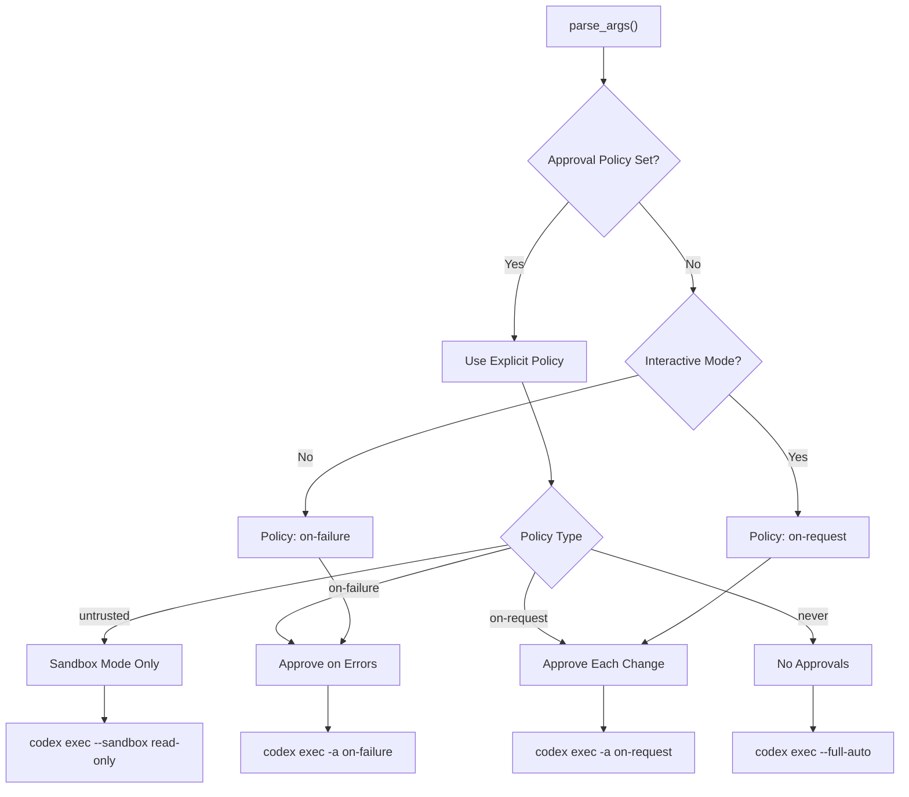
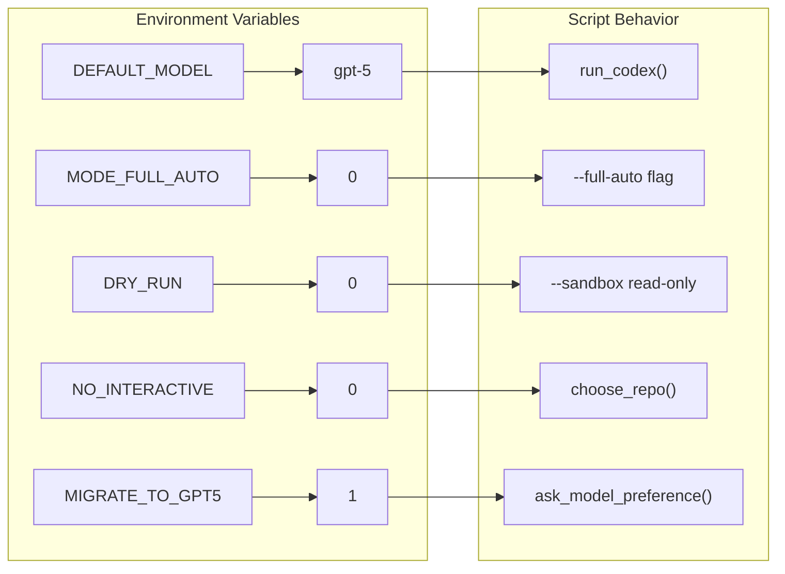
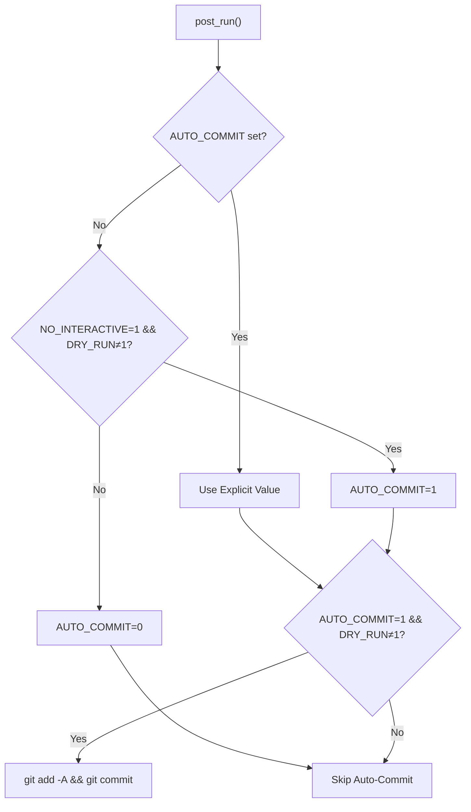
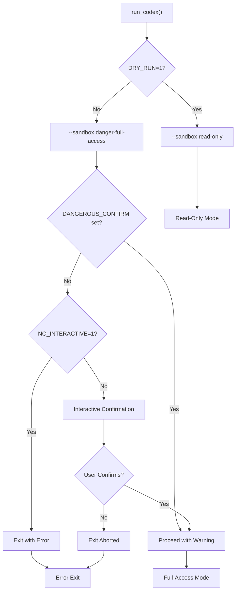

<!-- source: DeepWiki mcp.deepwiki.com · repo openai/completions-responses-migration-pack · page 5.1 Script Configuration · fetched 2026-10-26 -->

# Script Configuration

<details>
<summary>Relevant source files</summary>

The following files were used as context for generating this wiki page:

- [scripts/completions-to-responses-upgrade.sh](scripts/completions-to-responses-upgrade.sh)

</details>


This page documents the configuration options available for the `completions-to-responses-upgrade.sh` script, including command-line arguments, environment variables, and approval policies. This configuration system controls how the migration script interacts with the target repository, handles user approval, and executes the Codex AI agent.

For information about execution modes and runtime behavior, see [Execution Modes](#5.2). For the overall script architecture and workflow, see [Migration Script Reference](#5).

## Command-Line Options

The script accepts multiple command-line arguments that control its behavior. All options have corresponding environment variable equivalents for automation scenarios.

### Repository and Model Configuration

| Option | Description | Default | Environment Variable |
|--------|-------------|---------|---------------------|
| `-r, --repo <path>` | Path to target git repository | Current directory (interactive) | `REPO_DIR` |
| `-m, --model <name>` | Model to use for migration | `gpt-5` | `DEFAULT_MODEL` |
| `--branch <name>` | Branch name for migration | `migrate/openai-responses-<timestamp>` | `BRANCH_NAME` |

### Execution Mode Control

| Option | Description | Default | Environment Variable |
|--------|-------------|---------|---------------------|
| `--full-auto` | Run Codex in full automation mode | `false` | `MODE_FULL_AUTO=1` |
| `-n, --dry-run` | Plan only; no file writes | `false` | `DRY_RUN=1` |
| `--write` | Force write-enabled mode | `false` | `DRY_RUN=0` |
| `--dangerous` | Bypass approvals and sandbox | `false` | `DANGEROUS_MODE=1` |
| `--no-interactive` | Disable prompts; require --repo | `false` | `NO_INTERACTIVE=1` |

### Post-Execution Actions

| Option | Description | Default | Environment Variable |
|--------|-------------|---------|---------------------|
| `--open-pr` | Create GitHub PR after migration | `false` | `OPEN_PR=1` |
| `--auto-commit` | Stage and commit changes | Auto-detected | `AUTO_COMMIT=1` |
| `--no-auto-commit` | Disable auto-commit | N/A | `AUTO_COMMIT=0` |

Sources: [scripts/completions-to-responses-upgrade.sh:43-67](), [scripts/completions-to-responses-upgrade.sh:69-88]()

## Approval Policies

The script implements multiple approval policies that control how Codex handles file modifications and command execution.



**Policy Types:**
- `untrusted`: Sandbox mode only, no file writes
- `on-failure`: Request approval only when operations fail
- `on-request`: Request approval for each file modification
- `never`: No approvals required (full automation)

Sources: [scripts/completions-to-responses-upgrade.sh:52](), [scripts/completions-to-responses-upgrade.sh:451-463]()

## Environment Variables

All configuration options can be set via environment variables for automation and CI/CD integration.

### Core Configuration Variables



### Special Environment Variables

| Variable | Purpose | Values |
|----------|---------|---------|
| `DANGEROUS_CONFIRM` | Skip interactive confirmation for danger-full-access | `1` to skip |
| `OPENAI_API_KEY` | OpenAI API authentication | API key string |
| `CODEX_KIT_DIR` | Kit directory location | Path (set by script) |
| `AGENTS_CREATED_BY_SCRIPT` | Track AGENTS.md creation | `0`/`1` (internal) |

Sources: [scripts/completions-to-responses-upgrade.sh:13-24](), [scripts/completions-to-responses-upgrade.sh:470-486]()

## Configuration Precedence and Defaults

The script applies configuration in a specific precedence order, with intelligent defaults based on execution context.

### Auto-Commit Default Logic



### Full-Auto Mode Activation

The script automatically enables full-auto mode under specific conditions:

```bash
# Automatic full-auto activation logic
if [[ "$NO_INTERACTIVE" == "1" && "$DRY_RUN" != "1" && -z "$APPROVAL_POLICY" && "$MODE_FULL_AUTO" != "1" && "$DANGEROUS_MODE" != "1" ]]; then
    MODE_FULL_AUTO=1
fi
```

Sources: [scripts/completions-to-responses-upgrade.sh:511-518](), [scripts/completions-to-responses-upgrade.sh:561-564]()

## Sandbox Configuration

The script configures Codex sandbox modes based on the dry-run and approval settings.



**Sandbox Modes:**
- `read-only`: Safe mode for dry runs, no file modifications
- `danger-full-access`: Full workspace access for actual migrations

Sources: [scripts/completions-to-responses-upgrade.sh:445-449](), [scripts/completions-to-responses-upgrade.sh:467-489]()

## Configuration Examples

### Interactive Migration
```bash
./completions-to-responses-upgrade.sh
# Prompts for repository path, uses default gpt-5 model
# Uses on-request approval policy
```

### Automated CI/CD Migration
```bash
export NO_INTERACTIVE=1
export REPO_DIR="/path/to/repo"
export APPROVAL_POLICY="on-failure"
export AUTO_COMMIT=1
./completions-to-responses-upgrade.sh --open-pr
```

### Dry Run with Custom Model
```bash
./completions-to-responses-upgrade.sh \
  --repo ./my-project \
  --model gpt-4o \
  --dry-run
```

### Full Automation (Dangerous)
```bash
export DANGEROUS_CONFIRM=1
./completions-to-responses-upgrade.sh \
  --repo ./my-project \
  --dangerous \
  --auto-commit \
  --open-pr
```

Sources: [scripts/completions-to-responses-upgrade.sh:43-67](), [scripts/completions-to-responses-upgrade.sh:552-574]()

---

