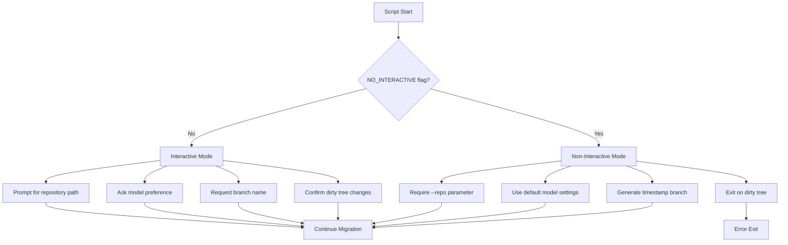
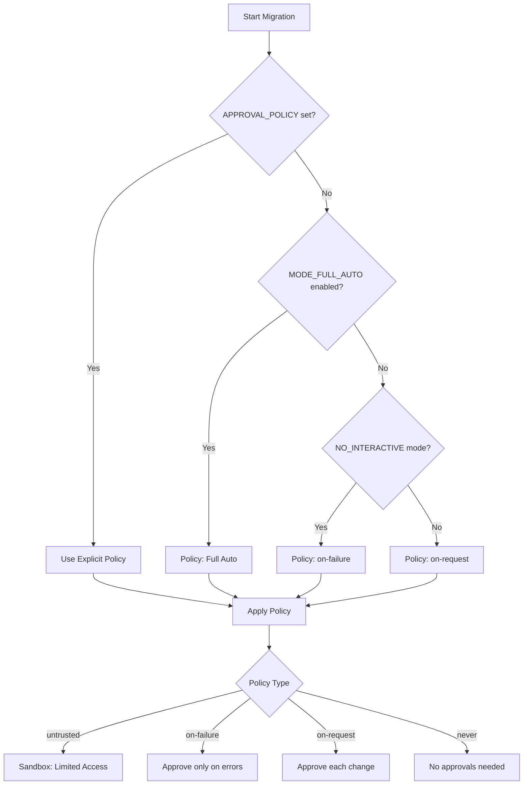
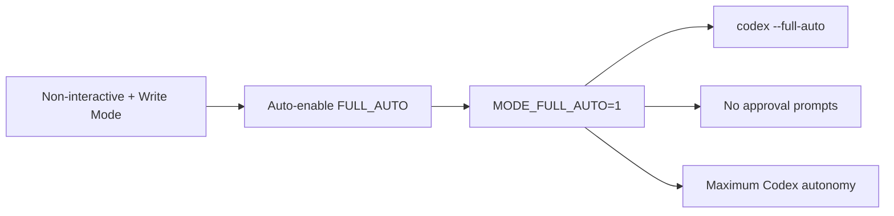
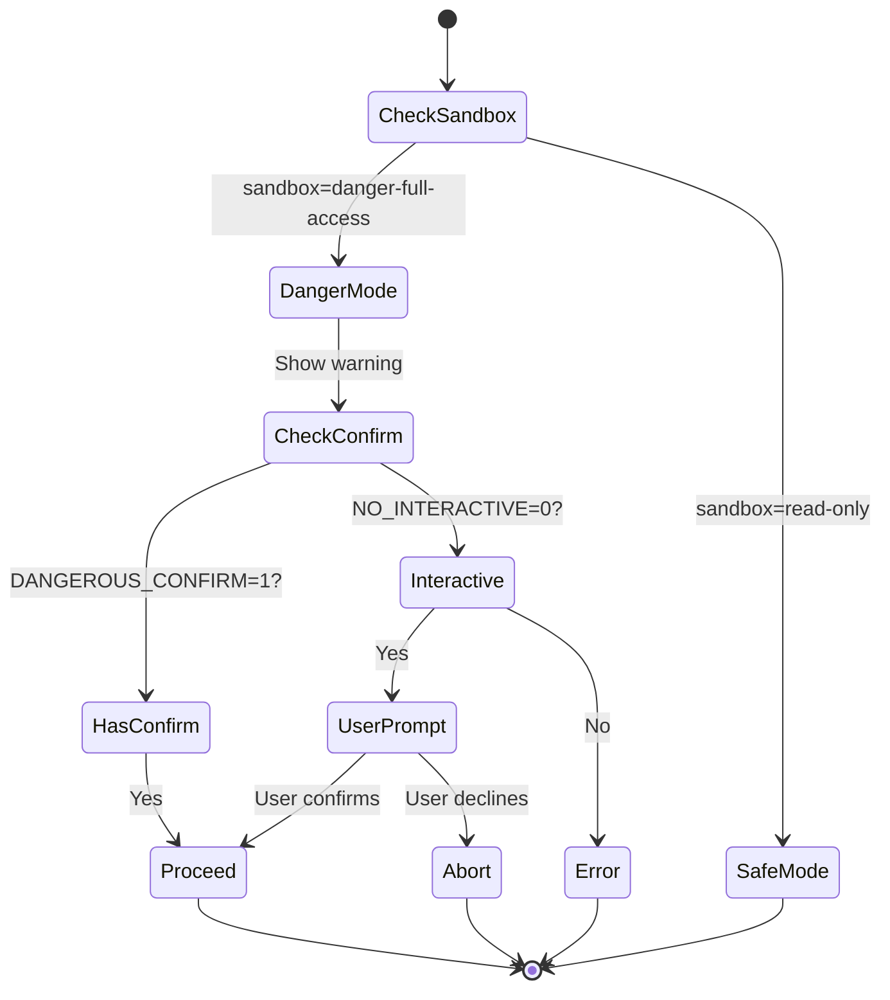
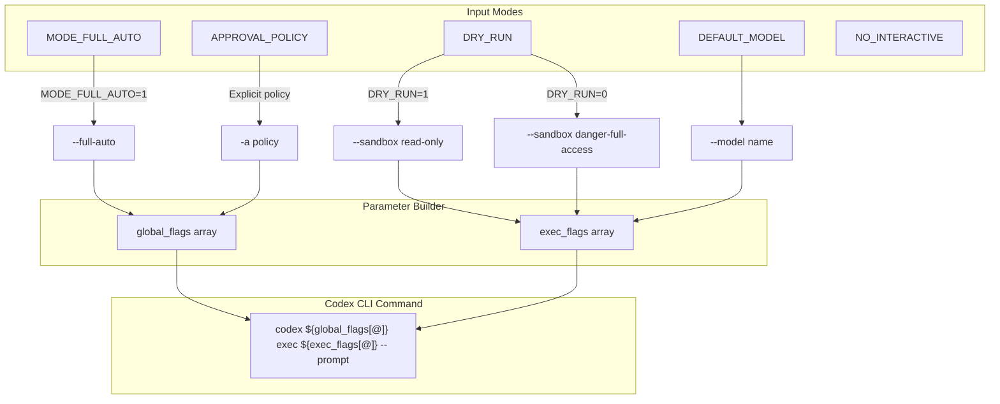
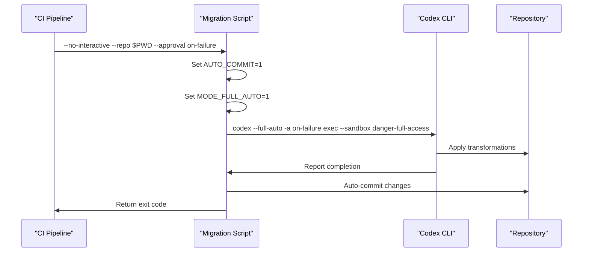

<!-- source: DeepWiki mcp.deepwiki.com · repo openai/completions-responses-migration-pack · page 5.2 Execution Modes · fetched 2026-10-26 -->

# Execution Modes

Relevant source files

The following files were used as context for generating this wiki page:

- [scripts/completions-to-responses-upgrade.sh](scripts/completions-to-responses-upgrade.sh)

This document describes the various execution modes available in the migration script, their safety mechanisms, and how they control the behavior of the Codex AI agent during code transformation. These modes determine the level of automation, user interaction, and file modification permissions during the migration process.

For information about script configuration options and environment variables, see [Script Configuration](#5.1). For details about the Responses API itself, see [Responses API Reference](#6).

## Overview of Execution Modes

The migration script supports multiple execution modes that control three primary aspects:
- **Interaction Level**: Whether the script prompts for user input
- **Write Permission**: Whether files can be modified or only analyzed
- **Approval Policy**: How file changes are reviewed before application

## Mode Categories

### Interactive vs Non-Interactive Modes

The script operates in either interactive or non-interactive mode, controlled by the `NO_INTERACTIVE` environment variable or `--no-interactive` flag.

**Sources:** [scripts/completions-to-responses-upgrade.sh:17](), [scripts/completions-to-responses-upgrade.sh:79](), [scripts/completions-to-responses-upgrade.sh:113-118](), [scripts/completions-to-responses-upgrade.sh:167-169]()

### Write Modes

#### Dry Run Mode (`DRY_RUN=1`)

In dry run mode, the script performs analysis and planning without modifying any files.

| Aspect | Behavior |
|--------|----------|
| File Modification | Disabled |
| Codex Sandbox | `read-only` |
| Output | Migration plan and unified diff |
| Testing | Skipped |
| Commits | None |

#### Write Mode (Default)

When dry run is disabled, the script enables file modifications through the Codex agent.

| Aspect | Behavior |
|--------|----------|
| File Modification | Enabled |
| Codex Sandbox | `danger-full-access` |
| Output | Actual file changes |
| Testing | Executed if detected |
| Commits | Based on `AUTO_COMMIT` setting |

**Sources:** [scripts/completions-to-responses-upgrade.sh:15](), [scripts/completions-to-responses-upgrade.sh:445-449](), [scripts/completions-to-responses-upgrade.sh:436-440]()

### Approval Policies

The script supports four approval policies that control how file changes are reviewed:

#### Approval Policy Decision Flow

**Sources:** [scripts/completions-to-responses-upgrade.sh:20](), [scripts/completions-to-responses-upgrade.sh:454-463]()

#### Policy Details

| Policy | Description | Use Case | Safety Level |
|--------|-------------|----------|--------------|
| `untrusted` | Sandbox mode only, no file writes | Testing unknown codebases | Highest |
| `on-failure` | Approve only when Codex encounters errors | Automated CI/CD pipelines | High |
| `on-request` | Approve each file modification | Manual review workflows | Medium |
| `never` | No approvals required | Trusted environments | Lowest |

### Automation Modes

#### Full Automation Mode

Full automation mode (`MODE_FULL_AUTO=1`) disables all approval prompts and runs Codex with maximum autonomy.

**Sources:** [scripts/completions-to-responses-upgrade.sh:14](), [scripts/completions-to-responses-upgrade.sh:451-452](), [scripts/completions-to-responses-upgrade.sh:561-564]()

## Safety Mechanisms

### Sandbox Warning System

When enabling `danger-full-access` sandbox mode, the script implements a confirmation system:

**Sources:** [scripts/completions-to-responses-upgrade.sh:466-489]()

### Git Safety Checks

The script includes several git-based safety mechanisms:

| Check | Purpose | Behavior |
|-------|---------|----------|
| Clean working tree | Prevent data loss | Warns on uncommitted changes |
| Branch creation | Isolate changes | Creates `migrate/openai-responses-*` branch |
| Repository validation | Ensure git context | Verifies `.git` directory exists |

**Sources:** [scripts/completions-to-responses-upgrade.sh:110-119](), [scripts/completions-to-responses-upgrade.sh:174-175](), [scripts/completions-to-responses-upgrade.sh:202-221]()

## Codex CLI Parameter Mapping

The script translates execution modes into specific Codex CLI parameters:

### Parameter Construction Flow

**Sources:** [scripts/completions-to-responses-upgrade.sh:442-497]()

## Mode Combinations and Use Cases

### Common Mode Combinations

| Scenario | Flags | Use Case |
|----------|--------|----------|
| Initial Assessment | `--dry-run` | Understand migration scope |
| Development Testing | `--dry-run --approval on-request` | Safe exploration |
| Manual Migration | (default) | Interactive file-by-file review |
| CI/CD Pipeline | `--no-interactive --approval on-failure` | Automated with error handling |
| Trusted Automation | `--no-interactive --full-auto` | Maximum automation |

### Advanced Execution Patterns

#### CI/CD Integration Pattern

**Sources:** [scripts/completions-to-responses-upgrade.sh:511-531](), [scripts/completions-to-responses-upgrade.sh:561-564]()

## Post-Execution Behavior

### Auto-Commit Logic

The script implements intelligent auto-commit behavior based on execution mode:

| Mode | Auto-Commit Default | Override Available |
|------|-------------------|------------------|
| Interactive | Disabled | `--auto-commit` |
| Non-Interactive + Write | Enabled | `--no-auto-commit` |
| Dry Run | N/A | N/A |

### Cleanup Operations

The script performs cleanup operations regardless of execution mode:

1. **AGENTS.md Management**: Removes temporary `AGENTS.md` if created by script
2. **Artifact Cleanup**: Deletes `.bak`, `.orig`, `.rej` files
3. **Status Reporting**: Shows git status and diff statistics

**Sources:** [scripts/completions-to-responses-upgrade.sh:500-550](), [scripts/completions-to-responses-upgrade.sh:504-509](), [scripts/completions-to-responses-upgrade.sh:522-524]()

---

