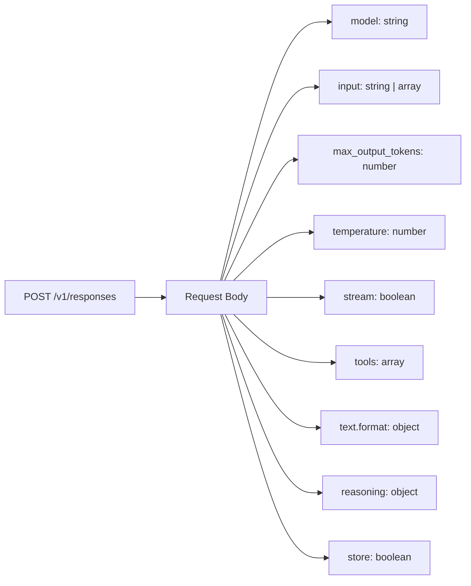
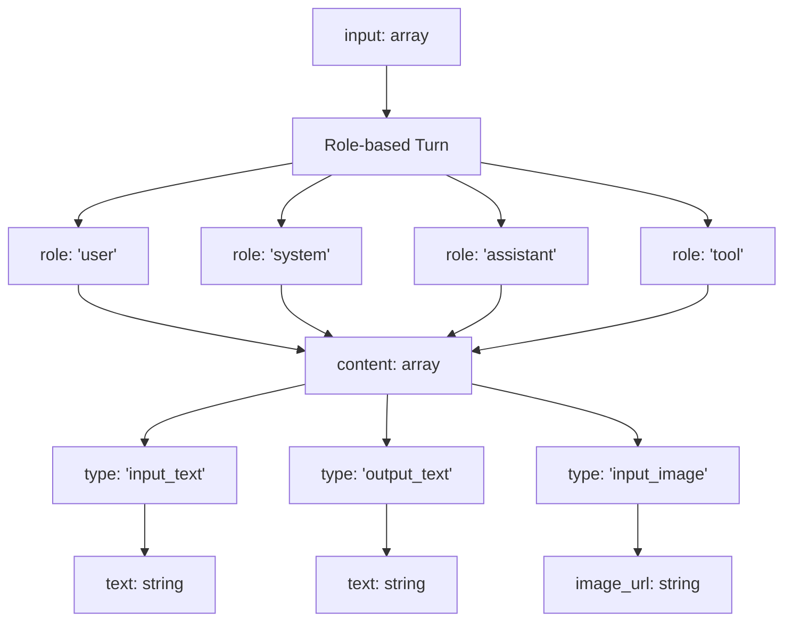
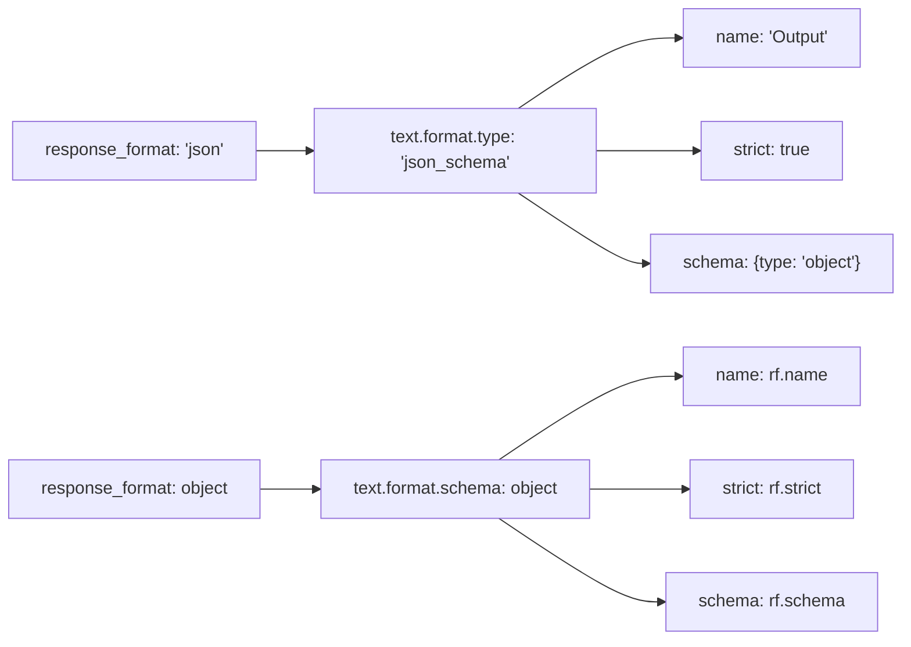
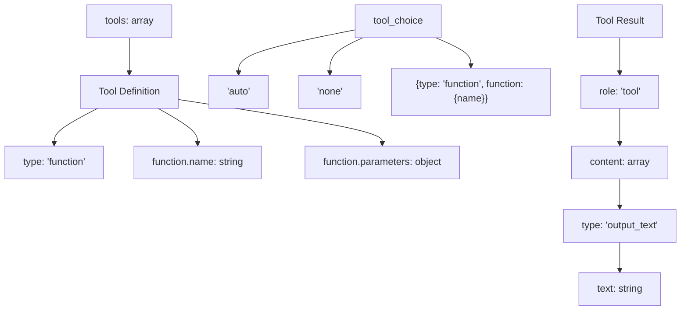
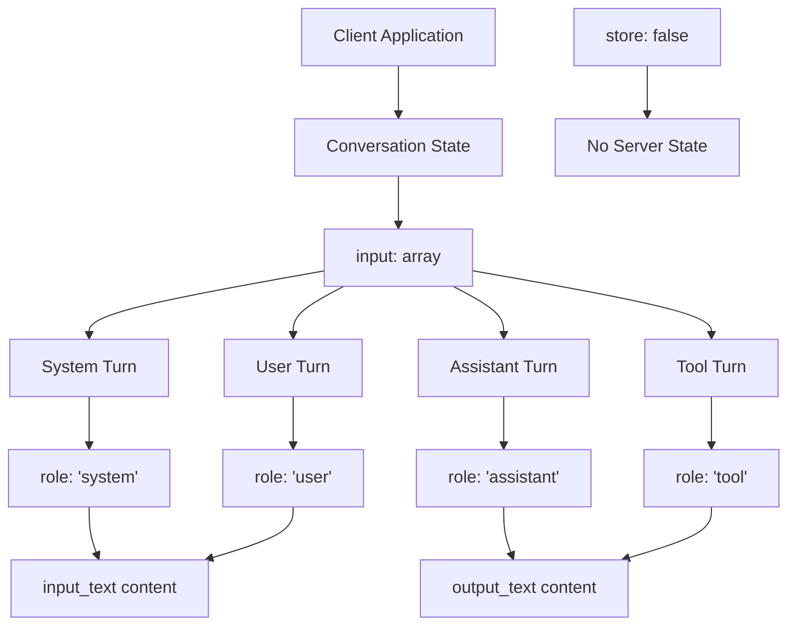

<!-- source: DeepWiki mcp.deepwiki.com · repo openai/completions-responses-migration-pack · page 6 Responses API Reference · fetched 2026-10-26 -->

# Responses API Reference

<details>
<summary>Relevant source files</summary>

The following files were used as context for generating this wiki page:

- [docs/migration-notes.md](docs/migration-notes.md)
- [docs/responses-cheatsheet.md](docs/responses-cheatsheet.md)

</details>


This document provides comprehensive reference documentation for the OpenAI `/v1/responses` API endpoint, covering all parameters, content types, streaming capabilities, tools integration, and structured output formats. This reference focuses on the technical specifications and implementation details for the unified Responses API.

For general migration guidance from legacy Completions/Chat APIs, see [Understanding the Migration](#3). For language-specific implementation examples, see [Language-Specific Migration Guides](#4).

## API Endpoint Overview

The Responses API consolidates OpenAI's text generation capabilities into a single unified endpoint that supports text completion, tool orchestration, streaming, and structured output.

### Core Endpoint Structure



**API Endpoint Structure**

Sources: [docs/responses-cheatsheet.md:3-8](), [docs/migration-notes.md:4-5]()

## Request Parameters

### Core Parameters

| Parameter | Type | Description | Legacy Equivalent |
|-----------|------|-------------|-------------------|
| `model` | string | Model identifier (e.g., `"gpt-5"`) | `model` |
| `input` | string \| array | Text input or conversation turns | `prompt` (Completions), `messages` (Chat) |
| `max_output_tokens` | number | Maximum tokens in response | `max_tokens` |
| `temperature` | number | Sampling temperature (0-2) | `temperature` |
| `store` | boolean | Whether to store response (default: `false`) | N/A |

### Advanced Parameters

| Parameter | Type | Description |
|-----------|------|-------------|
| `stream` | boolean | Enable streaming responses via SSE |
| `tools` | array | Function definitions for tool calling |
| `tool_choice` | string \| object | Control tool selection behavior |
| `text.format` | object | Structured output configuration |
| `reasoning` | object | GPT-5 reasoning configuration |
| `stop` | array | Sequences to stop generation |
| `frequency_penalty` | number | Frequency penalty (-2.0 to 2.0) |
| `presence_penalty` | number | Presence penalty (-2.0 to 2.0) |

Sources: [docs/responses-cheatsheet.md:11-21](), [docs/migration-notes.md:5-6]()

## Input Content Types

The Responses API uses specific content types that differ from legacy Chat Completions:



**Content Type Structure for Multi-turn Conversations**

### Content Type Mapping

| Legacy Chat Type | Responses Type | Usage |
|------------------|----------------|--------|
| `"text"` | `"input_text"` | User/system input |
| N/A | `"output_text"` | Assistant/tool output |
| `"image_url"` | `"input_image"` | Image input |

### Example Content Structures

**Text Input:**
```json
{
  "role": "user",
  "content": [
    {
      "type": "input_text",
      "text": "Hello, world!"
    }
  ]
}
```

**Image Input:**
```json
{
  "role": "user", 
  "content": [
    {
      "type": "input_image",
      "image_url": "https://example.com/image.jpg"
    }
  ]
}
```

Sources: [docs/migration-notes.md:7-8](), [docs/responses-cheatsheet.md:57-62](), [docs/responses-cheatsheet.md:133-140]()

## Structured Output Configuration

The Responses API supports JSON Schema-based structured output through the `text.format` parameter:

### JSON Schema Format

```json
{
  "text": {
    "format": {
      "type": "json_schema",
      "name": "OutputSchema", 
      "strict": true,
      "schema": {
        "type": "object",
        "properties": {
          "answer": {"type": "string"}
        },
        "required": ["answer"],
        "additionalProperties": false
      }
    }
  }
}
```

### Response Format Migration



**Legacy response_format to text.format Migration**

Sources: [docs/migration-notes.md:6](), [docs/responses-cheatsheet.md:14-17](), [docs/responses-cheatsheet.md:144-159]()

## Streaming Response Handling

Enable streaming by setting `stream: true` in the request. The API returns Server-Sent Events (SSE):

### Streaming Event Structure

```json
{
  "id": "resp_123",
  "object": "responses.streaming",
  "delta": "Hello",
  "finish_reason": null
}
```

### Implementation Examples

**Node.js Streaming:**
```javascript
const stream = await client.responses.create({
  model: "gpt-5",
  input: "stream me", 
  stream: true
});

for await (const event of stream) {
  if (event.delta) {
    process.stdout.write(event.delta);
  }
}
```

Sources: [docs/responses-cheatsheet.md:10](), [docs/responses-cheatsheet.md:42-49](), [docs/migration-notes.md:73]()

## Tools Integration

The Responses API supports function calling through the `tools` parameter:



**Tools Configuration and Response Flow**

### Tool Definition Example

```json
{
  "tools": [
    {
      "type": "function",
      "function": {
        "name": "get_weather",
        "description": "Get weather for a location",
        "parameters": {
          "type": "object", 
          "properties": {
            "location": {"type": "string"}
          },
          "required": ["location"]
        }
      }
    }
  ],
  "tool_choice": "auto"
}
```

### Built-in Tools

The API supports built-in tools like web search:

```json
{
  "tools": [{"type": "web_search_preview"}]
}
```

Sources: [docs/responses-cheatsheet.md:77-90](), [docs/migration-notes.md:74]()

## GPT-5 Reasoning Configuration

GPT-5 supports configurable reasoning effort through the `reasoning` parameter:

### Reasoning Effort Levels

| Migration Source | Reasoning Effort | Configuration |
|------------------|------------------|---------------|
| o-series models (o3, o1, etc.) | `"medium"` | `{"effort": "medium"}` |
| GPT-series models (gpt-4, gpt-3.5, etc.) | `"minimal"` | `{"effort": "minimal"}` |

### Implementation Example

```json
{
  "model": "gpt-5",
  "input": "Solve this problem step by step",
  "reasoning": {
    "effort": "minimal"
  },
  "store": false
}
```

The reasoning process generates encrypted reasoning tokens that are not exposed as plaintext chain-of-thought.

Sources: [docs/migration-notes.md:10-15](), [docs/responses-cheatsheet.md:92-125]()

## Multi-turn Conversation Management

Unlike Chat Completions, Responses API requires explicit conversation state management:

### State Management Pattern



**Client-managed Conversation State Flow**

### Conversation Example

```json
{
  "input": [
    {
      "role": "system",
      "content": [{"type": "input_text", "text": "You are helpful."}]
    },
    {
      "role": "user", 
      "content": [{"type": "input_text", "text": "Hi"}]
    },
    {
      "role": "assistant",
      "content": [{"type": "output_text", "text": "Hello!"}] 
    },
    {
      "role": "user",
      "content": [{"type": "input_text", "text": "Tell me a joke"}]
    }
  ],
  "store": false
}
```

Sources: [docs/responses-cheatsheet.md:127-140](), [docs/migration-notes.md:75-76]()

## Common Error Patterns and Troubleshooting

### Validation Errors

| Error | Cause | Solution |
|-------|-------|----------|
| `missing_required_parameter: text.format.name` | Missing schema name | Add `name` field to `json_schema` |
| `invalid_type: text.format` | Plain string format | Use object with `type: "json_schema"` |
| `invalid input content type` | Wrong content type | Use `input_text`/`output_text` instead of `text` |

### Parameter Migration Issues

Common issues when migrating from legacy APIs:

- Using `max_tokens` instead of `max_output_tokens`
- Passing `response_format` as string instead of `text.format` object
- Using Chat Completions `content.type: "text"` instead of `"input_text"`
- Forgetting to set `store: false` for stateless requests

Sources: [docs/responses-cheatsheet.md:191-195](), [docs/responses-cheatsheet.md:165-171]()

## Complete Request Example

```bash
curl https://api.openai.com/v1/responses \
  -H "Authorization: Bearer $OPENAI_API_KEY" \
  -H "Content-Type: application/json" \
  -d '{
    "model": "gpt-5",
    "input": [
      {
        "role": "user", 
        "content": [
          {
            "type": "input_text", 
            "text": "Return a JSON object with key answer"
          }
        ]
      }
    ],
    "text": {
      "format": {
        "type": "json_schema",
        "name": "Output", 
        "strict": true,
        "schema": {
          "type": "object",
          "properties": {
            "answer": {"type": "string"}
          },
          "required": ["answer"],
          "additionalProperties": false
        }
      }
    },
    "store": false
  }'
```

Sources: [docs/responses-cheatsheet.md:64-75]()

---

