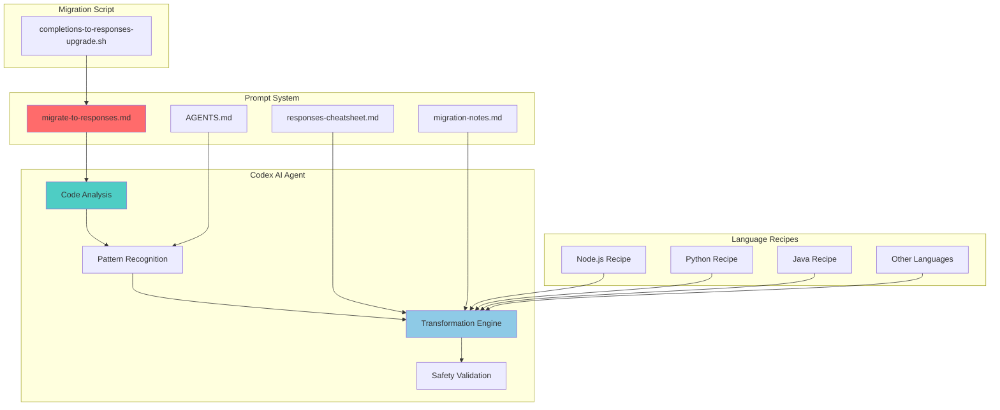
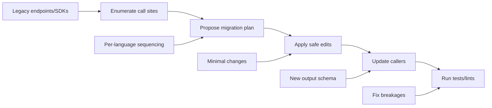
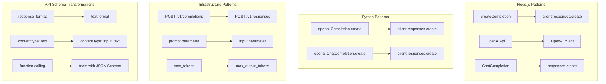
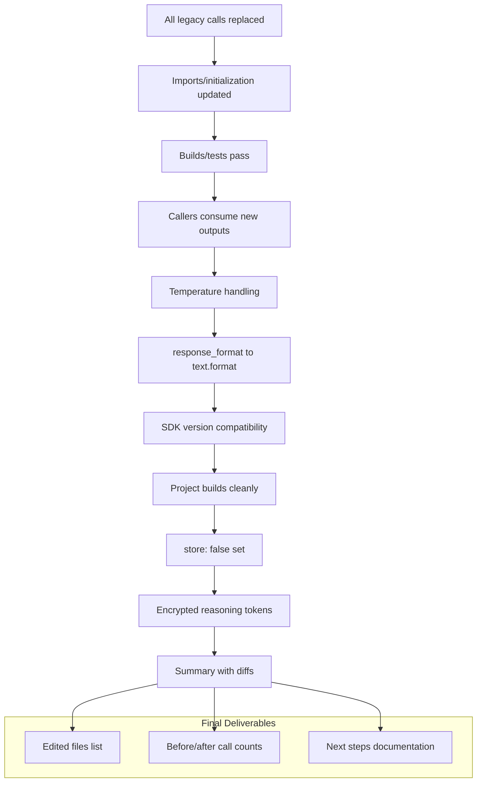
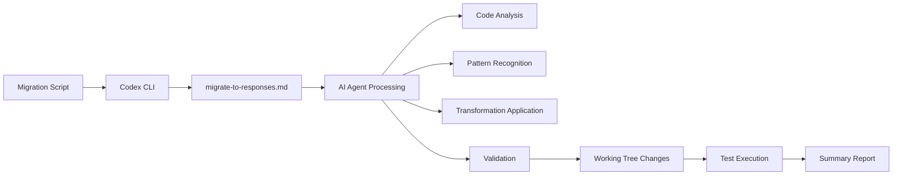

<!-- source: DeepWiki mcp.deepwiki.com · repo openai/completions-responses-migration-pack · page 7 Migration Prompts and AI Instructions · fetched 2026-10-26 -->

# Migration Prompts and AI Instructions

Relevant source files

The following files were used as context for generating this wiki page:

- [prompts/migrate-to-responses.md](prompts/migrate-to-responses.md)

This page documents the internal prompts and instructions that guide the Codex AI agent during automated code transformations. These prompts serve as the "brain" of the migration process, encoding migration logic, safety constraints, and transformation rules that the AI uses to convert legacy OpenAI API calls to the unified Responses API.

For information about the overall migration workflow, see [Getting Started](#2). For details about the script that orchestrates these prompts, see [Migration Script Reference](#5).

## Purpose and Architecture

The migration prompts system provides structured instructions that enable the Codex AI agent to perform intelligent code transformations across multiple programming languages. The system is designed around a single comprehensive prompt file that contains all the necessary context, rules, and constraints for safe automated migration.

### Prompt System Overview

Sources: [prompts/migrate-to-responses.md:1-48]()

## Core Migration Instructions

The primary migration prompt is structured as a comprehensive automation brief that provides the Codex agent with clear objectives, constraints, and transformation rules.

### Instruction Structure

The migration prompt follows a structured format with distinct sections:

| Section | Purpose | Line Range |
|---------|---------|------------|
| Goals | Define migration objectives and success criteria | [3-11]() |
| Guardrails | Safety constraints and limitations | [13-19]() |
| Reference Pack | Documentation resources to consult | [21-23]() |
| Heuristics | Language-specific transformation rules | [25-33]() |
| Acceptance | Validation criteria for completed migration | [35-46]() |

### Goals and Objectives

The prompt defines five primary objectives for the AI agent:

Sources: [prompts/migrate-to-responses.md:5-11]()

## Transformation Heuristics

The prompt system encodes specific transformation rules for different programming environments and API patterns. These heuristics enable the AI agent to recognize legacy patterns and apply appropriate migrations.

### Language-Specific Transformations

Sources: [prompts/migrate-to-responses.md:26-32]()

### Parameter Mapping Rules

The prompt defines specific parameter transformations that the AI agent must apply:

| Legacy Parameter | New Parameter | Context |
|------------------|---------------|---------|
| `prompt` | `input` | Basic text input |
| `max_tokens` | `max_output_tokens` | Token limits |
| `response_format` | `text.format` | Output formatting |
| `content[].type: "text"` | `content[].type: "input_text"` | User/system messages |
| Function calling | `tools` with JSON Schema | Tool integration |

Sources: [prompts/migrate-to-responses.md:28-32]()

## Safety Guardrails and Constraints

The prompt system implements multiple layers of safety constraints to ensure secure and reliable automated transformations.

### Operational Constraints

```mermaid
graph TB
    subgraph "File System Constraints"
        A["Only modify git workspace files"]
        B["Never write outside workspace"]
        C["No backup files creation"]
        D["No tombstone comments"]
    end
    
    subgraph "Version Control Constraints"
        E["No git add/commit/push"]
        F["Working-tree edits only"]
        G["Leave version control to script"]
    end
    
    subgraph "Code Quality Constraints"
        H["No backward-compatibility shims"]
        I["Migrate to new API shape"]
        J["Preserve streaming semantics"]
        K["Run tests and lints"]
    end
    
    subgraph "Security Constraints"
        L["Ask approval for commands"]
        M["No network calls without approval"]
        N["Always set store: false"]
        O["Include encrypted reasoning tokens"]
    end
    
    A --> B
    C --> D
    E --> F
    F --> G
    H --> I
    I --> J
    J --> K
    L --> M
    N --> O
```

Sources: [prompts/migrate-to-responses.md:14-19](), [prompts/migrate-to-responses.md:43-44]()

### Model-Specific Configuration

The prompt includes logic for handling different AI models with appropriate reasoning effort settings:

| Model Pattern | Reasoning Effort | Condition |
|---------------|------------------|-----------|
| `/^o/` (o-series) | `medium` | Previous model was o1, o1-mini, etc. |
| `/^gpt-/` (GPT series) | `minimal` | Previous model was gpt-4, gpt-3.5, etc. |
| Explicit setting | User-provided | Respect existing `reasoning.effort` |

Sources: [prompts/migrate-to-responses.md:33]()

## Acceptance Criteria and Validation

The prompt defines comprehensive acceptance criteria that the AI agent must satisfy for a successful migration.

### Validation Requirements

Sources: [prompts/migrate-to-responses.md:36-45]()

### Build and Test Requirements

The prompt specifies that migrations must ensure:

- OpenAI SDK upgraded to version supporting Responses API
- Dependencies reinstalled (`npm install`, `pip install -U openai`)
- Project builds cleanly (`npm run build`, `pnpm build`, `yarn build`)
- All tests pass with new API integration
- Clear TODO notes for any remaining issues

Sources: [prompts/migrate-to-responses.md:41-42]()

## Integration with Migration Workflow

The prompt system integrates with the broader migration toolkit through several mechanisms:

### Reference Documentation Integration

The prompt instructs the AI agent to consult specific documentation files:

- `docs/responses-cheatsheet.md` - API parameter mappings and examples
- `docs/migration-notes.md` - Technical implementation details  
- `docs/language-recipes/*.md` - Language-specific idioms and patterns

Sources: [prompts/migrate-to-responses.md:22-23]()

### Execution Context

Sources: [prompts/migrate-to-responses.md:1-48]()

The prompt system serves as the knowledge base and instruction set that enables intelligent, safe, and comprehensive migration from legacy OpenAI APIs to the unified Responses API across multiple programming languages and environments.

---

