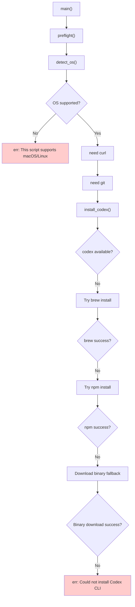
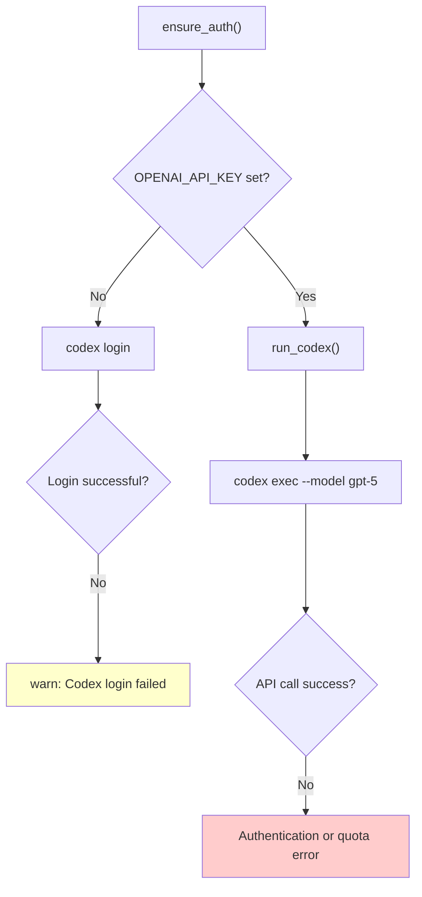
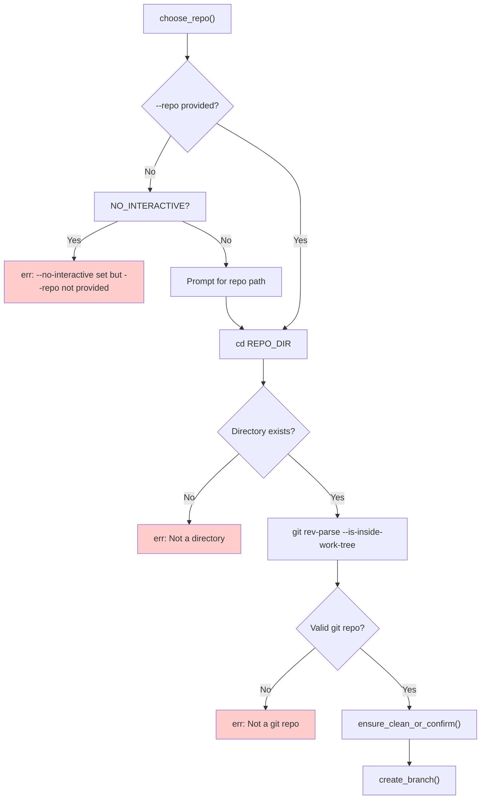
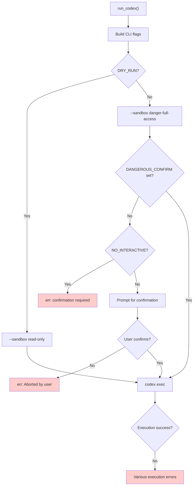
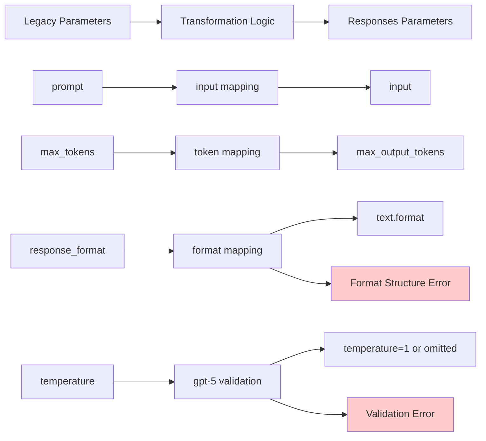
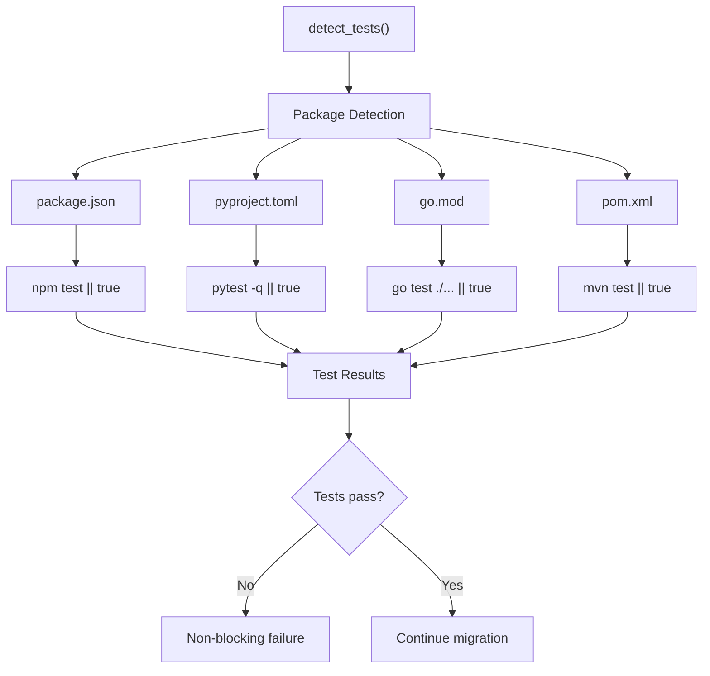

<!-- source: DeepWiki mcp.deepwiki.com · repo openai/completions-responses-migration-pack · page 8 Troubleshooting · fetched 2026-10-26 -->

# Troubleshooting

<details>
<summary>Relevant source files</summary>

The following files were used as context for generating this wiki page:

- [README.md](README.md)
- [docs/migration-notes.md](docs/migration-notes.md)
- [scripts/completions-to-responses-upgrade.sh](scripts/completions-to-responses-upgrade.sh)

</details>


This page provides solutions for common issues encountered during the migration from OpenAI Completions/Chat Completions APIs to the unified Responses API using the `completions-to-responses-upgrade.sh` script. It covers installation problems, authentication failures, execution errors, and migration-specific issues.

For information about script configuration options, see [Script Configuration](#5.1). For execution mode details, see [Execution Modes](#5.2). For API-specific migration guidance, see [Understanding the Migration](#3).

## Common Error Categories

### Prerequisites and Installation Issues

The migration script requires several dependencies and can fail during the installation phase. Here's the error flow and resolution process:

**Installation Error Flow**


**Common Installation Errors:**

1. **"Missing required command" errors**
   - **Cause**: Missing `curl` or `git` dependencies
   - **Solution**: Install via package manager: `apt install curl git` (Ubuntu) or `brew install curl git` (macOS)
   - **Code reference**: [scripts/completions-to-responses-upgrade.sh:41]()

2. **"Could not install Codex CLI" error**
   - **Cause**: All installation methods failed (brew, npm, binary download)
   - **Solutions**:
     - Manually install via: `npm install -g @openai/codex`
     - Check network connectivity for GitHub releases
     - Verify `$HOME/.local/bin` is in `$PATH`
   - **Code reference**: [scripts/completions-to-responses-upgrade.sh:150]()

3. **"This script supports macOS/Linux" error**
   - **Cause**: Running on unsupported OS
   - **Solution**: Use WSL2 on Windows
   - **Code reference**: [scripts/completions-to-responses-upgrade.sh:94]()

Sources: [scripts/completions-to-responses-upgrade.sh:90-108](), [scripts/completions-to-responses-upgrade.sh:121-151]()

### Authentication and API Issues

Authentication problems can prevent the migration from starting or cause failures during execution.

**Authentication Error Flow**


**Common Authentication Errors:**

1. **"Codex login failed or cancelled"**
   - **Cause**: Interactive login was cancelled or invalid credentials
   - **Solutions**:
     - Export `OPENAI_API_KEY` environment variable
     - Run `codex login` separately and retry
     - Verify API key has sufficient permissions
   - **Code reference**: [scripts/completions-to-responses-upgrade.sh:157]()

2. **API quota or permission errors during execution**
   - **Symptoms**: Codex starts but fails during migration
   - **Solutions**:
     - Check API usage limits in OpenAI dashboard
     - Verify API key has access to required models (gpt-5)
     - Use `--model` flag to specify alternative model
   - **Code reference**: [scripts/completions-to-responses-upgrade.sh:444]()

Sources: [scripts/completions-to-responses-upgrade.sh:153-160](), [scripts/completions-to-responses-upgrade.sh:416-498]()

### Repository and Git Issues

Problems with the target repository or Git operations can prevent migration from proceeding.

**Repository Validation Flow**


**Common Repository Errors:**

1. **"Not a directory" error**
   - **Cause**: Invalid path specified with `--repo`
   - **Solution**: Provide absolute or relative path to valid directory
   - **Code reference**: [scripts/completions-to-responses-upgrade.sh:164]()

2. **"Not a git repo" error**
   - **Cause**: Target directory is not a Git repository
   - **Solution**: Run `git init` in target directory or specify correct repository path
   - **Code reference**: [scripts/completions-to-responses-upgrade.sh:174]()

3. **"Refusing to proceed with dirty tree"**
   - **Cause**: Uncommitted changes in `--no-interactive` mode
   - **Solutions**:
     - Commit or stash changes: `git add -A && git commit -m "backup"`
     - Run interactively without `--no-interactive` flag
   - **Code reference**: [scripts/completions-to-responses-upgrade.sh:114]()

4. **Branch creation failures**
   - **Symptoms**: Branch already exists or creation fails
   - **Solutions**:
     - Use `--branch` flag with unique name
     - Delete existing branch: `git branch -D migrate/openai-responses-*`
   - **Code reference**: [scripts/completions-to-responses-upgrade.sh:219]()

Sources: [scripts/completions-to-responses-upgrade.sh:162-175](), [scripts/completions-to-responses-upgrade.sh:110-119](), [scripts/completions-to-responses-upgrade.sh:202-221]()

### Codex Execution and Approval Issues

Problems during the actual migration execution, including sandbox and approval policy issues.

**Codex Execution Error Flow**


**Common Execution Errors:**

1. **"unexpected argument" errors**
   - **Cause**: Outdated Codex CLI version
   - **Solutions**:
     - Update Codex: `brew upgrade codex` or `npm update -g @openai/codex`
     - Clear npm cache: `npm cache clean --force`
   - **Reference**: [README.md:112]()

2. **"Sandbox mode confirmation required"**
   - **Cause**: Running with `danger-full-access` sandbox in non-interactive mode
   - **Solutions**:
     - Set `DANGEROUS_CONFIRM=1` environment variable
     - Run interactively to provide confirmation
     - Use safer approval policy: `-a on-request`
   - **Code reference**: [scripts/completions-to-responses-upgrade.sh:472]()

3. **"Diffs but no writes" issue**
   - **Cause**: Changes planned but not applied due to approval policy
   - **Solutions**:
     - Apply manually: `codex apply <TASK_ID>` (printed at end)
     - Use `--full-auto` or `-a never` for automatic application
   - **Reference**: [README.md:114]()

4. **Sandbox write issues**
   - **Symptoms**: Files not being modified despite successful planning
   - **Solutions**:
     - Use `--full-auto` flag for write-enabled sandbox
     - Switch to `-a on-request` for interactive approval
   - **Reference**: [README.md:113]()

Sources: [README.md:111-116](), [scripts/completions-to-responses-upgrade.sh:466-489]()

## Migration-Specific Troubleshooting

### Model and Temperature Issues

GPT-5 model usage has specific requirements that can cause migration failures.

| Error Symptom | Cause | Solution | Code Reference |
|---------------|-------|----------|----------------|
| "temperature must be 1" | GPT-5 requires `temperature=1` or omitted | Remove temperature parameter or set to 1 | [scripts/completions-to-responses-upgrade.sh:79]() |
| "model not found" | Specified model unavailable | Use `--model` flag with available model | [scripts/completions-to-responses-upgrade.sh:444]() |
| "reasoning effort required" | GPT-5 needs reasoning configuration | Set `reasoning: { effort: "minimal\|medium" }` | [docs/migration-notes.md:10-14]() |

### API Parameter Mapping Issues

**Parameter Transformation Errors**


**Common Parameter Issues:**

1. **`response_format` transformation errors**
   - **Cause**: Complex JSON schema not properly transformed
   - **Solution**: Use proper JSON Schema wrapper as shown in migration notes
   - **Code reference**: [docs/migration-notes.md:49-58]()

2. **Content type mapping failures**
   - **Cause**: Chat `content[].type: "text"` not converted to `"input_text"`
   - **Solution**: Update content transformation logic
   - **Code reference**: [docs/migration-notes.md:60-67]()

Sources: [docs/migration-notes.md:44-70](), [scripts/completions-to-responses-upgrade.sh:423-431]()

### Test and Build Failures

The migration process includes running tests and builds, which can fail for various reasons.

**Test Execution Flow**


**Test-Related Issues:**

1. **Test runner failures from other ecosystems**
   - **Symptom**: Go/Maven/Ruby tests fail during migration
   - **Behavior**: These are ignored unless they belong to your app
   - **Solution**: Focus on your application's test suite; ecosystem tests are non-blocking
   - **Reference**: [README.md:115-116]()

2. **Missing test dependencies**
   - **Symptoms**: Test commands not found during execution
   - **Solutions**:
     - Install missing test runners: `npm install`, `pip install pytest`
     - Verify package.json scripts or test configurations exist
   - **Code reference**: [scripts/completions-to-responses-upgrade.sh:337-375]()

Sources: [scripts/completions-to-responses-upgrade.sh:337-375](), [README.md:115-116]()

## Environment and System Issues

### Path and Permission Problems

| Issue | Symptoms | Solutions |
|-------|----------|-----------|
| Codex binary not in PATH | "command not found: codex" | Add `$HOME/.local/bin` to PATH |
| Permission denied | Cannot execute downloaded binary | `chmod +x $HOME/.local/bin/codex*` |
| Network access blocked | Download failures | Check firewall/proxy settings |
| Insufficient disk space | "No space left on device" | Free up space in temp directory |

**Code reference**: [scripts/completions-to-responses-upgrade.sh:145-149]()

### WSL and Cross-Platform Issues

1. **WSL environment detection**
   - Script automatically detects WSL via `/proc/version` check
   - **Code reference**: [scripts/completions-to-responses-upgrade.sh:97-99]()

2. **File system compatibility**
   - Ensure repository is on WSL file system (not Windows mount)
   - Use WSL paths, not Windows paths

Sources: [scripts/completions-to-responses-upgrade.sh:90-100]()

## Recovery and Cleanup

### Manual Recovery Steps

If migration fails partway through:

1. **Check current branch**: `git branch --show-current`
2. **Review changes**: `git status` and `git diff`
3. **Reset if needed**: `git reset --hard HEAD`
4. **Clean up**: `rm -f AGENTS.md` (if created by script)
5. **Retry with different flags**: Use `--dry-run` first to test

### Debugging Commands

```bash
# Check Codex installation
codex --version

# Verify authentication  
codex auth status

# Test API access
curl -H "Authorization: Bearer $OPENAI_API_KEY" \
  https://api.openai.com/v1/models

# Check git repository status
git rev-parse --is-inside-work-tree
git status --porcelain
```

Sources: [scripts/completions-to-responses-upgrade.sh:500-550]()

---

