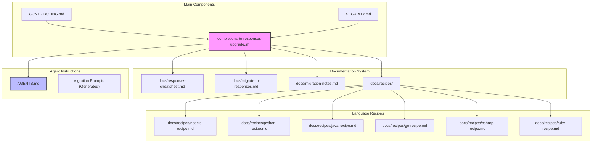
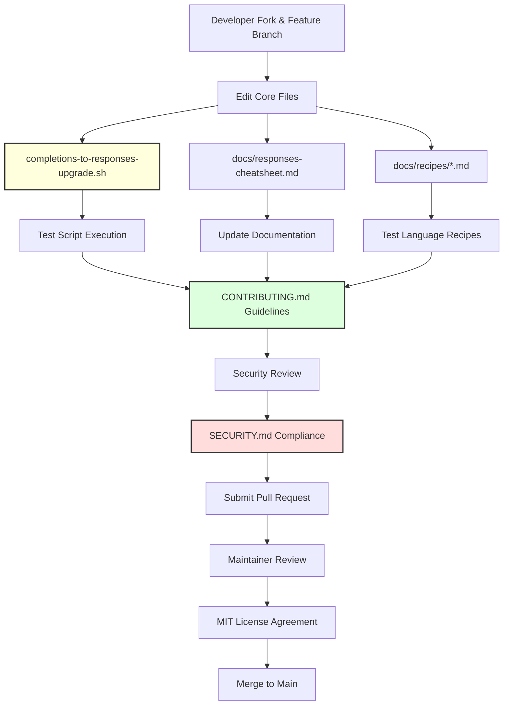
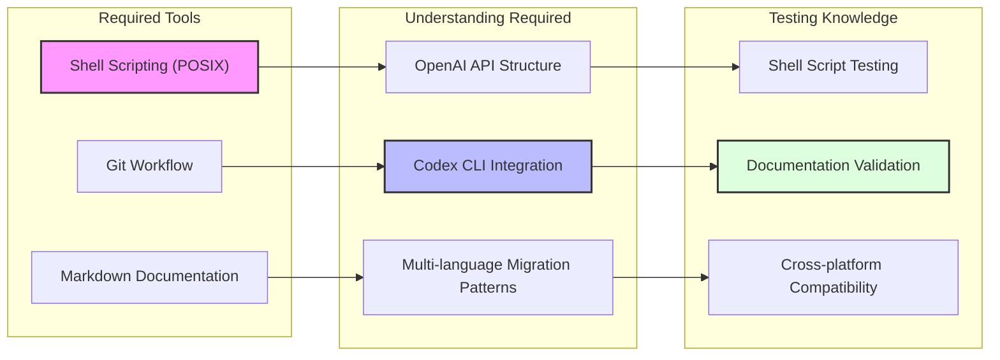

<!-- source: DeepWiki mcp.deepwiki.com · repo openai/completions-responses-migration-pack · page 9 Contributing and Development · fetched 2026-10-26 -->

# Contributing and Development

Relevant source files

The following files were used as context for generating this wiki page:

- [CONTRIBUTING.md](CONTRIBUTING.md)
- [SECURITY.md](SECURITY.md)

This page provides information for developers who want to contribute to the migration toolkit, modify its behavior, or understand its internal architecture. It covers project structure, development guidelines, security policies, and the relationship between different components in the codebase.

For information about using the migration script, see [Getting Started](#2). For details about script configuration and execution, see [Migration Script Reference](#5).

## Project Structure for Contributors

The migration toolkit is organized around a central orchestration script that coordinates AI-powered code transformations through documentation-driven instructions.

### Core Architecture Components

Sources: [CONTRIBUTING.md:10-14](), [SECURITY.md:1-12]()

### Development Workflow Integration

Sources: [CONTRIBUTING.md:6-8](), [CONTRIBUTING.md:21-21]()

## Contributing Guidelines

### How to Contribute

The project follows a standard GitHub contribution workflow with specific requirements for this migration toolkit:

| Step | Requirement | Reference |
|------|-------------|-----------|
| Issue Creation | Describe problem or proposed enhancement clearly | [CONTRIBUTING.md:6]() |
| Fork & Branch | Create focused feature branch from main | [CONTRIBUTING.md:7]() |
| Pull Request | Include clear description with before/after notes | [CONTRIBUTING.md:7-8]() |
| Scope | Keep edits focused and small | [CONTRIBUTING.md:8]() |

Sources: [CONTRIBUTING.md:5-8]()

### Coding Standards

#### Shell Script Guidelines

The main orchestration script follows specific coding practices to ensure reliability across different environments:

- **POSIX Compatibility**: Keep `completions-to-responses-upgrade.sh` POSIX-friendly for broad compatibility
- **Defensive Programming**: Prefer clear, defensive shell code patterns
- **Clean Environment**: Avoid leaving temporary files or comments ("tombstones") in user repositories
- **Workspace Boundaries**: Do not write outside the target git workspace

Sources: [CONTRIBUTING.md:11-13]()

#### Documentation Structure

Changes to behavior must be reflected in the documentation system:

- Update `docs/responses-cheatsheet.md` when API mappings change
- Modify language-specific recipes in `docs/recipes/` when transformation logic changes
- Follow the established `docs/*` structure for new documentation

Sources: [CONTRIBUTING.md:14]()

## Security Considerations

### Secrets Management

The migration toolkit handles sensitive information including API keys and authentication tokens:

| Security Rule | Implementation | File Reference |
|---------------|----------------|----------------|
| No Secret Logging | Never log secrets in script output | [CONTRIBUTING.md:17]() |
| Environment Files | Do not commit `.env` files to repository | [CONTRIBUTING.md:17]() |
| Runtime Secrets | Handle OpenAI API keys securely during script execution | [CONTRIBUTING.md:17]() |

Sources: [CONTRIBUTING.md:16-18]()

### Vulnerability Reporting

Security issues should be reported through established channels:

1. **GitHub Security Advisories**: Use private reporting feature for vulnerabilities
2. **Direct Contact**: Contact project maintainers via OpenAI channels
3. **Investigation Process**: Maintainers investigate promptly and coordinate fixes
4. **Disclosure**: Follow responsible disclosure process

Sources: [SECURITY.md:5-9]()

## Development Environment Setup

### Prerequisites for Contributors

Contributing to the migration toolkit requires understanding of several technologies:

Sources: [CONTRIBUTING.md:11-14]()

### Testing Changes

When modifying the migration toolkit, contributors should verify changes across multiple dimensions:

1. **Script Execution**: Test `completions-to-responses-upgrade.sh` with different parameters
2. **Documentation Updates**: Verify that `docs/responses-cheatsheet.md` changes are accurate
3. **Recipe Validation**: Test language-specific recipes in `docs/recipes/` against real codebases
4. **Cross-platform**: Ensure POSIX compliance for shell script changes

Sources: [CONTRIBUTING.md:11-14]()

## Code Organization Principles

### Separation of Concerns

The toolkit maintains clear separation between different responsibilities:

- **Orchestration**: `completions-to-responses-upgrade.sh` handles workflow coordination
- **Documentation**: `docs/` directory contains all reference materials and recipes  
- **AI Instructions**: `AGENTS.md` and generated prompts guide Codex CLI behavior
- **Project Governance**: `CONTRIBUTING.md` and `SECURITY.md` define contribution policies

Sources: [CONTRIBUTING.md:14](), [SECURITY.md:1]()

### Extensibility Points

Contributors can extend the toolkit in several areas:

| Extension Area | Implementation Method | Key Files |
|----------------|----------------------|-----------|
| New Language Support | Add recipe to `docs/recipes/` | `docs/recipes/*.md` |
| API Mapping Updates | Modify cheatsheet documentation | `docs/responses-cheatsheet.md` |
| Migration Logic | Update agent instructions | `AGENTS.md` |
| Script Features | Extend main orchestration script | `completions-to-responses-upgrade.sh` |

## License and Legal

All contributions are subject to the MIT License terms. By contributing, developers agree that their contributions will be licensed under the same MIT License that covers the project.

Sources: [CONTRIBUTING.md:20-21]()

---

