# Page: Overview

# Overview

<details>
<summary>Relevant source files</summary>

The following files were used as context for generating this wiki page:

- [README.md](README.md)

</details>


This document provides a comprehensive overview of the OpenAI Completions → Responses Migration Pack, an AI-powered toolkit for transitioning codebases from legacy OpenAI APIs to the unified Responses API. The migration pack combines automated code transformation through the Codex CLI with extensive documentation and safety mechanisms to ensure reliable API migrations across multiple programming languages.

For specific migration instructions by programming language, see [Language-Specific Migration Guides](#4). For detailed script configuration and execution options, see [Migration Script Reference](#5). For complete API parameter mappings and examples, see [Responses API Reference](#6).

## System Architecture

The migration pack is built around a central orchestration script that coordinates AI-powered code transformation with comprehensive safety mechanisms and multi-language support.

### Core Component Relationships

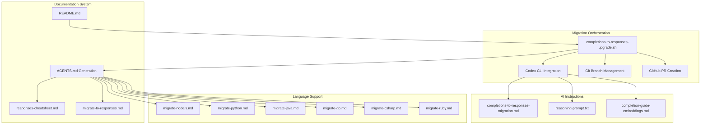

Sources: [README.md:1-185](), [scripts/completions-to-responses-upgrade.sh]()

### API Transformation Pipeline

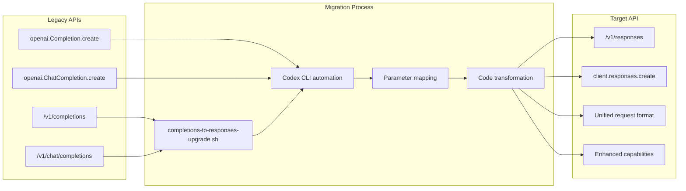

Sources: [README.md:96-103](), [docs/responses-cheatsheet.md]()

## Key System Components

### Main Orchestration Script

The `completions-to-responses-upgrade.sh` script serves as the primary entry point and orchestrates the entire migration process. It handles prerequisite validation, Codex CLI installation, authentication, Git branch management, and optional PR creation.

**Core Functions:**
- Repository detection and validation
- Codex CLI installation and updates
- OpenAI API authentication
- Git branch creation with timestamp-based naming (`migrate/openai-responses-<timestamp>`)
- Documentation kit preparation and embedding
- Automated code transformation execution
- Test running and result summarization
- Optional GitHub PR creation

Sources: [README.md:104-109](), [README.md:85-94]()

### AI-Powered Code Transformation

The migration leverages the Codex CLI as an AI-powered code agent to perform intelligent transformations across multiple programming languages. The system uses structured prompts and language-specific instructions to ensure accurate API migrations.

**Transformation Capabilities:**
- Endpoint migration: `/v1/completions` → `/v1/responses`
- Parameter mapping: `prompt` → `input`, `max_tokens` → `max_output_tokens`
- SDK updates: Legacy completion methods → `client.responses.create()`
- Streaming preservation where originally implemented
- Tool calling migration to unified `tools` parameter with JSON Schema
- Multi-turn conversation handling

Sources: [README.md:96-103](), [docs/completions-to-responses-migration.md]()

### Safety and Validation System

The migration pack implements multiple layers of safety to ensure reliable code transformations:

**Approval Policies:**
- `untrusted`: Sandbox mode only, no file writes
- `on-failure`: Apply changes automatically, ask for approval only on failures
- `on-request`: Interactive approval for all changes
- `never`: Apply all changes without approval (requires `--dangerous` flag)

**Git Integration:**
- Automatic branch creation with timestamped names
- Clean separation of migration changes
- Optional PR creation via GitHub CLI
- Rollback capabilities through Git

**Testing Integration:**
- Automatic test execution when test runners are detected
- Linting validation
- Summary reporting of test results
- Failure handling and reporting

Sources: [README.md:67-75](), [README.md:111-115]()

### Multi-Language Support

The system provides comprehensive support for migrating codebases across different programming languages and frameworks:

| Language | Migration Guide | Key Transformations |
|----------|----------------|-------------------|
| Node.js | `migrate-nodejs.md` | OpenAI SDK client initialization, async/await patterns |
| Python | `migrate-python.md` | `openai.Completion.create` → `client.responses.create` |
| Java | `migrate-java.md` | HTTP client updates, JSON payload construction |
| Go | `migrate-go.md` | HTTP client migration, struct definitions |
| C# | `migrate-csharp.md` | HttpClient usage, JSON serialization |
| Ruby | `migrate-ruby.md` | Net::HTTP implementation, response parsing |

Sources: [docs/migrate-nodejs.md](), [docs/migrate-python.md](), [docs/migrate-java.md](), [docs/migrate-go.md](), [docs/migrate-csharp.md](), [docs/migrate-ruby.md]()

## Migration Benefits and Motivation

### Technical Advantages

The migration from legacy APIs to the Responses API provides several technical benefits:

**GPT-5 Optimization:**
- Enhanced reasoning capabilities with encrypted reasoning tokens
- Improved performance and lower latency
- Better tool orchestration as part of reasoning process
- Cost optimization through improved cache utilization

**API Unification:**
- Single `/v1/responses` endpoint for all text generation needs
- Consistent request/response format across use cases
- Simplified client code and reduced API surface area

**Enhanced Features:**
- Stateful conversations with `store: true` and `previous_response_id`
- Built-in tools: `web_search_preview`, `file_search`, custom functions
- Flexible input formats: single string or items array
- Event-driven streaming model with semantic events

Sources: [README.md:15-25]()

### State and Security Policy

The migration toolkit enforces a security-first approach to API transitions:

- Always sets `store: false` on Responses requests for stateless operation
- Avoids using previous message IDs or server-stored context
- Maintains conversation state locally with minimal logged metadata
- No API keys written to disk, honors existing environment configuration
- Encrypted reasoning tokens included by default for enhanced privacy

Sources: [README.md:81-84](), [README.md:117-120]()

---

# Page: Getting Started

# Getting Started

<details>
<summary>Relevant source files</summary>

The following files were used as context for generating this wiki page:

- [README.md](README.md)
- [scripts/completions-to-responses-upgrade.sh](scripts/completions-to-responses-upgrade.sh)

</details>


This document provides step-by-step instructions for setting up and executing the migration script to transition from OpenAI's legacy Completions/Chat Completions APIs to the unified Responses API. It covers prerequisites, installation, basic execution modes, and initial run configuration.

For detailed information about the migration script's configuration options and advanced features, see [Script Configuration](#5.1). For language-specific migration examples and best practices, see [Language-Specific Migration Guides](#4).

## Prerequisites

The migration toolkit requires a Unix-like environment and several core dependencies to function properly.

### System Requirements

| Requirement | Supported Versions | Notes |
|-------------|-------------------|--------|
| Operating System | macOS, Linux, Windows (WSL2) | Windows requires WSL2 environment |
| Git | Any recent version | Used for branch creation and repository management |
| curl | Any recent version | Required for downloading components |
| OpenAI API Access | Active API key | Can be set via `OPENAI_API_KEY` or interactive login |

The script automatically detects WSL environments and adjusts behavior accordingly. Windows users must run the script within WSL2 rather than native Windows.

**System Detection Workflow**
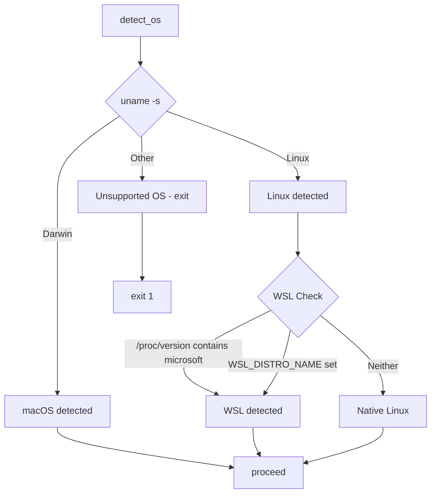

Sources: [scripts/completions-to-responses-upgrade.sh:90-100]()

### Authentication Setup

The script requires OpenAI API access through one of two methods:

1. **Environment Variable**: Set `OPENAI_API_KEY` with your API key
2. **Interactive Login**: Use `codex login` command during execution

The `ensure_auth()` function handles authentication by first checking for the environment variable, then falling back to interactive login if needed.

Sources: [scripts/completions-to-responses-upgrade.sh:153-160]()

## Installation Workflow

The migration toolkit uses the Codex CLI as its core engine. The script automatically handles Codex installation through multiple fallback methods.

**Codex Installation Process**
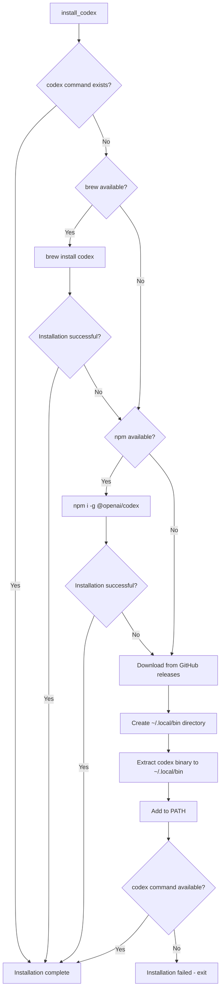

Sources: [scripts/completions-to-responses-upgrade.sh:121-151]()

The installation function `install_codex()` implements a robust fallback strategy:
1. Check if `codex` command already exists
2. Try Homebrew installation (`brew install codex`)
3. Try npm installation (`npm i -g @openai/codex`)
4. Download binary from GitHub releases as last resort

## Execution Modes

The script supports multiple execution modes to accommodate different use cases and safety requirements.

### Quick Start Options

**One-liner execution (GitHub-hosted)**:
```bash
/bin/bash -c "$(curl -fsSL https://raw.githubusercontent.com/openai/completions-responses-migration-pack/main/scripts/completions-to-responses-upgrade.sh)"
```

**Interactive mode** (prompts for repository and model preferences):
```bash
bash scripts/completions-to-responses-upgrade.sh
```

**Non-interactive mode** (requires explicit repository path):
```bash
bash scripts/completions-to-responses-upgrade.sh --repo /path/to/repo --no-interactive
```

### Safety and Control Modes

| Mode | Command | Behavior | Use Case |
|------|---------|----------|----------|
| Dry Run | `--dry-run` | Plans changes without writing | Preview migration impact |
| Write Mode | `--write` | Applies changes to files | Standard migration |
| Full Auto | `--full-auto` | No approval prompts | CI/CD environments |

**Command Line Flag Processing**
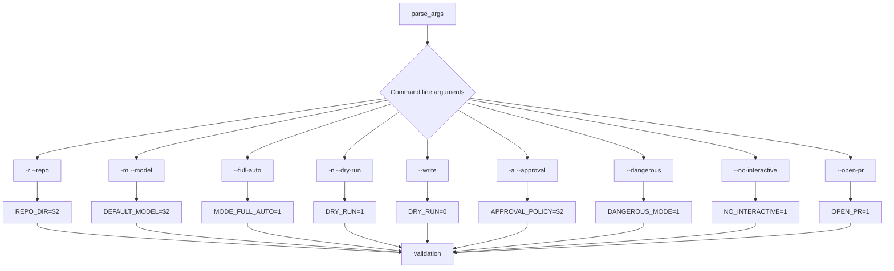

Sources: [scripts/completions-to-responses-upgrade.sh:69-87]()

### Approval Policies

The script implements several approval policies controlled by the `--approval` flag:

- `untrusted`: Sandbox mode only, no file modifications
- `on-failure`: Apply changes directly, ask for approval only on failures
- `on-request`: Prompt for approval on each significant change
- `never`: Apply all changes without prompts (dangerous)

Sources: [scripts/completions-to-responses-upgrade.sh:90]()

## First Run Walkthrough

A typical first-time execution involves several automated steps managed by the `main()` function.

### Repository Selection and Validation

The `choose_repo()` function handles repository selection through two paths:

1. **Explicit path**: When `--repo` flag is provided
2. **Interactive prompt**: When running in interactive mode

```bash
# Example: Interactive repository selection
[?] Path to the repository to migrate: /path/to/my-project
```

The function validates that the target directory exists and contains a valid Git repository using `git rev-parse --is-inside-work-tree`.

Sources: [scripts/completions-to-responses-upgrade.sh:162-175]()

### Model Migration Preference

The `ask_model_preference()` function determines whether to migrate model references to GPT-5:

```bash
[?] Migrate model references to gpt-5? [Y/n]: 
```

This setting affects:
- Model parameter updates in API calls
- Temperature validation (GPT-5 requires temperature unset or equal to 1)
- Model reference consistency across the codebase

Sources: [scripts/completions-to-responses-upgrade.sh:177-195]()

### Branch Creation

The script creates a dedicated migration branch using the `create_branch()` function:

**Branch Creation Logic**
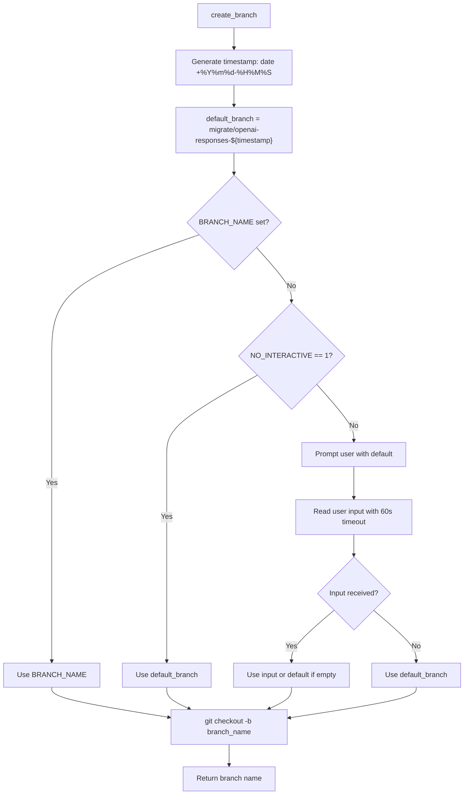

Sources: [scripts/completions-to-responses-upgrade.sh:202-221]()

### Migration Kit Preparation

The `prep_kit()` function sets up the documentation and guidance files that Codex uses during migration:

1. Creates temporary kit directory with embedded documentation
2. Copies local documentation if script is run from the repository
3. Creates or augments `AGENTS.md` with migration instructions
4. Sets environment variables for Codex integration

The function embeds essential documentation including `responses-cheatsheet.md` and migration prompts directly in the script, ensuring availability even when run remotely.

Sources: [scripts/completions-to-responses-upgrade.sh:242-335]()

## Execution Summary

After repository setup and configuration, the script proceeds to:

1. **Codex Execution**: Launch the AI migration agent with configured parameters
2. **Safety Validation**: Apply approval policies and sandbox restrictions
3. **Post-processing**: Handle commits, cleanup, and optional PR creation

The `run_codex()` function coordinates the AI-powered migration with extensive safety controls and validation logic.

For detailed information about the Codex execution process and advanced configuration options, see [Execution Modes](#5.2).

Sources: [scripts/completions-to-responses-upgrade.sh:552-574]()

---

# Page: Understanding the Migration

# Understanding the Migration

<details>
<summary>Relevant source files</summary>

The following files were used as context for generating this wiki page:

- [docs/migration-notes.md](docs/migration-notes.md)
- [docs/responses-cheatsheet.md](docs/responses-cheatsheet.md)

</details>


This document explains the fundamental changes between OpenAI's legacy APIs (Completions and Chat Completions) and the new unified Responses API. It covers the key architectural differences, parameter mappings, and benefits that drive the migration process.

For specific implementation guidance in different programming languages, see [Language-Specific Migration Guides](#4). For detailed API parameter documentation, see [Responses API Reference](#6).

## Migration Overview and Benefits

The migration from legacy OpenAI APIs to the Responses API represents a shift from multiple specialized endpoints to a single unified interface optimized for GPT-5 and future models.

### Why Migrate

The Responses API serves as the unified interface for text generation, tool orchestration, and streaming capabilities. Legacy Completions and Chat Completions endpoints are deprecated and cause performance degradation with GPT-5. Specifically, GPT-5 orchestrates tool calls as part of its internal reasoning process and relies on the Responses API's structured tool flow. Using legacy endpoints can degrade intelligence and cause repeated tool calls because they don't preserve the model's tool context.

**Core Migration Diagram**
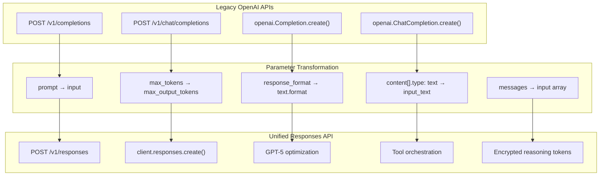

Sources: [docs/migration-notes.md:1-14]()

## API Endpoint Transformation

The migration consolidates multiple endpoints into a single unified interface with enhanced capabilities.

### Endpoint Changes

| Legacy API | New API | Purpose |
|------------|---------|---------|
| `POST /v1/completions` | `POST /v1/responses` | Text completion |
| `POST /v1/chat/completions` | `POST /v1/responses` | Conversational AI |

**Request Structure Comparison**
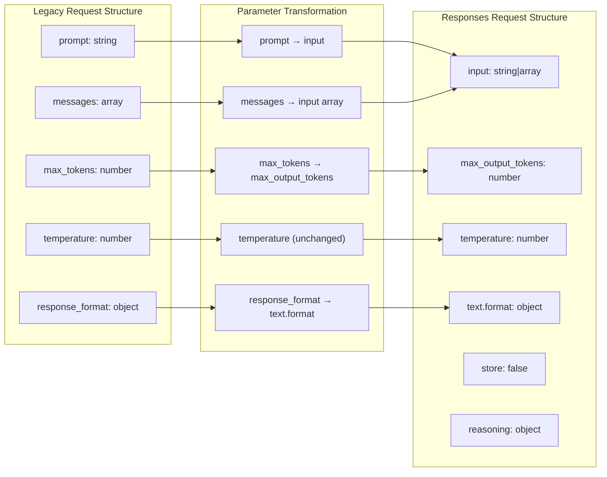

Sources: [docs/migration-notes.md:4-5](), [docs/responses-cheatsheet.md:3-22]()

## Parameter Mapping Changes

### Core Parameter Transformations

The migration involves systematic parameter renaming and restructuring:

| Legacy Parameter | Responses Parameter | Notes |
|------------------|-------------------|-------|
| `prompt` | `input` | Accepts string or array format |
| `max_tokens` | `max_output_tokens` | Clearer naming convention |
| `temperature` | `temperature` | Unchanged |
| `response_format` | `text.format` | Structured object required |
| `stop` | `stop` | Supported as relevant |
| `frequency_penalty` | `frequency_penalty` | Supported as relevant |
| `presence_penalty` | `presence_penalty` | Supported as relevant |

### Response Format Transformation

Legacy `response_format` handling requires specific transformation logic:

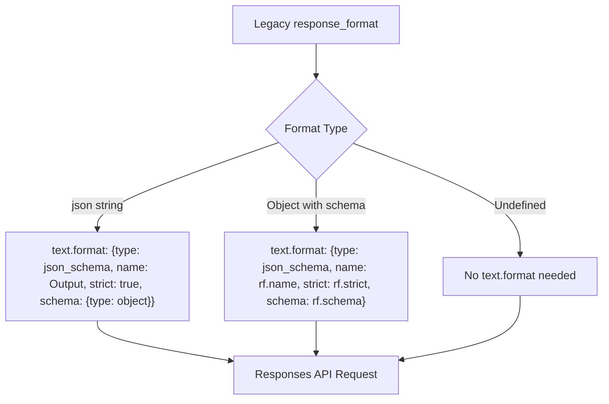

The transformation logic is implemented in the migration helper function:

Sources: [docs/migration-notes.md:49-58](), [docs/responses-cheatsheet.md:14-17]()

## Content Type Changes

### Message Content Structure

The Responses API introduces specific content type identifiers for different input and output scenarios:

| Legacy Content Type | Responses Content Type | Usage |
|-------------------|----------------------|-------|
| `content[].type: "text"` | `content[].type: "input_text"` | User/system input |
| Assistant responses | `content[].type: "output_text"` | Assistant/tool outputs |
| `content[].type: "image_url"` | `content[].type: "input_image"` | Image inputs |

**Content Type Transformation Flow**
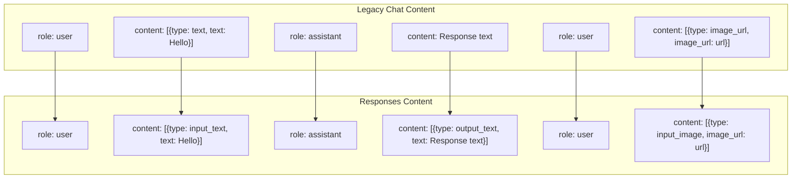

Sources: [docs/migration-notes.md:7-8](), [docs/responses-cheatsheet.md:169]()

## GPT-5 Reasoning Integration

### Reasoning Effort Configuration

The Responses API introduces reasoning capabilities optimized for different model families:

| Source Model Family | Reasoning Configuration | Example Models |
|-------------------|------------------------|----------------|
| o-series models | `reasoning: { effort: "medium" }` | o3, o4-mini, o1, o1-preview |
| GPT-series models | `reasoning: { effort: "minimal" }` | gpt-4, gpt-4.1, gpt-4o, gpt-3.5 |

The migration process includes automatic reasoning effort detection based on the original model string, defaulting to minimal effort unless the model clearly starts with "o".

### Encrypted Reasoning Tokens

All reasoning operations use encrypted reasoning tokens rather than plaintext chain-of-thought output, ensuring security while maintaining reasoning capabilities.

Sources: [docs/migration-notes.md:10-14](), [docs/responses-cheatsheet.md:92-96]()

## SDK and Client Changes

### Client Initialization

Legacy SDK patterns are replaced with unified client methods:

| Legacy Pattern | Responses Pattern |
|----------------|------------------|
| `openai.Completion.create()` | `client.responses.create()` |
| `openai.ChatCompletion.create()` | `client.responses.create()` |

### Required SDK Versions

Migration requires upgrading to compatible SDK versions:
- Node.js: `openai@latest`
- Python: `pip install -U openai`

Sources: [docs/migration-notes.md:71-72]()

## Data Retention and State Management

### Storage Configuration

The Responses API requires explicit state management:

- **Default setting**: `store: false` for all requests
- **State management**: Client-side conversation state handling
- **No server retention**: Eliminates dependency on server-stored context
- **Explicit input**: All conversation history passed in `input` array

### Multi-turn Conversation Pattern

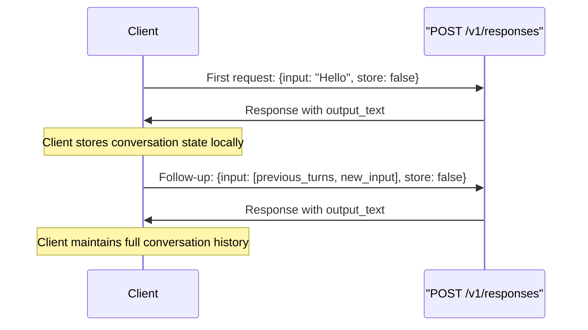

Sources: [docs/migration-notes.md:75-80](), [docs/responses-cheatsheet.md:127-131]()

## Tool Integration Changes

### Function Calling Migration

Legacy Chat Completions function-calling is replaced with structured tool definitions:

- **Tool definition**: JSON Schema-based parameter specification
- **Tool choice**: `tool_choice` parameter for execution control
- **Tool results**: Returned via follow-up requests with `tool` role items
- **Built-in tools**: Support for integrated tools like `web_search_preview`

### Tool Orchestration Benefits

GPT-5's internal tool orchestration provides:
- Reduced repeated tool calls
- Maintained tool context across interactions
- Improved reasoning about tool usage
- Stateless request handling with tool state management

Sources: [docs/migration-notes.md:74](), [docs/responses-cheatsheet.md:77-90]()

---

# Page: Language-Specific Migration Guides

# Language-Specific Migration Guides

<details>
<summary>Relevant source files</summary>

The following files were used as context for generating this wiki page:

- [docs/language-recipes/java.md](docs/language-recipes/java.md)
- [docs/language-recipes/node.md](docs/language-recipes/node.md)
- [docs/language-recipes/python.md](docs/language-recipes/python.md)

</details>


This document provides comprehensive migration instructions for transitioning from OpenAI's legacy Completions and Chat APIs to the unified Responses API across multiple programming languages and environments. Each language guide includes practical examples, parameter mappings, and platform-specific implementation details.

For information about the overall migration process and script execution, see [Getting Started](#2). For detailed API reference documentation, see [Responses API Reference](#6).

## Overview of Language Support

The migration toolkit supports transformation of legacy OpenAI API calls across six major programming languages and environments. Each language follows the same core transformation pattern while accommodating language-specific idioms and SDK differences.

### Supported Environments

| Language | Primary Interface | Migration Focus |
|----------|------------------|-----------------|
| Node.js | OpenAI SDK v4+ | Client method transformation |
| Python | OpenAI Python SDK | Library method migration |
| Java | HTTP Client | Direct HTTP API calls |
| Go | HTTP Client | Request/response handling |
| C# | HttpClient | JSON payload construction |
| Ruby | Net::HTTP | HTTP endpoint migration |

**Sources:** [docs/language-recipes/node.md:1-148](), [docs/language-recipes/python.md:1-44](), [docs/language-recipes/java.md:1-31]()

## Migration Transformation Flow

The following diagram illustrates how legacy API calls transform to the unified Responses API across different programming languages:

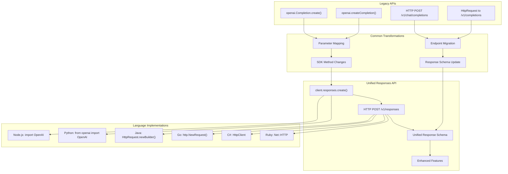

**Sources:** [docs/language-recipes/node.md:6-21](), [docs/language-recipes/python.md:5-19](), [docs/language-recipes/java.md:3-16]()

## Parameter Mapping Patterns

All languages follow consistent parameter transformations when migrating from legacy APIs to the Responses API:

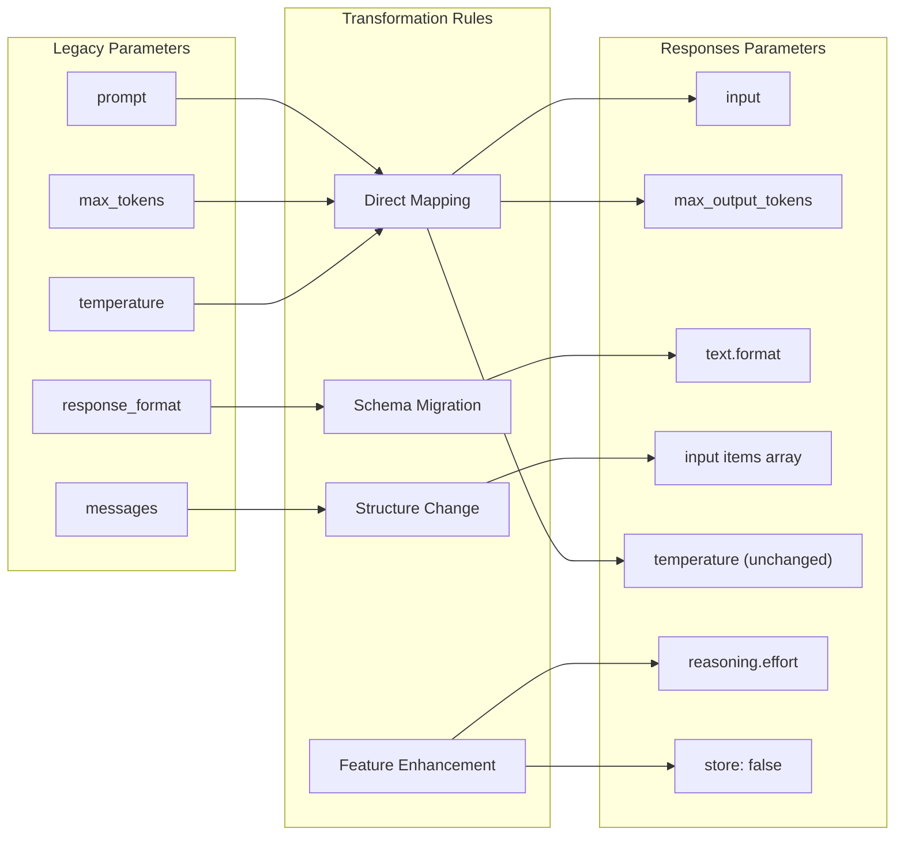

### Core Parameter Transformations

| Legacy Parameter | Responses Parameter | Notes |
|------------------|-------------------|-------|
| `prompt` | `input` | String or structured input items |
| `max_tokens` | `max_output_tokens` | Same value, different name |
| `temperature` | `temperature` | Unchanged |
| `response_format` | `text.format` | JSON schema structure |
| `messages` | `input` | Array of input items with role/content |

**Sources:** [docs/language-recipes/node.md:69-88](), [docs/language-recipes/python.md:36-40](), [docs/language-recipes/java.md:3-5]()

## Language-Specific Implementation Patterns

### SDK-Based Languages (Node.js, Python)

These languages use the official OpenAI SDK and follow object-oriented patterns:

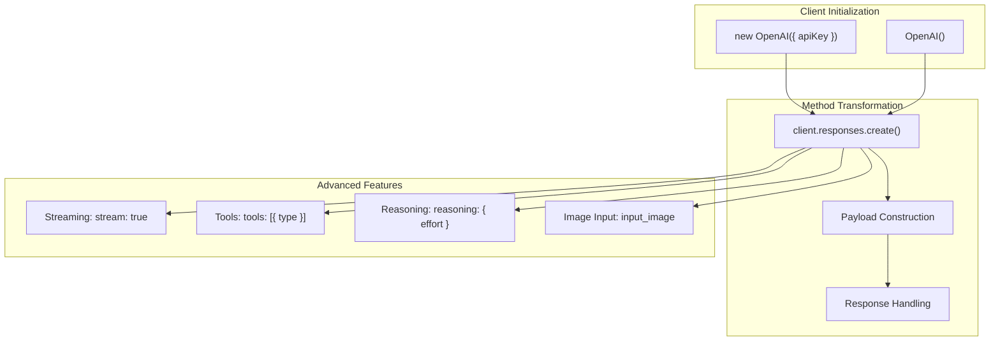

**Sources:** [docs/language-recipes/node.md:16-35](), [docs/language-recipes/python.md:14-34]()

### HTTP-Based Languages (Java, Go, C#, Ruby)

These languages work directly with HTTP clients and require manual request construction:

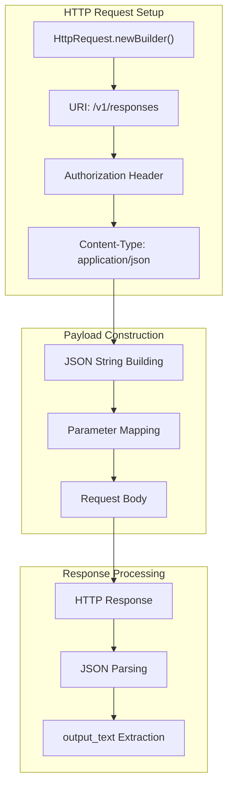

**Sources:** [docs/language-recipes/java.md:10-28]()

## Detailed Language Guides

For comprehensive migration instructions specific to each programming language:

- **Node.js Applications**: See [Node.js Migration](#4.1) for SDK client usage, streaming, and TypeScript examples
- **Python Projects**: See [Python Migration](#4.2) for library method transformations and async patterns  
- **Java HTTP Clients**: See [Java Migration](#4.3) for HTTP request construction and response parsing
- **Go Applications**: See [Go Migration](#4.4) for HTTP client implementation and error handling
- **C# Projects**: See [C# Migration](#4.5) for HttpClient usage and JSON serialization
- **Ruby Scripts**: See [Ruby Migration](#4.6) for Net::HTTP implementation and stateless requests

Each guide includes before/after code examples, parameter mapping tables, and language-specific best practices for implementing the Responses API.

**Sources:** [docs/language-recipes/node.md:1-148](), [docs/language-recipes/python.md:1-44](), [docs/language-recipes/java.md:1-31]()

---

# Page: Node.js Migration

# Node.js Migration

<details>
<summary>Relevant source files</summary>

The following files were used as context for generating this wiki page:

- [docs/language-recipes/node.md](docs/language-recipes/node.md)

</details>


This page provides detailed guidance for migrating Node.js applications from legacy OpenAI APIs (Completions and Chat) to the unified Responses API. This covers client initialization, parameter mapping, streaming, and framework integration patterns.

For general migration concepts and API differences, see [Understanding the Migration](#3). For migration script automation, see [Migration Script Reference](#5).

## Client Initialization Changes

The migration involves updating from the legacy openai v3 SDK pattern to the modern client initialization approach.

**Legacy Pattern**
The old approach used `Configuration` and `OpenAIApi` classes with separate instantiation steps, as shown in [docs/language-recipes/node.md:6-8]().

**Modern Pattern** 
The new approach uses direct `OpenAI` client instantiation with simplified configuration, as demonstrated in [docs/language-recipes/node.md:16-17]().

### Client Initialization Transformation

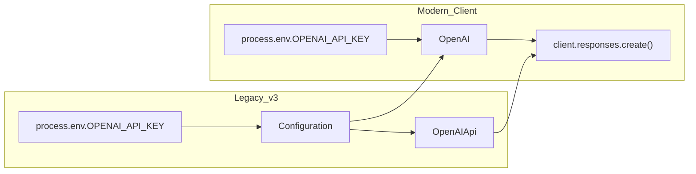

Sources: [docs/language-recipes/node.md:6-20]()

## Method and Parameter Mapping

The core API method calls undergo significant changes in both naming and parameter structure.

| Legacy API | Modern API | Key Changes |
|------------|------------|-------------|
| `openai.createCompletion()` | `client.responses.create()` | Unified endpoint |
| `prompt` | `input` | Parameter rename |
| `max_tokens` | `max_output_tokens` | Parameter rename |
| `model: "text-davinci-003"` | `model: "gpt-5"` | Model update |
| `res.data.choices[0].text` | `res.output_text` | Response structure |

### Parameter Transformation Flow

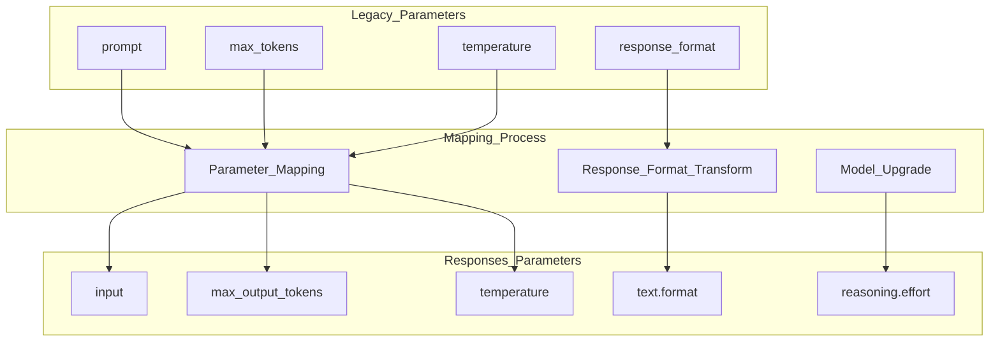

Sources: [docs/language-recipes/node.md:69-88]()

## Advanced Features Integration

### Reasoning and Stateless Requests

The new API introduces reasoning capabilities with encrypted tokens by default, as shown in [docs/language-recipes/node.md:22-35](). The `store: false` parameter ensures stateless operation, while `reasoning.effort` controls computational intensity.

### Streaming Implementation

Streaming maintains similar patterns but with updated method calls and event handling, demonstrated in [docs/language-recipes/node.md:37-44](). The `stream: true` parameter enables real-time response processing through async iteration.

### Built-in Tools Integration

The Responses API includes native tool support without requiring separate function definitions, as exemplified in [docs/language-recipes/node.md:45-54]() with the `web_search_preview` tool.

## Multi-Modal Input Handling

### Image Input Structure

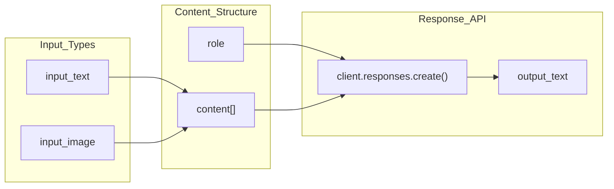

The new API supports mixed content types within the same request, as demonstrated in [docs/language-recipes/node.md:56-67](), enabling seamless multi-modal interactions.

Sources: [docs/language-recipes/node.md:56-99]()

## Framework Integration Patterns

### Next.js Route Handler Implementation

The migration includes comprehensive framework integration examples, particularly for Next.js API routes. The implementation in [docs/language-recipes/node.md:101-145]() demonstrates:

- Request body mapping from legacy to modern parameters
- Conditional reasoning effort assignment based on model family
- Message array transformation to input format
- Response format conversion from `response_format` to `text.format`

### Integration Architecture

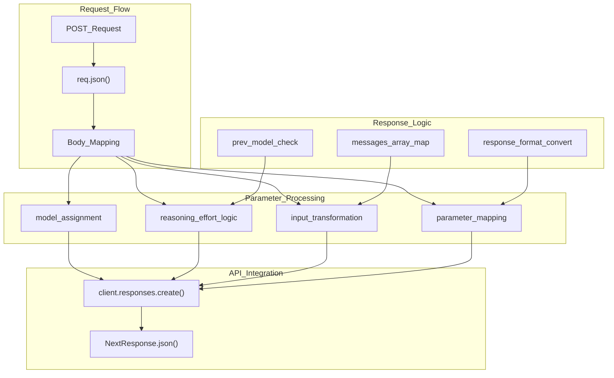

Sources: [docs/language-recipes/node.md:101-145]()

## Migration Checklist

### Required Changes
- [ ] Update import statements from `require("openai")` to `import OpenAI from "openai"`
- [ ] Replace `Configuration` and `OpenAIApi` with direct `OpenAI` instantiation
- [ ] Change `createCompletion()` calls to `client.responses.create()`
- [ ] Map `prompt` parameter to `input`
- [ ] Update `max_tokens` to `max_output_tokens`
- [ ] Modify response access from `res.data.choices[0].text` to `res.output_text`

### Optional Enhancements
- [ ] Add reasoning configuration for GPT-5 optimization
- [ ] Implement stateless requests with `store: false`
- [ ] Integrate built-in tools for enhanced capabilities
- [ ] Update streaming implementations for new event structure
- [ ] Convert response format configurations to `text.format`

Sources: [docs/language-recipes/node.md:1-148]()

---

# Page: Python Migration

# Python Migration

<details>
<summary>Relevant source files</summary>

The following files were used as context for generating this wiki page:

- [docs/language-recipes/python.md](docs/language-recipes/python.md)

</details>


## Purpose and Scope

This document provides comprehensive guidance for migrating Python applications from OpenAI's legacy Completions and Chat APIs to the unified Responses API. It covers client initialization patterns, parameter mappings, response handling, and advanced features specific to Python implementations using the OpenAI Python SDK.

For general migration concepts and API differences, see [Understanding the Migration](#3). For script automation of Python migrations, see [Migration Script Reference](#5).

## Migration Overview

The Python migration involves transitioning from the legacy `openai.Completion.create()` and `openai.ChatCompletion.create()` methods to the new `client.responses.create()` pattern. This change introduces a more modern client-based approach with enhanced capabilities.

### Legacy to Modern Client Pattern

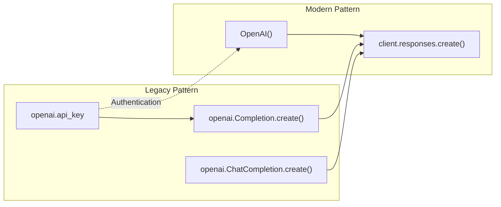

Sources: [docs/language-recipes/python.md:1-44]()

## API Method Transformations

The core transformation involves replacing multiple legacy endpoints with a single unified method:

```mermaid
graph TD
    subgraph LegacyMethods["Legacy Methods"]
        L1["openai.Completion.create()"]
        L2["openai.ChatCompletion.create()"]
    end
    
    subgraph ResponsesAPI["Responses API"]
        R1["client.responses.create()"]
    end
    
    subgraph Parameters["Key Parameter Changes"]
        P1["prompt → input"]
        P2["max_tokens → max_output_tokens"]
        P3["temperature (unchanged)"]
    end
    
    L1 --> R1
    L2 --> R1
    P1 --> R1
    P2 --> R1
    P3 --> R1
```

Sources: [docs/language-recipes/python.md:36-40]()

## Client Initialization Migration

### Legacy Authentication Pattern

The legacy approach used global API key configuration:

| Legacy Pattern | New Pattern |
|---|---|
| `openai.api_key = os.getenv("OPENAI_API_KEY")` | `client = OpenAI()` |
| Global state management | Instance-based client |
| Manual key assignment | Automatic environment detection |

Sources: [docs/language-recipes/python.md:6-7](), [docs/language-recipes/python.md:15-16]()

### Modern Client Initialization

The new pattern uses the `OpenAI()` constructor which automatically handles authentication through environment variables or explicit configuration.

Sources: [docs/language-recipes/python.md:15-16]()

## Parameter Mapping Reference

### Core Parameter Transformations

| Legacy Parameter | Responses API Parameter | Notes |
|---|---|---|
| `prompt` | `input` | String input becomes `input` |
| `max_tokens` | `max_output_tokens` | Output length control |
| `temperature` | `temperature` | Unchanged |
| `model` | `model` | Typically migrates to `"gpt-5"` |

Sources: [docs/language-recipes/python.md:36-40]()

### Response Handling Changes

```mermaid
flowchart TB
    subgraph LegacyResponse["Legacy Response Structure"]
        LR1["resp['choices'][0]['text']"]
        LR2["Dictionary access pattern"]
    end
    
    subgraph ModernResponse["Modern Response Structure"]
        MR1["resp.output_text"]
        MR2["Attribute access pattern"]
    end
    
    LegacyResponse --> ModernResponse
```

Sources: [docs/language-recipes/python.md:9](), [docs/language-recipes/python.md:18]()

## Advanced Features

### Reasoning and Stateless Requests

The new Responses API introduces reasoning capabilities with encrypted reasoning tokens by default:

```mermaid
graph LR
    subgraph NewFeatures["New Responses API Features"]
        NF1["reasoning.effort"]
        NF2["store: False"]
        NF3["input_items"]
        NF4["Encrypted reasoning tokens"]
    end
    
    subgraph ClientCall["client.responses.create()"]
        CC1["model parameter"]
        CC2["input parameter"] 
        CC3["store parameter"]
        CC4["reasoning parameter"]
    end
    
    NF1 --> CC4
    NF2 --> CC3
    NF3 --> CC2
    NF4 -.->|"Default behavior"| CC4
```

The `reasoning.effort` parameter accepts values like `"minimal"` to control computational effort for reasoning tasks.

Sources: [docs/language-recipes/python.md:21-34]()

### Stateless Operation

Setting `store=False` ensures stateless requests where no conversation history or reasoning tokens are persisted on OpenAI's servers, enhancing privacy and security.

Sources: [docs/language-recipes/python.md:30]()

## Streaming Considerations

For applications that previously used streaming with the legacy APIs, the migration requires following the updated streaming patterns in the OpenAI Python library. The specific streaming implementation details are covered in the library's streaming documentation.

Sources: [docs/language-recipes/python.md:41]()

## Migration Code Examples

### Basic Migration Pattern

The simplest migration transforms a basic completion call:

**Before (Legacy):** [docs/language-recipes/python.md:5-9]()
**After (Responses API):** [docs/language-recipes/python.md:14-18]()

### Advanced Migration with Reasoning

For applications requiring reasoning capabilities:

**Advanced Pattern:** [docs/language-recipes/python.md:23-33]()

This pattern demonstrates the integration of reasoning parameters and stateless operation mode available in the new API.

Sources: [docs/language-recipes/python.md:1-44]()

---

# Page: Java Migration

# Java Migration

<details>
<summary>Relevant source files</summary>

The following files were used as context for generating this wiki page:

- [docs/language-recipes/java.md](docs/language-recipes/java.md)

</details>


This document provides detailed instructions for migrating Java applications from OpenAI's legacy APIs (`/v1/completions` and `/v1/chat/completions`) to the unified `/v1/responses` API. It covers HTTP client migration, parameter mapping, request construction, and response handling patterns specific to Java development environments.

For general migration concepts and API differences, see [Understanding the Migration](#3). For automated migration using the toolkit script, see [Migration Script Reference](#5).

## Migration Overview

The Java migration process involves updating HTTP client code to target the new `/v1/responses` endpoint with transformed request parameters and updated response parsing logic.

### API Transformation Flow

```mermaid
flowchart TD
    A[HttpRequest.newBuilder] --> B["URI.create('/v1/completions')"]
    C[HttpRequest.newBuilder] --> D["URI.create('/v1/responses')"]
    
    E["Legacy Request Body"] --> F["{'prompt': 'text', 'max_tokens': 100}"]
    G["New Request Body"] --> H["{'input': 'text', 'max_output_tokens': 100, 'model': 'gpt-5'}"]
    
    I["Legacy Response"] --> J["choices[0].text"]
    K["New Response"] --> L["output_text"]
    
    A --> E
    A --> I
    
    C --> G
    C --> K
    
    style B fill:#ffbe0b
    style D fill:#8ecae6
    style F fill:#ffbe0b
    style H fill:#8ecae6
    style J fill:#ffbe0b
    style L fill:#8ecae6
```

*Sources: docs/language-recipes/java.md:1-5*

### Java HTTP Client Migration Pattern

```mermaid
graph LR
    subgraph "Legacy Pattern"
        A[HttpRequest.newBuilder] --> B["/v1/completions"]
        B --> C["prompt parameter"]
        C --> D["max_tokens parameter"]
    end
    
    subgraph "New Pattern"
        E[HttpRequest.newBuilder] --> F["/v1/responses"]
        F --> G["input parameter"]
        G --> H["max_output_tokens parameter"]
        H --> I["model: gpt-5"]
    end
    
    A -.-> E
    B -.-> F
    C -.-> G
    D -.-> H
    
    style A fill:#ffbe0b
    style E fill:#8ecae6
```

*Sources: docs/language-recipes/java.md:3-4*

## HTTP Client Migration

### Basic Request Construction

The primary migration involves updating the URI endpoint and transforming the request body parameters. Java applications typically use `HttpRequest.newBuilder()` for API calls.

| Legacy Implementation | New Implementation |
|----------------------|-------------------|
| `URI.create("https://api.openai.com/v1/completions")` | `URI.create("https://api.openai.com/v1/responses")` |
| `"prompt": "text"` | `"input": "text"` |
| `"max_tokens": 100` | `"max_output_tokens": 100` |
| Optional `model` parameter | Required `"model": "gpt-5"` |

The basic HTTP request pattern is demonstrated in [docs/language-recipes/java.md:10-16](), showing the complete `HttpRequest` construction with proper headers and JSON payload.

*Sources: docs/language-recipes/java.md:7-16*

## Parameter Mapping

### Core Parameter Transformations

| Legacy Parameter | Responses Parameter | Description |
|-----------------|-------------------|-------------|
| `prompt` | `input` | Text input for completion |
| `max_tokens` | `max_output_tokens` | Maximum tokens in response |
| `model` (optional) | `model` (required) | Must specify "gpt-5" |
| N/A | `store` | Set to `false` for stateless requests |
| N/A | `reasoning.effort` | Control reasoning computation |

*Sources: docs/language-recipes/java.md:3-4*

### Request Body Construction

Java applications construct JSON request bodies as strings when using the standard `HttpRequest.BodyPublishers.ofString()` method. The new format requires:

1. **Model specification**: Always include `"model": "gpt-5"`
2. **Input transformation**: Replace `prompt` with `input`
3. **Token limit adjustment**: Use `max_output_tokens` instead of `max_tokens`

*Sources: docs/language-recipes/java.md:14, 21*

## Advanced Features

### Stateless Requests with Reasoning

The Responses API supports enhanced features like reasoning control and stateless operation. The example in [docs/language-recipes/java.md:20-28]() demonstrates:

```java
String payload = "{\"model\":\"gpt-5\",\"input\":\"Hello\",\"store\":false,\"reasoning\":{\"effort\":\"minimal\"}}";
```

This payload includes:
- **`store: false`**: Ensures stateless request processing
- **`reasoning.effort`**: Controls computational effort for reasoning ("minimal", "standard", "extended")

### HTTP Request Headers

Both legacy and new implementations require identical authentication and content-type headers:
- `Authorization: Bearer ${OPENAI_API_KEY}`
- `Content-Type: application/json`

*Sources: docs/language-recipes/java.md:18-28*

## Response Handling

### Response Schema Changes

The Responses API returns a different response structure that requires updated parsing logic:

```mermaid
graph TB
    subgraph "Legacy Response Structure"
        A["HttpResponse<String>"] --> B["JSON.parse()"]
        B --> C["choices[0].text"]
    end
    
    subgraph "New Response Structure"
        D["HttpResponse<String>"] --> E["JSON.parse()"]
        E --> F["output_text"]
        E --> G["reasoning_tokens (if applicable)"]
        E --> H["store_metadata (if stored)"]
    end
    
    A -.-> D
    C -.-> F
    
    style A fill:#ffbe0b
    style D fill:#8ecae6
    style C fill:#ffbe0b
    style F fill:#8ecae6
```

*Sources: docs/language-recipes/java.md:5*

### Response Processing

When using Java HTTP clients, response parsing should be updated to:

1. **Extract text content**: Access `output_text` instead of `choices[0].text`
2. **Handle reasoning data**: Process `reasoning_tokens` if reasoning was requested
3. **Validate model response**: Ensure the response matches the expected GPT-5 format

The migration toolkit automatically handles these transformations when processing Java codebases that use standard HTTP client patterns.

*Sources: docs/language-recipes/java.md:5*

---

# Page: Go Migration

# Go Migration

<details>
<summary>Relevant source files</summary>

The following files were used as context for generating this wiki page:

- [docs/language-recipes/go.md](docs/language-recipes/go.md)

</details>


This document provides comprehensive guidance for migrating Go applications from OpenAI's legacy Completions and Chat APIs to the unified Responses API. It covers HTTP client implementation, request construction, parameter mapping, and response handling patterns specific to Go.

For general migration concepts and API differences, see [Understanding the Migration](#3). For script automation of Go codebases, see [Migration Script Reference](#5).

## Migration Overview

The Go migration process involves updating HTTP clients to use the new `/v1/responses` endpoint while transforming request parameters and response handling logic.

### API Endpoint Transformation

```mermaid
graph LR
    subgraph "Legacy_APIs"
        A["POST /v1/completions"]
        B["POST /v1/chat/completions"]
    end
    
    subgraph "Go_HTTP_Client"
        C["http.NewRequest()"]
        D["req.Header.Set()"]
        E["client.Do()"]
    end
    
    subgraph "Unified_API"
        F["POST /v1/responses"]
        G["gpt-5 model"]
        H["store:false"]
    end
    
    A --> C
    B --> C
    C --> F
    D --> G
    E --> H
```

**Sources:** [docs/language-recipes/go.md:1-27]()

## HTTP Client Implementation

Go applications typically use the `net/http` package to interact with OpenAI APIs. The migration involves updating the endpoint URL and request construction patterns.

### Basic Request Structure

The fundamental HTTP request structure changes from multiple endpoints to a single `/v1/responses` endpoint:

```mermaid
graph TD
    subgraph "http_NewRequest"
        A["method: POST"]
        B["url: https://api.openai.com/v1/responses"]
        C["body: strings.NewReader(payload)"]
    end
    
    subgraph "Header_Configuration"
        D["Authorization: Bearer + OPENAI_API_KEY"]
        E["Content-Type: application/json"]
    end
    
    subgraph "Request_Payload"
        F["model: gpt-5"]
        G["input: prompt_text"]
        H["max_output_tokens: token_limit"]
    end
    
    A --> D
    B --> E
    C --> F
    F --> G
    G --> H
```

**Sources:** [docs/language-recipes/go.md:7-14]()

## Parameter Mapping

The migration requires transforming legacy parameters to match the Responses API schema:

| Legacy Parameter | Responses API Parameter | Go Implementation |
|------------------|------------------------|-------------------|
| `prompt` | `input` | String field in JSON payload |
| `max_tokens` | `max_output_tokens` | Integer field in JSON payload |
| `response_format` | `text.format` | Nested object structure |
| `model` | `model` | Set to `gpt-5` |

**Sources:** [docs/language-recipes/go.md:4]()

## Request Construction Patterns

### Standard Request

The basic migration pattern involves constructing a JSON payload with the new parameter structure:

**Sources:** [docs/language-recipes/go.md:9-14]()

### Enhanced Request with Reasoning

For applications requiring reasoning capabilities, the request includes additional parameters:

```mermaid
graph LR
    subgraph "Enhanced_Payload"
        A["model: gpt-5"]
        B["input: prompt_content"]
        C["store: false"]
        D["reasoning.effort: minimal"]
    end
    
    subgraph "strings_NewReader"
        E["JSON payload"]
        F["io.Reader interface"]
    end
    
    subgraph "http_Request"
        G["POST method"]
        H["responses endpoint"]
        I["authorization header"]
    end
    
    A --> E
    B --> E
    C --> E
    D --> E
    E --> F
    F --> G
    G --> H
    H --> I
```

**Sources:** [docs/language-recipes/go.md:16-24]()

## Response Handling Migration

Go applications must update their JSON unmarshalling logic to handle the new response structure from the Responses API.

### Response Structure Changes

```mermaid
graph TD
    subgraph "Legacy_Response"
        A["choices[0].text"]
        B["choices[0].message.content"]
        C["usage.total_tokens"]
    end
    
    subgraph "Responses_API"
        D["output.text"]
        E["output.reasoning"]
        F["usage.output_tokens"]
    end
    
    subgraph "Go_Unmarshalling"
        G["json.Unmarshal()"]
        H["struct field mapping"]
        I["error handling"]
    end
    
    A --> G
    B --> G
    C --> G
    D --> H
    E --> H
    F --> H
    G --> I
```

**Sources:** [docs/language-recipes/go.md:5]()

## Complete Migration Example

The migration process transforms a typical Go HTTP client implementation from legacy endpoints to the unified Responses API while maintaining the same HTTP client patterns and adding support for new features like stateless requests and reasoning capabilities.

**Sources:** [docs/language-recipes/go.md:1-27]()

---

# Page: C# Migration

# C# Migration

<details>
<summary>Relevant source files</summary>

The following files were used as context for generating this wiki page:

- [docs/language-recipes/csharp.md](docs/language-recipes/csharp.md)

</details>


This document provides comprehensive guidance for migrating C# applications from OpenAI's legacy Completions and Chat APIs to the unified Responses API. It covers HTTP client usage, parameter mapping, request construction, and advanced features specific to C# implementations.

For general migration concepts and API differences, see [Understanding the Migration](#3). For automated migration using the script, see [Migration Script Reference](#5).

## Migration Overview

The C# migration involves transitioning from multiple legacy endpoints to the single `/v1/responses` endpoint while updating HTTP request construction and parameter names.

### C# API Migration Flow

```mermaid
flowchart TD
    A[Legacy_API] --> B["HttpRequestMessage"]
    B --> C["StringContent_Construction"]
    C --> D["Parameter_Mapping"]
    D --> E["New_Responses_Endpoint"]
    
    F["/v1/completions"] --> G["prompt_parameter"]
    H["/v1/chat/completions"] --> I["messages_parameter"]
    
    G --> J["input_parameter"]
    I --> J
    
    K["max_tokens"] --> L["max_output_tokens"]
    M["gpt-3.5-turbo"] --> N["gpt-5"]
    
    J --> O["/v1/responses"]
    L --> O
    N --> O
    
    O --> P["AuthenticationHeaderValue"]
    P --> Q["Bearer_Token"]
```

Sources: [docs/language-recipes/csharp.md:1-25]()

## HTTP Client Migration

C# applications typically use `HttpRequestMessage` and `StringContent` classes to construct API requests. The migration updates the endpoint URL and JSON payload structure.

### Request Construction Components

```mermaid
graph TB
    A["HttpRequestMessage"] --> B["HttpMethod.Post"]
    A --> C["api.openai.com/v1/responses"]
    A --> D["StringContent"]
    
    D --> E["JSON_Payload"]
    E --> F["model_gpt-5"]
    E --> G["input_parameter"]
    E --> H["max_output_tokens"]
    
    I["Headers"] --> J["AuthenticationHeaderValue"]
    J --> K["Bearer_Token"]
    J --> L["OPENAI_API_KEY"]
    
    A --> I
```

Sources: [docs/language-recipes/csharp.md:7-13]()

## Parameter Mapping

The migration requires updating parameter names and values in the JSON payload:

| Legacy Parameter | Responses Parameter | Notes |
|-----------------|-------------------|-------|
| `prompt` | `input` | Text input field |
| `max_tokens` | `max_output_tokens` | Token limit |
| `gpt-3.5-turbo` | `gpt-5` | Model upgrade |
| `messages` | `input` | Chat format conversion |

Sources: [docs/language-recipes/csharp.md:4-5]()

## Basic Request Construction

The basic HTTP request uses `HttpRequestMessage` with `StringContent` for the JSON payload and `AuthenticationHeaderValue` for authentication:

```
HttpRequestMessage → POST https://api.openai.com/v1/responses
StringContent → {"model":"gpt-5","input":"Hello"}
AuthenticationHeaderValue → Bearer [OPENAI_API_KEY]
```

The request construction follows the pattern shown in [docs/language-recipes/csharp.md:10-13](), using `Encoding.UTF8` and `application/json` content type.

Sources: [docs/language-recipes/csharp.md:7-13]()

## Advanced Features

### Reasoning and Stateless Requests

Advanced features include reasoning capabilities and stateless request configuration:

```mermaid
graph LR
    A["JSON_Payload"] --> B["model"]
    A --> C["input"]
    A --> D["store_false"]
    A --> E["reasoning_object"]
    
    E --> F["effort_minimal"]
    
    G["StringContent"] --> A
    H["HttpRequestMessage"] --> G
```

The reasoning feature uses an object with an `effort` parameter, while `store: false` ensures stateless operation as demonstrated in [docs/language-recipes/csharp.md:18-21]().

Sources: [docs/language-recipes/csharp.md:15-22]()

## Request Headers and Authentication

C# applications use `AuthenticationHeaderValue` with the "Bearer" scheme and retrieve the API key from environment variables using `Environment.GetEnvironmentVariable("OPENAI_API_KEY")`.

### Authentication Flow

```mermaid
flowchart LR
    A["Environment.GetEnvironmentVariable"] --> B["OPENAI_API_KEY"]
    B --> C["AuthenticationHeaderValue"]
    C --> D["Bearer_Scheme"]
    D --> E["HttpRequestMessage.Headers"]
    E --> F["Authorization_Header"]
```

Sources: [docs/language-recipes/csharp.md:12-13](), [docs/language-recipes/csharp.md:21-21]()

## Complete Migration Pattern

The complete migration follows this code entity pattern:

1. Create `HttpRequestMessage` with `HttpMethod.Post`
2. Set endpoint to `https://api.openai.com/v1/responses`
3. Construct `StringContent` with updated JSON payload
4. Apply `AuthenticationHeaderValue` with Bearer token
5. Use `Encoding.UTF8` and `application/json` content type

This pattern applies to both basic requests and advanced requests with reasoning capabilities, maintaining consistent HTTP client usage across all C# applications.

Sources: [docs/language-recipes/csharp.md:1-25]()

---

# Page: Ruby Migration

# Ruby Migration

<details>
<summary>Relevant source files</summary>

The following files were used as context for generating this wiki page:

- [docs/language-recipes/ruby.md](docs/language-recipes/ruby.md)

</details>


This document provides Ruby-specific migration instructions for transitioning from legacy OpenAI APIs to the unified Responses API using Ruby's built-in `Net::HTTP` library. It covers HTTP client configuration, parameter mapping, and request construction patterns for stateless API calls.

For general migration concepts and API differences, see [Understanding the Migration](#3). For migration script automation, see [Migration Script Reference](#5).

## API Endpoint Migration

Ruby applications must migrate from legacy endpoints to the unified `/v1/responses` endpoint. The core transformation involves updating the URI target and remapping request parameters to align with the new API specification.

**Ruby HTTP Endpoint Transformation**

```mermaid
flowchart LR
    subgraph "Legacy_APIs"
        A["/v1/completions"]
        B["/v1/chat/completions"]
    end
    
    subgraph "Migration_Process"
        C["Net::HTTP::Post.new()"]
        D["Parameter Mapping"]
        E["Request Body Construction"]
    end
    
    subgraph "Responses_API"
        F["/v1/responses"]
        G["Unified Endpoint"]
    end
    
    A --> C
    B --> C
    C --> D
    D --> E
    E --> F
    F --> G
    
    style C fill:#f9f9f9
    style D fill:#f9f9f9
    style E fill:#f9f9f9
```

Sources: [docs/language-recipes/ruby.md:1-14]()

## Parameter Mapping

The migration requires specific parameter transformations when constructing JSON payloads for Ruby HTTP requests.

| Legacy Parameter | Responses API Parameter | Ruby Implementation |
|-----------------|------------------------|-------------------|
| `prompt` | `input` | `{ input: "Hello" }` |
| `max_tokens` | `max_output_tokens` | `{ max_output_tokens: 100 }` |
| `messages` | `input` | `{ input: conversation_text }` |

**Parameter Transformation Flow**

```mermaid
flowchart TD
    subgraph "Legacy_Parameters"
        A["prompt: string"]
        B["max_tokens: integer"]
        C["messages: array"]
    end
    
    subgraph "Ruby_Hash_Construction"
        D["Hash.new"]
        E["to_json()"]
        F["req.body assignment"]
    end
    
    subgraph "Responses_Parameters"
        G["input: string"]
        H["max_output_tokens: integer"]
        I["model: string"]
    end
    
    A --> D
    B --> D
    C --> D
    D --> E
    E --> F
    F --> G
    F --> H
    F --> I
```

Sources: [docs/language-recipes/ruby.md:3-4]()

## HTTP Client Configuration

Ruby applications use `Net::HTTP` and `URI` classes to construct requests to the Responses API. The standard pattern involves URI parsing, request object creation, and header configuration.

**Net::HTTP Request Structure**

```mermaid
graph TB
    subgraph "Ruby_HTTP_Components"
        A["URI()"]
        B["Net::HTTP::Post.new()"]
        C["Authorization Header"]
        D["Content-Type Header"]
        E["JSON Body"]
    end
    
    subgraph "API_Target"
        F["https://api.openai.com/v1/responses"]
        G["Bearer Token Authentication"]
        H["application/json Content"]
    end
    
    A --> F
    B --> A
    C --> G
    D --> H
    E --> H
    
    B --> C
    B --> D
    B --> E
```

The basic HTTP configuration pattern is demonstrated in [docs/language-recipes/ruby.md:9-13](), which shows URI construction, request initialization, and header assignment for authentication and content type specification.

Sources: [docs/language-recipes/ruby.md:6-14]()

## Basic Request Implementation

Ruby applications construct requests using `Net::HTTP::Post` objects with proper authorization headers and JSON payloads. The implementation requires `URI` parsing and request body serialization.

The standard request pattern follows the structure shown in [docs/language-recipes/ruby.md:9-14]():
- `URI("https://api.openai.com/v1/responses")` for endpoint targeting
- `Net::HTTP::Post.new(uri)` for request object creation  
- `req["Authorization"] = "Bearer #{ENV["OPENAI_API_KEY"]}"` for API authentication
- `req.body = { model: "gpt-5", input: "Hello" }.to_json` for payload construction

Sources: [docs/language-recipes/ruby.md:8-14]()

## Advanced Features

The Responses API supports additional parameters for reasoning control and stateless operation. Ruby implementations can include these features through expanded JSON payload construction.

**Reasoning and Stateless Configuration**

```mermaid
flowchart LR
    subgraph "Basic_Request"
        A["model: gpt-5"]
        B["input: string"]
    end
    
    subgraph "Advanced_Parameters"
        C["store: false"]
        D["reasoning.effort: minimal"]
        E["Stateless Operation"]
    end
    
    subgraph "Ruby_Implementation"
        F["Hash payload"]
        G["to_json serialization"]
        H["req.body assignment"]
    end
    
    A --> F
    B --> F
    C --> F
    D --> F
    E --> C
    F --> G
    G --> H
```

The advanced implementation pattern in [docs/language-recipes/ruby.md:19-23]() demonstrates payload construction with `store: false` for stateless requests and `reasoning: { effort: "minimal" }` for reasoning control.

Sources: [docs/language-recipes/ruby.md:16-24]()

## Migration Patterns

Ruby migrations typically follow a consistent pattern of replacing legacy API calls with Responses API equivalents while maintaining the same `Net::HTTP` infrastructure.

**Ruby Migration Transformation**

```mermaid
flowchart TD
    subgraph "Legacy_Ruby_Pattern"
        A["URI /v1/completions"]
        B["prompt parameter"]
        C["max_tokens parameter"]
    end
    
    subgraph "Migration_Transform"
        D["Update URI target"]
        E["Remap parameters"]
        F["Maintain HTTP structure"]
    end
    
    subgraph "Responses_Ruby_Pattern"
        G["URI /v1/responses"]
        H["input parameter"]
        I["max_output_tokens parameter"]
        J["Optional reasoning/store"]
    end
    
    A --> D --> G
    B --> E --> H
    C --> E --> I
    F --> J
    
    style D fill:#f9f9f9
    style E fill:#f9f9f9
    style F fill:#f9f9f9
```

The migration maintains Ruby's `Net::HTTP` request patterns while updating endpoint URLs and parameter names to align with the unified Responses API specification.

Sources: [docs/language-recipes/ruby.md:1-27]()

---

# Page: Migration Script Reference

# Migration Script Reference

<details>
<summary>Relevant source files</summary>

The following files were used as context for generating this wiki page:

- [scripts/completions-to-responses-upgrade.sh](scripts/completions-to-responses-upgrade.sh)

</details>


This document provides comprehensive reference documentation for the `completions-to-responses-upgrade.sh` script, the main orchestration tool in the migration toolkit. This script automates the process of migrating codebases from legacy OpenAI APIs to the unified Responses API using AI-powered code transformations.

For information about specific execution modes and their use cases, see [Script Configuration](#5.1) and [Execution Modes](#5.2). For language-specific migration examples that the script can generate, see [Language-Specific Migration Guides](#4).

## Script Overview

The migration script serves as the primary entry point for automated code migrations. It orchestrates the entire migration workflow from initial setup through final validation, leveraging the Codex CLI as an AI-powered coding agent to perform the actual code transformations.

### Core Architecture

**Script Architecture and Function Flow**

```mermaid
flowchart TD
    main["main()"] --> parse_args["parse_args()"]
    main --> preflight["preflight()"]
    main --> install_codex["install_codex()"]
    main --> ensure_auth["ensure_auth()"]
    main --> choose_repo["choose_repo()"]
    main --> ask_model_preference["ask_model_preference()"]
    
    main --> ensure_clean_or_confirm["ensure_clean_or_confirm()"]
    main --> create_branch["create_branch()"]
    main --> prep_kit["prep_kit()"]
    main --> run_codex["run_codex()"]
    main --> post_run["post_run()"]
    
    parse_args --> |"Sets global variables"| vars["REPO_DIR<br/>DEFAULT_MODEL<br/>DRY_RUN<br/>APPROVAL_POLICY<br/>MODE_FULL_AUTO"]
    
    preflight --> need["need()"]
    preflight --> detect_os["detect_os()"]
    
    install_codex --> |"Homebrew"| brew_install["brew install codex"]
    install_codex --> |"NPM"| npm_install["npm i -g @openai/codex"]
    install_codex --> |"Fallback"| github_release["GitHub release download"]
    
    ensure_auth --> codex_login["codex login"]
    
    prep_kit --> copy_local_kit_if_available["copy_local_kit_if_available()"]
    prep_kit --> agents_md["AGENTS.md creation/augmentation"]
    prep_kit --> kit_dir["$CODEX_KIT_DIR setup"]
    
    run_codex --> detect_tests["detect_tests()"]
    run_codex --> detect_build_cmds["detect_build_cmds()"]
    run_codex --> detect_sdk_upgrade_hints["detect_sdk_upgrade_hints()"]
    run_codex --> codex_exec["codex exec"]
    
    post_run --> auto_commit_logic["Auto-commit logic"]
    post_run --> open_pr_logic["GitHub PR creation"]
```

**Configuration Variables and Dependencies**

```mermaid
graph TB
    subgraph "Environment Variables"
        env_model["DEFAULT_MODEL"]
        env_full_auto["MODE_FULL_AUTO"]
        env_dry_run["DRY_RUN"]
        env_no_interactive["NO_INTERACTIVE"]
        env_open_pr["OPEN_PR"]
        env_approval["APPROVAL_POLICY"]
        env_dangerous["DANGEROUS_MODE"]
        env_gpt5["MIGRATE_TO_GPT5"]
        env_branch["BRANCH_NAME"]
        env_confirm["DANGEROUS_CONFIRM"]
        openai_key["OPENAI_API_KEY"]
    end
    
    subgraph "Command Line Options"
        opt_repo["-r, --repo"]
        opt_model["-m, --model"]
        opt_full_auto["--full-auto"]
        opt_dry_run["-n, --dry-run"]
        opt_approval["-a, --approval"]
        opt_dangerous["--dangerous"]
        opt_no_interactive["--no-interactive"]
        opt_open_pr["--open-pr"]
        opt_auto_commit["--auto-commit"]
        opt_branch["--branch"]
    end
    
    subgraph "External Dependencies"
        codex_cli["codex CLI"]
        git_cmd["git"]
        curl_cmd["curl"]
        openai_api["OpenAI API"]
        github_cli["gh (GitHub CLI)"]
        os_detection["macOS/Linux/WSL"]
    end
    
    opt_repo --> env_model
    opt_model --> env_model
    opt_full_auto --> env_full_auto
    opt_dry_run --> env_dry_run
    opt_approval --> env_approval
    opt_dangerous --> env_dangerous
    opt_no_interactive --> env_no_interactive
    opt_open_pr --> env_open_pr
    opt_auto_commit --> auto_commit_var["AUTO_COMMIT"]
    opt_branch --> env_branch
    
    codex_cli --> openai_key
    codex_cli --> openai_api
    github_cli --> opt_open_pr
```

Sources: [scripts/completions-to-responses-upgrade.sh:1-88](), [scripts/completions-to-responses-upgrade.sh:552-574]()

## Command-Line Interface

The script provides a comprehensive command-line interface with options for controlling every aspect of the migration process.

### Basic Usage

```bash
./completions-to-responses-upgrade.sh [options]
```

### Command-Line Options

| Option | Environment Variable | Default | Description |
|--------|---------------------|---------|-------------|
| `-r, --repo <path>` | - | Interactive prompt | Path to target git repository |
| `-m, --model <name>` | `DEFAULT_MODEL` | `gpt-5` | Model for Codex AI agent |
| `--full-auto` | `MODE_FULL_AUTO=1` | `0` | Run Codex with no approval prompts |
| `-n, --dry-run` | `DRY_RUN=1` | `0` | Plan only; emit diffs without writes |
| `-a, --approval <policy>` | `APPROVAL_POLICY` | Context-dependent | Approval policy for file modifications |
| `--write` | `DRY_RUN=0` | - | Force write-enabled mode |
| `--dangerous` | `DANGEROUS_MODE=1` | `0` | Bypass approvals and sandbox |
| `--no-interactive` | `NO_INTERACTIVE=1` | `0` | Disable prompts; require `--repo` |
| `--open-pr` | `OPEN_PR=1` | `0` | Create GitHub PR after migration |
| `--auto-commit` | `AUTO_COMMIT=1` | Context-dependent | Stage and commit changes |
| `--no-auto-commit` | `AUTO_COMMIT=0` | - | Override auto-commit defaults |
| `--branch <name>` | `BRANCH_NAME` | `migrate/openai-responses-*` | Custom branch name |
| `-h, --help` | - | - | Show usage information |

Sources: [scripts/completions-to-responses-upgrade.sh:43-67](), [scripts/completions-to-responses-upgrade.sh:69-88]()

### Approval Policies

The `APPROVAL_POLICY` variable controls how Codex requests permission for file modifications:

| Policy | Behavior |
|--------|----------|
| `untrusted` | Sandbox mode only; no file writes |
| `on-failure` | Ask approval only when operations fail |
| `on-request` | Ask approval for all file modifications |
| `never` | Apply changes directly without approval |

The script automatically selects appropriate defaults based on the execution context:
- Interactive mode: `on-request`  
- Non-interactive mode: `on-failure`
- Full-auto mode: No approval prompts

Sources: [scripts/completions-to-responses-upgrade.sh:452-463]()

## Prerequisites and Dependencies

### System Requirements

The script performs comprehensive prerequisite checking through the `preflight()` and `detect_os()` functions:

**Operating System Support**
- macOS (Darwin)
- Linux distributions
- Windows Subsystem for Linux (WSL2) with automatic detection

**Required Commands**
- `curl` - For downloading Codex CLI and API communication
- `git` - For repository operations and branch management

Sources: [scripts/completions-to-responses-upgrade.sh:90-108]()

### Codex CLI Installation

The script handles Codex CLI installation automatically through multiple methods:

**Installation Priority**
1. **Homebrew** (if available): `brew install codex`
2. **NPM** (if available): `npm i -g @openai/codex`  
3. **GitHub Releases** (fallback): Downloads binary from `https://github.com/openai/codex/releases/latest/download/codex-{arch}-{os}.tar.gz`

**Architecture Detection**
- `x86_64` → `amd64`
- `aarch64`, `arm64` → `arm64`
- Installs to `$HOME/.local/bin` with automatic PATH export

Sources: [scripts/completions-to-responses-upgrade.sh:121-151]()

### Authentication Flow

Authentication is handled by the `ensure_auth()` function:

1. Checks for `OPENAI_API_KEY` environment variable
2. If not set, attempts `codex login` interactive flow
3. Provides guidance for manual API key setup on failure

Sources: [scripts/completions-to-responses-upgrade.sh:153-160]()

## Migration Workflow

### Repository Setup and Safety Checks

**Git Repository Validation**

```mermaid
flowchart TD
    choose_repo["choose_repo()"] --> check_dir["Check directory exists"]
    check_dir --> change_dir["cd $REPO_DIR"]
    change_dir --> git_check["git rev-parse --is-inside-work-tree"]
    git_check --> |"Success"| clean_check["ensure_clean_or_confirm()"]
    git_check --> |"Fail"| error_exit["Exit: Not a git repo"]
    
    clean_check --> diff_check["git diff --quiet<br/>git diff --cached --quiet"]
    diff_check --> |"Clean"| branch_creation["create_branch()"]
    diff_check --> |"Dirty"| interactive_check["NO_INTERACTIVE check"]
    
    interactive_check --> |"Interactive"| user_prompt["Prompt: Proceed anyway? [y/N]"]
    interactive_check --> |"Non-interactive"| abort["Exit: Dirty tree"]
    
    user_prompt --> |"Yes"| branch_creation
    user_prompt --> |"No"| abort
```

**Branch Creation Strategy**
- Default pattern: `migrate/openai-responses-{timestamp}`
- Timestamp format: `YYYYMMDD-HHMMSS` 
- Interactive mode allows custom branch names with 60-second timeout
- Always creates new branch from current HEAD

Sources: [scripts/completions-to-responses-upgrade.sh:110-119](), [scripts/completions-to-responses-upgrade.sh:162-175](), [scripts/completions-to-responses-upgrade.sh:202-221]()

### Documentation Kit Preparation

The `prep_kit()` function assembles migration documentation and prompts:

**Kit Directory Structure**
```
$CODEX_KIT_DIR/
├── docs/
│   ├── responses-cheatsheet.md (embedded fallback)
│   └── language-recipes/ (copied from local)
└── prompts/
    └── migrate-to-responses.md (embedded fallback)
```

**AGENTS.md Management**
- If `AGENTS.md` exists: Appends migration task instructions
- If missing: Creates new file with complete migration guidance
- Sets `AGENTS_CREATED_BY_SCRIPT` flag for cleanup tracking

**Embedded Documentation**
The script includes fallback documentation embedded directly in the source:
- **responses-cheatsheet.md**: Condensed API reference with parameter mappings
- **migrate-to-responses.md**: Detailed migration prompts for Codex agent

Sources: [scripts/completions-to-responses-upgrade.sh:242-335]()

### Project Detection and Test Commands

The script includes sophisticated detection for various project types and their associated commands:

**Test Detection via `detect_tests()`**
- **JavaScript**: `npm test`, `pnpm test`, `yarn test` based on `package.json` presence
- **Python**: `pytest -q`, `python -m pytest -q` for projects with `pyproject.toml`, `setup.py`, `requirements.txt`, or `tests/` directory
- **Go**: `go test ./...` for projects with `go.mod`
- **Java**: `mvn -q -DskipTests=false test` (Maven), `gradle test` (Gradle)
- **.NET**: `dotnet test` for `*.sln` or `*.csproj` files
- **Ruby**: `bundle exec rspec` for `Gemfile` projects
- **Rust**: `cargo test` for `Cargo.toml` projects

**Build Command Detection via `detect_build_cmds()`**
- Detects `"build"` scripts in `package.json`
- Supports npm, pnpm, yarn build commands
- TypeScript direct compilation with `tsc -p .`

**SDK Upgrade Hints via `detect_sdk_upgrade_hints()`**
- **Node.js**: Detects package manager from lockfiles (`pnpm-lock.yaml`, `yarn.lock`, `package-lock.json`)
- **Python**: Suggests pip, poetry, or pipenv upgrade commands

Sources: [scripts/completions-to-responses-upgrade.sh:337-412]()

### Codex Agent Execution

The `run_codex()` function orchestrates the AI-powered migration:

**Prompt Construction**
- Dynamically builds prompts based on detected project characteristics
- Incorporates model policy (GPT-5 migration preferences)
- Includes compatibility and comment policies
- Adds SDK upgrade guidance and test/build commands

**CLI Flag Management**
```bash
# Global flags (precede subcommand)
codex --full-auto -a on-request -c shell_environment_policy.inherit=all \
      -c model_reasoning_effort=high \
      exec --model gpt-5 --sandbox danger-full-access -- "$prompt"
```

**Safety Confirmations**
- `danger-full-access` sandbox requires explicit confirmation
- `DANGEROUS_CONFIRM=1` environment variable bypasses interactive prompt
- Non-interactive mode requires confirmation environment variable

**Environment Policy**
- `shell_environment_policy.inherit=all`: Inherits full shell environment
- `model_reasoning_effort=high`: Requests enhanced reasoning capabilities

Sources: [scripts/completions-to-responses-upgrade.sh:416-498]()

## Post-Migration Processing

### Cleanup and Commit Logic

The `post_run()` function handles cleanup and optional automation:

**AGENTS.md Cleanup**
- Removes `AGENTS.md` if created by script (`AGENTS_CREATED_BY_SCRIPT=1`)
- Preserves existing `AGENTS.md` files modified by script

**Auto-Commit Behavior**
- **Default Logic**: Enable for non-interactive + non-dry-run, disable otherwise
- **File Staging**: `git add -A` includes all changes and new files
- **Backup Cleanup**: Removes `*.bak`, `*.orig`, `*.rej` files before commit
- **Commit Message**: `"migrate: Completions → Responses via Codex migration pack"`

**Status Reporting**
- `git status -sb`: Short status with branch info
- `git log -1 --stat`: Last commit details if commit was made
- `git diff --stat`: Change summary if no commit

Sources: [scripts/completions-to-responses-upgrade.sh:500-550]()

### GitHub Integration

**Pull Request Creation**
- Requires GitHub CLI (`gh`) installation
- Uses `gh pr create --fill` with automated title and description
- Title: `"Migrate to OpenAI Responses API"`
- Body: `"Automated migration using Codex Starter Pack."`
- Gracefully handles failures with warnings

Sources: [scripts/completions-to-responses-upgrade.sh:542-549]()

## Execution Context and Defaults

The script automatically adapts its behavior based on execution context:

**Non-Interactive Mode Adjustments**
- When `NO_INTERACTIVE=1` and not in dry-run mode, automatically enables `MODE_FULL_AUTO=1`
- Prevents hanging on user prompts
- Uses `on-failure` approval policy as default

**Error Handling**
- `set -Eeuo pipefail`: Strict error handling with pipeline failure detection
- `umask 077`: Restrictive permissions for temporary files
- Comprehensive prerequisite validation before execution

Sources: [scripts/completions-to-responses-upgrade.sh:1-3](), [scripts/completions-to-responses-upgrade.sh:560-564]()

---

# Page: Script Configuration

# Script Configuration

<details>
<summary>Relevant source files</summary>

The following files were used as context for generating this wiki page:

- [scripts/completions-to-responses-upgrade.sh](scripts/completions-to-responses-upgrade.sh)

</details>


This page documents the configuration options available for the `completions-to-responses-upgrade.sh` script, including command-line arguments, environment variables, and approval policies. This configuration system controls how the migration script interacts with the target repository, handles user approval, and executes the Codex AI agent.

For information about execution modes and runtime behavior, see [Execution Modes](#5.2). For the overall script architecture and workflow, see [Migration Script Reference](#5).

## Command-Line Options

The script accepts multiple command-line arguments that control its behavior. All options have corresponding environment variable equivalents for automation scenarios.

### Repository and Model Configuration

| Option | Description | Default | Environment Variable |
|--------|-------------|---------|---------------------|
| `-r, --repo <path>` | Path to target git repository | Current directory (interactive) | `REPO_DIR` |
| `-m, --model <name>` | Model to use for migration | `gpt-5` | `DEFAULT_MODEL` |
| `--branch <name>` | Branch name for migration | `migrate/openai-responses-<timestamp>` | `BRANCH_NAME` |

### Execution Mode Control

| Option | Description | Default | Environment Variable |
|--------|-------------|---------|---------------------|
| `--full-auto` | Run Codex in full automation mode | `false` | `MODE_FULL_AUTO=1` |
| `-n, --dry-run` | Plan only; no file writes | `false` | `DRY_RUN=1` |
| `--write` | Force write-enabled mode | `false` | `DRY_RUN=0` |
| `--dangerous` | Bypass approvals and sandbox | `false` | `DANGEROUS_MODE=1` |
| `--no-interactive` | Disable prompts; require --repo | `false` | `NO_INTERACTIVE=1` |

### Post-Execution Actions

| Option | Description | Default | Environment Variable |
|--------|-------------|---------|---------------------|
| `--open-pr` | Create GitHub PR after migration | `false` | `OPEN_PR=1` |
| `--auto-commit` | Stage and commit changes | Auto-detected | `AUTO_COMMIT=1` |
| `--no-auto-commit` | Disable auto-commit | N/A | `AUTO_COMMIT=0` |

Sources: [scripts/completions-to-responses-upgrade.sh:43-67](), [scripts/completions-to-responses-upgrade.sh:69-88]()

## Approval Policies

The script implements multiple approval policies that control how Codex handles file modifications and command execution.

```mermaid
flowchart TD
    A["parse_args()"] --> B{"Approval Policy Set?"}
    B -->|Yes| C["Use Explicit Policy"]
    B -->|No| D{"Interactive Mode?"}
    D -->|Yes| E["Policy: on-request"]
    D -->|No| F["Policy: on-failure"]
    
    C --> G{"Policy Type"}
    G -->|untrusted| H["Sandbox Mode Only"]
    G -->|on-failure| I["Approve on Errors"]
    G -->|on-request| J["Approve Each Change"]
    G -->|never| K["No Approvals"]
    
    E --> J
    F --> I
    
    H --> L["codex exec --sandbox read-only"]
    I --> M["codex exec -a on-failure"]
    J --> N["codex exec -a on-request"]
    K --> O["codex exec --full-auto"]
```

**Policy Types:**
- `untrusted`: Sandbox mode only, no file writes
- `on-failure`: Request approval only when operations fail
- `on-request`: Request approval for each file modification
- `never`: No approvals required (full automation)

Sources: [scripts/completions-to-responses-upgrade.sh:52](), [scripts/completions-to-responses-upgrade.sh:451-463]()

## Environment Variables

All configuration options can be set via environment variables for automation and CI/CD integration.

### Core Configuration Variables

```mermaid
graph LR
    subgraph "Environment Variables"
        A["DEFAULT_MODEL"] --> B["gpt-5"]
        C["MODE_FULL_AUTO"] --> D["0"]
        E["DRY_RUN"] --> F["0"]
        G["NO_INTERACTIVE"] --> H["0"]
        I["MIGRATE_TO_GPT5"] --> J["1"]
    end
    
    subgraph "Script Behavior"
        B --> K["run_codex()"]
        D --> L["--full-auto flag"]
        F --> M["--sandbox read-only"]
        H --> N["choose_repo()"]
        J --> O["ask_model_preference()"]
    end
```

### Special Environment Variables

| Variable | Purpose | Values |
|----------|---------|---------|
| `DANGEROUS_CONFIRM` | Skip interactive confirmation for danger-full-access | `1` to skip |
| `OPENAI_API_KEY` | OpenAI API authentication | API key string |
| `CODEX_KIT_DIR` | Kit directory location | Path (set by script) |
| `AGENTS_CREATED_BY_SCRIPT` | Track AGENTS.md creation | `0`/`1` (internal) |

Sources: [scripts/completions-to-responses-upgrade.sh:13-24](), [scripts/completions-to-responses-upgrade.sh:470-486]()

## Configuration Precedence and Defaults

The script applies configuration in a specific precedence order, with intelligent defaults based on execution context.

### Auto-Commit Default Logic

```mermaid
flowchart TD
    A["post_run()"] --> B{"AUTO_COMMIT set?"}
    B -->|No| C{"NO_INTERACTIVE=1 && DRY_RUN≠1?"}
    B -->|Yes| D["Use Explicit Value"]
    
    C -->|Yes| E["AUTO_COMMIT=1"]
    C -->|No| F["AUTO_COMMIT=0"]
    
    D --> G{"AUTO_COMMIT=1 && DRY_RUN≠1?"}
    E --> G
    F --> H["Skip Auto-Commit"]
    
    G -->|Yes| I["git add -A && git commit"]
    G -->|No| H
```

### Full-Auto Mode Activation

The script automatically enables full-auto mode under specific conditions:

```bash
# Automatic full-auto activation logic
if [[ "$NO_INTERACTIVE" == "1" && "$DRY_RUN" != "1" && -z "$APPROVAL_POLICY" && "$MODE_FULL_AUTO" != "1" && "$DANGEROUS_MODE" != "1" ]]; then
    MODE_FULL_AUTO=1
fi
```

Sources: [scripts/completions-to-responses-upgrade.sh:511-518](), [scripts/completions-to-responses-upgrade.sh:561-564]()

## Sandbox Configuration

The script configures Codex sandbox modes based on the dry-run and approval settings.

```mermaid
graph TD
    A["run_codex()"] --> B{"DRY_RUN=1?"}
    B -->|Yes| C["--sandbox read-only"]
    B -->|No| D["--sandbox danger-full-access"]
    
    D --> E{"DANGEROUS_CONFIRM set?"}
    E -->|No| F{"NO_INTERACTIVE=1?"}
    E -->|Yes| G["Proceed with Warning"]
    
    F -->|Yes| H["Exit with Error"]
    F -->|No| I["Interactive Confirmation"]
    
    I --> J{"User Confirms?"}
    J -->|Yes| G
    J -->|No| K["Exit Aborted"]
    
    C --> L["Read-Only Mode"]
    G --> M["Full-Access Mode"]
    H --> N["Error Exit"]
    K --> N
```

**Sandbox Modes:**
- `read-only`: Safe mode for dry runs, no file modifications
- `danger-full-access`: Full workspace access for actual migrations

Sources: [scripts/completions-to-responses-upgrade.sh:445-449](), [scripts/completions-to-responses-upgrade.sh:467-489]()

## Configuration Examples

### Interactive Migration
```bash
./completions-to-responses-upgrade.sh
# Prompts for repository path, uses default gpt-5 model
# Uses on-request approval policy
```

### Automated CI/CD Migration
```bash
export NO_INTERACTIVE=1
export REPO_DIR="/path/to/repo"
export APPROVAL_POLICY="on-failure"
export AUTO_COMMIT=1
./completions-to-responses-upgrade.sh --open-pr
```

### Dry Run with Custom Model
```bash
./completions-to-responses-upgrade.sh \
  --repo ./my-project \
  --model gpt-4o \
  --dry-run
```

### Full Automation (Dangerous)
```bash
export DANGEROUS_CONFIRM=1
./completions-to-responses-upgrade.sh \
  --repo ./my-project \
  --dangerous \
  --auto-commit \
  --open-pr
```

Sources: [scripts/completions-to-responses-upgrade.sh:43-67](), [scripts/completions-to-responses-upgrade.sh:552-574]()

---

# Page: Execution Modes

# Execution Modes

<details>
<summary>Relevant source files</summary>

The following files were used as context for generating this wiki page:

- [scripts/completions-to-responses-upgrade.sh](scripts/completions-to-responses-upgrade.sh)

</details>


This document describes the various execution modes available in the migration script, their safety mechanisms, and how they control the behavior of the Codex AI agent during code transformation. These modes determine the level of automation, user interaction, and file modification permissions during the migration process.

For information about script configuration options and environment variables, see [Script Configuration](#5.1). For details about the Responses API itself, see [Responses API Reference](#6).

## Overview of Execution Modes

The migration script supports multiple execution modes that control three primary aspects:
- **Interaction Level**: Whether the script prompts for user input
- **Write Permission**: Whether files can be modified or only analyzed
- **Approval Policy**: How file changes are reviewed before application

## Mode Categories

### Interactive vs Non-Interactive Modes

The script operates in either interactive or non-interactive mode, controlled by the `NO_INTERACTIVE` environment variable or `--no-interactive` flag.

```mermaid
graph TD
    A[Script Start] --> B{NO_INTERACTIVE flag?}
    B -->|No| C["Interactive Mode"]
    B -->|Yes| D["Non-Interactive Mode"]
    
    C --> E["Prompt for repository path"]
    C --> F["Ask model preference"]
    C --> G["Request branch name"]
    C --> H["Confirm dirty tree changes"]
    
    D --> I["Require --repo parameter"]
    D --> J["Use default model settings"]
    D --> K["Generate timestamp branch"]
    D --> L["Exit on dirty tree"]
    
    E --> M["Continue Migration"]
    F --> M
    G --> M
    H --> M
    I --> M
    J --> M
    K --> M
    L --> N["Error Exit"]
```

**Sources:** [scripts/completions-to-responses-upgrade.sh:17](), [scripts/completions-to-responses-upgrade.sh:79](), [scripts/completions-to-responses-upgrade.sh:113-118](), [scripts/completions-to-responses-upgrade.sh:167-169]()

### Write Modes

#### Dry Run Mode (`DRY_RUN=1`)

In dry run mode, the script performs analysis and planning without modifying any files.

| Aspect | Behavior |
|--------|----------|
| File Modification | Disabled |
| Codex Sandbox | `read-only` |
| Output | Migration plan and unified diff |
| Testing | Skipped |
| Commits | None |

#### Write Mode (Default)

When dry run is disabled, the script enables file modifications through the Codex agent.

| Aspect | Behavior |
|--------|----------|
| File Modification | Enabled |
| Codex Sandbox | `danger-full-access` |
| Output | Actual file changes |
| Testing | Executed if detected |
| Commits | Based on `AUTO_COMMIT` setting |

**Sources:** [scripts/completions-to-responses-upgrade.sh:15](), [scripts/completions-to-responses-upgrade.sh:445-449](), [scripts/completions-to-responses-upgrade.sh:436-440]()

### Approval Policies

The script supports four approval policies that control how file changes are reviewed:

#### Approval Policy Decision Flow

```mermaid
flowchart TD
    A[Start Migration] --> B{APPROVAL_POLICY set?}
    B -->|Yes| C[Use Explicit Policy]
    B -->|No| D{MODE_FULL_AUTO enabled?}
    
    D -->|Yes| E["Policy: Full Auto"]
    D -->|No| F{NO_INTERACTIVE mode?}
    
    F -->|Yes| G["Policy: on-failure"]
    F -->|No| H["Policy: on-request"]
    
    C --> I[Apply Policy]
    E --> I
    G --> I
    H --> I
    
    I --> J{Policy Type}
    J -->|"untrusted"| K["Sandbox: Limited Access"]
    J -->|"on-failure"| L["Approve only on errors"]
    J -->|"on-request"| M["Approve each change"]
    J -->|"never"| N["No approvals needed"]
```

**Sources:** [scripts/completions-to-responses-upgrade.sh:20](), [scripts/completions-to-responses-upgrade.sh:454-463]()

#### Policy Details

| Policy | Description | Use Case | Safety Level |
|--------|-------------|----------|--------------|
| `untrusted` | Sandbox mode only, no file writes | Testing unknown codebases | Highest |
| `on-failure` | Approve only when Codex encounters errors | Automated CI/CD pipelines | High |
| `on-request` | Approve each file modification | Manual review workflows | Medium |
| `never` | No approvals required | Trusted environments | Lowest |

### Automation Modes

#### Full Automation Mode

Full automation mode (`MODE_FULL_AUTO=1`) disables all approval prompts and runs Codex with maximum autonomy.

```mermaid
graph LR
    A["MODE_FULL_AUTO=1"] --> B["codex --full-auto"]
    A --> C["No approval prompts"]
    A --> D["Maximum Codex autonomy"]
    
    E["Non-interactive + Write Mode"] --> F["Auto-enable FULL_AUTO"]
    F --> A
```

**Sources:** [scripts/completions-to-responses-upgrade.sh:14](), [scripts/completions-to-responses-upgrade.sh:451-452](), [scripts/completions-to-responses-upgrade.sh:561-564]()

## Safety Mechanisms

### Sandbox Warning System

When enabling `danger-full-access` sandbox mode, the script implements a confirmation system:

```mermaid
stateDiagram-v2
    [*] --> CheckSandbox
    CheckSandbox --> DangerMode: sandbox=danger-full-access
    CheckSandbox --> SafeMode: sandbox=read-only
    
    DangerMode --> CheckConfirm: Show warning
    CheckConfirm --> HasConfirm: DANGEROUS_CONFIRM=1?
    CheckConfirm --> Interactive: NO_INTERACTIVE=0?
    
    HasConfirm --> Proceed: Yes
    Interactive --> UserPrompt: Yes
    Interactive --> Error: No
    
    UserPrompt --> Proceed: User confirms
    UserPrompt --> Abort: User declines
    
    Proceed --> [*]
    SafeMode --> [*]
    Error --> [*]
    Abort --> [*]
```

**Sources:** [scripts/completions-to-responses-upgrade.sh:466-489]()

### Git Safety Checks

The script includes several git-based safety mechanisms:

| Check | Purpose | Behavior |
|-------|---------|----------|
| Clean working tree | Prevent data loss | Warns on uncommitted changes |
| Branch creation | Isolate changes | Creates `migrate/openai-responses-*` branch |
| Repository validation | Ensure git context | Verifies `.git` directory exists |

**Sources:** [scripts/completions-to-responses-upgrade.sh:110-119](), [scripts/completions-to-responses-upgrade.sh:174-175](), [scripts/completions-to-responses-upgrade.sh:202-221]()

## Codex CLI Parameter Mapping

The script translates execution modes into specific Codex CLI parameters:

### Parameter Construction Flow

```mermaid
graph TB
    subgraph "Input Modes"
        A[DRY_RUN]
        B[MODE_FULL_AUTO]
        C[APPROVAL_POLICY]
        D[DEFAULT_MODEL]
        E[NO_INTERACTIVE]
    end
    
    subgraph "Parameter Builder"
        F[global_flags array]
        G[exec_flags array]
    end
    
    subgraph "Codex CLI Command"
        H["codex ${global_flags[@]} exec ${exec_flags[@]} -- prompt"]
    end
    
    A -->|DRY_RUN=1| I[--sandbox read-only]
    A -->|DRY_RUN=0| J[--sandbox danger-full-access]
    
    B -->|MODE_FULL_AUTO=1| K[--full-auto]
    C -->|Explicit policy| L[-a policy]
    D --> M[--model name]
    
    I --> G
    J --> G
    K --> F
    L --> F
    M --> G
    
    F --> H
    G --> H
```

**Sources:** [scripts/completions-to-responses-upgrade.sh:442-497]()

## Mode Combinations and Use Cases

### Common Mode Combinations

| Scenario | Flags | Use Case |
|----------|--------|----------|
| Initial Assessment | `--dry-run` | Understand migration scope |
| Development Testing | `--dry-run --approval on-request` | Safe exploration |
| Manual Migration | (default) | Interactive file-by-file review |
| CI/CD Pipeline | `--no-interactive --approval on-failure` | Automated with error handling |
| Trusted Automation | `--no-interactive --full-auto` | Maximum automation |

### Advanced Execution Patterns

#### CI/CD Integration Pattern

```mermaid
sequenceDiagram
    participant CI as "CI Pipeline"
    participant Script as "Migration Script"
    participant Codex as "Codex CLI"
    participant Repo as "Repository"
    
    CI->>Script: --no-interactive --repo $PWD --approval on-failure
    Script->>Script: Set AUTO_COMMIT=1
    Script->>Script: Set MODE_FULL_AUTO=1
    Script->>Codex: codex --full-auto -a on-failure exec --sandbox danger-full-access
    Codex->>Repo: Apply transformations
    Codex->>Script: Report completion
    Script->>Repo: Auto-commit changes
    Script->>CI: Return exit code
```

**Sources:** [scripts/completions-to-responses-upgrade.sh:511-531](), [scripts/completions-to-responses-upgrade.sh:561-564]()

## Post-Execution Behavior

### Auto-Commit Logic

The script implements intelligent auto-commit behavior based on execution mode:

| Mode | Auto-Commit Default | Override Available |
|------|-------------------|------------------|
| Interactive | Disabled | `--auto-commit` |
| Non-Interactive + Write | Enabled | `--no-auto-commit` |
| Dry Run | N/A | N/A |

### Cleanup Operations

The script performs cleanup operations regardless of execution mode:

1. **AGENTS.md Management**: Removes temporary `AGENTS.md` if created by script
2. **Artifact Cleanup**: Deletes `.bak`, `.orig`, `.rej` files
3. **Status Reporting**: Shows git status and diff statistics

**Sources:** [scripts/completions-to-responses-upgrade.sh:500-550](), [scripts/completions-to-responses-upgrade.sh:504-509](), [scripts/completions-to-responses-upgrade.sh:522-524]()

---

# Page: Responses API Reference

# Responses API Reference

<details>
<summary>Relevant source files</summary>

The following files were used as context for generating this wiki page:

- [docs/migration-notes.md](docs/migration-notes.md)
- [docs/responses-cheatsheet.md](docs/responses-cheatsheet.md)

</details>


This document provides comprehensive reference documentation for the OpenAI `/v1/responses` API endpoint, covering all parameters, content types, streaming capabilities, tools integration, and structured output formats. This reference focuses on the technical specifications and implementation details for the unified Responses API.

For general migration guidance from legacy Completions/Chat APIs, see [Understanding the Migration](#3). For language-specific implementation examples, see [Language-Specific Migration Guides](#4).

## API Endpoint Overview

The Responses API consolidates OpenAI's text generation capabilities into a single unified endpoint that supports text completion, tool orchestration, streaming, and structured output.

### Core Endpoint Structure

```mermaid
graph LR
    A["`POST /v1/responses`"] --> B["`Request Body`"]
    B --> C["`model: string`"]
    B --> D["`input: string | array`"]
    B --> E["`max_output_tokens: number`"]
    B --> F["`temperature: number`"]
    B --> G["`stream: boolean`"]
    B --> H["`tools: array`"]
    B --> I["`text.format: object`"]
    B --> J["`reasoning: object`"]
    B --> K["`store: boolean`"]
```

**API Endpoint Structure**

Sources: [docs/responses-cheatsheet.md:3-8](), [docs/migration-notes.md:4-5]()

## Request Parameters

### Core Parameters

| Parameter | Type | Description | Legacy Equivalent |
|-----------|------|-------------|-------------------|
| `model` | string | Model identifier (e.g., `"gpt-5"`) | `model` |
| `input` | string \| array | Text input or conversation turns | `prompt` (Completions), `messages` (Chat) |
| `max_output_tokens` | number | Maximum tokens in response | `max_tokens` |
| `temperature` | number | Sampling temperature (0-2) | `temperature` |
| `store` | boolean | Whether to store response (default: `false`) | N/A |

### Advanced Parameters

| Parameter | Type | Description |
|-----------|------|-------------|
| `stream` | boolean | Enable streaming responses via SSE |
| `tools` | array | Function definitions for tool calling |
| `tool_choice` | string \| object | Control tool selection behavior |
| `text.format` | object | Structured output configuration |
| `reasoning` | object | GPT-5 reasoning configuration |
| `stop` | array | Sequences to stop generation |
| `frequency_penalty` | number | Frequency penalty (-2.0 to 2.0) |
| `presence_penalty` | number | Presence penalty (-2.0 to 2.0) |

Sources: [docs/responses-cheatsheet.md:11-21](), [docs/migration-notes.md:5-6]()

## Input Content Types

The Responses API uses specific content types that differ from legacy Chat Completions:

```mermaid
graph TD
    A["`input: array`"] --> B["`Role-based Turn`"]
    B --> C["`role: 'user'`"]
    B --> D["`role: 'system'`"]
    B --> E["`role: 'assistant'`"]
    B --> F["`role: 'tool'`"]
    
    C --> G["`content: array`"]
    D --> G
    E --> G
    F --> G
    
    G --> H["`type: 'input_text'`"]
    G --> I["`type: 'output_text'`"]
    G --> J["`type: 'input_image'`"]
    
    H --> K["`text: string`"]
    I --> L["`text: string`"]
    J --> M["`image_url: string`"]
```

**Content Type Structure for Multi-turn Conversations**

### Content Type Mapping

| Legacy Chat Type | Responses Type | Usage |
|------------------|----------------|--------|
| `"text"` | `"input_text"` | User/system input |
| N/A | `"output_text"` | Assistant/tool output |
| `"image_url"` | `"input_image"` | Image input |

### Example Content Structures

**Text Input:**
```json
{
  "role": "user",
  "content": [
    {
      "type": "input_text",
      "text": "Hello, world!"
    }
  ]
}
```

**Image Input:**
```json
{
  "role": "user", 
  "content": [
    {
      "type": "input_image",
      "image_url": "https://example.com/image.jpg"
    }
  ]
}
```

Sources: [docs/migration-notes.md:7-8](), [docs/responses-cheatsheet.md:57-62](), [docs/responses-cheatsheet.md:133-140]()

## Structured Output Configuration

The Responses API supports JSON Schema-based structured output through the `text.format` parameter:

### JSON Schema Format

```json
{
  "text": {
    "format": {
      "type": "json_schema",
      "name": "OutputSchema", 
      "strict": true,
      "schema": {
        "type": "object",
        "properties": {
          "answer": {"type": "string"}
        },
        "required": ["answer"],
        "additionalProperties": false
      }
    }
  }
}
```

### Response Format Migration

```mermaid
graph LR
    A["`response_format: 'json'`"] --> B["`text.format.type: 'json_schema'`"]
    C["`response_format: object`"] --> D["`text.format.schema: object`"]
    
    B --> E["`name: 'Output'`"]
    B --> F["`strict: true`"]
    B --> G["`schema: {type: 'object'}`"]
    
    D --> H["`name: rf.name`"]
    D --> I["`strict: rf.strict`"] 
    D --> J["`schema: rf.schema`"]
```

**Legacy response_format to text.format Migration**

Sources: [docs/migration-notes.md:6](), [docs/responses-cheatsheet.md:14-17](), [docs/responses-cheatsheet.md:144-159]()

## Streaming Response Handling

Enable streaming by setting `stream: true` in the request. The API returns Server-Sent Events (SSE):

### Streaming Event Structure

```json
{
  "id": "resp_123",
  "object": "responses.streaming",
  "delta": "Hello",
  "finish_reason": null
}
```

### Implementation Examples

**Node.js Streaming:**
```javascript
const stream = await client.responses.create({
  model: "gpt-5",
  input: "stream me", 
  stream: true
});

for await (const event of stream) {
  if (event.delta) {
    process.stdout.write(event.delta);
  }
}
```

Sources: [docs/responses-cheatsheet.md:10](), [docs/responses-cheatsheet.md:42-49](), [docs/migration-notes.md:73]()

## Tools Integration

The Responses API supports function calling through the `tools` parameter:

```mermaid
graph TD
    A["`tools: array`"] --> B["`Tool Definition`"]
    B --> C["`type: 'function'`"]
    B --> D["`function.name: string`"]
    B --> E["`function.parameters: object`"]
    
    F["`tool_choice`"] --> G["`'auto'`"]
    F --> H["`'none'`"]
    F --> I["`{type: 'function', function: {name}}`"]
    
    J["`Tool Result`"] --> K["`role: 'tool'`"]
    K --> L["`content: array`"]
    L --> M["`type: 'output_text'`"]
    M --> N["`text: string`"]
```

**Tools Configuration and Response Flow**

### Tool Definition Example

```json
{
  "tools": [
    {
      "type": "function",
      "function": {
        "name": "get_weather",
        "description": "Get weather for a location",
        "parameters": {
          "type": "object", 
          "properties": {
            "location": {"type": "string"}
          },
          "required": ["location"]
        }
      }
    }
  ],
  "tool_choice": "auto"
}
```

### Built-in Tools

The API supports built-in tools like web search:

```json
{
  "tools": [{"type": "web_search_preview"}]
}
```

Sources: [docs/responses-cheatsheet.md:77-90](), [docs/migration-notes.md:74]()

## GPT-5 Reasoning Configuration

GPT-5 supports configurable reasoning effort through the `reasoning` parameter:

### Reasoning Effort Levels

| Migration Source | Reasoning Effort | Configuration |
|------------------|------------------|---------------|
| o-series models (o3, o1, etc.) | `"medium"` | `{"effort": "medium"}` |
| GPT-series models (gpt-4, gpt-3.5, etc.) | `"minimal"` | `{"effort": "minimal"}` |

### Implementation Example

```json
{
  "model": "gpt-5",
  "input": "Solve this problem step by step",
  "reasoning": {
    "effort": "minimal"
  },
  "store": false
}
```

The reasoning process generates encrypted reasoning tokens that are not exposed as plaintext chain-of-thought.

Sources: [docs/migration-notes.md:10-15](), [docs/responses-cheatsheet.md:92-125]()

## Multi-turn Conversation Management

Unlike Chat Completions, Responses API requires explicit conversation state management:

### State Management Pattern

```mermaid
graph TD
    A["`Client Application`"] --> B["`Conversation State`"]
    B --> C["`input: array`"]
    C --> D["`System Turn`"]
    C --> E["`User Turn`"] 
    C --> F["`Assistant Turn`"]
    C --> G["`Tool Turn`"]
    
    D --> H["`role: 'system'`"]
    E --> I["`role: 'user'`"]
    F --> J["`role: 'assistant'`"]
    G --> K["`role: 'tool'`"]
    
    H --> L["`input_text content`"]
    I --> L
    J --> M["`output_text content`"]
    K --> M
    
    N["`store: false`"] --> O["`No Server State`"]
```

**Client-managed Conversation State Flow**

### Conversation Example

```json
{
  "input": [
    {
      "role": "system",
      "content": [{"type": "input_text", "text": "You are helpful."}]
    },
    {
      "role": "user", 
      "content": [{"type": "input_text", "text": "Hi"}]
    },
    {
      "role": "assistant",
      "content": [{"type": "output_text", "text": "Hello!"}] 
    },
    {
      "role": "user",
      "content": [{"type": "input_text", "text": "Tell me a joke"}]
    }
  ],
  "store": false
}
```

Sources: [docs/responses-cheatsheet.md:127-140](), [docs/migration-notes.md:75-76]()

## Common Error Patterns and Troubleshooting

### Validation Errors

| Error | Cause | Solution |
|-------|-------|----------|
| `missing_required_parameter: text.format.name` | Missing schema name | Add `name` field to `json_schema` |
| `invalid_type: text.format` | Plain string format | Use object with `type: "json_schema"` |
| `invalid input content type` | Wrong content type | Use `input_text`/`output_text` instead of `text` |

### Parameter Migration Issues

Common issues when migrating from legacy APIs:

- Using `max_tokens` instead of `max_output_tokens`
- Passing `response_format` as string instead of `text.format` object
- Using Chat Completions `content.type: "text"` instead of `"input_text"`
- Forgetting to set `store: false` for stateless requests

Sources: [docs/responses-cheatsheet.md:191-195](), [docs/responses-cheatsheet.md:165-171]()

## Complete Request Example

```bash
curl https://api.openai.com/v1/responses \
  -H "Authorization: Bearer $OPENAI_API_KEY" \
  -H "Content-Type: application/json" \
  -d '{
    "model": "gpt-5",
    "input": [
      {
        "role": "user", 
        "content": [
          {
            "type": "input_text", 
            "text": "Return a JSON object with key answer"
          }
        ]
      }
    ],
    "text": {
      "format": {
        "type": "json_schema",
        "name": "Output", 
        "strict": true,
        "schema": {
          "type": "object",
          "properties": {
            "answer": {"type": "string"}
          },
          "required": ["answer"],
          "additionalProperties": false
        }
      }
    },
    "store": false
  }'
```

Sources: [docs/responses-cheatsheet.md:64-75]()

---

# Page: Migration Prompts and AI Instructions

# Migration Prompts and AI Instructions

<details>
<summary>Relevant source files</summary>

The following files were used as context for generating this wiki page:

- [prompts/migrate-to-responses.md](prompts/migrate-to-responses.md)

</details>


This page documents the internal prompts and instructions that guide the Codex AI agent during automated code transformations. These prompts serve as the "brain" of the migration process, encoding migration logic, safety constraints, and transformation rules that the AI uses to convert legacy OpenAI API calls to the unified Responses API.

For information about the overall migration workflow, see [Getting Started](#2). For details about the script that orchestrates these prompts, see [Migration Script Reference](#5).

## Purpose and Architecture

The migration prompts system provides structured instructions that enable the Codex AI agent to perform intelligent code transformations across multiple programming languages. The system is designed around a single comprehensive prompt file that contains all the necessary context, rules, and constraints for safe automated migration.

### Prompt System Overview

```mermaid
graph TB
    subgraph "Migration Script"
        A[completions-to-responses-upgrade.sh]
    end
    
    subgraph "Prompt System"
        B["migrate-to-responses.md"]
        C["AGENTS.md"]
        D["responses-cheatsheet.md"]
        E["migration-notes.md"]
    end
    
    subgraph "Language Recipes"
        F["Node.js Recipe"]
        G["Python Recipe"]
        H["Java Recipe"]
        I["Other Languages"]
    end
    
    subgraph "Codex AI Agent"
        J["Code Analysis"]
        K["Pattern Recognition"]
        L["Transformation Engine"]
        M["Safety Validation"]
    end
    
    A --> B
    B --> J
    C --> K
    D --> L
    E --> L
    F --> L
    G --> L
    H --> L
    I --> L
    
    J --> K
    K --> L
    L --> M
    
    style B fill:#ff6b6b
    style J fill:#4ecdc4
    style L fill:#8ecae6
```

Sources: [prompts/migrate-to-responses.md:1-48]()

## Core Migration Instructions

The primary migration prompt is structured as a comprehensive automation brief that provides the Codex agent with clear objectives, constraints, and transformation rules.

### Instruction Structure

The migration prompt follows a structured format with distinct sections:

| Section | Purpose | Line Range |
|---------|---------|------------|
| Goals | Define migration objectives and success criteria | [3-11]() |
| Guardrails | Safety constraints and limitations | [13-19]() |
| Reference Pack | Documentation resources to consult | [21-23]() |
| Heuristics | Language-specific transformation rules | [25-33]() |
| Acceptance | Validation criteria for completed migration | [35-46]() |

### Goals and Objectives

The prompt defines five primary objectives for the AI agent:

```mermaid
graph LR
    A["Enumerate call sites"] --> B["Propose migration plan"]
    B --> C["Apply safe edits"]
    C --> D["Update callers"]
    D --> E["Run tests/lints"]
    
    A1["Legacy endpoints/SDKs"] --> A
    B1["Per-language sequencing"] --> B
    C1["Minimal changes"] --> C
    D1["New output schema"] --> D
    E1["Fix breakages"] --> E
```

Sources: [prompts/migrate-to-responses.md:5-11]()

## Transformation Heuristics

The prompt system encodes specific transformation rules for different programming environments and API patterns. These heuristics enable the AI agent to recognize legacy patterns and apply appropriate migrations.

### Language-Specific Transformations

```mermaid
graph TB
    subgraph "Node.js Patterns"
        A1["createCompletion"] --> B1["client.responses.create"]
        A2["OpenAIApi"] --> B2["OpenAI client"]
        A3["ChatCompletion"] --> B3["responses.create"]
    end
    
    subgraph "Python Patterns"
        A4["openai.Completion.create"] --> B4["client.responses.create"]
        A5["openai.ChatCompletion.create"] --> B5["client.responses.create"]
    end
    
    subgraph "Infrastructure Patterns"
        A6["POST /v1/completions"] --> B6["POST /v1/responses"]
        A7["prompt parameter"] --> B7["input parameter"]
        A8["max_tokens"] --> B8["max_output_tokens"]
    end
    
    subgraph "API Schema Transformations"
        A9["response_format"] --> B9["text.format"]
        A10["content.type: text"] --> B10["content.type: input_text"]
        A11["function calling"] --> B11["tools with JSON Schema"]
    end
```

Sources: [prompts/migrate-to-responses.md:26-32]()

### Parameter Mapping Rules

The prompt defines specific parameter transformations that the AI agent must apply:

| Legacy Parameter | New Parameter | Context |
|------------------|---------------|---------|
| `prompt` | `input` | Basic text input |
| `max_tokens` | `max_output_tokens` | Token limits |
| `response_format` | `text.format` | Output formatting |
| `content[].type: "text"` | `content[].type: "input_text"` | User/system messages |
| Function calling | `tools` with JSON Schema | Tool integration |

Sources: [prompts/migrate-to-responses.md:28-32]()

## Safety Guardrails and Constraints

The prompt system implements multiple layers of safety constraints to ensure secure and reliable automated transformations.

### Operational Constraints

```mermaid
graph TB
    subgraph "File System Constraints"
        A["Only modify git workspace files"]
        B["Never write outside workspace"]
        C["No backup files creation"]
        D["No tombstone comments"]
    end
    
    subgraph "Version Control Constraints"
        E["No git add/commit/push"]
        F["Working-tree edits only"]
        G["Leave version control to script"]
    end
    
    subgraph "Code Quality Constraints"
        H["No backward-compatibility shims"]
        I["Migrate to new API shape"]
        J["Preserve streaming semantics"]
        K["Run tests and lints"]
    end
    
    subgraph "Security Constraints"
        L["Ask approval for commands"]
        M["No network calls without approval"]
        N["Always set store: false"]
        O["Include encrypted reasoning tokens"]
    end
    
    A --> B
    C --> D
    E --> F
    F --> G
    H --> I
    I --> J
    J --> K
    L --> M
    N --> O
```

Sources: [prompts/migrate-to-responses.md:14-19](), [prompts/migrate-to-responses.md:43-44]()

### Model-Specific Configuration

The prompt includes logic for handling different AI models with appropriate reasoning effort settings:

| Model Pattern | Reasoning Effort | Condition |
|---------------|------------------|-----------|
| `/^o/` (o-series) | `medium` | Previous model was o1, o1-mini, etc. |
| `/^gpt-/` (GPT series) | `minimal` | Previous model was gpt-4, gpt-3.5, etc. |
| Explicit setting | User-provided | Respect existing `reasoning.effort` |

Sources: [prompts/migrate-to-responses.md:33]()

## Acceptance Criteria and Validation

The prompt defines comprehensive acceptance criteria that the AI agent must satisfy for a successful migration.

### Validation Requirements

```mermaid
graph TD
    A["All legacy calls replaced"] --> B["Imports/initialization updated"]
    B --> C["Builds/tests pass"]
    C --> D["Callers consume new outputs"]
    
    D --> E["Temperature handling"]
    E --> F["response_format to text.format"]
    F --> G["SDK version compatibility"]
    G --> H["Project builds cleanly"]
    
    H --> I["store: false set"]
    I --> J["Encrypted reasoning tokens"]
    J --> K["Summary with diffs"]
    
    subgraph "Final Deliverables"
        L["Edited files list"]
        M["Before/after call counts"]
        N["Next steps documentation"]
    end
    
    K --> L
    K --> M
    K --> N
```

Sources: [prompts/migrate-to-responses.md:36-45]()

### Build and Test Requirements

The prompt specifies that migrations must ensure:

- OpenAI SDK upgraded to version supporting Responses API
- Dependencies reinstalled (`npm install`, `pip install -U openai`)
- Project builds cleanly (`npm run build`, `pnpm build`, `yarn build`)
- All tests pass with new API integration
- Clear TODO notes for any remaining issues

Sources: [prompts/migrate-to-responses.md:41-42]()

## Integration with Migration Workflow

The prompt system integrates with the broader migration toolkit through several mechanisms:

### Reference Documentation Integration

The prompt instructs the AI agent to consult specific documentation files:

- `docs/responses-cheatsheet.md` - API parameter mappings and examples
- `docs/migration-notes.md` - Technical implementation details  
- `docs/language-recipes/*.md` - Language-specific idioms and patterns

Sources: [prompts/migrate-to-responses.md:22-23]()

### Execution Context

```mermaid
graph LR
    A["Migration Script"] --> B["Codex CLI"]
    B --> C["migrate-to-responses.md"]
    C --> D["AI Agent Processing"]
    
    D --> E["Code Analysis"]
    D --> F["Pattern Recognition"]  
    D --> G["Transformation Application"]
    D --> H["Validation"]
    
    H --> I["Working Tree Changes"]
    I --> J["Test Execution"]
    J --> K["Summary Report"]
```

Sources: [prompts/migrate-to-responses.md:1-48]()

The prompt system serves as the knowledge base and instruction set that enables intelligent, safe, and comprehensive migration from legacy OpenAI APIs to the unified Responses API across multiple programming languages and environments.

---

# Page: Troubleshooting

# Troubleshooting

<details>
<summary>Relevant source files</summary>

The following files were used as context for generating this wiki page:

- [README.md](README.md)
- [docs/migration-notes.md](docs/migration-notes.md)
- [scripts/completions-to-responses-upgrade.sh](scripts/completions-to-responses-upgrade.sh)

</details>


This page provides solutions for common issues encountered during the migration from OpenAI Completions/Chat Completions APIs to the unified Responses API using the `completions-to-responses-upgrade.sh` script. It covers installation problems, authentication failures, execution errors, and migration-specific issues.

For information about script configuration options, see [Script Configuration](#5.1). For execution mode details, see [Execution Modes](#5.2). For API-specific migration guidance, see [Understanding the Migration](#3).

## Common Error Categories

### Prerequisites and Installation Issues

The migration script requires several dependencies and can fail during the installation phase. Here's the error flow and resolution process:

**Installation Error Flow**
```mermaid
flowchart TD
    A["main()"] --> B["preflight()"]
    B --> C["detect_os()"]
    C --> D{"OS supported?"}
    D -->|No| E["err: This script supports macOS/Linux"]
    D -->|Yes| F["need curl"]
    F --> G["need git"]
    G --> H["install_codex()"]
    H --> I{"codex available?"}
    I -->|No| J["Try brew install"]
    J --> K{"brew success?"}
    K -->|No| L["Try npm install"]
    L --> M{"npm success?"}
    M -->|No| N["Download binary fallback"]
    N --> O{"Binary download success?"}
    O -->|No| P["err: Could not install Codex CLI"]
    
    style E fill:#ffcccc
    style P fill:#ffcccc
```

**Common Installation Errors:**

1. **"Missing required command" errors**
   - **Cause**: Missing `curl` or `git` dependencies
   - **Solution**: Install via package manager: `apt install curl git` (Ubuntu) or `brew install curl git` (macOS)
   - **Code reference**: [scripts/completions-to-responses-upgrade.sh:41]()

2. **"Could not install Codex CLI" error**
   - **Cause**: All installation methods failed (brew, npm, binary download)
   - **Solutions**:
     - Manually install via: `npm install -g @openai/codex`
     - Check network connectivity for GitHub releases
     - Verify `$HOME/.local/bin` is in `$PATH`
   - **Code reference**: [scripts/completions-to-responses-upgrade.sh:150]()

3. **"This script supports macOS/Linux" error**
   - **Cause**: Running on unsupported OS
   - **Solution**: Use WSL2 on Windows
   - **Code reference**: [scripts/completions-to-responses-upgrade.sh:94]()

Sources: [scripts/completions-to-responses-upgrade.sh:90-108](), [scripts/completions-to-responses-upgrade.sh:121-151]()

### Authentication and API Issues

Authentication problems can prevent the migration from starting or cause failures during execution.

**Authentication Error Flow**
```mermaid
flowchart TD
    A["ensure_auth()"] --> B{"OPENAI_API_KEY set?"}
    B -->|No| C["codex login"]
    C --> D{"Login successful?"}
    D -->|No| E["warn: Codex login failed"]
    B -->|Yes| F["run_codex()"]
    F --> G["codex exec --model gpt-5"]
    G --> H{"API call success?"}
    H -->|No| I["Authentication or quota error"]
    
    style E fill:#ffffcc
    style I fill:#ffcccc
```

**Common Authentication Errors:**

1. **"Codex login failed or cancelled"**
   - **Cause**: Interactive login was cancelled or invalid credentials
   - **Solutions**:
     - Export `OPENAI_API_KEY` environment variable
     - Run `codex login` separately and retry
     - Verify API key has sufficient permissions
   - **Code reference**: [scripts/completions-to-responses-upgrade.sh:157]()

2. **API quota or permission errors during execution**
   - **Symptoms**: Codex starts but fails during migration
   - **Solutions**:
     - Check API usage limits in OpenAI dashboard
     - Verify API key has access to required models (gpt-5)
     - Use `--model` flag to specify alternative model
   - **Code reference**: [scripts/completions-to-responses-upgrade.sh:444]()

Sources: [scripts/completions-to-responses-upgrade.sh:153-160](), [scripts/completions-to-responses-upgrade.sh:416-498]()

### Repository and Git Issues

Problems with the target repository or Git operations can prevent migration from proceeding.

**Repository Validation Flow**
```mermaid
flowchart TD
    A["choose_repo()"] --> B{"--repo provided?"}
    B -->|No| C["NO_INTERACTIVE?"]
    C -->|Yes| D["err: --no-interactive set but --repo not provided"]
    C -->|No| E["Prompt for repo path"]
    B -->|Yes| F["cd REPO_DIR"]
    E --> F
    F --> G{"Directory exists?"}
    G -->|No| H["err: Not a directory"]
    G -->|Yes| I["git rev-parse --is-inside-work-tree"]
    I --> J{"Valid git repo?"}
    J -->|No| K["err: Not a git repo"]
    J -->|Yes| L["ensure_clean_or_confirm()"]
    L --> M["create_branch()"]
    
    style D fill:#ffcccc
    style H fill:#ffcccc
    style K fill:#ffcccc
```

**Common Repository Errors:**

1. **"Not a directory" error**
   - **Cause**: Invalid path specified with `--repo`
   - **Solution**: Provide absolute or relative path to valid directory
   - **Code reference**: [scripts/completions-to-responses-upgrade.sh:164]()

2. **"Not a git repo" error**
   - **Cause**: Target directory is not a Git repository
   - **Solution**: Run `git init` in target directory or specify correct repository path
   - **Code reference**: [scripts/completions-to-responses-upgrade.sh:174]()

3. **"Refusing to proceed with dirty tree"**
   - **Cause**: Uncommitted changes in `--no-interactive` mode
   - **Solutions**:
     - Commit or stash changes: `git add -A && git commit -m "backup"`
     - Run interactively without `--no-interactive` flag
   - **Code reference**: [scripts/completions-to-responses-upgrade.sh:114]()

4. **Branch creation failures**
   - **Symptoms**: Branch already exists or creation fails
   - **Solutions**:
     - Use `--branch` flag with unique name
     - Delete existing branch: `git branch -D migrate/openai-responses-*`
   - **Code reference**: [scripts/completions-to-responses-upgrade.sh:219]()

Sources: [scripts/completions-to-responses-upgrade.sh:162-175](), [scripts/completions-to-responses-upgrade.sh:110-119](), [scripts/completions-to-responses-upgrade.sh:202-221]()

### Codex Execution and Approval Issues

Problems during the actual migration execution, including sandbox and approval policy issues.

**Codex Execution Error Flow**
```mermaid
flowchart TD
    A["run_codex()"] --> B["Build CLI flags"]
    B --> C{"DRY_RUN?"}
    C -->|Yes| D["--sandbox read-only"]
    C -->|No| E["--sandbox danger-full-access"]
    E --> F{"DANGEROUS_CONFIRM set?"}
    F -->|No| G{"NO_INTERACTIVE?"}
    G -->|Yes| H["err: confirmation required"]
    G -->|No| I["Prompt for confirmation"]
    I --> J{"User confirms?"}
    J -->|No| K["err: Aborted by user"]
    F -->|Yes| L["codex exec"]
    D --> L
    J -->|Yes| L
    L --> M{"Execution success?"}
    M -->|No| N["Various execution errors"]
    
    style H fill:#ffcccc
    style K fill:#ffcccc
    style N fill:#ffcccc
```

**Common Execution Errors:**

1. **"unexpected argument" errors**
   - **Cause**: Outdated Codex CLI version
   - **Solutions**:
     - Update Codex: `brew upgrade codex` or `npm update -g @openai/codex`
     - Clear npm cache: `npm cache clean --force`
   - **Reference**: [README.md:112]()

2. **"Sandbox mode confirmation required"**
   - **Cause**: Running with `danger-full-access` sandbox in non-interactive mode
   - **Solutions**:
     - Set `DANGEROUS_CONFIRM=1` environment variable
     - Run interactively to provide confirmation
     - Use safer approval policy: `-a on-request`
   - **Code reference**: [scripts/completions-to-responses-upgrade.sh:472]()

3. **"Diffs but no writes" issue**
   - **Cause**: Changes planned but not applied due to approval policy
   - **Solutions**:
     - Apply manually: `codex apply <TASK_ID>` (printed at end)
     - Use `--full-auto` or `-a never` for automatic application
   - **Reference**: [README.md:114]()

4. **Sandbox write issues**
   - **Symptoms**: Files not being modified despite successful planning
   - **Solutions**:
     - Use `--full-auto` flag for write-enabled sandbox
     - Switch to `-a on-request` for interactive approval
   - **Reference**: [README.md:113]()

Sources: [README.md:111-116](), [scripts/completions-to-responses-upgrade.sh:466-489]()

## Migration-Specific Troubleshooting

### Model and Temperature Issues

GPT-5 model usage has specific requirements that can cause migration failures.

| Error Symptom | Cause | Solution | Code Reference |
|---------------|-------|----------|----------------|
| "temperature must be 1" | GPT-5 requires `temperature=1` or omitted | Remove temperature parameter or set to 1 | [scripts/completions-to-responses-upgrade.sh:79]() |
| "model not found" | Specified model unavailable | Use `--model` flag with available model | [scripts/completions-to-responses-upgrade.sh:444]() |
| "reasoning effort required" | GPT-5 needs reasoning configuration | Set `reasoning: { effort: "minimal\|medium" }` | [docs/migration-notes.md:10-14]() |

### API Parameter Mapping Issues

**Parameter Transformation Errors**
```mermaid
flowchart LR
    A["Legacy Parameters"] --> B["Transformation Logic"]
    B --> C["Responses Parameters"]
    
    A1["prompt"] --> B1["input mapping"] --> C1["input"]
    A2["max_tokens"] --> B2["token mapping"] --> C2["max_output_tokens"]  
    A3["response_format"] --> B3["format mapping"] --> C3["text.format"]
    A4["temperature"] --> B4["gpt-5 validation"] --> C4["temperature=1 or omitted"]
    
    B4 --> D4["Validation Error"]
    B3 --> D3["Format Structure Error"]
    
    style D3 fill:#ffcccc
    style D4 fill:#ffcccc
```

**Common Parameter Issues:**

1. **`response_format` transformation errors**
   - **Cause**: Complex JSON schema not properly transformed
   - **Solution**: Use proper JSON Schema wrapper as shown in migration notes
   - **Code reference**: [docs/migration-notes.md:49-58]()

2. **Content type mapping failures**
   - **Cause**: Chat `content[].type: "text"` not converted to `"input_text"`
   - **Solution**: Update content transformation logic
   - **Code reference**: [docs/migration-notes.md:60-67]()

Sources: [docs/migration-notes.md:44-70](), [scripts/completions-to-responses-upgrade.sh:423-431]()

### Test and Build Failures

The migration process includes running tests and builds, which can fail for various reasons.

**Test Execution Flow**
```mermaid
flowchart TD
    A["detect_tests()"] --> B["Package Detection"]
    B --> C1["package.json"] 
    B --> C2["pyproject.toml"]
    B --> C3["go.mod"]
    B --> C4["pom.xml"]
    C1 --> D1["npm test || true"]
    C2 --> D2["pytest -q || true"] 
    C3 --> D3["go test ./... || true"]
    C4 --> D4["mvn test || true"]
    D1 --> E["Test Results"]
    D2 --> E
    D3 --> E 
    D4 --> E
    E --> F{"Tests pass?"}
    F -->|No| G["Non-blocking failure"]
    F -->|Yes| H["Continue migration"]
```

**Test-Related Issues:**

1. **Test runner failures from other ecosystems**
   - **Symptom**: Go/Maven/Ruby tests fail during migration
   - **Behavior**: These are ignored unless they belong to your app
   - **Solution**: Focus on your application's test suite; ecosystem tests are non-blocking
   - **Reference**: [README.md:115-116]()

2. **Missing test dependencies**
   - **Symptoms**: Test commands not found during execution
   - **Solutions**:
     - Install missing test runners: `npm install`, `pip install pytest`
     - Verify package.json scripts or test configurations exist
   - **Code reference**: [scripts/completions-to-responses-upgrade.sh:337-375]()

Sources: [scripts/completions-to-responses-upgrade.sh:337-375](), [README.md:115-116]()

## Environment and System Issues

### Path and Permission Problems

| Issue | Symptoms | Solutions |
|-------|----------|-----------|
| Codex binary not in PATH | "command not found: codex" | Add `$HOME/.local/bin` to PATH |
| Permission denied | Cannot execute downloaded binary | `chmod +x $HOME/.local/bin/codex*` |
| Network access blocked | Download failures | Check firewall/proxy settings |
| Insufficient disk space | "No space left on device" | Free up space in temp directory |

**Code reference**: [scripts/completions-to-responses-upgrade.sh:145-149]()

### WSL and Cross-Platform Issues

1. **WSL environment detection**
   - Script automatically detects WSL via `/proc/version` check
   - **Code reference**: [scripts/completions-to-responses-upgrade.sh:97-99]()

2. **File system compatibility**
   - Ensure repository is on WSL file system (not Windows mount)
   - Use WSL paths, not Windows paths

Sources: [scripts/completions-to-responses-upgrade.sh:90-100]()

## Recovery and Cleanup

### Manual Recovery Steps

If migration fails partway through:

1. **Check current branch**: `git branch --show-current`
2. **Review changes**: `git status` and `git diff`
3. **Reset if needed**: `git reset --hard HEAD`
4. **Clean up**: `rm -f AGENTS.md` (if created by script)
5. **Retry with different flags**: Use `--dry-run` first to test

### Debugging Commands

```bash
# Check Codex installation
codex --version

# Verify authentication  
codex auth status

# Test API access
curl -H "Authorization: Bearer $OPENAI_API_KEY" \
  https://api.openai.com/v1/models

# Check git repository status
git rev-parse --is-inside-work-tree
git status --porcelain
```

Sources: [scripts/completions-to-responses-upgrade.sh:500-550]()

---

# Page: Contributing and Development

# Contributing and Development

<details>
<summary>Relevant source files</summary>

The following files were used as context for generating this wiki page:

- [CONTRIBUTING.md](CONTRIBUTING.md)
- [SECURITY.md](SECURITY.md)

</details>


This page provides information for developers who want to contribute to the migration toolkit, modify its behavior, or understand its internal architecture. It covers project structure, development guidelines, security policies, and the relationship between different components in the codebase.

For information about using the migration script, see [Getting Started](#2). For details about script configuration and execution, see [Migration Script Reference](#5).

## Project Structure for Contributors

The migration toolkit is organized around a central orchestration script that coordinates AI-powered code transformations through documentation-driven instructions.

### Core Architecture Components

```mermaid
graph TB
    subgraph "Main Components"
        A[completions-to-responses-upgrade.sh]
        B[CONTRIBUTING.md]
        C[SECURITY.md]
    end
    
    subgraph "Documentation System"
        D[docs/responses-cheatsheet.md]
        E[docs/migrate-to-responses.md]
        F[docs/migration-notes.md]
        G[docs/recipes/]
    end
    
    subgraph "Language Recipes"
        H[docs/recipes/nodejs-recipe.md]
        I[docs/recipes/python-recipe.md]
        J[docs/recipes/java-recipe.md]
        K[docs/recipes/go-recipe.md]
        L[docs/recipes/csharp-recipe.md]
        M[docs/recipes/ruby-recipe.md]
    end
    
    subgraph "Agent Instructions"
        N[AGENTS.md]
        O["Migration Prompts (Generated)"]
    end
    
    A --> D
    A --> E
    A --> F
    A --> G
    A --> N
    
    G --> H
    G --> I
    G --> J
    G --> K
    G --> L
    G --> M
    
    B --> A
    C --> A
    
    style A fill:#f9f,stroke:#333,stroke-width:2px
    style N fill:#bbf,stroke:#333,stroke-width:2px
```

Sources: [CONTRIBUTING.md:10-14](), [SECURITY.md:1-12]()

### Development Workflow Integration

```mermaid
flowchart TD
    A["Developer Fork & Feature Branch"] --> B["Edit Core Files"]
    B --> C["completions-to-responses-upgrade.sh"]
    B --> D["docs/responses-cheatsheet.md"]
    B --> E["docs/recipes/*.md"]
    
    C --> F["Test Script Execution"]
    D --> G["Update Documentation"]
    E --> H["Test Language Recipes"]
    
    F --> I["CONTRIBUTING.md Guidelines"]
    G --> I
    H --> I
    
    I --> J["Security Review"]
    J --> K["SECURITY.md Compliance"]
    K --> L["Submit Pull Request"]
    
    L --> M["Maintainer Review"]
    M --> N["MIT License Agreement"]
    N --> O["Merge to Main"]
    
    style C fill:#ffd,stroke:#333,stroke-width:2px
    style I fill:#dfd,stroke:#333,stroke-width:2px
    style K fill:#fdd,stroke:#333,stroke-width:2px
```

Sources: [CONTRIBUTING.md:6-8](), [CONTRIBUTING.md:21-21]()

## Contributing Guidelines

### How to Contribute

The project follows a standard GitHub contribution workflow with specific requirements for this migration toolkit:

| Step | Requirement | Reference |
|------|-------------|-----------|
| Issue Creation | Describe problem or proposed enhancement clearly | [CONTRIBUTING.md:6]() |
| Fork & Branch | Create focused feature branch from main | [CONTRIBUTING.md:7]() |
| Pull Request | Include clear description with before/after notes | [CONTRIBUTING.md:7-8]() |
| Scope | Keep edits focused and small | [CONTRIBUTING.md:8]() |

Sources: [CONTRIBUTING.md:5-8]()

### Coding Standards

#### Shell Script Guidelines

The main orchestration script follows specific coding practices to ensure reliability across different environments:

- **POSIX Compatibility**: Keep `completions-to-responses-upgrade.sh` POSIX-friendly for broad compatibility
- **Defensive Programming**: Prefer clear, defensive shell code patterns
- **Clean Environment**: Avoid leaving temporary files or comments ("tombstones") in user repositories
- **Workspace Boundaries**: Do not write outside the target git workspace

Sources: [CONTRIBUTING.md:11-13]()

#### Documentation Structure

Changes to behavior must be reflected in the documentation system:

- Update `docs/responses-cheatsheet.md` when API mappings change
- Modify language-specific recipes in `docs/recipes/` when transformation logic changes
- Follow the established `docs/*` structure for new documentation

Sources: [CONTRIBUTING.md:14]()

## Security Considerations

### Secrets Management

The migration toolkit handles sensitive information including API keys and authentication tokens:

| Security Rule | Implementation | File Reference |
|---------------|----------------|----------------|
| No Secret Logging | Never log secrets in script output | [CONTRIBUTING.md:17]() |
| Environment Files | Do not commit `.env` files to repository | [CONTRIBUTING.md:17]() |
| Runtime Secrets | Handle OpenAI API keys securely during script execution | [CONTRIBUTING.md:17]() |

Sources: [CONTRIBUTING.md:16-18]()

### Vulnerability Reporting

Security issues should be reported through established channels:

1. **GitHub Security Advisories**: Use private reporting feature for vulnerabilities
2. **Direct Contact**: Contact project maintainers via OpenAI channels
3. **Investigation Process**: Maintainers investigate promptly and coordinate fixes
4. **Disclosure**: Follow responsible disclosure process

Sources: [SECURITY.md:5-9]()

## Development Environment Setup

### Prerequisites for Contributors

Contributing to the migration toolkit requires understanding of several technologies:

```mermaid
graph LR
    subgraph "Required Tools"
        A["Shell Scripting (POSIX)"]
        B["Git Workflow"]
        C["Markdown Documentation"]
    end
    
    subgraph "Understanding Required"
        D["OpenAI API Structure"]
        E["Codex CLI Integration"]
        F["Multi-language Migration Patterns"]
    end
    
    subgraph "Testing Knowledge"
        G["Shell Script Testing"]
        H["Documentation Validation"]
        I["Cross-platform Compatibility"]
    end
    
    A --> D
    B --> E
    C --> F
    
    D --> G
    E --> H
    F --> I
    
    style A fill:#f9f,stroke:#333,stroke-width:2px
    style E fill:#bbf,stroke:#333,stroke-width:2px
    style H fill:#dfd,stroke:#333,stroke-width:2px
```

Sources: [CONTRIBUTING.md:11-14]()

### Testing Changes

When modifying the migration toolkit, contributors should verify changes across multiple dimensions:

1. **Script Execution**: Test `completions-to-responses-upgrade.sh` with different parameters
2. **Documentation Updates**: Verify that `docs/responses-cheatsheet.md` changes are accurate
3. **Recipe Validation**: Test language-specific recipes in `docs/recipes/` against real codebases
4. **Cross-platform**: Ensure POSIX compliance for shell script changes

Sources: [CONTRIBUTING.md:11-14]()

## Code Organization Principles

### Separation of Concerns

The toolkit maintains clear separation between different responsibilities:

- **Orchestration**: `completions-to-responses-upgrade.sh` handles workflow coordination
- **Documentation**: `docs/` directory contains all reference materials and recipes  
- **AI Instructions**: `AGENTS.md` and generated prompts guide Codex CLI behavior
- **Project Governance**: `CONTRIBUTING.md` and `SECURITY.md` define contribution policies

Sources: [CONTRIBUTING.md:14](), [SECURITY.md:1]()

### Extensibility Points

Contributors can extend the toolkit in several areas:

| Extension Area | Implementation Method | Key Files |
|----------------|----------------------|-----------|
| New Language Support | Add recipe to `docs/recipes/` | `docs/recipes/*.md` |
| API Mapping Updates | Modify cheatsheet documentation | `docs/responses-cheatsheet.md` |
| Migration Logic | Update agent instructions | `AGENTS.md` |
| Script Features | Extend main orchestration script | `completions-to-responses-upgrade.sh` |

## License and Legal

All contributions are subject to the MIT License terms. By contributing, developers agree that their contributions will be licensed under the same MIT License that covers the project.

Sources: [CONTRIBUTING.md:20-21]()

---

# Page: Project Information

# Project Information

<details>
<summary>Relevant source files</summary>

The following files were used as context for generating this wiki page:

- [LICENSE](LICENSE)
- [assets/SHA256SUMS](assets/SHA256SUMS)
- [assets/VERSION](assets/VERSION)

</details>


This document provides essential project metadata for the completions-responses-migration-pack repository, including licensing terms, version information, security checksums, and release management details. This information is primarily used for compliance, security verification, and project governance purposes.

For detailed usage instructions, see [Getting Started](#2). For technical implementation details, see [Migration Script Reference](#5).

## License

The completions-responses-migration-pack is distributed under the MIT License, providing broad permissions for use, modification, and distribution with minimal restrictions.

### License Terms

| Aspect | Details |
|--------|---------|
| License Type | MIT License |
| Copyright Holder | OpenAI |
| Copyright Year | 2025 |
| Permissions | Use, modify, distribute, sublicense, sell |
| Conditions | Include copyright notice and license text |
| Limitations | No warranty, no liability |

The complete license text specifies that the software is provided "as is" without any warranty, and OpenAI shall not be liable for any claims or damages arising from the software's use [LICENSE:15-21]().

**Project License Structure**

```mermaid
graph TB
    subgraph "License Framework"
        A["MIT License"]
        B["Copyright (c) 2025 OpenAI"]
        C["Permission Grant"]
        D["Conditions"]
        E["Disclaimer"]
    end
    
    subgraph "Permitted Actions"
        F["Use"]
        G["Modify"] 
        H["Distribute"]
        I["Sublicense"]
        J["Sell"]
    end
    
    subgraph "Required Actions"
        K["Include Copyright Notice"]
        L["Include License Text"]
    end
    
    A --> B
    A --> C
    A --> D
    A --> E
    
    C --> F
    C --> G
    C --> H
    C --> I
    C --> J
    
    D --> K
    D --> L
```

Sources: [LICENSE:1-24]()

## Version Information

The project follows semantic versioning principles for release management and compatibility tracking.

### Current Version

| Component | Version |
|-----------|---------|
| Release Version | v0.1.0 |
| Version File | `assets/VERSION` |
| Status | Initial Release |

The version identifier `v0.1.0` indicates this is an initial release in the 0.x series, suggesting the API and features may still be subject to breaking changes [assets/VERSION:1]().

**Version Management Architecture**

```mermaid
graph LR
    subgraph "Version Control"
        A["assets/VERSION"]
        B["v0.1.0"]
    end
    
    subgraph "Script Distribution"
        C["completions-to-responses-upgrade.sh"]
        D["SHA256 Checksum"]
    end
    
    subgraph "Integrity Verification" 
        E["assets/SHA256SUMS"]
        F["c3a6566a240665efdd2acb..."]
    end
    
    A --> B
    C --> D
    D --> F
    E --> F
    B -.->|"Version Tag"| C
```

Sources: [assets/VERSION:1]()

## Security and Integrity

The project implements cryptographic verification to ensure script integrity and prevent tampering during distribution.

### Checksum Verification

| File | SHA256 Hash |
|------|-------------|
| `scripts/completions-to-responses-upgrade.sh` | `c3a6566a240665efdd2acb806963300249012822ca8cd138c9041d92dfc64803` |

The SHA256 checksum provides a cryptographic fingerprint that users can verify to ensure the script has not been modified or corrupted [assets/SHA256SUMS:1]().

### Verification Process

Users can verify script integrity using standard cryptographic tools:

```bash
# Verify checksum against distributed script
sha256sum scripts/completions-to-responses-upgrade.sh
# Compare output with assets/SHA256SUMS
```

**Security Verification Flow**

```mermaid
flowchart TD
    A["User Downloads Script"] --> B["Calculate SHA256"]
    B --> C["Compare with assets/SHA256SUMS"]
    C --> D{Checksums Match?}
    D -->|Yes| E["Script Verified"]
    D -->|No| F["Security Warning"]
    E --> G["Safe to Execute"]
    F --> H["Do Not Execute"]
    
    subgraph "Checksum Sources"
        I["assets/SHA256SUMS"]
        J["c3a6566a240665efdd..."]
    end
    
    I --> J
    J --> C
```

Sources: [assets/SHA256SUMS:1-2]()

## Project Structure

The project metadata is organized across specific asset files that support distribution, verification, and compliance requirements.

### Asset Organization

| File | Purpose | Content Type |
|------|---------|--------------|
| `assets/VERSION` | Version tracking | Semantic version string |
| `assets/SHA256SUMS` | Integrity verification | Cryptographic checksums |
| `LICENSE` | Legal compliance | MIT license text |

**Project Metadata Dependencies**

```mermaid
graph TB
    subgraph "Core Script"
        A["scripts/completions-to-responses-upgrade.sh"]
    end
    
    subgraph "Metadata Files"
        B["assets/VERSION"]
        C["assets/SHA256SUMS"] 
        D["LICENSE"]
    end
    
    subgraph "Distribution Properties"
        E["Version: v0.1.0"]
        F["Checksum: c3a6566a..."]
        G["License: MIT"]
    end
    
    A -.->|"Protected by"| C
    A -.->|"Tagged with"| B
    A -.->|"Licensed under"| D
    
    B --> E
    C --> F
    D --> G
```

Sources: [assets/VERSION:1](), [assets/SHA256SUMS:1](), [LICENSE:1-3]()

## Release Management

The current v0.1.0 release represents the initial public version of the migration toolkit, establishing the foundation for the completions-to-responses migration process.

### Release Characteristics

- **Initial Release**: First public version of the migration toolkit
- **Alpha Status**: Version 0.x indicates potential for breaking changes
- **Core Functionality**: Complete migration workflow implementation
- **Security Ready**: Cryptographic integrity verification included

### Future Versioning

The semantic versioning approach suggests:
- **Patch versions (0.1.x)**: Bug fixes and minor improvements
- **Minor versions (0.x.0)**: New features and enhancements
- **Major versions (1.0.0)**: API stability and production readiness

Sources: [assets/VERSION:1](), [assets/SHA256SUMS:1-2](), [LICENSE:1-24]()