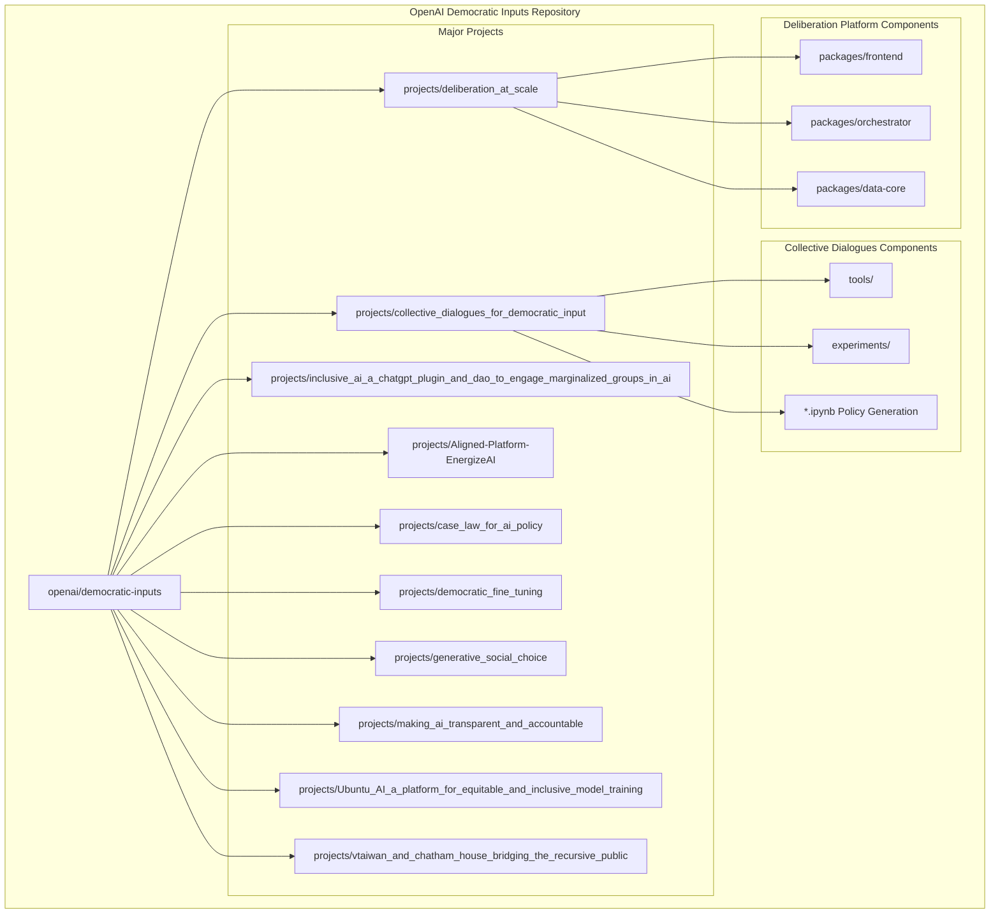
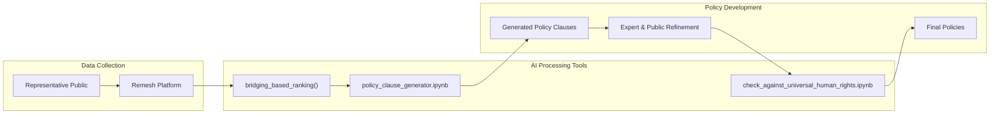
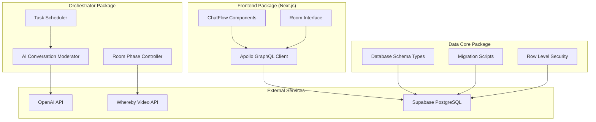

<!-- source: DeepWiki mcp.deepwiki.com · repo openai/democratic-inputs · page 1 Overview · fetched 2026-10-26 -->

# Overview

Relevant source files

The following files were used as context for generating this wiki page:

- [README.md](README.md)
- [projects/collective_dialogues_for_democratic_input/README.md](projects/collective_dialogues_for_democratic_input/README.md)
- [projects/inclusive_ai_a_chatgpt_plugin_and_dao_to_engage_marginalized_groups_in_ai/README.md](projects/inclusive_ai_a_chatgpt_plugin_and_dao_to_engage_marginalized_groups_in_ai/README.md)
- [projects/making_ai_transparent_and_accountable/README.md](projects/making_ai_transparent_and_accountable/README.md)
- [projects/vtaiwan_and_chatham_house_bridging_the_recursive_public/README.md](projects/vtaiwan_and_chatham_house_bridging_the_recursive_public/README.md)

## Purpose and Scope

This documentation covers the OpenAI Democratic Inputs repository, a collection of funded research projects exploring democratic governance mechanisms for AI systems. The repository contains code, tools, and experimental results from 10 teams who developed and tested various approaches to incorporating public input into AI decision-making processes.

This overview introduces the repository structure, grant program context, and key systems. For detailed technical architecture of the deliberation platform, see [System Architecture](#2). For information about specific grant projects and their methodologies, see [Grant Projects](#7).

## Repository Structure

The repository is organized as a collection of independent grant projects, each exploring different approaches to democratic AI governance:

Sources: [README.md:1-184](), [projects/collective_dialogues_for_democratic_input/README.md:1-49]()

## Grant Program Overview

The Democratic Inputs to AI grant program funded 10 teams to develop processes for incorporating public input into AI governance. Each project represents a different methodology for democratic participation:

| Project | Approach | Key Innovation |
|---------|----------|----------------|
| **Collective Dialogues** | Large-scale deliberation with AI synthesis | Bridging-based ranking for consensus discovery |
| **Deliberation at Scale** | Small group video discussions | AI-facilitated conversation progression |
| **Inclusive.AI** | DAO-based decision making | Web3 voting tokens for marginalized groups |
| **Democratic Fine-Tuning** | Value elicitation through chat | Moral graphs for model alignment |
| **Aligned Platform** | Community notes algorithm | Live, large-scale participation |
| **Generative Social Choice** | Mathematical fair representation | Distilling opinions into representative slates |
| **Case Law for AI Policy** | Expert-layperson collaboration | Building case repositories for AI scenarios |
| **vTaiwan Recursive Public** | Adapted Taiwan methodology | Connected participatory processes |
| **Rappler Transparency** | Offline-online integration | AI synthesis of focus group discussions |
| **Ubuntu-AI** | Equitable model training | Value return to content creators |

Sources: [README.md:9-184](), [projects/collective_dialogues_for_democratic_input/README.md:9-18](), [projects/inclusive_ai_a_chatgpt_plugin_and_dao_to_engage_marginalized_groups_in_ai/README.md:1-6]()

## Key Technical Systems

The repository contains two major technical platforms with distinct architectures:

### Collective Dialogues Pipeline

Sources: [projects/collective_dialogues_for_democratic_input/README.md:11-25]()

### Deliberation Platform Architecture

Sources: Based on system architecture diagrams provided in context

## Project Implementation Status

The projects vary significantly in their implementation completeness and technical sophistication:

**Production-Ready Systems:**
- **Collective Dialogues**: Complete pipeline with 10+ Jupyter notebooks, tested on 3 policy areas (medical advice, war/conflict, vaccine information)
- **Deliberation at Scale**: Full-stack platform with real-time video, AI moderation, and multi-language support

**Prototype/Research Systems:**
- **Inclusive.AI**: DAO voting system with Web3Auth integration and Optimism blockchain deployment
- **Democratic Fine-Tuning**: Value elicitation chat system for model alignment research

**Research Reports Only:**
- Several projects provided primarily research findings and methodological documentation without complete codebases

Sources: [projects/collective_dialogues_for_democratic_input/README.md:27-41](), [projects/inclusive_ai_a_chatgpt_plugin_and_dao_to_engage_marginalized_groups_in_ai/README.md:9-83]()

## Navigation Guide

This wiki is organized to provide both high-level context and deep technical details:

- **System Architecture** : Technical overview of the deliberation platform's monorepo structure
- **Database Schema & Data Layer** : Complete data model documentation  
- **Frontend Systems** : Next.js frontend architecture and user interfaces
- **AI Orchestration System** : Backend AI-powered conversation management
- **Localization System** : Multi-language support implementation
- **Grant Projects** : Individual project documentation and methodologies

The repository demonstrates various approaches to democratic AI governance, from large-scale policy development pipelines to intimate small-group deliberation platforms, providing a comprehensive exploration of how technology can support democratic participation in AI decision-making.

---

