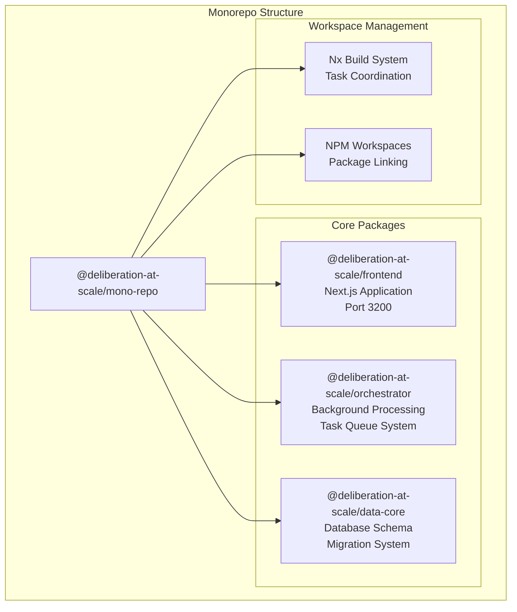
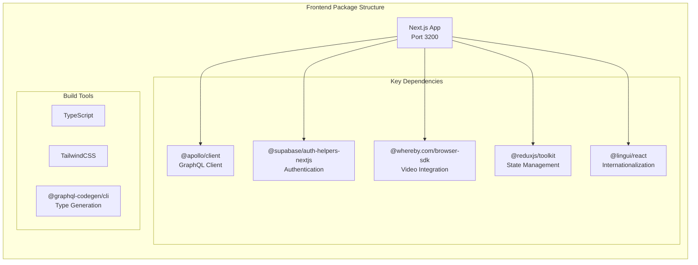
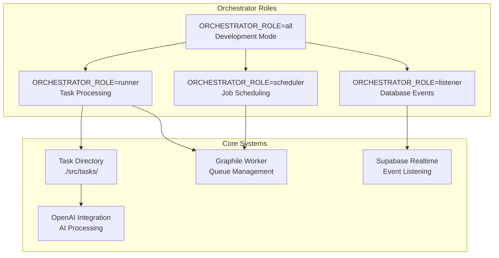
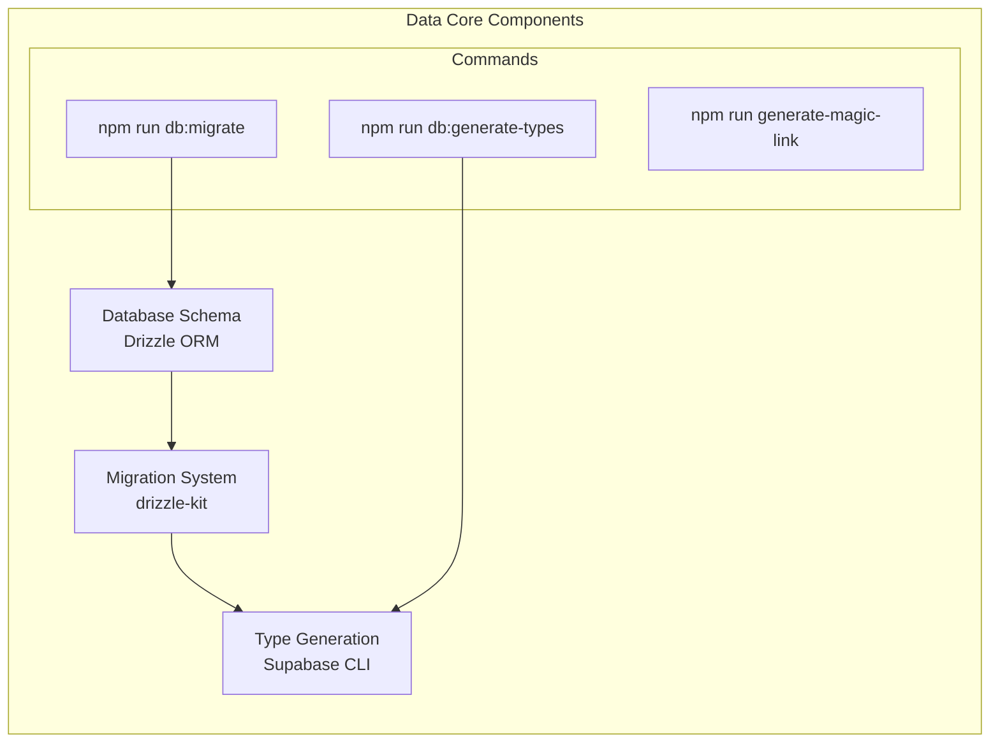
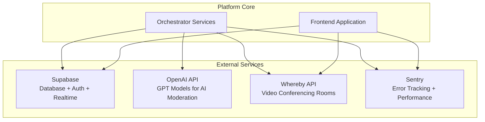
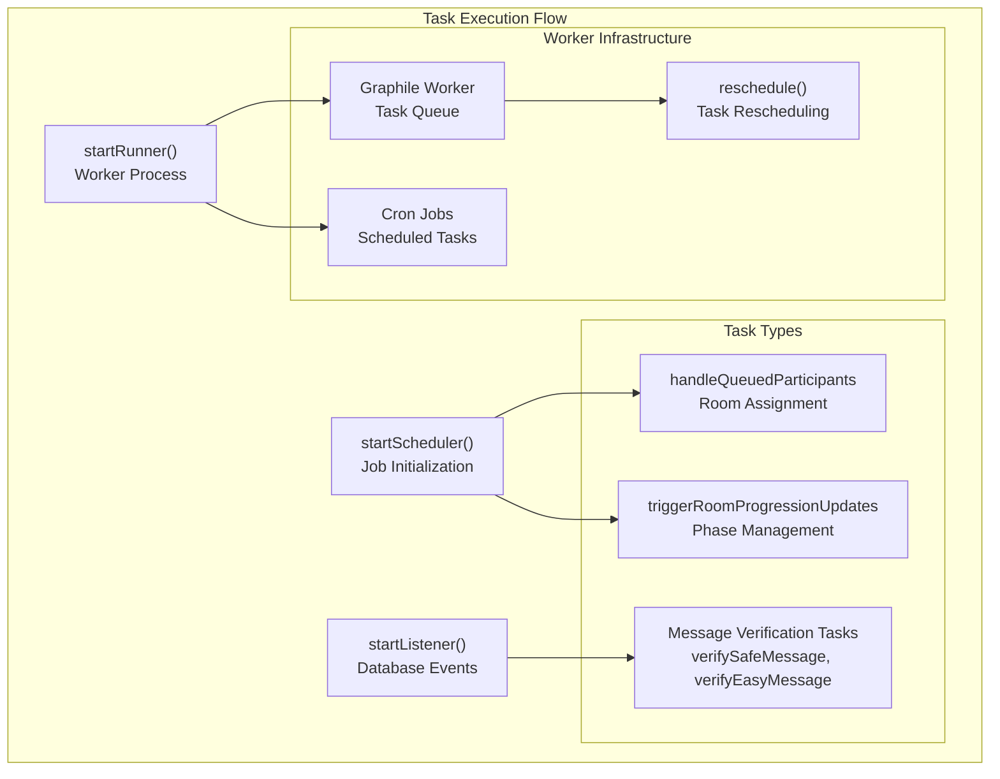
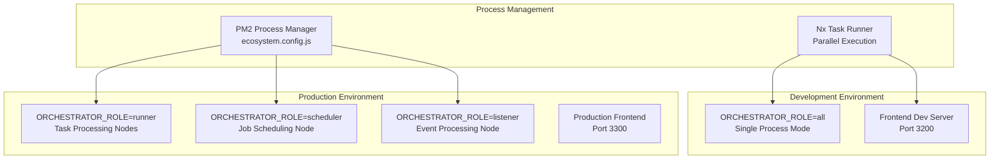

<!-- source: DeepWiki mcp.deepwiki.com · repo openai/democratic-inputs · page 2 System Architecture · fetched 2026-10-26 -->

# System Architecture

Relevant source files

The following files were used as context for generating this wiki page:

- [projects/deliberation_at_scale/package-lock.json](projects/deliberation_at_scale/package-lock.json)
- [projects/deliberation_at_scale/package.json](projects/deliberation_at_scale/package.json)
- [projects/deliberation_at_scale/packages/data-core/package.json](projects/deliberation_at_scale/packages/data-core/package.json)
- [projects/deliberation_at_scale/packages/frontend/package.json](projects/deliberation_at_scale/packages/frontend/package.json)
- [projects/deliberation_at_scale/packages/orchestrator/.env.example](projects/deliberation_at_scale/packages/orchestrator/.env.example)
- [projects/deliberation_at_scale/packages/orchestrator/.eslintrc.js](projects/deliberation_at_scale/packages/orchestrator/.eslintrc.js)
- [projects/deliberation_at_scale/packages/orchestrator/package-lock.json](projects/deliberation_at_scale/packages/orchestrator/package-lock.json)
- [projects/deliberation_at_scale/packages/orchestrator/package.json](projects/deliberation_at_scale/packages/orchestrator/package.json)
- [projects/deliberation_at_scale/packages/orchestrator/src/index.ts](projects/deliberation_at_scale/packages/orchestrator/src/index.ts)
- [projects/deliberation_at_scale/packages/orchestrator/src/listener.ts](projects/deliberation_at_scale/packages/orchestrator/src/listener.ts)
- [projects/deliberation_at_scale/packages/orchestrator/src/runner.ts](projects/deliberation_at_scale/packages/orchestrator/src/runner.ts)
- [projects/deliberation_at_scale/packages/orchestrator/src/scheduler.ts](projects/deliberation_at_scale/packages/orchestrator/src/scheduler.ts)

This document provides a comprehensive overview of the Deliberation at Scale platform architecture, covering the monorepo structure, core packages, and system integrations. It focuses on the technical implementation details and code organization that powers the democratic input platform.

For information about specific AI conversation management, see [AI Orchestration System](#5). For details about the database schema and data relationships, see [Database Schema & Data Layer](#3). For frontend-specific architecture, see [Frontend Systems](#4).

## Overview

The Deliberation at Scale platform is implemented as a Node.js monorepo containing three primary packages that work together to facilitate AI-moderated group deliberations. The system combines real-time web technologies, AI processing pipelines, and structured conversation management to enable scalable democratic input processes.

**Sources:** [projects/deliberation_at_scale/package.json:1-31](), [projects/deliberation_at_scale/package-lock.json:1-24]()

## Package Architecture

### Frontend Package

The frontend package implements a Next.js application serving as the user interface for deliberation sessions. It handles user registration, real-time chat, video integration, and voting interfaces.

**Sources:** [projects/deliberation_at_scale/packages/frontend/package.json:1-98]()

### Orchestrator Package

The orchestrator package manages background task processing, AI integration, and conversation flow control through a sophisticated worker system built on Graphile Worker.

**Sources:** [projects/deliberation_at_scale/packages/orchestrator/package.json:1-50](), [projects/deliberation_at_scale/packages/orchestrator/src/index.ts:16-41]()

### Data Core Package

The data core package provides database schema management, migrations, and type generation for the entire platform using Drizzle ORM and Supabase.

**Sources:** [projects/deliberation_at_scale/packages/data-core/package.json:1-48]()

## External Service Integration

The platform integrates with several external services to provide comprehensive functionality:

**Sources:** [projects/deliberation_at_scale/packages/orchestrator/.env.example:1-10](), [projects/deliberation_at_scale/packages/frontend/package.json:26-63]()

## Task Processing System

The orchestrator implements a sophisticated task processing system that manages the AI-powered conversation flow:

**Sources:** [projects/deliberation_at_scale/packages/orchestrator/src/scheduler.ts:6-16](), [projects/deliberation_at_scale/packages/orchestrator/src/runner.ts:9-37](), [projects/deliberation_at_scale/packages/orchestrator/src/listener.ts:10-57]()

## Real-time Data Flow

The platform implements a comprehensive real-time data synchronization system:

```mermaid
graph LR
    subgraph "Frontend State"
        APOLLO_CACHE["Apollo Client Cache<br/>GraphQL State"]
        REDUX_STORE["Redux Store<br/>Application State"]
    end
    
    subgraph "Real-time Layer"
        SUPABASE_RT["Supabase Realtime<br/>postgres_changes Events"]
        GRAPHQL_API["GraphQL API<br/>Queries + Mutations"]
    end
    
    subgraph "Background Processing"
        MESSAGE_LISTENER["Message INSERT Listener<br/>startMessageListener()"]
        TASK_QUEUE["Graphile Worker Queue<br/>quickAddJob()"]
        AI_TASKS["AI Processing Tasks<br/>verifySafeMessage, etc."]
    end
    
    APOLLO_CACHE --> GRAPHQL_API
    REDUX_STORE --> APOLLO_CACHE
    
    GRAPHQL_API --> SUPABASE_RT
    SUPABASE_RT --> MESSAGE_LISTENER
    MESSAGE_LISTENER --> TASK_QUEUE
    TASK_QUEUE --> AI_TASKS
```

**Sources:** [projects/deliberation_at_scale/packages/orchestrator/src/listener.ts:20-56](), [projects/deliberation_at_scale/packages/frontend/package.json:27-28]()

## Technology Stack Summary

| Component | Technology | Purpose |
|-----------|------------|---------|
| **Frontend Framework** | Next.js 13.5.9 | React-based web application |
| **State Management** | Redux Toolkit + Apollo Client | Client-side state and GraphQL caching |
| **Backend Processing** | Node.js + Graphile Worker | Background task processing |
| **Database** | PostgreSQL via Supabase | Primary data storage |
| **Real-time** | Supabase Realtime | Live data synchronization |
| **AI Integration** | OpenAI API (GPT models) | Conversation moderation and guidance |
| **Video** | Whereby Browser SDK | Video conferencing |
| **Build System** | Nx + TypeScript | Monorepo management |
| **Internationalization** | Lingui | Multi-language support |
| **Error Tracking** | Sentry | Production monitoring |

## Development and Deployment

The system supports multiple deployment configurations through environment-based role assignment:

**Sources:** [projects/deliberation_at_scale/packages/orchestrator/src/index.ts:43-64](), [projects/deliberation_at_scale/packages/orchestrator/package.json:13-18](), [projects/deliberation_at_scale/package.json:6-13]()

---

