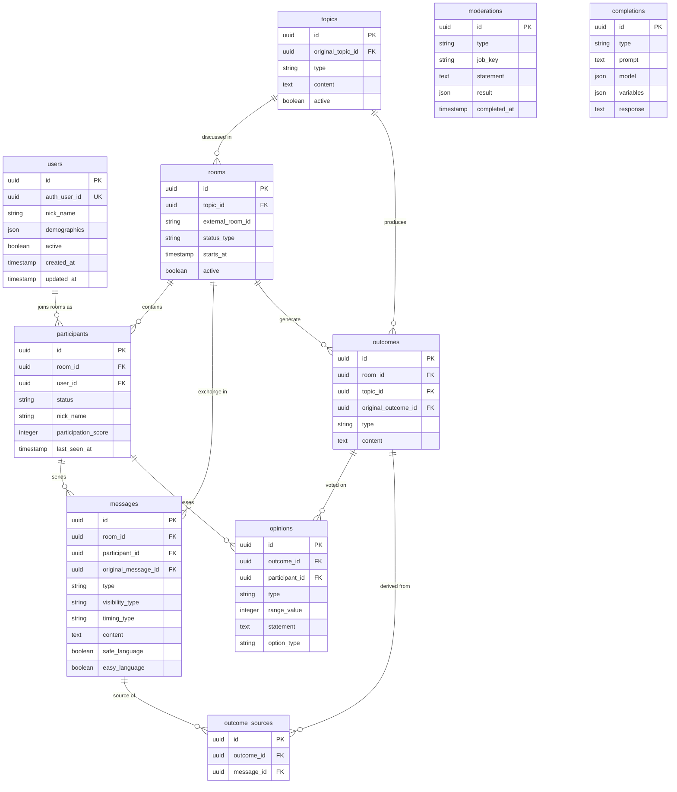
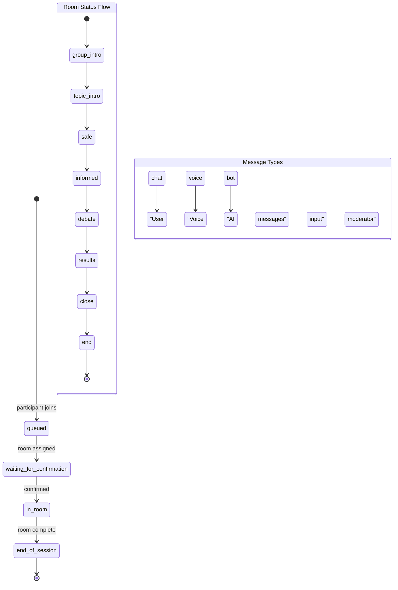
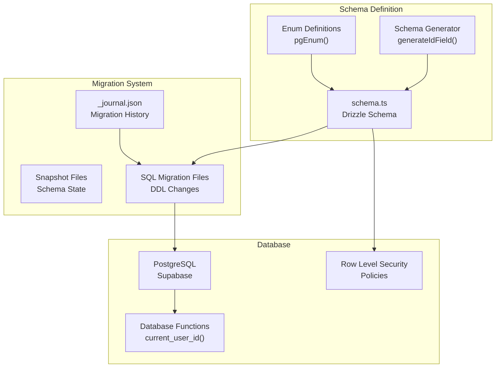
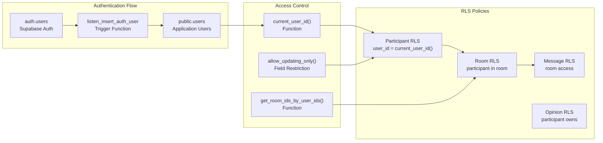
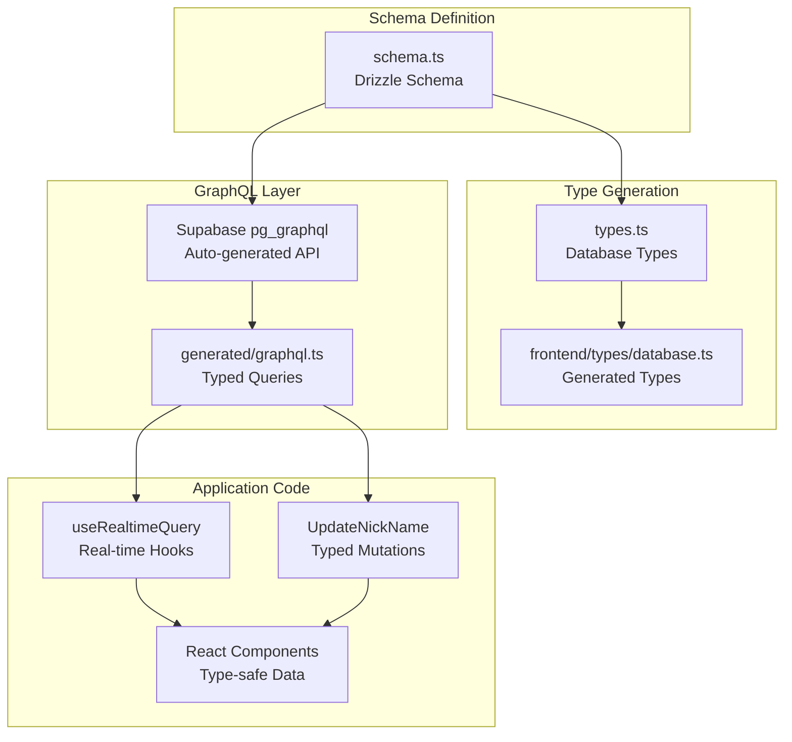

<!-- source: DeepWiki mcp.deepwiki.com · repo openai/democratic-inputs · page 3 Database Schema & Data Layer · fetched 2026-10-26 -->

# Database Schema & Data Layer

<details>
<summary>Relevant source files</summary>

The following files were used as context for generating this wiki page:

- [projects/deliberation_at_scale/packages/data-core/src/database/migrations/0000_tough_marten_broadcloak.sql](projects/deliberation_at_scale/packages/data-core/src/database/migrations/0000_tough_marten_broadcloak.sql)
- [projects/deliberation_at_scale/packages/data-core/src/database/migrations/0005_typical_mac_gargan.sql](projects/deliberation_at_scale/packages/data-core/src/database/migrations/0005_typical_mac_gargan.sql)
- [projects/deliberation_at_scale/packages/data-core/src/database/migrations/0027_spooky_sentinels.sql](projects/deliberation_at_scale/packages/data-core/src/database/migrations/0027_spooky_sentinels.sql)
- [projects/deliberation_at_scale/packages/data-core/src/database/migrations/0030_colorful_patriot.sql](projects/deliberation_at_scale/packages/data-core/src/database/migrations/0030_colorful_patriot.sql)
- [projects/deliberation_at_scale/packages/data-core/src/database/migrations/0036_real_ben_parker.sql](projects/deliberation_at_scale/packages/data-core/src/database/migrations/0036_real_ben_parker.sql)
- [projects/deliberation_at_scale/packages/data-core/src/database/migrations/0037_chemical_overlord.sql](projects/deliberation_at_scale/packages/data-core/src/database/migrations/0037_chemical_overlord.sql)
- [projects/deliberation_at_scale/packages/data-core/src/database/migrations/0041_free_talisman.sql](projects/deliberation_at_scale/packages/data-core/src/database/migrations/0041_free_talisman.sql)
- [projects/deliberation_at_scale/packages/data-core/src/database/migrations/meta/0000_snapshot.json](projects/deliberation_at_scale/packages/data-core/src/database/migrations/meta/0000_snapshot.json)
- [projects/deliberation_at_scale/packages/data-core/src/database/migrations/meta/0005_snapshot.json](projects/deliberation_at_scale/packages/data-core/src/database/migrations/meta/0005_snapshot.json)
- [projects/deliberation_at_scale/packages/data-core/src/database/migrations/meta/0027_snapshot.json](projects/deliberation_at_scale/packages/data-core/src/database/migrations/meta/0027_snapshot.json)
- [projects/deliberation_at_scale/packages/data-core/src/database/migrations/meta/0030_snapshot.json](projects/deliberation_at_scale/packages/data-core/src/database/migrations/meta/0030_snapshot.json)
- [projects/deliberation_at_scale/packages/data-core/src/database/migrations/meta/0041_snapshot.json](projects/deliberation_at_scale/packages/data-core/src/database/migrations/meta/0041_snapshot.json)
- [projects/deliberation_at_scale/packages/data-core/src/database/migrations/meta/_journal.json](projects/deliberation_at_scale/packages/data-core/src/database/migrations/meta/_journal.json)
- [projects/deliberation_at_scale/packages/data-core/src/database/schema.ts](projects/deliberation_at_scale/packages/data-core/src/database/schema.ts)
- [projects/deliberation_at_scale/packages/data-core/src/database/types.ts](projects/deliberation_at_scale/packages/data-core/src/database/types.ts)
- [projects/deliberation_at_scale/packages/frontend/components/ChatFlow/LobbyChatFlow.tsx](projects/deliberation_at_scale/packages/frontend/components/ChatFlow/LobbyChatFlow.tsx)
- [projects/deliberation_at_scale/packages/frontend/hooks/useProfile.ts](projects/deliberation_at_scale/packages/frontend/hooks/useProfile.ts)
- [projects/deliberation_at_scale/packages/frontend/state/queries/UpdateNickName.graphql](projects/deliberation_at_scale/packages/frontend/state/queries/UpdateNickName.graphql)
- [projects/deliberation_at_scale/packages/frontend/state/slices/profile.ts](projects/deliberation_at_scale/packages/frontend/state/slices/profile.ts)
- [projects/deliberation_at_scale/packages/frontend/types/database.ts](projects/deliberation_at_scale/packages/frontend/types/database.ts)

</details>


This document covers the database design, schema structure, and data access patterns for the deliberation platform. It focuses on the PostgreSQL database schema, entity relationships, migration system, and how the application layers interact with persistent data storage.

For information about real-time data synchronization and GraphQL queries, see [Real-time Data & GraphQL](#4.2). For details about AI-powered data processing workflows, see [AI Orchestration System](#5).

## Database Technology Stack

The platform uses PostgreSQL as the primary database with Supabase as the hosting provider. The data layer is built using:

- **Drizzle ORM** for schema definition and type-safe database operations
- **PostgreSQL** with Row Level Security (RLS) for data access control  
- **Supabase** for database hosting, authentication, and real-time subscriptions
- **GraphQL** via pg_graphql for API layer data access

Sources: [projects/deliberation_at_scale/packages/data-core/src/database/schema.ts:1-13]()

## Core Database Entities

### Entity Relationship Overview



Sources: [projects/deliberation_at_scale/packages/data-core/src/database/schema.ts:115-358]()

### Primary Entity Types

The database schema is organized around several core entity types that represent different aspects of the deliberation process:

| Entity | Purpose | Key Relationships |
|--------|---------|-------------------|
| `users` | Authentication and user profiles | Links to Supabase auth, has many participants |
| `topics` | Discussion subjects | Can be original or remixed, used in rooms |
| `rooms` | Deliberation sessions | Contains participants, progresses through status phases |
| `participants` | User sessions in rooms | Bridges users and rooms, tracks participation |
| `messages` | Chat and bot communications | Sent by participants, can be moderated |
| `outcomes` | Discussion results and consensus | Generated from messages, can be voted on |
| `opinions` | Participant votes and feedback | Expressed on outcomes by participants |

Sources: [projects/deliberation_at_scale/packages/data-core/src/database/schema.ts:17-28]()

### Enumerated Types and Status Flows

The schema defines several enums that control entity state transitions:



**Key Enums:**
- `participantStatusType`: `queued`, `waiting_for_confirmation`, `in_room`, `end_of_session`
- `roomStatusType`: `group_intro`, `topic_intro`, `safe`, `informed`, `debate`, `results`, `close`, `end`
- `messageType`: `chat`, `voice`, `bot`
- `outcomeType`: `milestone`, `consensus`, `off_topic`, `seed_statement`
- `opinionOptionType`: `agree`, `maybe`, `disagree`, `wrong`

Sources: [projects/deliberation_at_scale/packages/data-core/src/database/schema.ts:54-114]()

## Schema Evolution and Migration System

### Migration Architecture



The migration system tracks 43 migrations from initial schema to current state, with each migration including:

- **DDL Changes**: Table creation, column additions, index creation
- **Security Policies**: RLS policy definitions for data access control
- **Helper Functions**: Database functions for user identification and data processing

**Migration Highlights:**
- Migration 0000: Initial schema with core entities
- Migration 0027: Addition of events table and participant demographics
- Migration 0036-0037: Help requests system for technical support
- Migration 0041: Seed statement outcome type addition

Sources: [projects/deliberation_at_scale/packages/data-core/src/database/migrations/meta/_journal.json:1-314](), [projects/deliberation_at_scale/packages/data-core/src/database/migrations/0000_tough_marten_broadcloak.sql:1-462]()

### Schema Generation Patterns

The schema uses consistent patterns for entity definition:

```typescript
// Example pattern from schema.ts
export const participants = pgTable(PARTICIPANTS_TABLE_NAME, {
    id: generateIdField(),
    active: generateActiveField(),
    status: participantStatusType("status").notNull().default("queued"),
    roomId: uuid(ROOM_ID_FIELD_NAME).references(() => rooms.id),
    userId: uuid(USER_ID_FIELD_NAME).references(() => users.id),
    nickName: generateNickNameField(),
    participationScore: integer("participation_score").notNull().default(0),
    ...generateTimestampFields(),
}, (table) => ({
    ...generateActiveFieldIndex(table),
    ...generateTimestampFieldIndexes(table),
}));
```

**Common Patterns:**
- `generateIdField()`: UUID primary keys with random defaults
- `generateActiveField()`: Boolean flags for soft deletion
- `generateTimestampFields()`: Created/updated timestamp tracking
- Comprehensive indexing on foreign keys and frequently queried fields

Sources: [projects/deliberation_at_scale/packages/data-core/src/database/schema.ts:360-426]()

## Data Access and Security Model

### Row Level Security Implementation



The database implements comprehensive Row Level Security with these key policies:

**User Data Access:**
- Users can only access their own profile data
- Participants can only see other participants in their rooms
- Messages are restricted to room participants

**Data Modification Controls:**
- Participants can only update specific fields (`last_seen_at`, `status`)
- Opinions can only be modified by their creators
- Service role has elevated permissions for AI operations

**Key Security Functions:**
- `current_user_id()`: Maps Supabase auth to internal user IDs
- `get_room_ids_by_user_ids()`: Determines accessible rooms per user
- `allow_updating_only()`: Restricts field-level modifications

Sources: [projects/deliberation_at_scale/packages/data-core/src/database/migrations/0027_spooky_sentinels.sql:18-209]()

### AI Integration and Background Processing

The schema includes specialized tables for AI-powered features:

| Table | Purpose | Integration |
|-------|---------|-------------|
| `moderations` | AI moderation results | Tracks safety and consensus analysis |
| `completions` | OpenAI API responses | Stores prompts and generated content |
| `help_requests` | Technical support | Facilitates human intervention |

**AI Data Flow:**
1. User messages trigger moderation jobs via `moderations` table
2. Completed analysis stored in `result` JSON field  
3. Consensus outcomes generated through `completions` table
4. Background workers process via Graphile Worker integration

Sources: [projects/deliberation_at_scale/packages/data-core/src/database/schema.ts:321-358]()

## Type Safety and Code Integration

### Generated Types and GraphQL



The type system ensures end-to-end type safety from database to UI:

**Database Type Definitions:**
- Complete TypeScript interfaces for all tables
- Insert/Update/Select type variants
- Relationship type definitions with foreign key constraints

**GraphQL Integration:**
- Auto-generated GraphQL schema from PostgreSQL schema
- Typed queries and mutations via code generation
- Real-time subscription types for live data updates

Sources: [projects/deliberation_at_scale/packages/data-core/src/database/types.ts:1-10](), [projects/deliberation_at_scale/packages/frontend/types/database.ts:1-804]()

## Performance and Indexing Strategy

The schema includes comprehensive indexing for query performance:

**Primary Index Categories:**
- **Entity Lookup**: Primary key and unique constraint indexes
- **Relationship Navigation**: Foreign key indexes on all references  
- **Status Filtering**: Indexes on enum fields (`status`, `type`, etc.)
- **Temporal Queries**: Indexes on timestamp fields (`created_at`, `updated_at`)
- **Business Logic**: Custom indexes on `participation_score`, `last_seen_at`

**Index Examples:**
```sql
-- Participant room filtering
CREATE INDEX room_id_index ON participants (room_id);
CREATE INDEX user_id_index ON participants (user_id);

-- Message chronological access  
CREATE INDEX created_at_index ON messages (created_at);
CREATE INDEX room_id_index ON messages (room_id);

-- Opinion aggregation
CREATE INDEX outcome_id_index ON opinions (outcome_id);
CREATE INDEX participant_id_index ON opinions (participant_id);
```

Sources: [projects/deliberation_at_scale/packages/data-core/src/database/migrations/0005_typical_mac_gargan.sql:1-88]()

---

