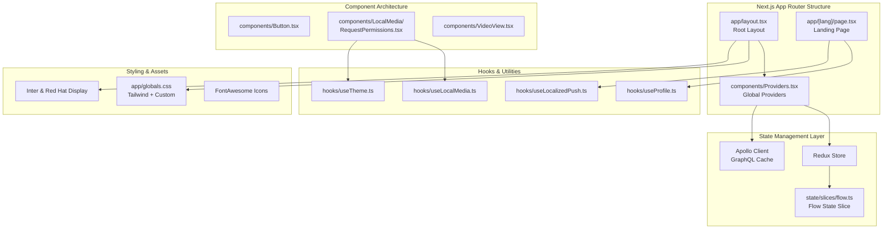
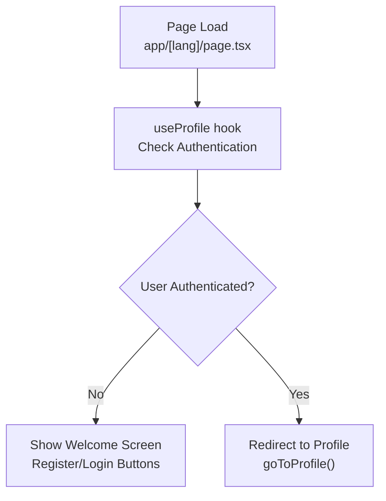
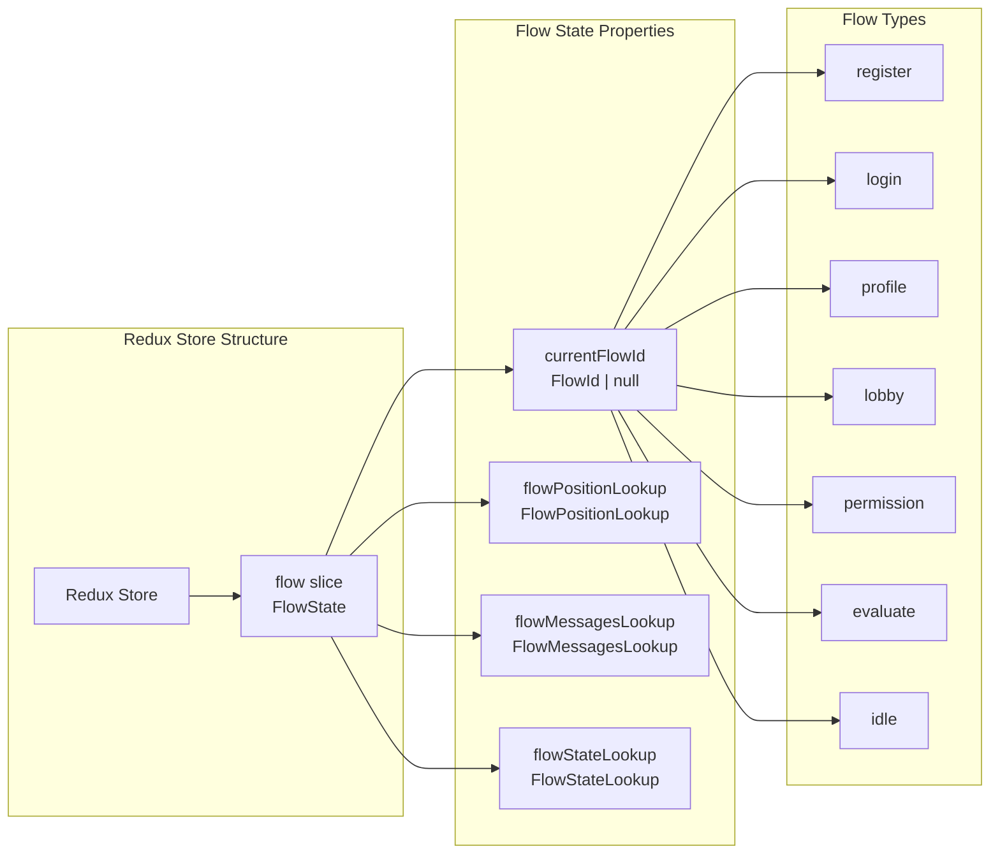
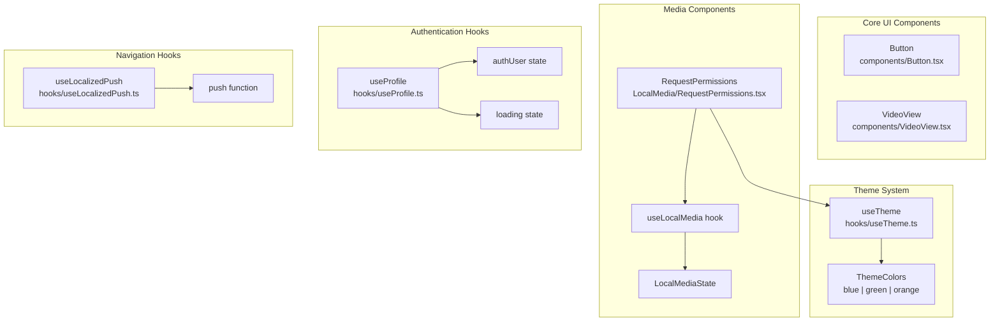
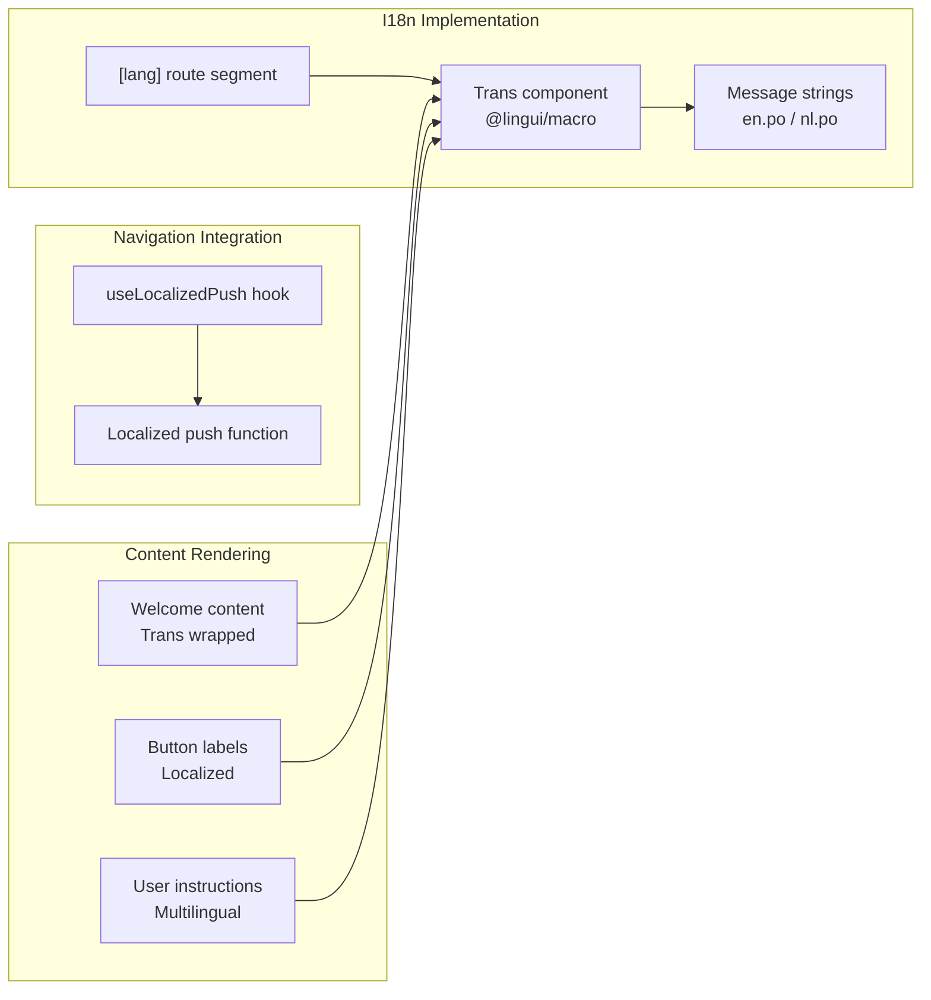
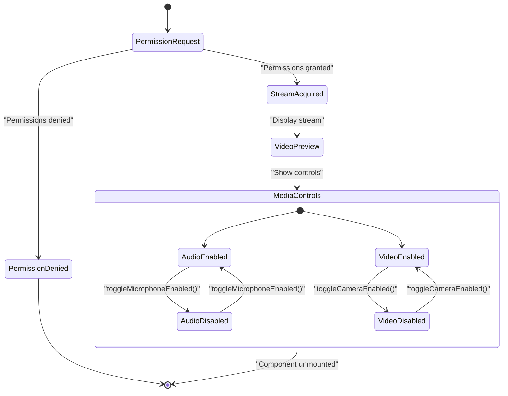

<!-- source: DeepWiki mcp.deepwiki.com · repo openai/democratic-inputs · page 4 Frontend Systems · fetched 2026-10-26 -->

# Frontend Systems

<details>
<summary>Relevant source files</summary>

The following files were used as context for generating this wiki page:

- [projects/deliberation_at_scale/packages/frontend/app/[lang]/page.tsx](projects/deliberation_at_scale/packages/frontend/app/[lang]/page.tsx)
- [projects/deliberation_at_scale/packages/frontend/app/globals.css](projects/deliberation_at_scale/packages/frontend/app/globals.css)
- [projects/deliberation_at_scale/packages/frontend/app/layout.tsx](projects/deliberation_at_scale/packages/frontend/app/layout.tsx)
- [projects/deliberation_at_scale/packages/frontend/components/LocalMedia/RequestPermissions.tsx](projects/deliberation_at_scale/packages/frontend/components/LocalMedia/RequestPermissions.tsx)
- [projects/deliberation_at_scale/packages/frontend/public/favicon.ico](projects/deliberation_at_scale/packages/frontend/public/favicon.ico)
- [projects/deliberation_at_scale/packages/frontend/public/favicon_io/android-chrome-192x192.png](projects/deliberation_at_scale/packages/frontend/public/favicon_io/android-chrome-192x192.png)
- [projects/deliberation_at_scale/packages/frontend/public/favicon_io/android-chrome-512x512.png](projects/deliberation_at_scale/packages/frontend/public/favicon_io/android-chrome-512x512.png)
- [projects/deliberation_at_scale/packages/frontend/public/favicon_io/apple-touch-icon.png](projects/deliberation_at_scale/packages/frontend/public/favicon_io/apple-touch-icon.png)
- [projects/deliberation_at_scale/packages/frontend/public/favicon_io/favicon-16x16.png](projects/deliberation_at_scale/packages/frontend/public/favicon_io/favicon-16x16.png)
- [projects/deliberation_at_scale/packages/frontend/public/favicon_io/favicon-32x32.png](projects/deliberation_at_scale/packages/frontend/public/favicon_io/favicon-32x32.png)
- [projects/deliberation_at_scale/packages/frontend/public/favicon_io/site.webmanifest](projects/deliberation_at_scale/packages/frontend/public/favicon_io/site.webmanifest)
- [projects/deliberation_at_scale/packages/frontend/state/slices/flow.ts](projects/deliberation_at_scale/packages/frontend/state/slices/flow.ts)

</details>


This document provides an overview of the Next.js frontend architecture that powers the deliberation platform's user-facing interface. It covers the application structure, state management, component organization, and core systems that enable users to participate in democratic deliberations.

For detailed information about the conversational user interface that guides users through registration and deliberation, see [Chat Flow System](#4.1). For real-time data synchronization and GraphQL integration, see [Real-time Data & GraphQL](#4.2). For the user interface components used during active deliberation sessions, see [Room Components](#4.3).

## Application Architecture Overview

The frontend is built as a Next.js 13+ application using the app router pattern with comprehensive internationalization support. The architecture follows a modular design with clear separation between presentation, state management, and data layers.



**Frontend Architecture Overview**
This diagram shows the high-level organization of the frontend codebase, from the Next.js app structure down to individual components and utilities.

Sources: [projects/deliberation_at_scale/packages/frontend/app/layout.tsx:1-46](), [projects/deliberation_at_scale/packages/frontend/app/[lang]/page.tsx:1-84](), [projects/deliberation_at_scale/packages/frontend/components/LocalMedia/RequestPermissions.tsx:1-100]()

## Next.js App Router Structure

The application uses Next.js 13's app router with internationalization support through dynamic route segments. The root layout establishes global providers and styling, while language-specific pages handle localized content.

| File | Purpose | Key Features |
|------|---------|--------------|
| `app/layout.tsx` | Root layout component | Font loading, global providers, metadata |
| `app/[lang]/page.tsx` | Internationalized landing page | Authentication flow, welcome content |
| `app/globals.css` | Global styles | Tailwind CSS, custom CSS variables |

The landing page implements a simple authentication flow that redirects logged-in users to their profile:



**Landing Page Authentication Flow**
This diagram shows how the main page determines whether to show the welcome screen or redirect authenticated users.

Sources: [projects/deliberation_at_scale/packages/frontend/app/[lang]/page.tsx:14-28]()

## State Management Architecture

The frontend uses Redux Toolkit for global state management, with specialized slices for different aspects of the application. The flow slice manages the conversational UI state across different user journeys.



**Redux Flow State Management**
This diagram illustrates the structure of the flow state slice that manages different user interface flows throughout the application.

The flow slice provides actions for managing conversational UI state:

| Action | Purpose | Parameters |
|--------|---------|------------|
| `setCurrentFlow` | Switch between flows | `FlowId` |
| `setFlowPosition` | Navigate within a flow | `flowId`, `deltaPosition`, `maxPosition` |
| `addFlowMessages` | Add messages to flow | `flowId`, `messages[]` |
| `setFlowStateEntry` | Update flow state | `flowId`, `key`, `value` |

Sources: [projects/deliberation_at_scale/packages/frontend/state/slices/flow.ts:1-154]()

## Component Architecture

The frontend follows a component-based architecture with reusable UI elements and specialized components for media handling. Components leverage custom hooks for state management and side effects.



**Component and Hook Architecture**
This diagram shows the relationship between UI components and the custom hooks that provide their functionality.

The `RequestPermissions` component demonstrates the integration of multiple systems:

- **Media Management**: Uses `useLocalMedia` hook to request camera/microphone permissions
- **Theme Integration**: Applies theme-specific colors using `useTheme` hook  
- **State Control**: Manages local component state through the `request` prop
- **Animation**: Integrates Framer Motion for smooth UI transitions

Sources: [projects/deliberation_at_scale/packages/frontend/components/LocalMedia/RequestPermissions.tsx:20-99]()

## Internationalization System

The frontend implements comprehensive internationalization through Next.js dynamic routing and the LinguiJS library. The `[lang]` route segment enables language-specific URLs and content.



**Internationalization Architecture**
This diagram shows how the frontend handles multiple languages through dynamic routing and localized content rendering.

Example usage in the landing page:

```typescript
<Trans>Experience and influence AI! Welcome to a conversation about AI in your city.</Trans>
```

Sources: [projects/deliberation_at_scale/packages/frontend/app/[lang]/page.tsx:32-62]()

## Styling System

The application uses a hybrid styling approach combining Tailwind CSS for utility classes with custom CSS for specific design requirements and font loading.

| Technology | Purpose | Configuration |
|------------|---------|---------------|
| Tailwind CSS | Utility-first styling | Base, components, utilities |
| Inter Font | Body text typography | Variable weight, Latin extended |
| Red Hat Display | Heading typography | Variable weight, Latin extended |
| FontAwesome | Icon system | SVG icons with tree shaking |

The global CSS establishes design system foundations:

```css
:root {
    --coloured-header-height: 10vh;
}

html, body {
    width: 100vw;
    height: 100vh;
    overflow: hidden;
    font-family: var(--font-inter);
}

h1,h2,h3,h4 {
    font-family: var(--font-red-hat-display);
}
```

Sources: [projects/deliberation_at_scale/packages/frontend/app/globals.css:1-32](), [projects/deliberation_at_scale/packages/frontend/app/layout.tsx:15-29]()

## Media Handling System

The frontend includes sophisticated media handling for video conferencing capabilities. The system requests and manages camera/microphone permissions with real-time preview and controls.



**Media Permission State Flow**
This diagram shows the state transitions for requesting and managing media permissions in the RequestPermissions component.

The media controls use theme-aware styling:

```typescript
const bgColorMap: Record<ThemeColors, string> = {
    'blue': 'text-blue-400 bg-blue-800/50',
    'green': 'text-green-400 bg-green-800/50', 
    'orange': 'text-orange-400 bg-orange-800/50',
};
```

Sources: [projects/deliberation_at_scale/packages/frontend/components/LocalMedia/RequestPermissions.tsx:10-82]()

---

