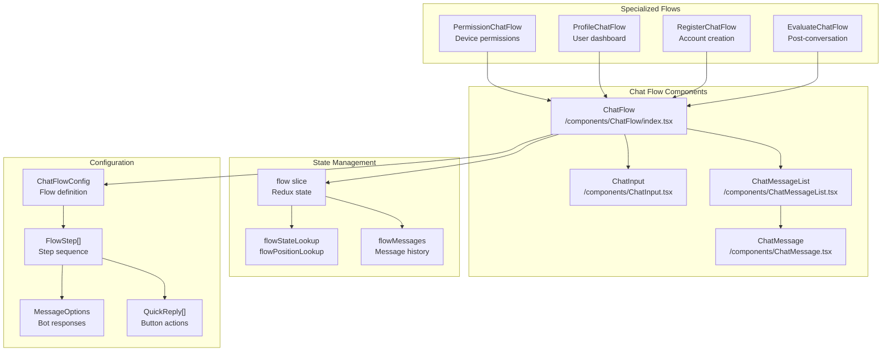
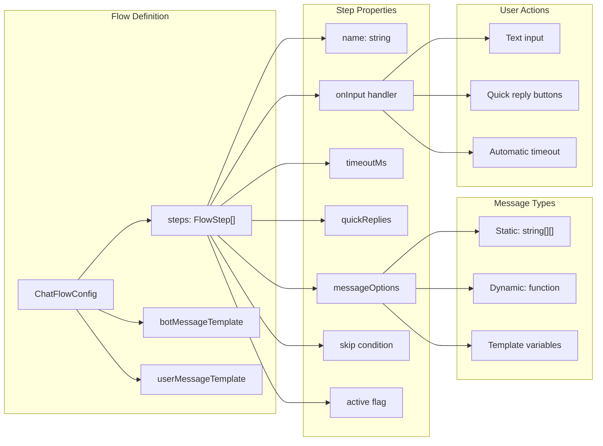
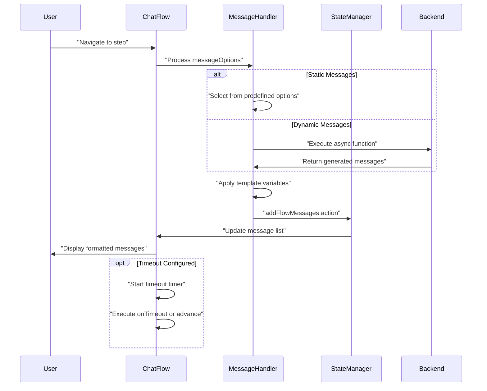
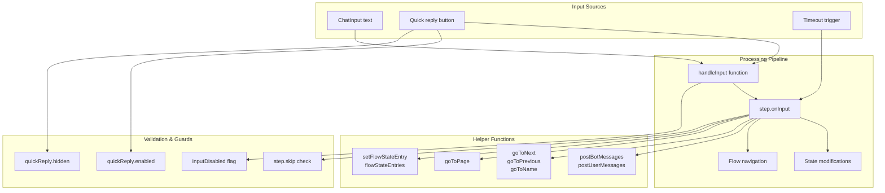
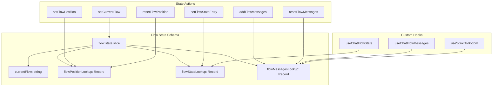
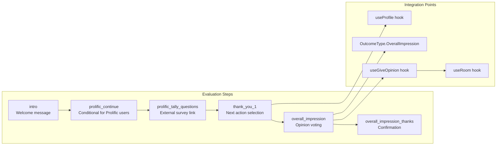
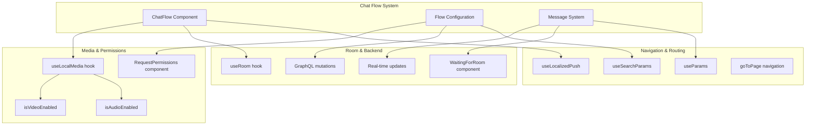

<!-- source: DeepWiki mcp.deepwiki.com · repo openai/democratic-inputs · page 4.1 Chat Flow System · fetched 2026-10-26 -->

# Chat Flow System

Relevant source files

The following files were used as context for generating this wiki page:

- [projects/deliberation_at_scale/packages/frontend/components/ChatFlow/EvaluateChatFlow.tsx](projects/deliberation_at_scale/packages/frontend/components/ChatFlow/EvaluateChatFlow.tsx)
- [projects/deliberation_at_scale/packages/frontend/components/ChatFlow/IdleChatFlow.tsx](projects/deliberation_at_scale/packages/frontend/components/ChatFlow/IdleChatFlow.tsx)
- [projects/deliberation_at_scale/packages/frontend/components/ChatFlow/InvalidChatFlow.tsx](projects/deliberation_at_scale/packages/frontend/components/ChatFlow/InvalidChatFlow.tsx)
- [projects/deliberation_at_scale/packages/frontend/components/ChatFlow/LoginChatFlow.tsx](projects/deliberation_at_scale/packages/frontend/components/ChatFlow/LoginChatFlow.tsx)
- [projects/deliberation_at_scale/packages/frontend/components/ChatFlow/PermissionChatFlow.tsx](projects/deliberation_at_scale/packages/frontend/components/ChatFlow/PermissionChatFlow.tsx)
- [projects/deliberation_at_scale/packages/frontend/components/ChatFlow/ProfileChatFlow.tsx](projects/deliberation_at_scale/packages/frontend/components/ChatFlow/ProfileChatFlow.tsx)
- [projects/deliberation_at_scale/packages/frontend/components/ChatFlow/RegisterChatFlow.tsx](projects/deliberation_at_scale/packages/frontend/components/ChatFlow/RegisterChatFlow.tsx)
- [projects/deliberation_at_scale/packages/frontend/components/ChatFlow/index.tsx](projects/deliberation_at_scale/packages/frontend/components/ChatFlow/index.tsx)
- [projects/deliberation_at_scale/packages/frontend/components/ChatInput.tsx](projects/deliberation_at_scale/packages/frontend/components/ChatInput.tsx)
- [projects/deliberation_at_scale/packages/frontend/components/ChatMessage.tsx](projects/deliberation_at_scale/packages/frontend/components/ChatMessage.tsx)
- [projects/deliberation_at_scale/packages/frontend/components/ChatMessageList.tsx](projects/deliberation_at_scale/packages/frontend/components/ChatMessageList.tsx)
- [projects/deliberation_at_scale/packages/frontend/components/ColouredHeader.tsx](projects/deliberation_at_scale/packages/frontend/components/ColouredHeader.tsx)
- [projects/deliberation_at_scale/packages/frontend/tailwind.config.js](projects/deliberation_at_scale/packages/frontend/tailwind.config.js)

## Purpose and Scope

The Chat Flow System is a conversational user interface framework that guides users through structured interactions using chat-like experiences. It handles user onboarding, device permission requests, deliberation participation, and post-conversation evaluation through configurable step-based flows.

This system manages the frontend conversation logic and user interaction patterns. For backend AI orchestration and room progression, see [AI Orchestration System](#5). For real-time data synchronization, see [Real-time Data & GraphQL](#4.2).

## Core Architecture

The Chat Flow System implements a step-based conversation engine where each flow consists of configurable steps that can display messages, handle user input, and trigger navigation actions.

### System Component Overview

**Sources:** [projects/deliberation_at_scale/packages/frontend/components/ChatFlow/index.tsx:1-359](), [projects/deliberation_at_scale/packages/frontend/components/ChatInput.tsx:1-181](), [projects/deliberation_at_scale/packages/frontend/components/ChatMessageList.tsx:1-79]()

### Flow Configuration System

Each chat flow is defined using the `ChatFlowConfig` interface which specifies steps, message templates, and interaction handlers.

**Sources:** [projects/deliberation_at_scale/packages/frontend/components/ChatFlow/index.tsx:43-52](), [projects/deliberation_at_scale/packages/frontend/components/ChatFlow/PermissionChatFlow.tsx:64-179]()

## Message Handling System

The system supports both automated bot messages and user-generated content with sophisticated templating and localization capabilities.

### Message Flow Processing

**Sources:** [projects/deliberation_at_scale/packages/frontend/components/ChatFlow/index.tsx:143-166](), [projects/deliberation_at_scale/packages/frontend/components/ChatFlow/index.tsx:267-276]()

### Message Template System

| Template Type | Purpose | Example Usage |
|---------------|---------|---------------|
| `botMessageTemplate` | AI moderator messages | `name: _(msg'AI Moderator'), nameIcon: aiSolid` |
| `userMessageTemplate` | User contributions | `name: "[nickName]"` |
| Variable replacement | Dynamic content | `[nickName]` → actual user nickname |
| Markdown support | Rich formatting | Links, emphasis, lists in message content |

**Sources:** [projects/deliberation_at_scale/packages/frontend/components/ChatFlow/index.tsx:30-42](), [projects/deliberation_at_scale/packages/frontend/components/ChatMessage.tsx:66-77]()

## User Interaction Patterns

The system provides multiple interaction mechanisms including text input, quick reply buttons, and automatic progression.

### Input Handling Architecture

**Sources:** [projects/deliberation_at_scale/packages/frontend/components/ChatFlow/index.tsx:193-216](), [projects/deliberation_at_scale/packages/frontend/components/ChatFlow/index.tsx:167-189]()

### Quick Reply System

Quick replies provide structured button-based interactions with conditional visibility and state-dependent behavior.

| Property | Type | Purpose |
|----------|------|---------|
| `id` | string | Unique identifier for the reply |
| `content` | string | Button label text |
| `icon` | IconDefinition | Optional FontAwesome icon |
| `onClick` | function | Action handler with helper access |
| `enabled` | function | Dynamic enabled/disabled state |
| `hidden` | function | Dynamic visibility control |

**Sources:** [projects/deliberation_at_scale/packages/frontend/components/ChatFlow/index.tsx:309-343](), [projects/deliberation_at_scale/packages/frontend/components/ChatFlow/PermissionChatFlow.tsx:20-29]()

## State Management Integration

The Chat Flow System integrates deeply with Redux for state persistence and real-time synchronization.

### State Structure

**Sources:** [projects/deliberation_at_scale/packages/frontend/components/ChatFlow/index.tsx:59-66](), [projects/deliberation_at_scale/packages/frontend/components/ChatFlow/index.tsx:89-104]()

## Specialized Flow Implementations

The system includes several pre-built flows for specific use cases in the deliberation platform.

### Permission Flow Implementation

The `PermissionChatFlow` handles device permission requests and lobby integration.

| Step Name | Purpose | Navigation Logic |
|-----------|---------|------------------|
| `permission_ask` | Initial permission request | Timeout → verification step |
| `permission_verify_working` | Check permissions granted | Skip if no permissions → not_working |
| `permission_not_working` | Handle permission failures | Retry permission request |
| `waiting_for_room_1/2` | Room search states | Alternate between states until room found |
| `ask_to_enter_room` | Room entry confirmation | Direct navigation to room |

**Sources:** [projects/deliberation_at_scale/packages/frontend/components/ChatFlow/PermissionChatFlow.tsx:67-178](), [projects/deliberation_at_scale/packages/frontend/components/ChatFlow/PermissionChatFlow.tsx:219-241]()

### Evaluation Flow Integration

The `EvaluateChatFlow` handles post-conversation feedback collection with opinion voting integration.

**Sources:** [projects/deliberation_at_scale/packages/frontend/components/ChatFlow/EvaluateChatFlow.tsx:35-151](), [projects/deliberation_at_scale/packages/frontend/components/ChatFlow/EvaluateChatFlow.tsx:24-33]()

## Internationalization and Localization

The Chat Flow System provides comprehensive multi-language support through the LinguiJS framework.

### Localization Architecture

| Component | Localization Method | Example |
|-----------|-------------------|---------|
| Static messages | `_(msg\`text\`)` | `_(msg\`Welcome to Common Ground!\`)` |
| Template variables | Text replacement | `[nickName]` → localized user name |
| Quick reply content | Dynamic localization | Button text changes with locale |
| Error messages | Contextual messages | Locale-specific error handling |

**Sources:** [projects/deliberation_at_scale/packages/frontend/components/ChatFlow/index.tsx:35-42](), [projects/deliberation_at_scale/packages/frontend/components/ChatFlow/PermissionChatFlow.tsx:18-51]()

## Integration with Platform Systems

The Chat Flow System connects to multiple platform components for complete functionality.

### External System Integration

**Sources:** [projects/deliberation_at_scale/packages/frontend/components/ChatFlow/index.tsx:56-58](), [projects/deliberation_at_scale/packages/frontend/components/ChatFlow/PermissionChatFlow.tsx:210-214](), [projects/deliberation_at_scale/packages/frontend/components/ChatFlow/index.tsx:167-189]()

---

