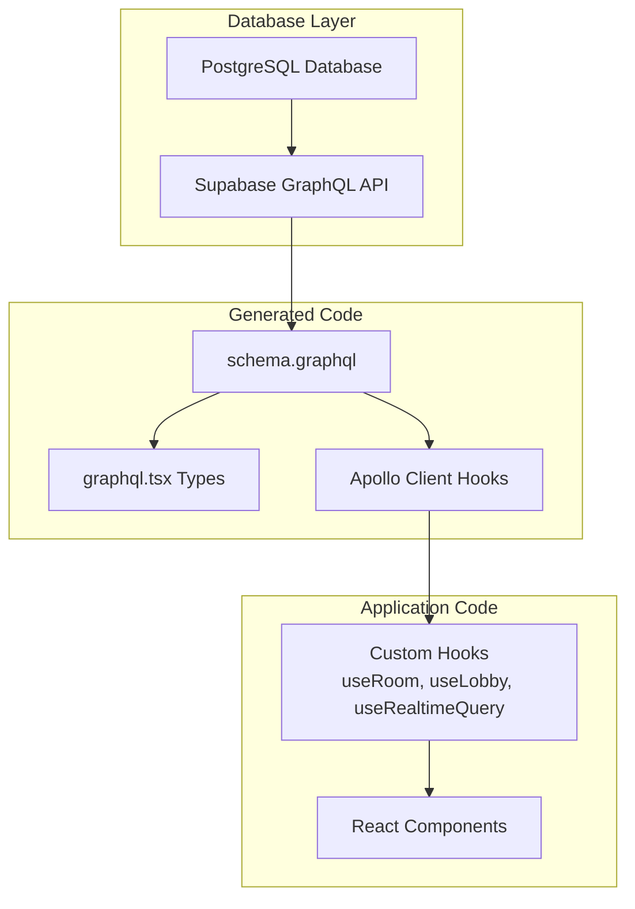
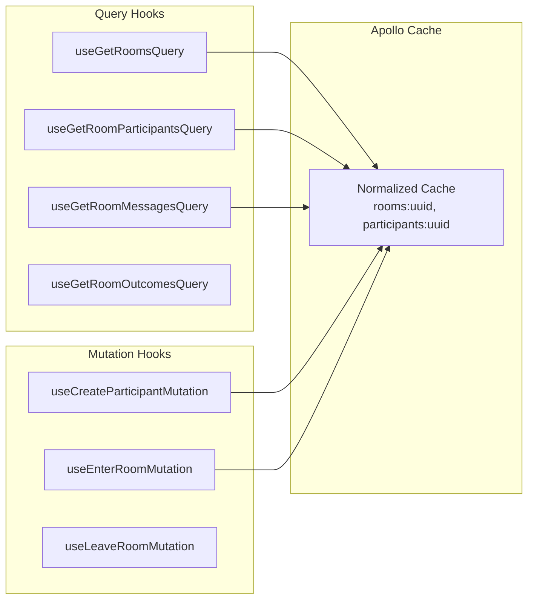
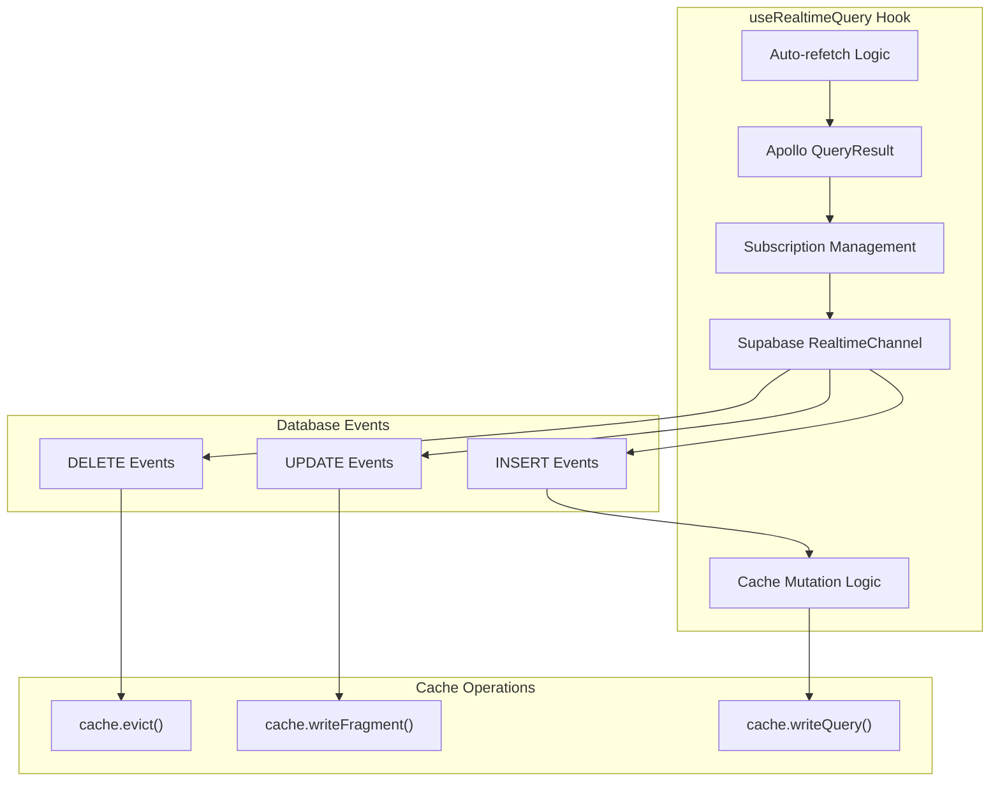
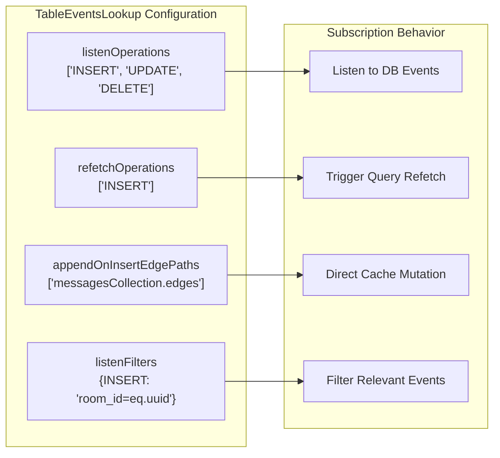
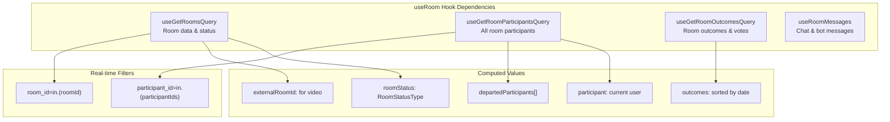
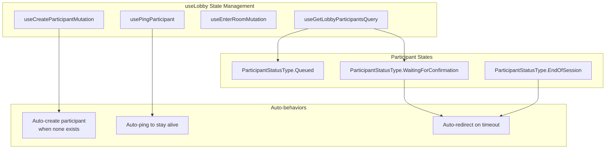
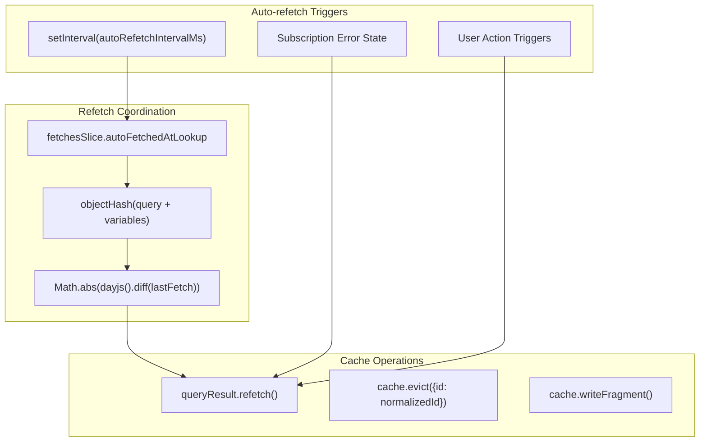
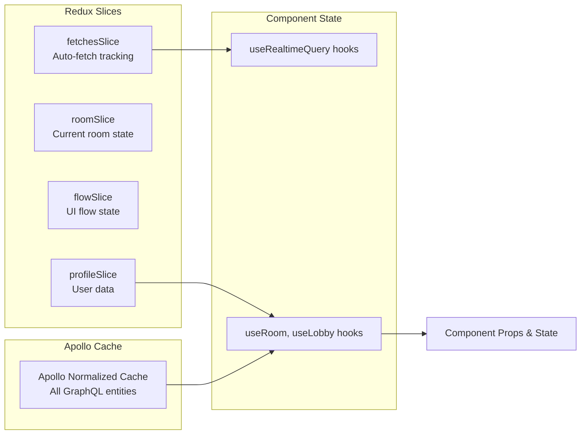

<!-- source: DeepWiki mcp.deepwiki.com · repo openai/democratic-inputs · page 4.2 Real-time Data & GraphQL · fetched 2026-10-26 -->

# Real-time Data & GraphQL

Relevant source files

The following files were used as context for generating this wiki page:

- [projects/deliberation_at_scale/packages/frontend/components/RoomParticipants/controls.tsx](projects/deliberation_at_scale/packages/frontend/components/RoomParticipants/controls.tsx)
- [projects/deliberation_at_scale/packages/frontend/generated/graphql.tsx](projects/deliberation_at_scale/packages/frontend/generated/graphql.tsx)
- [projects/deliberation_at_scale/packages/frontend/generated/schema.graphql](projects/deliberation_at_scale/packages/frontend/generated/schema.graphql)
- [projects/deliberation_at_scale/packages/frontend/hooks/useLobby.ts](projects/deliberation_at_scale/packages/frontend/hooks/useLobby.ts)
- [projects/deliberation_at_scale/packages/frontend/hooks/useRealtimeQuery.ts](projects/deliberation_at_scale/packages/frontend/hooks/useRealtimeQuery.ts)
- [projects/deliberation_at_scale/packages/frontend/hooks/useRoom.ts](projects/deliberation_at_scale/packages/frontend/hooks/useRoom.ts)
- [projects/deliberation_at_scale/packages/frontend/hooks/useRoomMessages.ts](projects/deliberation_at_scale/packages/frontend/hooks/useRoomMessages.ts)
- [projects/deliberation_at_scale/packages/frontend/state/queries/GetLobbyParticipants.graphql](projects/deliberation_at_scale/packages/frontend/state/queries/GetLobbyParticipants.graphql)
- [projects/deliberation_at_scale/packages/frontend/state/slices/fetches.ts](projects/deliberation_at_scale/packages/frontend/state/slices/fetches.ts)
- [projects/deliberation_at_scale/packages/frontend/state/store.ts](projects/deliberation_at_scale/packages/frontend/state/store.ts)

## Purpose and Scope

This document covers the frontend's real-time data management system, which combines GraphQL queries with Supabase real-time subscriptions to provide live data updates across the deliberation platform. The system automatically generates TypeScript types and Apollo Client hooks from a GraphQL schema, then enhances them with custom real-time capabilities.

For information about the backend AI orchestration and task processing, see [AI Orchestration System](#5). For details about the database schema and entities, see [Database Schema & Data Layer](#3).

## GraphQL Schema and Type Generation

The platform uses a code-first approach where the GraphQL schema is automatically generated from the PostgreSQL database schema via Supabase, then TypeScript types and Apollo Client hooks are generated from that schema.

### Type System Architecture

**Sources:** [projects/deliberation_at_scale/packages/frontend/generated/schema.graphql:1-835](), [projects/deliberation_at_scale/packages/frontend/generated/graphql.tsx:1-100]()

The generated types provide complete TypeScript coverage for all database entities:

| Entity Type | GraphQL Type | Key Fields |
|-------------|--------------|------------|
| Rooms | `Rooms` | `id`, `status_type`, `external_room_id` |
| Participants | `Participants` | `id`, `user_id`, `room_id`, `status` |
| Messages | `Messages` | `id`, `content`, `type`, `room_id` |
| Outcomes | `Outcomes` | `id`, `type`, `room_id`, `content` |
| Opinions | `Opinions` | `id`, `participant_id`, `option` |

**Sources:** [projects/deliberation_at_scale/packages/frontend/generated/graphql.tsx:697-730](), [projects/deliberation_at_scale/packages/frontend/generated/graphql.tsx:1482-1520]()

## Apollo Client Integration

The platform uses Apollo Client as the GraphQL client with automatic caching and normalized storage. Generated hooks follow the pattern `use{EntityName}{Operation}Query/Mutation`.

### Generated Hook Examples

**Sources:** [projects/deliberation_at_scale/packages/frontend/hooks/useRoom.ts:26-30](), [projects/deliberation_at_scale/packages/frontend/hooks/useLobby.ts:37-38](), [projects/deliberation_at_scale/packages/frontend/components/RoomParticipants/controls.tsx:29]()

## Real-time Query Hook System

The core innovation is the `useRealtimeQuery` hook, which wraps Apollo Client queries with Supabase real-time subscriptions to provide automatic live updates.

### useRealtimeQuery Architecture

**Sources:** [projects/deliberation_at_scale/packages/frontend/hooks/useRealtimeQuery.ts:51-373]()

### Table Event Configuration

The hook accepts a `tableEventsLookup` configuration that defines how to handle different database operations:

**Sources:** [projects/deliberation_at_scale/packages/frontend/hooks/useRealtimeQuery.ts:25-49](), [projects/deliberation_at_scale/packages/frontend/hooks/useRoomMessages.ts:40-52]()

## Custom Data Hooks

The platform provides specialized hooks that combine multiple queries and add business logic for specific UI needs.

### useRoom Hook

The `useRoom` hook orchestrates multiple related queries and provides computed values:

**Sources:** [projects/deliberation_at_scale/packages/frontend/hooks/useRoom.ts:42-151](), [projects/deliberation_at_scale/packages/frontend/hooks/useRoom.ts:69-81]()

### useLobby Hook

The `useLobby` hook manages participant queue state and room entry logic:

**Sources:** [projects/deliberation_at_scale/packages/frontend/hooks/useLobby.ts:16-132](), [projects/deliberation_at_scale/packages/frontend/hooks/useLobby.ts:75-95]()

## Auto-refetching and Cache Management

The system implements multiple layers of cache invalidation and data freshness:

### Auto-refetch System

**Sources:** [projects/deliberation_at_scale/packages/frontend/hooks/useRealtimeQuery.ts:78-101](), [projects/deliberation_at_scale/packages/frontend/state/slices/fetches.ts:20-33]()

### Cache Mutation Strategies

The system uses different cache update strategies based on operation type:

| Operation | Strategy | Implementation |
|-----------|----------|----------------|
| INSERT | Append to edges array | `cache.writeQuery()` with updated edges |
| UPDATE | Fragment update | `cache.writeFragment()` with new field values |
| DELETE | Evict from cache | `cache.evict()` with normalized ID |

**Sources:** [projects/deliberation_at_scale/packages/frontend/hooks/useRealtimeQuery.ts:234-284](), [projects/deliberation_at_scale/packages/frontend/hooks/useRealtimeQuery.ts:304-314](), [projects/deliberation_at_scale/packages/frontend/hooks/useRealtimeQuery.ts:332-340]()

## State Management Integration

While most data flows through Apollo Client's cache, some state is managed through Redux for cross-component coordination:

### Redux Integration Points

**Sources:** [projects/deliberation_at_scale/packages/frontend/state/store.ts:9-16](), [projects/deliberation_at_scale/packages/frontend/hooks/useRealtimeQuery.ts:74-76]()

The auto-fetch tracking system prevents unnecessary refetches by storing timestamps in Redux:

**Sources:** [projects/deliberation_at_scale/packages/frontend/state/slices/fetches.ts:4-33](), [projects/deliberation_at_scale/packages/frontend/hooks/useRealtimeQuery.ts:92-95]()

---

