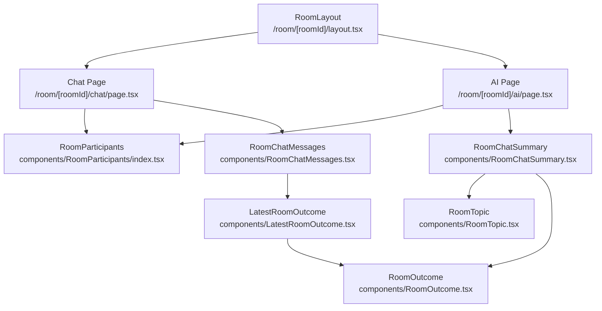
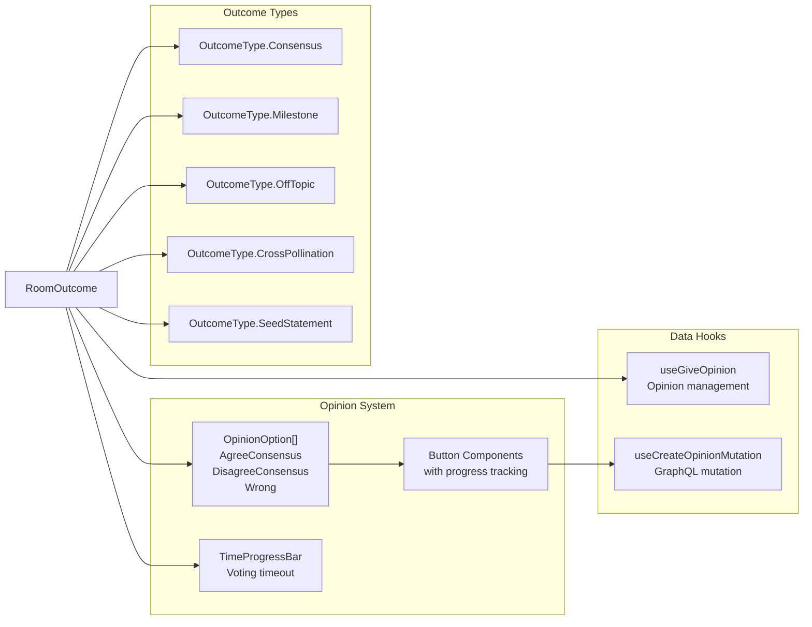
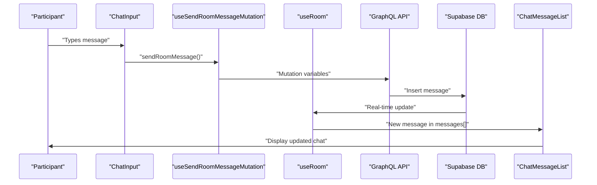
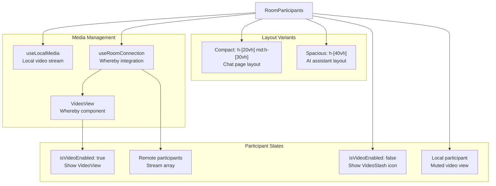
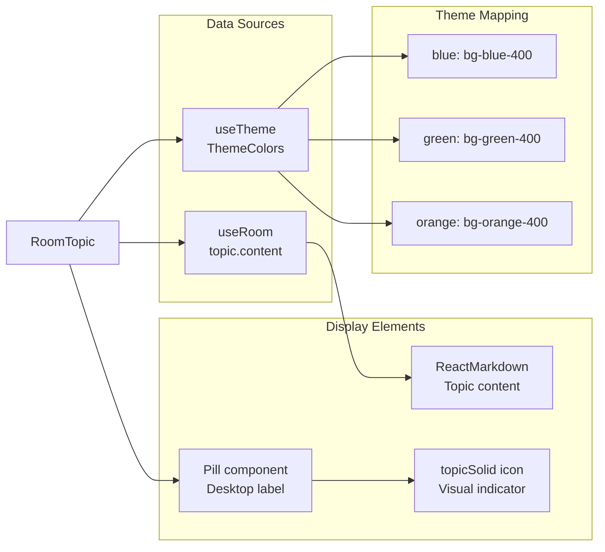
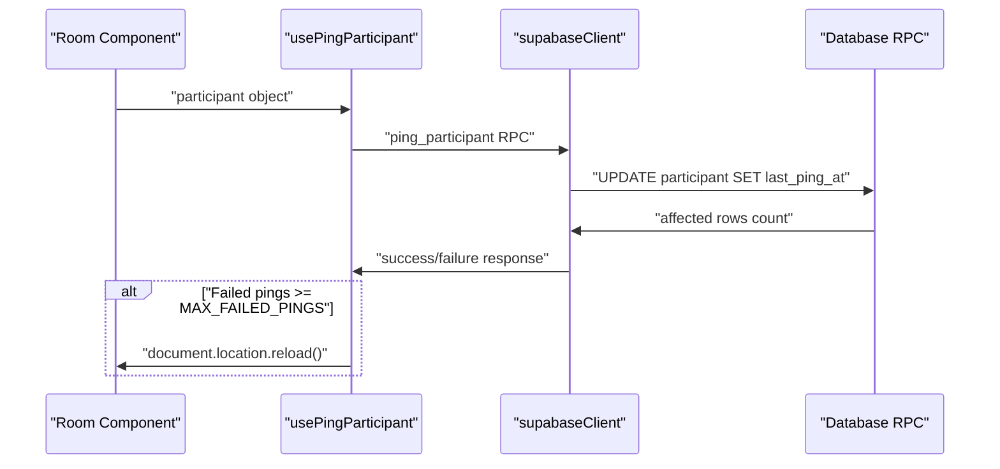
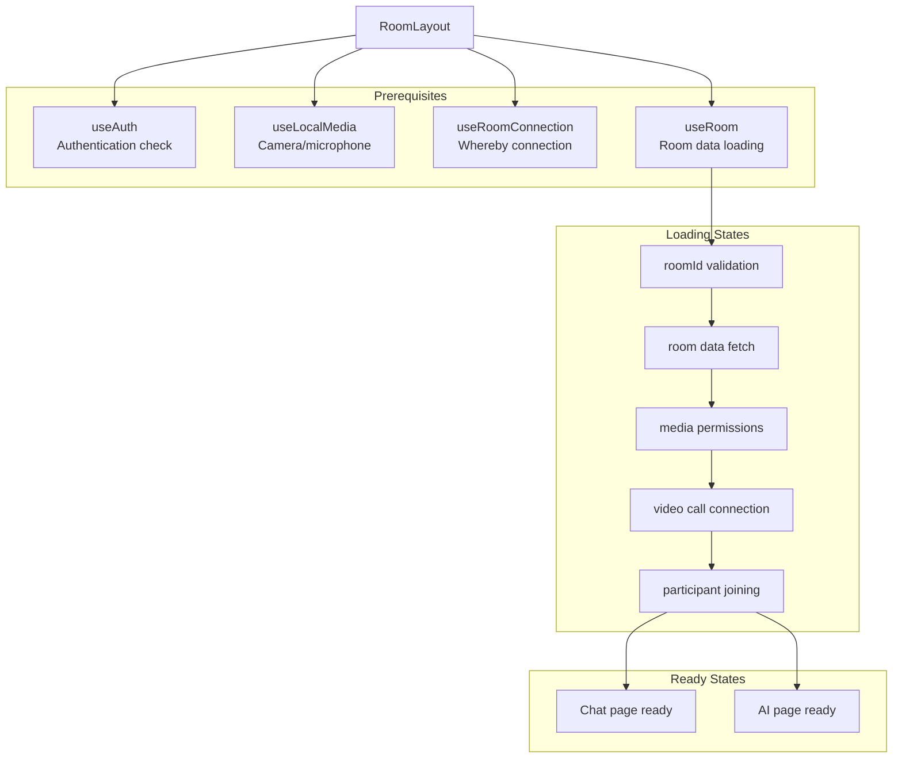

<!-- source: DeepWiki mcp.deepwiki.com · repo openai/democratic-inputs · page 4.3 Room Components · fetched 2026-10-26 -->

# Room Components

Relevant source files

The following files were used as context for generating this wiki page:

- [projects/deliberation_at_scale/packages/frontend/app/[lang]/layout.tsx](projects/deliberation_at_scale/packages/frontend/app/[lang]/layout.tsx)
- [projects/deliberation_at_scale/packages/frontend/app/[lang]/room/[roomId]/ai/page.tsx](projects/deliberation_at_scale/packages/frontend/app/[lang]/room/[roomId]/ai/page.tsx)
- [projects/deliberation_at_scale/packages/frontend/app/[lang]/room/[roomId]/chat/page.tsx](projects/deliberation_at_scale/packages/frontend/app/[lang]/room/[roomId]/chat/page.tsx)
- [projects/deliberation_at_scale/packages/frontend/app/[lang]/room/[roomId]/layout.tsx](projects/deliberation_at_scale/packages/frontend/app/[lang]/room/[roomId]/layout.tsx)
- [projects/deliberation_at_scale/packages/frontend/components/Button.tsx](projects/deliberation_at_scale/packages/frontend/components/Button.tsx)
- [projects/deliberation_at_scale/packages/frontend/components/LatestRoomOutcome.tsx](projects/deliberation_at_scale/packages/frontend/components/LatestRoomOutcome.tsx)
- [projects/deliberation_at_scale/packages/frontend/components/RoomChatMessages.tsx](projects/deliberation_at_scale/packages/frontend/components/RoomChatMessages.tsx)
- [projects/deliberation_at_scale/packages/frontend/components/RoomChatSummary.tsx](projects/deliberation_at_scale/packages/frontend/components/RoomChatSummary.tsx)
- [projects/deliberation_at_scale/packages/frontend/components/RoomOutcome.tsx](projects/deliberation_at_scale/packages/frontend/components/RoomOutcome.tsx)
- [projects/deliberation_at_scale/packages/frontend/components/RoomParticipants/index.tsx](projects/deliberation_at_scale/packages/frontend/components/RoomParticipants/index.tsx)
- [projects/deliberation_at_scale/packages/frontend/components/RoomTopic.tsx](projects/deliberation_at_scale/packages/frontend/components/RoomTopic.tsx)
- [projects/deliberation_at_scale/packages/frontend/hooks/useGiveOpinion.ts](projects/deliberation_at_scale/packages/frontend/hooks/useGiveOpinion.ts)
- [projects/deliberation_at_scale/packages/frontend/hooks/usePingParticipant.ts](projects/deliberation_at_scale/packages/frontend/hooks/usePingParticipant.ts)
- [projects/deliberation_at_scale/packages/frontend/hooks/useScrollToBottom.ts](projects/deliberation_at_scale/packages/frontend/hooks/useScrollToBottom.ts)

This document covers the user interface components that comprise active deliberation rooms in the frontend package. These components handle video conferencing, real-time chat, voting on AI-generated outcomes, and topic display during live deliberation sessions.

For information about the broader room progression system and AI orchestration, see [Room Progression Engine](#5.1). For details about real-time data synchronization, see [Real-time Data & GraphQL](#4.2).

## Purpose and Component Architecture

The room components system provides the interactive interface for participants engaged in structured deliberations. The system supports two primary views: a chat-focused interface for message exchange and an AI assistant interface for viewing AI-generated outcomes and voting.

### Room Component Hierarchy

Sources: [projects/deliberation_at_scale/packages/frontend/app/\[lang\]/room/\[roomId\]/layout.tsx:1-103](), [projects/deliberation_at_scale/packages/frontend/app/\[lang\]/room/\[roomId\]/chat/page.tsx:1-14](), [projects/deliberation_at_scale/packages/frontend/app/\[lang\]/room/\[roomId\]/ai/page.tsx:1-14]()

## Interactive Voting System

The `RoomOutcome` component serves as the primary interface for participants to vote on AI-generated statements and proposals. This component handles different outcome types and manages real-time opinion tracking.

### RoomOutcome Component Structure

The component supports multiple opinion option types through the `OpinionOptionType` enum and tracks voting progress across all participants. Timeout functionality prevents late voting using the `OUTCOME_OPINION_TIMEOUT_MS_LOOKUP` configuration.

Sources: [projects/deliberation_at_scale/packages/frontend/components/RoomOutcome.tsx:1-162](), [projects/deliberation_at_scale/packages/frontend/hooks/useGiveOpinion.ts:1-110]()

### Voting Mechanics

| Feature | Implementation | Purpose |
|---------|---------------|---------|
| **Opinion Types** | `AgreeConsensus`, `DisagreeConsensus`, `Wrong` | Standard voting options for consensus building |
| **Progress Tracking** | Real-time calculation of vote percentages | Visual feedback on group consensus |
| **Timeout System** | `TimeProgressBar` with configurable duration | Prevents indefinite voting delays |
| **Optimistic Updates** | Local state management before server confirmation | Responsive user experience |

The voting system uses the `useGiveOpinion` hook to manage opinion state and automatically handles duplicate vote prevention through existing opinion checking [projects/deliberation_at_scale/packages/frontend/hooks/useGiveOpinion.ts:44-48]().

Sources: [projects/deliberation_at_scale/packages/frontend/components/RoomOutcome.tsx:58-84](), [projects/deliberation_at_scale/packages/frontend/components/TimeProgressBar.tsx]()

## Chat and Messaging System

The messaging system provides two distinct interfaces: `RoomChatMessages` for full chat functionality and `RoomChatSummary` for AI-focused outcome display with limited chat history.

### Chat System Data Flow

The `RoomChatMessages` component handles full message history display and real-time scrolling behavior through the `useScrollToBottom` hook. Chat input is managed through the `ChatInput` component with submission handled by the `useSendRoomMessageMutation`.

Sources: [projects/deliberation_at_scale/packages/frontend/components/RoomChatMessages.tsx:1-75](), [projects/deliberation_at_scale/packages/frontend/hooks/useScrollToBottom.ts:1-35]()

### Chat vs Summary Modes

| Component | Purpose | Message Display | Chat Input |
|-----------|---------|----------------|------------|
| **RoomChatMessages** | Full chat interface | Complete message history | Enabled |
| **RoomChatSummary** | AI-focused view | Last bot + participant messages only | Disabled by default |

The `RoomChatSummary` component prioritizes AI-generated outcomes and bot messages while showing limited recent participant messages. The `ENABLE_CHAT` constant controls input availability [projects/deliberation_at_scale/packages/frontend/components/RoomChatSummary.tsx:21]().

Sources: [projects/deliberation_at_scale/packages/frontend/components/RoomChatSummary.tsx:1-132](), [projects/deliberation_at_scale/packages/frontend/components/RoomChatMessages.tsx:16-40]()

## Video Participant Management

The `RoomParticipants` component manages video display for all participants with support for compact and spacious layout variants. The component integrates with the Whereby video conferencing system through the `useRoomConnection` hook.

### Video Component Architecture

### Participant Display Logic

The component handles participant video streams through the Whereby SDK's `VideoView` component and provides fallback displays when video is disabled. Local participant controls are accessible through click interaction on the local video view.

| Layout | Dimensions | Use Case | Local Participant Position |
|--------|------------|----------|---------------------------|
| **Compact** | `h-[20vh] md:h-[30vh]` | Chat-focused interface | `bottom-0 right-2` |
| **Spacious** | `h-[40vh]` | AI assistant interface | `bottom-0 right-2` |

The component automatically positions remote participants in the available space and overlays local participant controls when `showLocalControls` is enabled [projects/deliberation_at_scale/packages/frontend/components/RoomParticipants/index.tsx:114-117]().

Sources: [projects/deliberation_at_scale/packages/frontend/components/RoomParticipants/index.tsx:1-121](), [projects/deliberation_at_scale/packages/frontend/hooks/useLocalMedia.ts]()

## Topic Display and Navigation

The `RoomTopic` component displays the current deliberation topic with theme-aware styling and responsive design for both compact and spacious layouts.

### Topic Component Integration

The topic component provides responsive design with different layouts for mobile and desktop through conditional class application and icon rotation [projects/deliberation_at_scale/packages/frontend/components/RoomTopic.tsx:43-44]().

Sources: [projects/deliberation_at_scale/packages/frontend/components/RoomTopic.tsx:1-47](), [projects/deliberation_at_scale/packages/frontend/hooks/useTheme.ts]()

## Participant Lifecycle Management

Room components implement participant presence tracking through the `usePingParticipant` hook, which maintains active session state and handles disconnection scenarios.

### Ping System Architecture

The ping system runs on a configurable interval defined by `PARTICIPANT_PING_INTERVAL_DELAY_MS` and automatically reloads the page after `MAX_FAILED_PINGS` consecutive failures to ensure participants don't remain in stale sessions.

Sources: [projects/deliberation_at_scale/packages/frontend/hooks/usePingParticipant.ts:1-54](), [projects/deliberation_at_scale/packages/frontend/components/RoomChatSummary.tsx:40](), [projects/deliberation_at_scale/packages/frontend/components/RoomChatMessages.tsx:60]()

## Component Integration and State Management

Room components are integrated through the room layout system which handles authentication, media initialization, and connection management before rendering the component tree.

### Room Layout Dependencies

The layout component implements comprehensive loading state management and automatic redirection to invalid room handling when prerequisites are not met within the `ROOM_JOINING_EXPIRY_TIME_MS` timeout period.

Sources: [projects/deliberation_at_scale/packages/frontend/app/\[lang\]/room/\[roomId\]/layout.tsx:22-102](), [projects/deliberation_at_scale/packages/frontend/hooks/useAuth.ts](), [projects/deliberation_at_scale/packages/frontend/hooks/useRoom.ts]()

---

