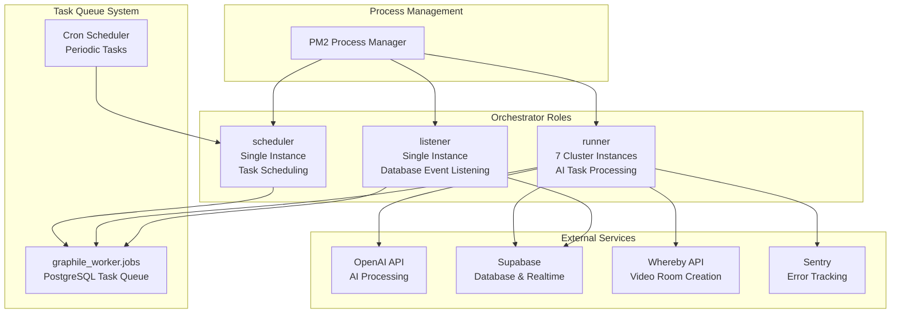
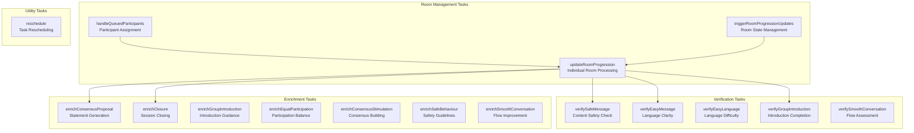
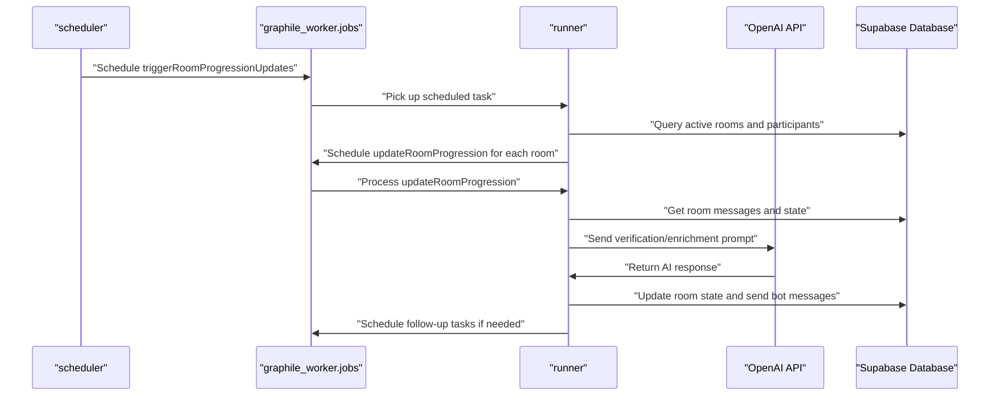
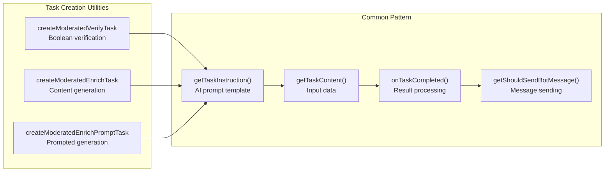

<!-- source: DeepWiki mcp.deepwiki.com · repo openai/democratic-inputs · page 5 AI Orchestration System · fetched 2026-10-26 -->

# AI Orchestration System

<details>
<summary>Relevant source files</summary>

The following files were used as context for generating this wiki page:

- [projects/deliberation_at_scale/packages/orchestrator/ecosystem.config.js](projects/deliberation_at_scale/packages/orchestrator/ecosystem.config.js)
- [projects/deliberation_at_scale/packages/orchestrator/src/config/constants.ts](projects/deliberation_at_scale/packages/orchestrator/src/config/constants.ts)
- [projects/deliberation_at_scale/packages/orchestrator/src/config/crontab.ts](projects/deliberation_at_scale/packages/orchestrator/src/config/crontab.ts)
- [projects/deliberation_at_scale/packages/orchestrator/src/tasks/enrichClosure.ts](projects/deliberation_at_scale/packages/orchestrator/src/tasks/enrichClosure.ts)
- [projects/deliberation_at_scale/packages/orchestrator/src/tasks/enrichConsensusProposal.ts](projects/deliberation_at_scale/packages/orchestrator/src/tasks/enrichConsensusProposal.ts)
- [projects/deliberation_at_scale/packages/orchestrator/src/tasks/enrichConsensusStimulation.ts](projects/deliberation_at_scale/packages/orchestrator/src/tasks/enrichConsensusStimulation.ts)
- [projects/deliberation_at_scale/packages/orchestrator/src/tasks/enrichEqualParticipation.ts](projects/deliberation_at_scale/packages/orchestrator/src/tasks/enrichEqualParticipation.ts)
- [projects/deliberation_at_scale/packages/orchestrator/src/tasks/enrichGroupIntroduction.ts](projects/deliberation_at_scale/packages/orchestrator/src/tasks/enrichGroupIntroduction.ts)
- [projects/deliberation_at_scale/packages/orchestrator/src/tasks/enrichSafeBehaviour.ts](projects/deliberation_at_scale/packages/orchestrator/src/tasks/enrichSafeBehaviour.ts)
- [projects/deliberation_at_scale/packages/orchestrator/src/tasks/enrichSmoothConversation.ts](projects/deliberation_at_scale/packages/orchestrator/src/tasks/enrichSmoothConversation.ts)
- [projects/deliberation_at_scale/packages/orchestrator/src/tasks/handleQueuedParticipants.ts](projects/deliberation_at_scale/packages/orchestrator/src/tasks/handleQueuedParticipants.ts)
- [projects/deliberation_at_scale/packages/orchestrator/src/tasks/reschedule.ts](projects/deliberation_at_scale/packages/orchestrator/src/tasks/reschedule.ts)
- [projects/deliberation_at_scale/packages/orchestrator/src/tasks/triggerRoomProgressionUpdates.ts](projects/deliberation_at_scale/packages/orchestrator/src/tasks/triggerRoomProgressionUpdates.ts)
- [projects/deliberation_at_scale/packages/orchestrator/src/tasks/verifyEasyLanguage.ts](projects/deliberation_at_scale/packages/orchestrator/src/tasks/verifyEasyLanguage.ts)
- [projects/deliberation_at_scale/packages/orchestrator/src/tasks/verifyEasyMessage.ts](projects/deliberation_at_scale/packages/orchestrator/src/tasks/verifyEasyMessage.ts)
- [projects/deliberation_at_scale/packages/orchestrator/src/tasks/verifyGroupIntroduction.ts](projects/deliberation_at_scale/packages/orchestrator/src/tasks/verifyGroupIntroduction.ts)
- [projects/deliberation_at_scale/packages/orchestrator/src/tasks/verifySafeMessage.ts](projects/deliberation_at_scale/packages/orchestrator/src/tasks/verifySafeMessage.ts)
- [projects/deliberation_at_scale/packages/orchestrator/src/tasks/verifySmoothConversation.ts](projects/deliberation_at_scale/packages/orchestrator/src/tasks/verifySmoothConversation.ts)

</details>


The AI Orchestration System is the backend engine that manages AI-powered conversation flows, task processing, and room progression in the deliberation platform. It coordinates between user interactions, AI moderation, and conversation state management through a distributed task processing architecture.

For information about the frontend room components and user interfaces, see [Room Components](#4.3). For details about the underlying database schema and data relationships, see [Database Schema & Data Layer](#3).

## System Architecture

The orchestrator operates as a distributed system with three distinct roles that can be deployed independently or together, managed through PM2 process configuration.

### Orchestrator Roles



**Sources:** [projects/deliberation_at_scale/packages/orchestrator/ecosystem.config.js:1-35](), [projects/deliberation_at_scale/packages/orchestrator/src/config/constants.ts:38-47]()

### Role Responsibilities

| Role | Instances | Primary Function | Key Tasks |
|------|-----------|------------------|-----------|
| `scheduler` | 1 | Schedules recurring tasks and room progression updates | `triggerRoomProgressionUpdates`, cron job management |
| `runner` | 7 | Processes AI tasks and handles heavy computation | AI moderation, content generation, room progression |
| `listener` | 1 | Monitors database changes and triggers reactive tasks | Database event handling, real-time updates |

**Sources:** [projects/deliberation_at_scale/packages/orchestrator/ecosystem.config.js:10-33]()

## Task Processing System

The orchestrator uses a sophisticated task queue system built on Graphile Worker that processes different types of AI-powered tasks for conversation management.

### Core Task Categories



**Sources:** [projects/deliberation_at_scale/packages/orchestrator/src/tasks/]()

### Task Execution Flow



**Sources:** [projects/deliberation_at_scale/packages/orchestrator/src/tasks/triggerRoomProgressionUpdates.ts:19-98](), [projects/deliberation_at_scale/packages/orchestrator/src/tasks/handleQueuedParticipants.ts:21-44]()

## Configuration Management

The system uses comprehensive environment-based configuration to manage external service integrations and operational parameters.

### Environment Variables

```typescript
// Required environment variables for orchestrator operation
const requiredEnvVars = [
    'DATABASE_URL',      // PostgreSQL connection
    'SUPABASE_URL',      // Supabase project URL
    'SUPABASE_KEY',      // Supabase service key
    'OPENAI_API_KEY',    // OpenAI API access
    'SENTRY_DSN',        // Error tracking
    'WHEREBY_BEARER_TOKEN' // Video room creation
];
```

**Sources:** [projects/deliberation_at_scale/packages/orchestrator/src/config/constants.ts:22-36]()

### Operational Constants

| Constant | Value | Purpose |
|----------|-------|---------|
| `PARTICIPANTS_PER_ROOM` | 3 | Standard room size |
| `MAX_ROOM_DURATION_MS` | 60 minutes | Room timeout |
| `HANDLE_QUEUED_PARTICIPANTS_INTERVAL_MS` | 5 seconds | Participant processing frequency |
| `UPDATE_ROOM_PROGRESSION_INTERVAL_MS` | 15 seconds | Room progression check frequency |
| `PARTICIPANT_PING_EXPIRY_TIME_MS` | 10 seconds | Participant activity timeout |

**Sources:** [projects/deliberation_at_scale/packages/orchestrator/src/config/constants.ts:72-84]()

## Participant Queue Management

The system manages participant flow from lobby queuing through room assignment and confirmation using sophisticated algorithms.

### Queue Processing Workflow

```mermaid
stateDiagram-v2
    [*] --> "deactivateDuplicateParticipants"
    "deactivateDuplicateParticipants" --> "deactivateInactiveParticipants"
    "deactivateInactiveParticipants" --> "deactivateExpiredRooms" 
    "deactivateExpiredRooms" --> "performDynamicGroupSlicing"
    "performDynamicGroupSlicing" --> "assignParticipantsToRoom"
    "assignParticipantsToRoom" --> "createExternalRoom"
    "createExternalRoom" --> "updateParticipantStatus"
    "updateParticipantStatus" --> [*]
    
    state "performDynamicGroupSlicing" {
        [*] --> "checkMinParticipants"
        "checkMinParticipants" --> "shuffleParticipants"
        "shuffleParticipants" --> "selectTopic"
        "selectTopic" --> "groupFormation"
    }
```

**Sources:** [projects/deliberation_at_scale/packages/orchestrator/src/tasks/handleQueuedParticipants.ts:156-271]()

### Dynamic Group Slicing Algorithm

The `performDynamicGroupSlicing` function implements participant assignment logic:

1. **Deduplication**: Removes duplicate participants per user using `unique()` function
2. **Shuffling**: Randomizes participant order using `shuffle()` from radash library  
3. **Topic Assignment**: Selects random topics using `draw()` function
4. **Room Creation**: Creates Whereby video rooms and database entries
5. **Status Updates**: Moves participants from `queued` to `waiting_for_confirmation`

**Sources:** [projects/deliberation_at_scale/packages/orchestrator/src/tasks/handleQueuedParticipants.ts:193-271]()

## AI Task Processing Framework

The orchestrator provides reusable task creation utilities that standardize AI interaction patterns for moderation and content generation.

### Moderated Task Types



**Sources:** [projects/deliberation_at_scale/packages/orchestrator/src/tasks/enrichConsensusProposal.ts:6-49](), [projects/deliberation_at_scale/packages/orchestrator/src/tasks/verifyEasyMessage.ts:7-43]()

### Message Safety Verification

The `verifySafeMessage` task demonstrates direct OpenAI Moderation API integration:

```typescript
const moderationResult = await openaiClient.moderations.create({
    input: content,
    model: 'text-moderation-stable',
});
const hasFlaggedContent = results.some(result => result.flagged);
```

This updates the message's `safe_language` field and stores moderation results in the database.

**Sources:** [projects/deliberation_at_scale/packages/orchestrator/src/tasks/verifySafeMessage.ts:14-46]()

## Scheduled Task Management

The system uses a cron-based scheduler for periodic task execution and automatic rescheduling of core processes.

### Cron Configuration

```typescript
const crontab: ToggleableCronItem[] = [
    {
        active: true,
        pattern: '* * * * *',  // Every minute
        task: 'reschedule',
        identifier: 'reschedule',
    },
];
```

The `reschedule` task maintains continuous operation by restarting the scheduler process and ensuring task queue processing continues.

**Sources:** [projects/deliberation_at_scale/packages/orchestrator/src/config/crontab.ts:8-17](), [projects/deliberation_at_scale/packages/orchestrator/src/tasks/reschedule.ts:1-5]()

### Task Interval Management

Core processes operate on fixed intervals:

- `handleQueuedParticipants`: Runs every 5 seconds to process lobby participants
- `triggerRoomProgressionUpdates`: Runs every 15 seconds to check room advancement
- Automatic rescheduling prevents task queue stagnation

**Sources:** [projects/deliberation_at_scale/packages/orchestrator/src/config/constants.ts:83-84]()

---

