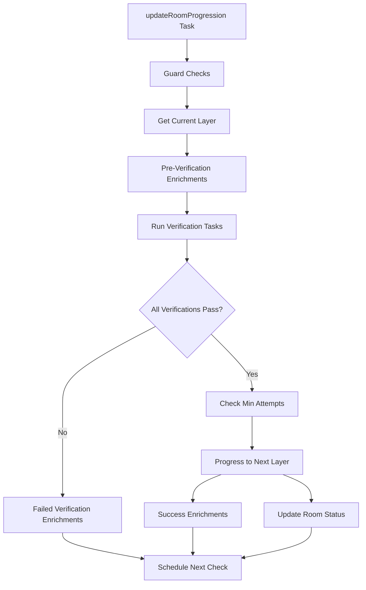
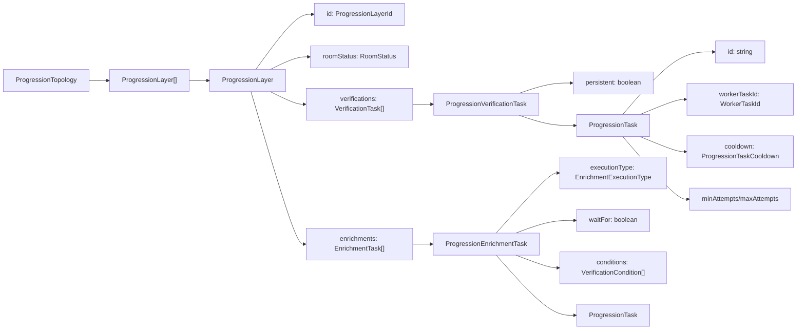
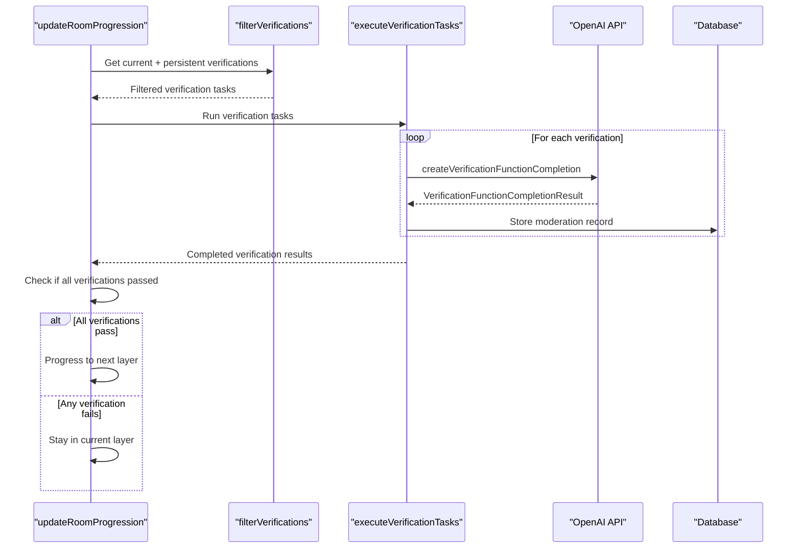
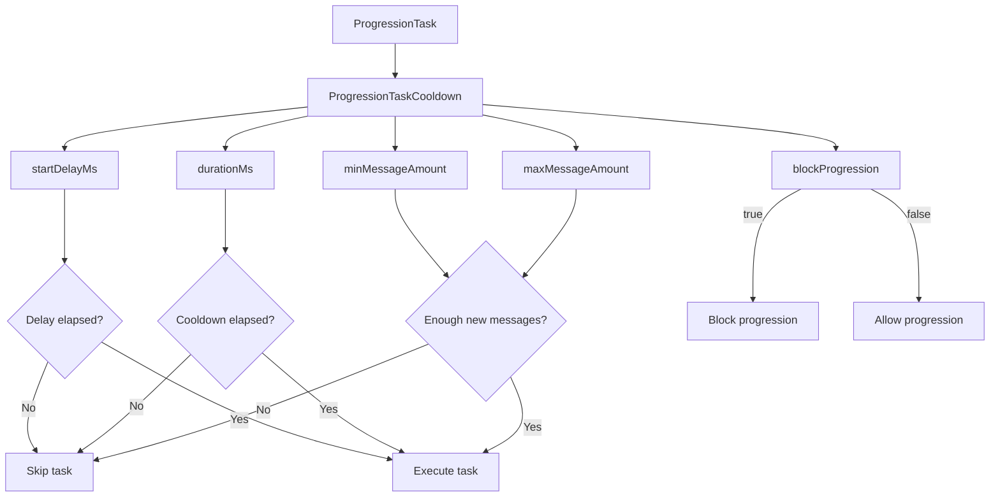
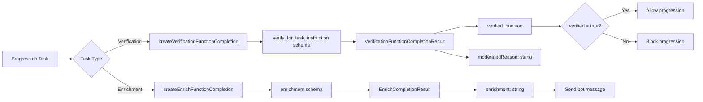
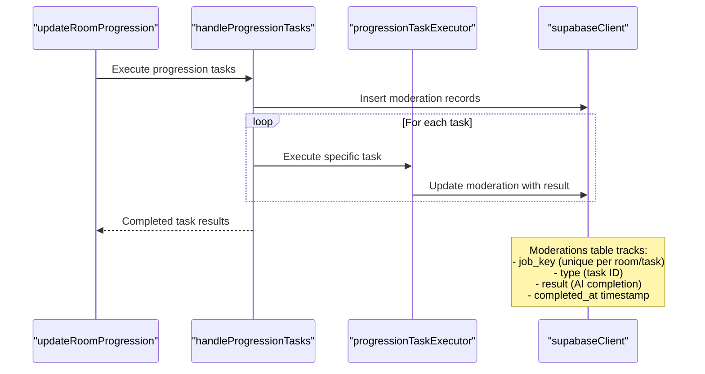
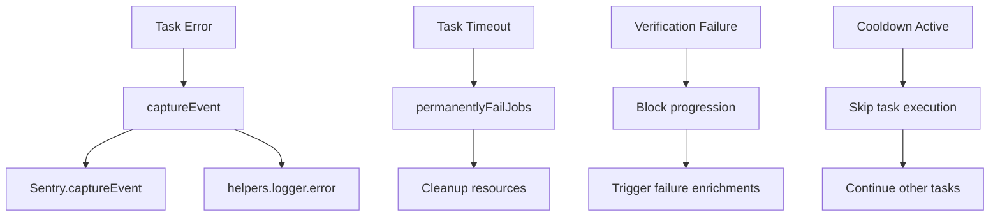

<!-- source: DeepWiki mcp.deepwiki.com · repo openai/democratic-inputs · page 5.1 Room Progression Engine · fetched 2026-10-26 -->

# Room Progression Engine

Relevant source files

The following files were used as context for generating this wiki page:

- [projects/deliberation_at_scale/packages/orchestrator/src/lib/graphileWorker.ts](projects/deliberation_at_scale/packages/orchestrator/src/lib/graphileWorker.ts)
- [projects/deliberation_at_scale/packages/orchestrator/src/lib/openai.ts](projects/deliberation_at_scale/packages/orchestrator/src/lib/openai.ts)
- [projects/deliberation_at_scale/packages/orchestrator/src/lib/sentry.ts](projects/deliberation_at_scale/packages/orchestrator/src/lib/sentry.ts)
- [projects/deliberation_at_scale/packages/orchestrator/src/lib/supabase.ts](projects/deliberation_at_scale/packages/orchestrator/src/lib/supabase.ts)
- [projects/deliberation_at_scale/packages/orchestrator/src/tasks/updateRoomProgression.ts](projects/deliberation_at_scale/packages/orchestrator/src/tasks/updateRoomProgression.ts)
- [projects/deliberation_at_scale/packages/orchestrator/src/types.ts](projects/deliberation_at_scale/packages/orchestrator/src/types.ts)

The Room Progression Engine is a sophisticated system that manages how deliberation rooms advance through different phases of structured democratic conversation. It orchestrates AI-powered verification and enrichment tasks to ensure productive discussion flow while maintaining conversation quality and safety standards.

For information about the AI moderation tasks themselves, see [AI Moderation & Vote Management](#5.2). For details about the frontend room interface, see [Room Components](#4.3).

## System Overview

The Room Progression Engine operates as a state machine that transitions deliberation rooms through predefined phases based on configurable verification criteria. Each phase (called a "layer") contains verification tasks that must pass and optional enrichment tasks that enhance the conversation experience.

**Core Progression Flow**

Sources: [projects/deliberation_at_scale/packages/orchestrator/src/tasks/updateRoomProgression.ts:30-61](), [projects/deliberation_at_scale/packages/orchestrator/src/tasks/updateRoomProgression.ts:64-209]()

## Progression Topology Structure

The system uses a configurable topology that defines the complete deliberation journey. Each layer represents a phase with specific verification requirements and enrichment opportunities.

**Topology Components**

Sources: [projects/deliberation_at_scale/packages/orchestrator/src/types.ts:30-157]()

## Layer Progression Phases

The default topology includes these progression layer IDs, each corresponding to a specific room status:

| Layer ID | Purpose | Key Verifications |
|----------|---------|------------------|
| `groupIntro` | Participant introductions | Group introduction completion |
| `topicIntro` | Topic presentation | Topic understanding |
| `safe` | Safety establishment | Safe language verification |
| `informed` | Information sharing | Sufficient content verification |
| `debate` | Open discussion | Equal participation, consensus forming |
| `results` | Outcome generation | Consensus verification |
| `close` | Session closure | End request verification |
| `end` | Final state | Session completion |

Sources: [projects/deliberation_at_scale/packages/orchestrator/src/types.ts:36](), [projects/deliberation_at_scale/packages/orchestrator/src/types.ts:38]()

## Task Execution System

The engine supports two types of tasks that work together to manage conversation flow:

### Verification Tasks

Verification tasks determine whether a room can progress to the next layer. All active verifications must pass for progression to occur.

**Verification Process**

Sources: [projects/deliberation_at_scale/packages/orchestrator/src/tasks/updateRoomProgression.ts:269-306](), [projects/deliberation_at_scale/packages/orchestrator/src/tasks/updateRoomProgression.ts:308-327]()

### Enrichment Tasks

Enrichment tasks enhance the conversation experience through AI-generated guidance and moderation. They run based on execution types and conditions.

**Enrichment Execution Types**

| Execution Type | When It Runs |
|----------------|--------------|
| `alwaysBeforeVerification` | Before running verifications |
| `onNotVerified` | When verifications fail (default) |
| `onVerified` | When verifications pass |
| `alwaysAfterVerification` | After verification results |

Sources: [projects/deliberation_at_scale/packages/orchestrator/src/types.ts:122](), [projects/deliberation_at_scale/packages/orchestrator/src/tasks/updateRoomProgression.ts:343-421]()

## Cooldown and Timing Control

The system includes sophisticated timing controls to prevent spam and ensure appropriate pacing:

**Cooldown Mechanisms**

Sources: [projects/deliberation_at_scale/packages/orchestrator/src/types.ts:99-114](), [projects/deliberation_at_scale/packages/orchestrator/src/tasks/updateRoomProgression.ts:639-775]()

## AI Integration Architecture

The engine integrates with OpenAI for intelligent verification and enrichment:

**AI Function Calling**

Sources: [projects/deliberation_at_scale/packages/orchestrator/src/lib/openai.ts:47-81](), [projects/deliberation_at_scale/packages/orchestrator/src/lib/openai.ts:83-109]()

## Job Management and Persistence

All progression tasks are tracked in the database through the moderation system:

**Task Persistence Flow**

Sources: [projects/deliberation_at_scale/packages/orchestrator/src/tasks/updateRoomProgression.ts:512-558](), [projects/deliberation_at_scale/packages/orchestrator/src/tasks/updateRoomProgression.ts:534-545]()

## Configuration and Control

The system provides several configuration options for testing and deployment:

**Key Constants and Controls**

| Constant | Purpose |
|----------|---------|
| `ENABLE_ROOM_PROGRESSION` | Master switch for progression |
| `PRINT_ROOM_PROGRESSION` | Debug messages in chat |
| `UPDATE_ROOM_PROGRESSION_INTERVAL_MS` | Polling frequency |

**Job Key Generation**

The system uses structured job keys to ensure task uniqueness:
- Room progression: `updateRoomProgression-room-${roomId}-layer-${layerId}`
- Task execution: `room-${roomId}-progression-task-${progressionTaskId}`

Sources: [projects/deliberation_at_scale/packages/orchestrator/src/config/constants.ts:13](), [projects/deliberation_at_scale/packages/orchestrator/src/tasks/updateRoomProgression.ts:329-331](), [projects/deliberation_at_scale/packages/orchestrator/src/tasks/updateRoomProgression.ts:780-783]()

## Error Handling and Monitoring

The engine includes comprehensive error handling with Sentry integration for production monitoring:

Sources: [projects/deliberation_at_scale/packages/orchestrator/src/tasks/updateRoomProgression.ts:52-60](), [projects/deliberation_at_scale/packages/orchestrator/src/lib/graphileWorker.ts:157-164]()

---

