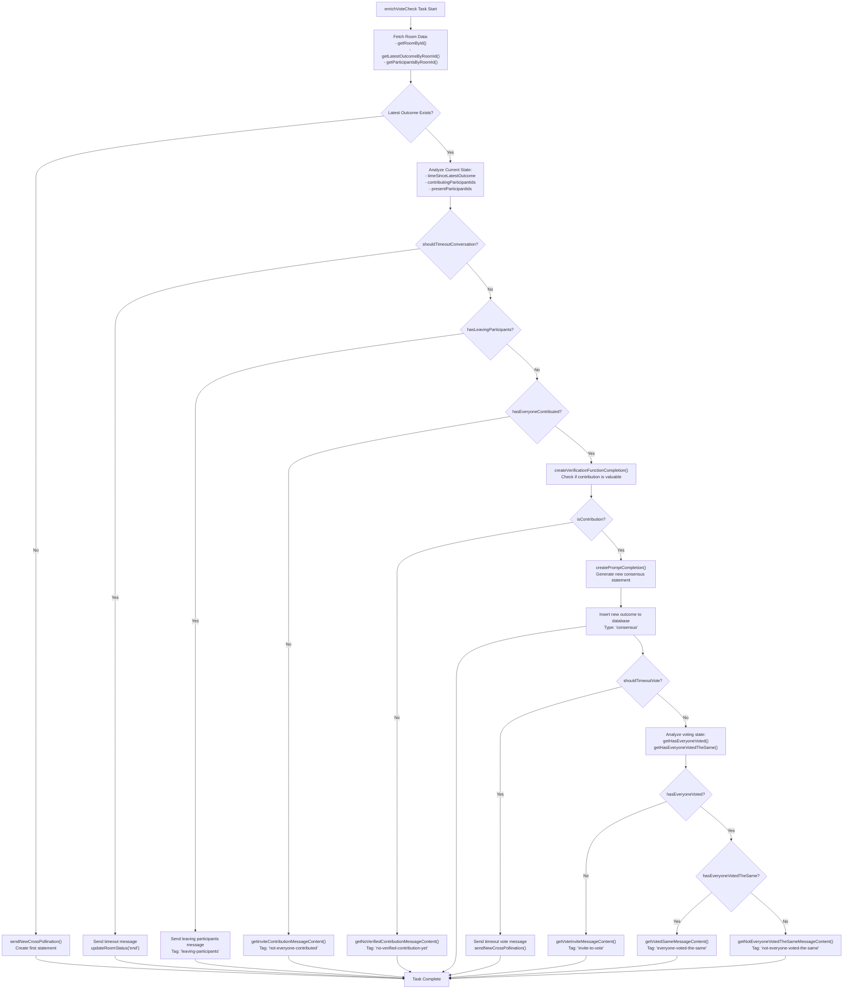
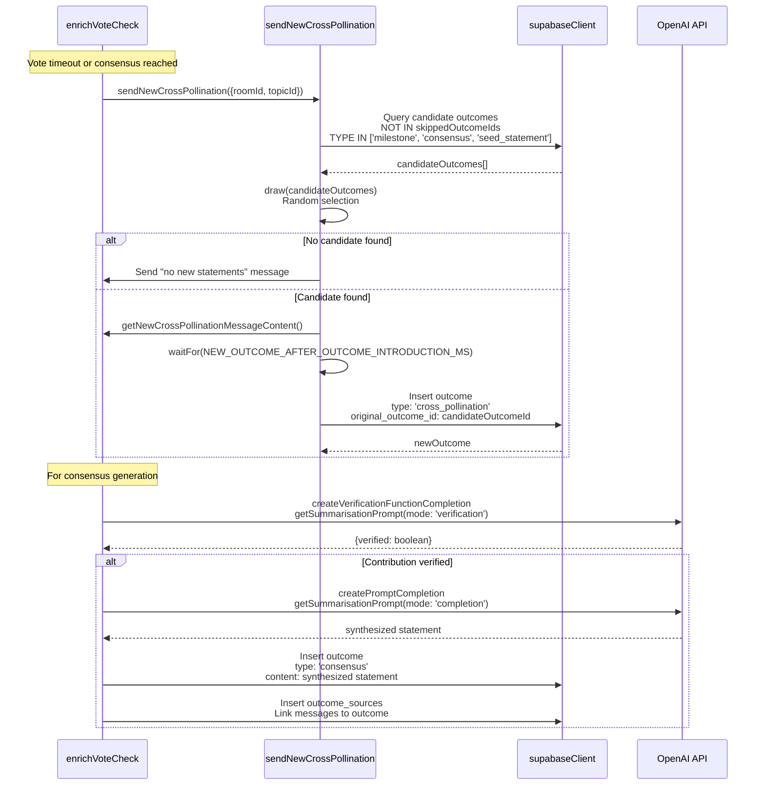
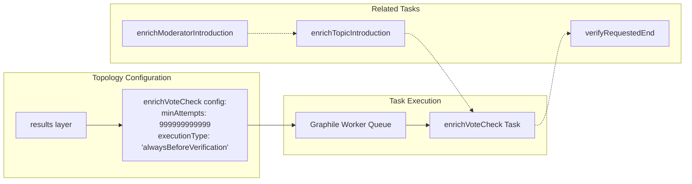

<!-- source: DeepWiki mcp.deepwiki.com · repo openai/democratic-inputs · page 5.2 AI Moderation & Vote Management · fetched 2026-10-26 -->

# AI Moderation & Vote Management

Relevant source files

The following files were used as context for generating this wiki page:

- [projects/deliberation_at_scale/packages/orchestrator/src/config/test-1-topology.ts](projects/deliberation_at_scale/packages/orchestrator/src/config/test-1-topology.ts)
- [projects/deliberation_at_scale/packages/orchestrator/src/tasks/enrichModeratorIntroduction.ts](projects/deliberation_at_scale/packages/orchestrator/src/tasks/enrichModeratorIntroduction.ts)
- [projects/deliberation_at_scale/packages/orchestrator/src/tasks/enrichTopicIntroduction.ts](projects/deliberation_at_scale/packages/orchestrator/src/tasks/enrichTopicIntroduction.ts)
- [projects/deliberation_at_scale/packages/orchestrator/src/tasks/enrichVoteCheck.ts](projects/deliberation_at_scale/packages/orchestrator/src/tasks/enrichVoteCheck.ts)
- [projects/deliberation_at_scale/packages/orchestrator/src/tasks/verifyRequestedEnd.ts](projects/deliberation_at_scale/packages/orchestrator/src/tasks/verifyRequestedEnd.ts)

This document covers the AI-powered moderation and voting management systems that guide democratic deliberation conversations. These systems automatically monitor participant engagement, manage voting cycles, generate consensus proposals, and provide contextual guidance to maintain productive discussions.

For information about the broader room progression framework that coordinates these systems, see [Room Progression Engine](#5.1). For details about the user interface components that display voting results, see [Room Components](#4.3).

## System Overview

The AI moderation and vote management system operates as a continuous enrichment process that monitors conversation state and provides adaptive guidance. The core orchestration happens through the `enrichVoteCheck` task, which runs repeatedly during the `results` phase of conversations.

```mermaid
graph TD
    subgraph "Vote Management Core"
        enrichVoteCheck["enrichVoteCheck()"]
        attemptSendBotMessage["attemptSendBotMessage()"]
        sendNewCrossPollination["sendNewCrossPollination()"]
    end
    
    subgraph "State Analysis"
        getHasEveryoneVoted["getHasEveryoneVoted()"]
        getHasEveryoneVotedTheSame["getHasEveryoneVotedTheSame()"]
        contributionCheck["AI Contribution Verification"]
        consensusGeneration["AI Consensus Generation"]
    end
    
    subgraph "Message Generation"
        getVoteInviteMessageContent["getVoteInviteMessageContent()"]
        getNotEveryoneVotedTheSameMessageContent["getNotEveryoneVotedTheSameMessageContent()"]
        getVotedSameMessageContent["getVotedSameMessageContent()"]
        getNewContributionMessageContent["getNewContributionMessageContent()"]
    end
    
    subgraph "External Systems"
        supabaseClient["supabaseClient (Database)"]
        createVerificationFunctionCompletion["OpenAI Verification"]
        createPromptCompletion["OpenAI Prompt Completion"]
    end
    
    enrichVoteCheck --> getHasEveryoneVoted
    enrichVoteCheck --> getHasEveryoneVotedTheSame
    enrichVoteCheck --> contributionCheck
    enrichVoteCheck --> attemptSendBotMessage
    
    contributionCheck --> createVerificationFunctionCompletion
    consensusGeneration --> createPromptCompletion
    
    attemptSendBotMessage --> getVoteInviteMessageContent
    attemptSendBotMessage --> getNotEveryoneVotedTheSameMessageContent
    attemptSendBotMessage --> getVotedSameMessageContent
    
    sendNewCrossPollination --> supabaseClient
    enrichVoteCheck --> sendNewCrossPollination
    
    consensusGeneration --> getNewContributionMessageContent
```

**Sources:** [enrichVoteCheck.ts:71-439]()

## Vote Check Enrichment Process

The `enrichVoteCheck` function implements a sophisticated state machine that continuously monitors conversation progress and provides appropriate interventions. The system operates on multiple time-based triggers and participant state conditions.

**Sources:** [enrichVoteCheck.ts:71-439](), [enrichVoteCheck.ts:15-54]()

## AI Message Generation System

The system uses a sophisticated message generation approach with cooldown mechanisms and contextual awareness. The `attemptSendBotMessage` function implements throttling and deduplication logic to prevent message spam.

| Function | Purpose | Tags | Cooldown |
|----------|---------|------|----------|
| `getVoteInviteMessageContent()` | Remind participants to vote | `invite-to-vote` | 4x BOT_TAG_COOLDOWN_MS |
| `getNotEveryoneVotedTheSameMessageContent()` | Encourage discussion when votes differ | `not-everyone-voted-the-same` | BOT_TAG_COOLDOWN_MS |
| `getVotedSameMessageContent()` | Acknowledge consensus | `everyone-voted-the-same` | BOT_TAG_COOLDOWN_MS |
| `getInviteContributionMessageContent()` | Request input from silent participants | `not-everyone-contributed` | 2x BOT_TAG_COOLDOWN_MS |
| `getLeavingParticipantsMessageContent()` | Handle participant departures | `leaving-participants` | 3x BOT_TAG_COOLDOWN_MS |
| `getTimeKeepingMessageContent()` | Provide time awareness | `timekeeping-{timeMs}` | Room scope, send once |

The message generation system includes randomization through the `draw()` function to provide varied responses while maintaining consistent messaging intent.

**Sources:** [enrichVoteCheck.ts:169-212](), [enrichVoteCheck.ts:573-697]()

## Cross-Pollination and Consensus Building

The `sendNewCrossPollination` function implements the system's ability to introduce new statements and generate consensus proposals. This function operates in two modes: introducing external statements and creating participant-generated consensus.

**Sources:** [enrichVoteCheck.ts:494-570](), [enrichVoteCheck.ts:264-348]()

## Consensus Generation and AI Prompting

The system uses sophisticated AI prompting for both verification and generation of consensus statements. The `getSummarisationPrompt` function creates context-aware prompts that follow democratic deliberation principles.

The AI prompting system operates in two modes:

### Verification Mode
Uses `createVerificationFunctionCompletion` to determine if participant messages contain valuable contribution content. The prompt instructs the AI to search for relevant content while ignoring meta-commentary and filler.

### Completion Mode  
Uses `createPromptCompletion` to generate normative statements following the structure: "(Who) (should/could/must) (not?) (do what) in order to (value)". The system enforces specific writing rules including active voice, conciseness, and standalone readability.

**Key Prompt Rules:**
- Don't use metaphors or similes
- Cut unnecessary words
- Use active voice over passive
- Avoid jargon when everyday equivalents exist
- Ensure statements are standalone and under two sentences
- Ignore meta-commentary and focus on societal discussion contributions
- Maintain neutrality across all viewpoints

**Sources:** [enrichVoteCheck.ts:699-741](), [enrichVoteCheck.ts:266-273](), [enrichVoteCheck.ts:293-301]()

## Time Management and Automatic Progression

The system implements multiple time-based triggers that ensure conversations progress even when participants are inactive. These timeouts prevent conversations from stalling indefinitely.

| Constant | Duration | Purpose |
|----------|----------|---------|
| `INVITE_VOTE_AFTER_MS` | 1 minute | Initial vote invitation |
| `INVITE_OPEN_DISCUSSION_AFTER_MS` | 3 minutes | Encourage discussion |
| `INVITE_PASS_AFTER_MS` | 5 minutes | Suggest skipping statement |
| `TIMEOUT_VOTE_AFTER_MS` | 10 minutes | Force new statement |
| `TIMEOUT_CONVSERSATION_AFTER_MS` | 40 minutes | End conversation |
| `NEW_CROSS_POLLINATION_COOLDOWN_MS` | 10 seconds | Prevent rapid statement changes |
| `TIMEKEEPING_MOMENTS` | 10, 20, 30 minutes | Progress notifications |

The system uses `BOT_OUTCOME_COOLDOWN_MS` (30 seconds) and `BOT_TAG_COOLDOWN_MS` (90 seconds) to prevent message flooding while ensuring responsive moderation.

**Sources:** [enrichVoteCheck.ts:15-57](), [enrichVoteCheck.ts:136-142](), [enrichVoteCheck.ts:241-251]()

## Integration with Topology System

The AI moderation system integrates with the broader room progression topology through the `test-1-topology.ts` configuration. The `enrichVoteCheck` task is configured to run continuously during the `results` phase with nearly unlimited attempts.

The system coordinates with other enrichment tasks including `enrichModeratorIntroduction` for initial greetings and `enrichTopicIntroduction` for topic presentation, creating a comprehensive AI-guided conversation flow.

**Sources:** [test-1-topology.ts:63-74](), [enrichModeratorIntroduction.ts:6-24](), [enrichTopicIntroduction.ts:10-95]()

---

