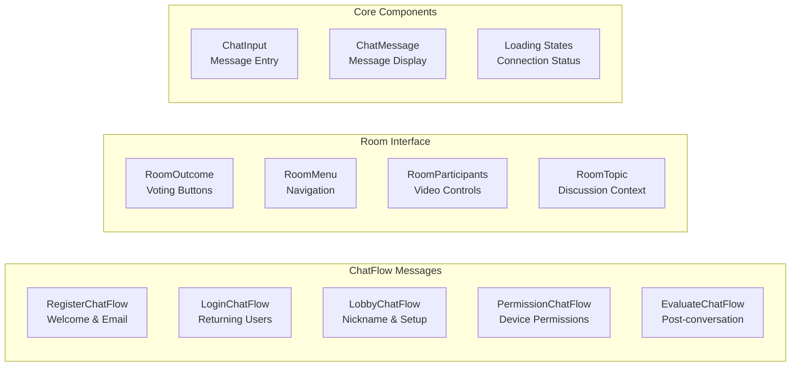
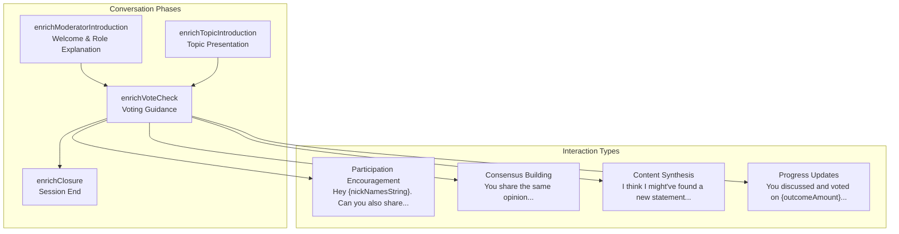
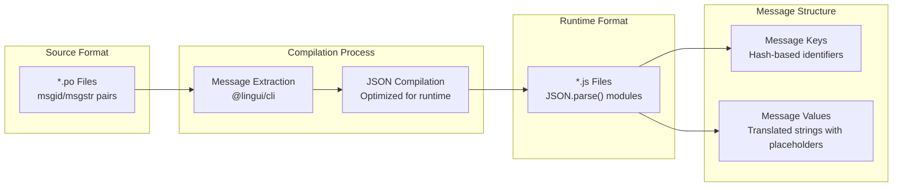

<!-- source: DeepWiki mcp.deepwiki.com · repo openai/democratic-inputs · page 6 Localization System · fetched 2026-10-26 -->

# Localization System

<details>
<summary>Relevant source files</summary>

The following files were used as context for generating this wiki page:

- [projects/deliberation_at_scale/packages/frontend/locales/en.js](projects/deliberation_at_scale/packages/frontend/locales/en.js)
- [projects/deliberation_at_scale/packages/frontend/locales/en.po](projects/deliberation_at_scale/packages/frontend/locales/en.po)
- [projects/deliberation_at_scale/packages/frontend/locales/nl.js](projects/deliberation_at_scale/packages/frontend/locales/nl.js)
- [projects/deliberation_at_scale/packages/frontend/locales/nl.po](projects/deliberation_at_scale/packages/frontend/locales/nl.po)
- [projects/deliberation_at_scale/packages/orchestrator/locales/en.js](projects/deliberation_at_scale/packages/orchestrator/locales/en.js)
- [projects/deliberation_at_scale/packages/orchestrator/locales/en.po](projects/deliberation_at_scale/packages/orchestrator/locales/en.po)
- [projects/deliberation_at_scale/packages/orchestrator/locales/nl.js](projects/deliberation_at_scale/packages/orchestrator/locales/nl.js)
- [projects/deliberation_at_scale/packages/orchestrator/locales/nl.po](projects/deliberation_at_scale/packages/orchestrator/locales/nl.po)

</details>


The localization system provides multi-language support for both user interface elements and AI moderator messages across the deliberation platform. This system enables global accessibility by translating all user-facing content and AI-generated conversation guidance into multiple languages.

This documentation covers the translation infrastructure, message compilation, and runtime localization. For information about the AI moderation system that uses these translated messages, see [AI Moderation & Vote Management](#5.2).

## System Architecture

The localization system operates across two distinct domains within the monorepo structure, each serving different purposes in the deliberation experience.

```mermaid
graph TB
    subgraph "Translation Sources"
        FESRC["Frontend Source Code<br/>Components & Hooks"]
        ORSRC["Orchestrator Source Code<br/>AI Task Files"]
    end
    
    subgraph "Translation Files"
        FEPO["frontend/locales/*.po<br/>UI Messages"]
        ORPO["orchestrator/locales/*.po<br/>AI Messages"]
    end
    
    subgraph "Compiled Runtime"
        FEJS["frontend/locales/*.js<br/>Compiled UI Messages"]
        ORJS["orchestrator/locales/*.js<br/>Compiled AI Messages"]
    end
    
    subgraph "Runtime Systems"
        FECOMP["React Components<br/>Chat Flow, Room UI"]
        AITASKS["AI Task Runners<br/>enrichVoteCheck, enrichTopicIntroduction"]
    end
    
    FESRC -->|"Extract msgid"| FEPO
    ORSRC -->|"Extract msgid"| ORPO
    FEPO -->|"Compile"| FEJS
    ORPO -->|"Compile"| ORJS
    FEJS -->|"Load at runtime"| FECOMP
    ORJS -->|"Load at runtime"| AITASKS
```



**Message Extraction and Compilation Flow**

Sources: [projects/deliberation_at_scale/packages/frontend/locales/en.po:1-549](), [projects/deliberation_at_scale/packages/orchestrator/locales/en.po:1-183]()

## Frontend Localization

The frontend localization system handles all user interface text, including registration flows, conversation controls, and voting interfaces. Messages are extracted from React components and hooks using the LinguiJS framework.

### Supported Languages

| Language | Code | Frontend Support | Coverage |
|----------|------|------------------|----------|
| English | `en` | Complete | 100% |
| Dutch | `nl` | Complete | ~95% |

### Message Categories

The frontend localization covers several distinct user experience areas:



**Frontend Message Organization by Component**

Sources: [projects/deliberation_at_scale/packages/frontend/locales/en.po:16-549]()

### Key Message Patterns

The frontend uses several consistent message patterns for user guidance:

- **Action Prompts**: Messages like `"Check device permissions now"` and `"Start searching for a conversation"`
- **Status Updates**: Loading states such as `"Finding room..."` and `"Connecting to video call..."`
- **User Feedback**: Response messages like `"Great! Moving you to the waiting lobby... Hold on tight!"`
- **Tips and Guidance**: Helpful notes such as `"Tip: Share your opinions first. Then vote."`

Sources: [projects/deliberation_at_scale/packages/frontend/locales/en.po:62-464]()

## AI Moderator Localization

The orchestrator package maintains separate localization files for AI-generated messages that guide conversation flow. These messages are contextually inserted during deliberation sessions to encourage participation and manage voting cycles.

### AI Message Categories



**AI Moderator Message Flow Through Conversation Phases**

Sources: [projects/deliberation_at_scale/packages/orchestrator/locales/en.po:48-182]()

### Contextual AI Prompts

The AI moderator system uses sophisticated prompt templates that adapt based on conversation state:

- **Statement Synthesis Instructions**: Complex prompts for creating new consensus statements from participant input
- **Time-based Interventions**: Messages triggered after specific durations like `"I've been instructed to introduce a new statement after {0} minutes"`
- **Participant Management**: Handling disconnections and encouraging re-engagement
- **Voting Guidance**: Different messages based on voting patterns and consensus levels

Sources: [projects/deliberation_at_scale/packages/orchestrator/locales/en.po:106-139](), [projects/deliberation_at_scale/packages/orchestrator/locales/en.po:74-100]()

## Message Compilation System

The localization system compiles `.po` files into JavaScript modules for runtime consumption. This compilation process transforms gettext-formatted translation files into optimized JSON structures.

### Compilation Pipeline



**Message Compilation and Runtime Loading**

### Compiled Message Format

The compiled `.js` files contain messages in a specific format optimized for runtime efficiency:

```javascript
// Example from compiled output
{
  "nKOIKk": "<0><1>Join a conversation</1> with two fellow participants</0>",
  "LD9pbe": ["Hey ", ["nickNamesString"], ". Can you also share your thoughts in the chat?"],
  "p4HLCp": ["You've been having a conversation for ", ["0"], " minutes. ", ["outcomeAmountMessage"], " ", ["invitation"]]
}
```

This format supports:
- **Rich Text Markup**: JSX-like tags for formatting
- **Variable Interpolation**: Dynamic content insertion using array structures  
- **Placeholder Substitution**: Named parameters for contextual data

Sources: [projects/deliberation_at_scale/packages/frontend/locales/en.js:1](), [projects/deliberation_at_scale/packages/orchestrator/locales/en.js:1]()

## Translation Workflow

The localization system follows a standard workflow for managing translations across multiple languages and maintaining consistency between frontend and orchestrator message sets.

### Message Lifecycle

| Stage | Process | Files Affected | Tools |
|-------|---------|----------------|-------|
| **Extraction** | Extract `msgid` from source code | `*.po` files | `@lingui/cli` |
| **Translation** | Add `msgstr` translations | `*.po` files | Manual/CAT tools |
| **Compilation** | Generate runtime modules | `*.js` files | Build process |
| **Runtime** | Load and display messages | Components/Tasks | LinguiJS runtime |

### Language Coverage Analysis

Comparing the Dutch translations with English sources reveals varying completion levels:

- **Frontend Dutch**: Most UI messages translated, some gaps in newer features
- **Orchestrator Dutch**: Partial translation with some English fallbacks
- **Contextual Accuracy**: AI messages require careful translation to maintain conversation flow

The Dutch translations show evidence of ongoing localization work, with some newer messages still requiring translation as indicated by empty `msgstr` values in the `.po` files.

Sources: [projects/deliberation_at_scale/packages/frontend/locales/nl.po:22-520](), [projects/deliberation_at_scale/packages/orchestrator/locales/nl.po:17-164]()

---

