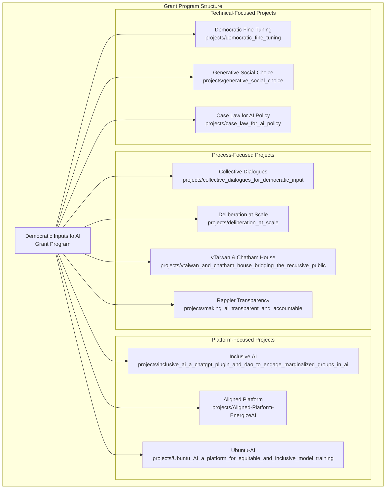
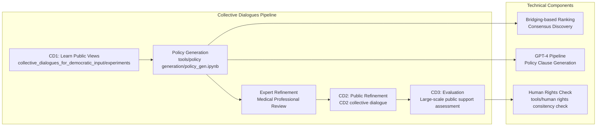
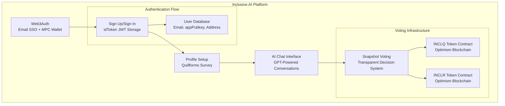
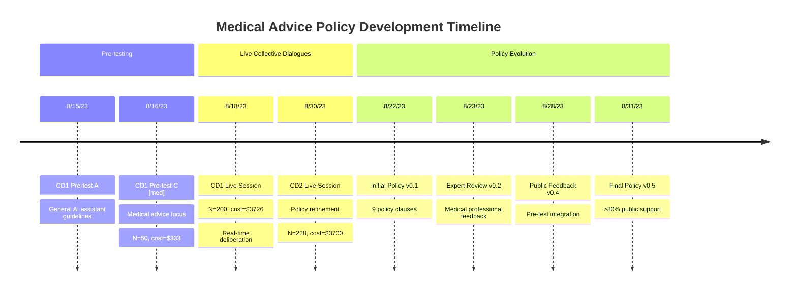
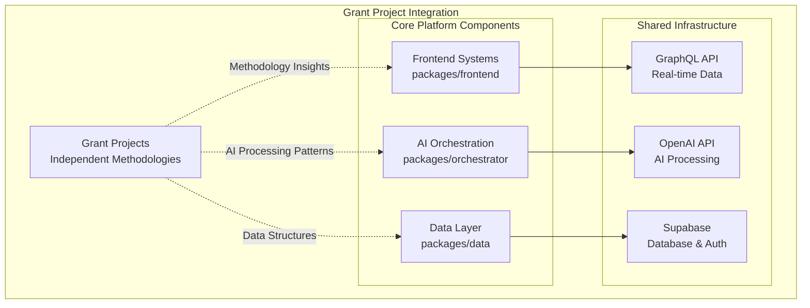

<!-- source: DeepWiki mcp.deepwiki.com · repo openai/democratic-inputs · page 7 Grant Projects · fetched 2026-10-26 -->

# Grant Projects

Relevant source files

The following files were used as context for generating this wiki page:

- [README.md](README.md)
- [projects/collective_dialogues_for_democratic_input/README.md](projects/collective_dialogues_for_democratic_input/README.md)
- [projects/collective_dialogues_for_democratic_input/experiments/research_log.md](projects/collective_dialogues_for_democratic_input/experiments/research_log.md)
- [projects/inclusive_ai_a_chatgpt_plugin_and_dao_to_engage_marginalized_groups_in_ai/README.md](projects/inclusive_ai_a_chatgpt_plugin_and_dao_to_engage_marginalized_groups_in_ai/README.md)
- [projects/making_ai_transparent_and_accountable/README.md](projects/making_ai_transparent_and_accountable/README.md)
- [projects/vtaiwan_and_chatham_house_bridging_the_recursive_public/README.md](projects/vtaiwan_and_chatham_house_bridging_the_recursive_public/README.md)

This page documents the individual funded projects within OpenAI's Democratic Inputs to AI grant program, which awarded 10 teams to develop and test innovative processes for democratic governance of AI systems. Each project explores different methodological approaches to collecting and integrating public input into AI policy development.

For documentation of the core deliberation platform infrastructure that supports some of these projects, see [System Architecture](#2). For details on the collective dialogues methodology specifically, see [Collective Dialogues Project](#7.1).

## Program Overview

The Democratic Inputs to AI grant program represents a comprehensive exploration of democratic mechanisms for AI governance. The program funded diverse approaches ranging from deliberative processes to technical platforms, each addressing different aspects of the challenge of incorporating public input into AI policy.

**Project Integration Overview**
This diagram shows how the 10 funded projects are organized by their primary methodological approach, with each project located in its respective directory within the monorepo structure.

Sources: [README.md:1-183]()

## Project Categories and Methodologies

### Process-Driven Democratic Input

These projects focus on developing scalable deliberative processes for collecting and synthesizing public opinion on AI governance questions.

| Project | Core Methodology | Technical Implementation | Key Outputs |
|---------|------------------|-------------------------|-------------|
| Collective Dialogues | Bridging-based consensus finding | GPT-4 policy generation pipeline | AI medical advice policies |
| Deliberation at Scale | Small group video conversations | AI-facilitated discussion management | Consensus through structured dialogue |
| vTaiwan & Chatham House | Recursive public methodology | Adapted vTaiwan platform | Connected participatory processes |
| Rappler Transparency | Offline-online hybrid processes | Text/audio synthesis via LLMs | Policy ideas from focus groups |

**Collective Dialogues Process Flow**

**Collective Dialogues Technical Implementation**
This shows the systematic process used by the collective dialogues project to transform public input into validated AI policies through multiple stages of refinement.

Sources: [projects/collective_dialogues_for_democratic_input/README.md:1-49](), [projects/collective_dialogues_for_democratic_input/experiments/research_log.md:1-500]()

### Platform-Based Democratic Mechanisms

These projects created technical platforms that enable democratic participation in AI governance decisions.

**Inclusive.AI Architecture**

**Inclusive.AI Platform Components**
This diagram illustrates the technical architecture of the Inclusive.AI platform, showing how Web3 authentication integrates with democratic voting mechanisms through blockchain-based tokens.

The platform uses several key technical components:
- `Web3Auth` for generating MPC wallets while maintaining simple email-based authentication
- `Snapshot` spaces and proposals for transparent voting on value questions
- `INCLQ` and `INCLR` vote token contracts deployed on Optimism for gas-efficient voting
- `Quillforms` for profile data collection to ensure representative participation

Sources: [projects/inclusive_ai_a_chatgpt_plugin_and_dao_to_engage_marginalized_groups_in_ai/README.md:1-83]()

### Technical Innovation Projects

These projects focused on novel technical approaches to incorporating democratic input directly into AI model development and evaluation.

```mermaid
graph LR
    subgraph "Technical Innovation Approaches"
        
        subgraph "Democratic Fine-Tuning"
            CHAT_DIALOGUE["Chat Dialogues<br/>Value Elicitation"]
            MORAL_GRAPH["Moral Graph<br/>Value Relationships"]
            MODEL_TUNING["Model Fine-Tuning<br/>Alignment Process"]
            
            CHAT_DIALOGUE --> MORAL_GRAPH
            MORAL_GRAPH --> MODEL_TUNING
        end
        
        subgraph "Generative Social Choice"
            FREE_TEXT["Free-text Opinions<br/>Large-scale Collection"]
            DISTILLATION["Mathematical Distillation<br/>Social Choice Theory"]
            SLATE["Concise Slate<br/>Fair Representation"]
            
            FREE_TEXT --> DISTILLATION
            DISTILLATION --> SLATE
        end
        
        subgraph "Case Law Approach"
            SCENARIOS["AI Interaction Scenarios<br/>Case Repository"]
            EXPERT_JUDGMENT["Expert + Laypeople<br/>Democratic Engagement"]
            CASE_LAW["Case-Law Judgments<br/>AI Policy Framework"]
            
            SCENARIOS --> EXPERT_JUDGMENT
            EXPERT_JUDGMENT --> CASE_LAW
        end
    end
```

**Technical Innovation Methods**
This shows three distinct technical approaches to incorporating democratic input: value-based model fine-tuning, mathematical opinion synthesis, and case-law-inspired policy development.

Sources: [README.md:77-118]()

## Implementation Status and Results

### Completed Experiments

The most extensively documented project is the Collective Dialogues initiative, which completed full end-to-end policy development cycles for three domains:

**Medical Advice Policy Development**

**Medical Advice Policy Evolution Timeline**
This timeline shows the systematic development of AI medical advice policies through multiple rounds of public input, expert review, and refinement.

The final policy (v0.5) includes specific guidelines for:
- Emergency situation assessment and response [projects/collective_dialogues_for_democratic_input/experiments/research_log.md:38-42]()
- Mental health crisis support protocols [projects/collective_dialogues_for_democratic_input/experiments/research_log.md:43-45]()
- Medical information sharing with source prioritization [projects/collective_dialogues_for_democratic_input/experiments/research_log.md:47-51]()
- Basic health advocacy and minor ailment assistance [projects/collective_dialogues_for_democratic_input/experiments/research_log.md:52-55]()

Sources: [projects/collective_dialogues_for_democratic_input/experiments/research_log.md:1-500]()

### Project Outcomes and Metrics

The grant program generated diverse outputs across methodological approaches:

| Project Type | Key Metrics | Technical Artifacts | Policy Outputs |
|--------------|-------------|-------------------|----------------|
| Collective Dialogues | N=1000+ participants, >80% policy support | 10+ Jupyter notebooks, GPT-4 pipelines | Medical, conflict, vaccine policies |
| Inclusive.AI | Web3Auth + Snapshot integration | Vote token contracts on Optimism | DAO governance mechanisms |
| Platform Projects | Multi-modal data synthesis | Custom platforms and interfaces | Process frameworks |
| Technical Projects | Novel algorithmic approaches | Mathematical models, fine-tuning methods | Alignment methodologies |

**Integration with Core Platform**

Several grant projects contributed components that integrate with the main deliberation platform documented elsewhere in this wiki:

**Grant Project and Core Platform Integration**
This shows how insights and methodologies from grant projects inform the development of the main deliberation platform, while sharing common infrastructure components.

Sources: [README.md:1-183](), [projects/collective_dialogues_for_democratic_input/README.md:19-26]()

## Research Contributions and Future Directions

The grant projects collectively demonstrate several key findings for democratic AI governance:

### Methodological Insights

1. **Scalable Deliberation**: Projects like Collective Dialogues prove that structured deliberative processes can work at scale (N=1000+) while maintaining quality consensus outcomes
2. **Technical Integration**: Platforms like Inclusive.AI show how Web3 technologies can enable transparent, sybil-resistant democratic participation
3. **Multi-Modal Synthesis**: Projects demonstrate effective techniques for synthesizing diverse input types (text, audio, structured votes) into coherent policy outputs

### Technical Innovations

The projects contributed several reusable technical patterns:
- Bridging-based consensus algorithms for identifying widely-supported positions
- GPT-4 policy generation pipelines with human validation loops  
- Blockchain-based voting mechanisms with democratic token distribution
- Multi-stage refinement processes incorporating both expert and public feedback

### Open Questions and Future Work

The grant program identified several areas requiring further research:
- Scaling considerations for different democratic input mechanisms
- Integration between multiple democratic input methodologies
- Long-term evaluation of policy effectiveness and public acceptance
- Cross-cultural adaptation of democratic input processes

Sources: [projects/collective_dialogues_for_democratic_input/experiments/research_log.md:171-183](), [projects/collective_dialogues_for_democratic_input/README.md:1-49]()

---

