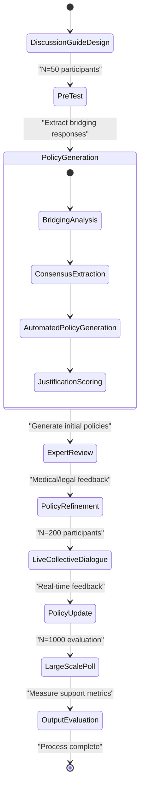
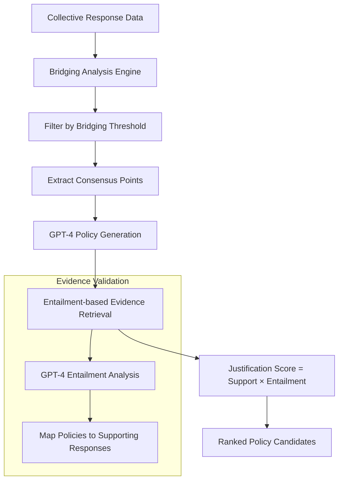
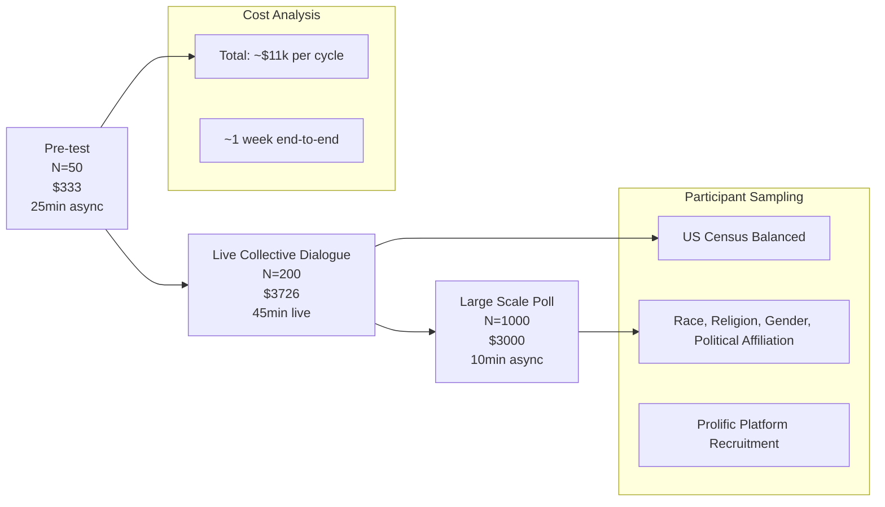
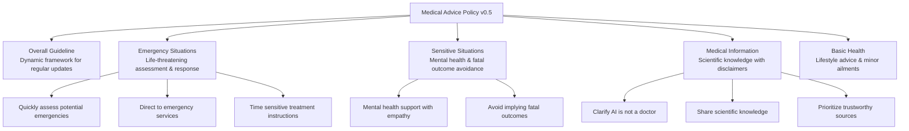
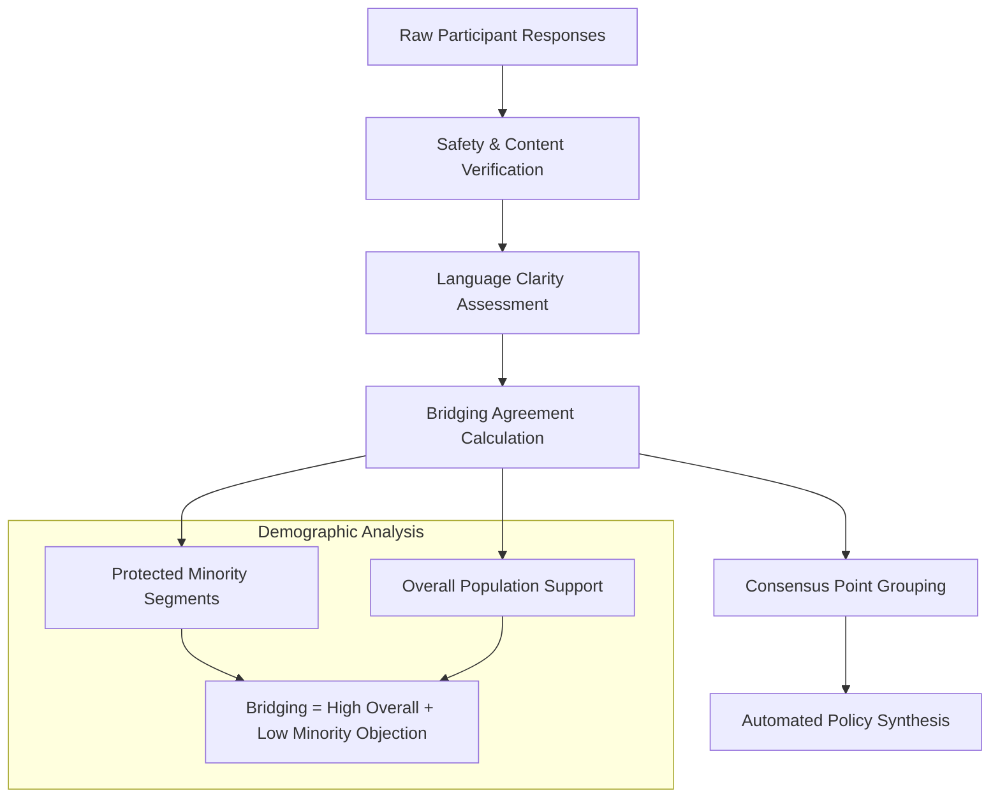

<!-- source: DeepWiki mcp.deepwiki.com · repo openai/democratic-inputs · page 7.1 Collective Dialogues Project · fetched 2026-10-26 -->

# Collective Dialogues Project

Relevant source files

The following files were used as context for generating this wiki page:

- [projects/collective_dialogues_for_democratic_input/experiments/research_log.md](projects/collective_dialogues_for_democratic_input/experiments/research_log.md)

## Purpose and Scope

The Collective Dialogues Project implements a systematic approach for democratic policy development using AI-moderated public deliberation. This project focuses specifically on generating AI governance policies through structured collective dialogues, expert consultation, and large-scale public evaluation. The system combines real-time public participation with automated policy synthesis to create democratically-informed AI safety guidelines.

This documentation covers the experimental framework, policy generation pipeline, and iterative refinement processes. For information about the broader deliberation platform architecture, see [System Architecture](#2). For details about AI moderation systems, see [AI Orchestration System](#5).

## System Overview

The Collective Dialogues Project operates as a multi-phase democratic input system that transforms public deliberation into actionable AI policies. The system cycles through collective dialogue sessions, expert review, policy refinement, and public evaluation to generate policies with measurable democratic support.

### Process Architecture

**Sources:** [projects/collective_dialogues_for_democratic_input/experiments/research_log.md:171-184]()

### Core System Components

The project implements four primary output categories from its democratic process:

| Output Type | Description | Measurement |
|-------------|-------------|-------------|
| Proposed Policies | Specific AI governance rules | Text policies with justification scores |
| Public Support | Quantified democratic backing | Percentage support across demographics |
| Design Affordances | System capability requirements | Feature requests from participants |
| New Policy Questions | Emergent governance issues | Topics requiring separate processes |

**Sources:** [projects/collective_dialogues_for_democratic_input/experiments/research_log.md:85-90]()

## Policy Development Pipeline

### Bridging Response Analysis

The system identifies consensus through "bridging agreement" - responses that maintain strong overall support without being objectionable to minority demographic segments. The bridging threshold typically ranges from 39% to 50% depending on participant diversity.

**Sources:** [projects/collective_dialogues_for_democratic_input/experiments/research_log.md:204-206](), [projects/collective_dialogues_for_democratic_input/experiments/research_log.md:232-243]()

### Policy Synthesis Methodology

The system converts bridging responses into structured policies through automated summarization and synthesis. Initial policy generation uses GPT-4 to extract actionable clauses from consensus points, which are then refined through expert feedback and public iteration.

**Example Policy Evolution:**

From bridging response: *"AI should always clarify its limitations and advise seeking a professional doctor"*

To structured policy: *"**Not a doctor**: The AI should always clarify that it's not a qualified medical professional, that it can sometimes make mistakes, and that any medical information it gives should not replace a consultation with a healthcare professional."*

**Sources:** [projects/collective_dialogues_for_democratic_input/experiments/research_log.md:33-55](), [projects/collective_dialogues_for_democratic_input/experiments/research_log.md:142-167]()

## Experimental Framework

### Multi-Scale Testing Architecture

**Sources:** [projects/collective_dialogues_for_democratic_input/experiments/research_log.md:171-184]()

### Iterative Refinement Process

The project implements systematic iteration across multiple dimensions:

1. **Discussion Guide Refinement**: Testing different prompts and contexts to generate more nuanced responses
2. **Policy Scope Narrowing**: Moving from general AI safety to specific domains like medical advice
3. **Evidence Retrieval Improvement**: Transitioning from semantic similarity to entailment-based evidence mapping

**Sources:** [projects/collective_dialogues_for_democratic_input/experiments/research_log.md:316-320](), [projects/collective_dialogues_for_democratic_input/experiments/research_log.md:204-206]()

## Medical Advice Policy Case Study

### Problem Formulation

The project focused on developing policies for "how AI assistants should handle medical advice" as a concrete test case for the democratic input process. This domain provided sufficient complexity to generate nuanced policies while remaining bounded enough for effective deliberation.

### Generated Policy Framework

The final policy (v0.5) structured medical advice governance into five categories:

**Sources:** [projects/collective_dialogues_for_democratic_input/experiments/research_log.md:33-55]()

### Public Support Metrics

The refined policy achieved >80% public support in large-scale testing, with specific citizen statements documenting both supporting and opposing arguments. The system captured quantified reasoning for policy positions, enabling evidence-based refinement.

**Citizens' Statement Structure:**
- **Reasons to support**: Foundation for assistance, safety focus, consistent framework, harm prevention
- **Reasons to not support**: Misinformation risks, privacy concerns, empathy limitations, over-restraint

**Sources:** [projects/collective_dialogues_for_democratic_input/experiments/research_log.md:10-27]()

## Data Processing and Analysis

### Response Classification System

The system processes collective dialogue responses through multiple analytical layers:

**Sources:** [projects/collective_dialogues_for_democratic_input/experiments/research_log.md:213-214](), [projects/collective_dialogues_for_democratic_input/experiments/research_log.md:232-243]()

### Quality Assessment Framework

The project implements multiple quality metrics for evaluating democratic input effectiveness:

- **Deliberation Quality**: Measured by view changes (e.g., 30% of AI pessimists becoming optimists)
- **Response Nuance**: Assessed by policy specificity compared to baseline discussions
- **Justification Strength**: Product of bridging support and entailment degree
- **Expert Validation**: Medical professional feedback on policy feasibility

**Sources:** [projects/collective_dialogues_for_democratic_input/experiments/research_log.md:186-191](), [projects/collective_dialogues_for_democratic_input/experiments/research_log.md:95-118]()