# Page: Overview

# Overview

<details>
<summary>Relevant source files</summary>

The following files were used as context for generating this wiki page:

- [README.md](README.md)
- [projects/collective_dialogues_for_democratic_input/README.md](projects/collective_dialogues_for_democratic_input/README.md)
- [projects/inclusive_ai_a_chatgpt_plugin_and_dao_to_engage_marginalized_groups_in_ai/README.md](projects/inclusive_ai_a_chatgpt_plugin_and_dao_to_engage_marginalized_groups_in_ai/README.md)
- [projects/making_ai_transparent_and_accountable/README.md](projects/making_ai_transparent_and_accountable/README.md)
- [projects/vtaiwan_and_chatham_house_bridging_the_recursive_public/README.md](projects/vtaiwan_and_chatham_house_bridging_the_recursive_public/README.md)

</details>


## Purpose and Scope

This documentation covers the OpenAI Democratic Inputs repository, a collection of funded research projects exploring democratic governance mechanisms for AI systems. The repository contains code, tools, and experimental results from 10 teams who developed and tested various approaches to incorporating public input into AI decision-making processes.

This overview introduces the repository structure, grant program context, and key systems. For detailed technical architecture of the deliberation platform, see [System Architecture](#2). For information about specific grant projects and their methodologies, see [Grant Projects](#7).

## Repository Structure

The repository is organized as a collection of independent grant projects, each exploring different approaches to democratic AI governance:

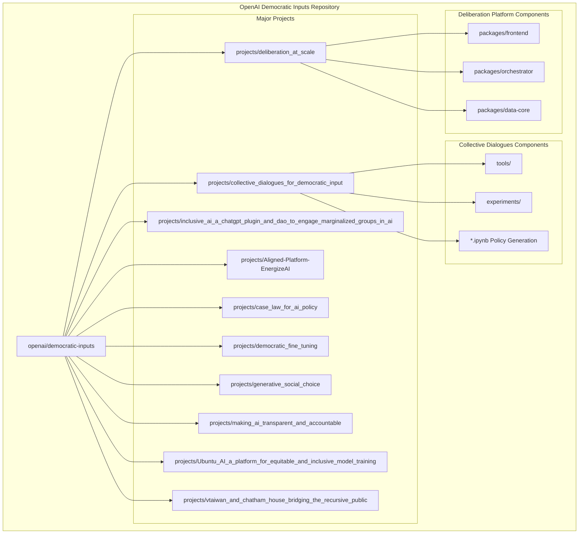

Sources: [README.md:1-184](), [projects/collective_dialogues_for_democratic_input/README.md:1-49]()

## Grant Program Overview

The Democratic Inputs to AI grant program funded 10 teams to develop processes for incorporating public input into AI governance. Each project represents a different methodology for democratic participation:

| Project | Approach | Key Innovation |
|---------|----------|----------------|
| **Collective Dialogues** | Large-scale deliberation with AI synthesis | Bridging-based ranking for consensus discovery |
| **Deliberation at Scale** | Small group video discussions | AI-facilitated conversation progression |
| **Inclusive.AI** | DAO-based decision making | Web3 voting tokens for marginalized groups |
| **Democratic Fine-Tuning** | Value elicitation through chat | Moral graphs for model alignment |
| **Aligned Platform** | Community notes algorithm | Live, large-scale participation |
| **Generative Social Choice** | Mathematical fair representation | Distilling opinions into representative slates |
| **Case Law for AI Policy** | Expert-layperson collaboration | Building case repositories for AI scenarios |
| **vTaiwan Recursive Public** | Adapted Taiwan methodology | Connected participatory processes |
| **Rappler Transparency** | Offline-online integration | AI synthesis of focus group discussions |
| **Ubuntu-AI** | Equitable model training | Value return to content creators |

Sources: [README.md:9-184](), [projects/collective_dialogues_for_democratic_input/README.md:9-18](), [projects/inclusive_ai_a_chatgpt_plugin_and_dao_to_engage_marginalized_groups_in_ai/README.md:1-6]()

## Key Technical Systems

The repository contains two major technical platforms with distinct architectures:

### Collective Dialogues Pipeline

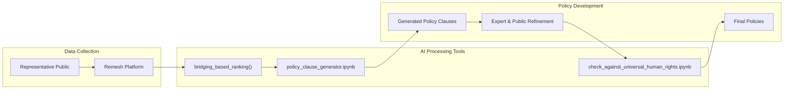

Sources: [projects/collective_dialogues_for_democratic_input/README.md:11-25]()

### Deliberation Platform Architecture

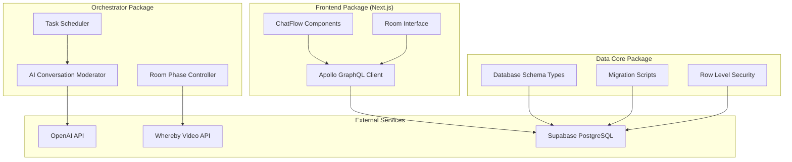

Sources: Based on system architecture diagrams provided in context

## Project Implementation Status

The projects vary significantly in their implementation completeness and technical sophistication:

**Production-Ready Systems:**
- **Collective Dialogues**: Complete pipeline with 10+ Jupyter notebooks, tested on 3 policy areas (medical advice, war/conflict, vaccine information)
- **Deliberation at Scale**: Full-stack platform with real-time video, AI moderation, and multi-language support

**Prototype/Research Systems:**
- **Inclusive.AI**: DAO voting system with Web3Auth integration and Optimism blockchain deployment
- **Democratic Fine-Tuning**: Value elicitation chat system for model alignment research

**Research Reports Only:**
- Several projects provided primarily research findings and methodological documentation without complete codebases

Sources: [projects/collective_dialogues_for_democratic_input/README.md:27-41](), [projects/inclusive_ai_a_chatgpt_plugin_and_dao_to_engage_marginalized_groups_in_ai/README.md:9-83]()

## Navigation Guide

This wiki is organized to provide both high-level context and deep technical details:

- **System Architecture** [](#2): Technical overview of the deliberation platform's monorepo structure
- **Database Schema & Data Layer** [](#3): Complete data model documentation  
- **Frontend Systems** [](#4): Next.js frontend architecture and user interfaces
- **AI Orchestration System** [](#5): Backend AI-powered conversation management
- **Localization System** [](#6): Multi-language support implementation
- **Grant Projects** [](#7): Individual project documentation and methodologies

The repository demonstrates various approaches to democratic AI governance, from large-scale policy development pipelines to intimate small-group deliberation platforms, providing a comprehensive exploration of how technology can support democratic participation in AI decision-making.

---

# Page: System Architecture

# System Architecture

<details>
<summary>Relevant source files</summary>

The following files were used as context for generating this wiki page:

- [projects/deliberation_at_scale/package-lock.json](projects/deliberation_at_scale/package-lock.json)
- [projects/deliberation_at_scale/package.json](projects/deliberation_at_scale/package.json)
- [projects/deliberation_at_scale/packages/data-core/package.json](projects/deliberation_at_scale/packages/data-core/package.json)
- [projects/deliberation_at_scale/packages/frontend/package.json](projects/deliberation_at_scale/packages/frontend/package.json)
- [projects/deliberation_at_scale/packages/orchestrator/.env.example](projects/deliberation_at_scale/packages/orchestrator/.env.example)
- [projects/deliberation_at_scale/packages/orchestrator/.eslintrc.js](projects/deliberation_at_scale/packages/orchestrator/.eslintrc.js)
- [projects/deliberation_at_scale/packages/orchestrator/package-lock.json](projects/deliberation_at_scale/packages/orchestrator/package-lock.json)
- [projects/deliberation_at_scale/packages/orchestrator/package.json](projects/deliberation_at_scale/packages/orchestrator/package.json)
- [projects/deliberation_at_scale/packages/orchestrator/src/index.ts](projects/deliberation_at_scale/packages/orchestrator/src/index.ts)
- [projects/deliberation_at_scale/packages/orchestrator/src/listener.ts](projects/deliberation_at_scale/packages/orchestrator/src/listener.ts)
- [projects/deliberation_at_scale/packages/orchestrator/src/runner.ts](projects/deliberation_at_scale/packages/orchestrator/src/runner.ts)
- [projects/deliberation_at_scale/packages/orchestrator/src/scheduler.ts](projects/deliberation_at_scale/packages/orchestrator/src/scheduler.ts)

</details>


This document provides a comprehensive overview of the Deliberation at Scale platform architecture, covering the monorepo structure, core packages, and system integrations. It focuses on the technical implementation details and code organization that powers the democratic input platform.

For information about specific AI conversation management, see [AI Orchestration System](#5). For details about the database schema and data relationships, see [Database Schema & Data Layer](#3). For frontend-specific architecture, see [Frontend Systems](#4).

## Overview

The Deliberation at Scale platform is implemented as a Node.js monorepo containing three primary packages that work together to facilitate AI-moderated group deliberations. The system combines real-time web technologies, AI processing pipelines, and structured conversation management to enable scalable democratic input processes.

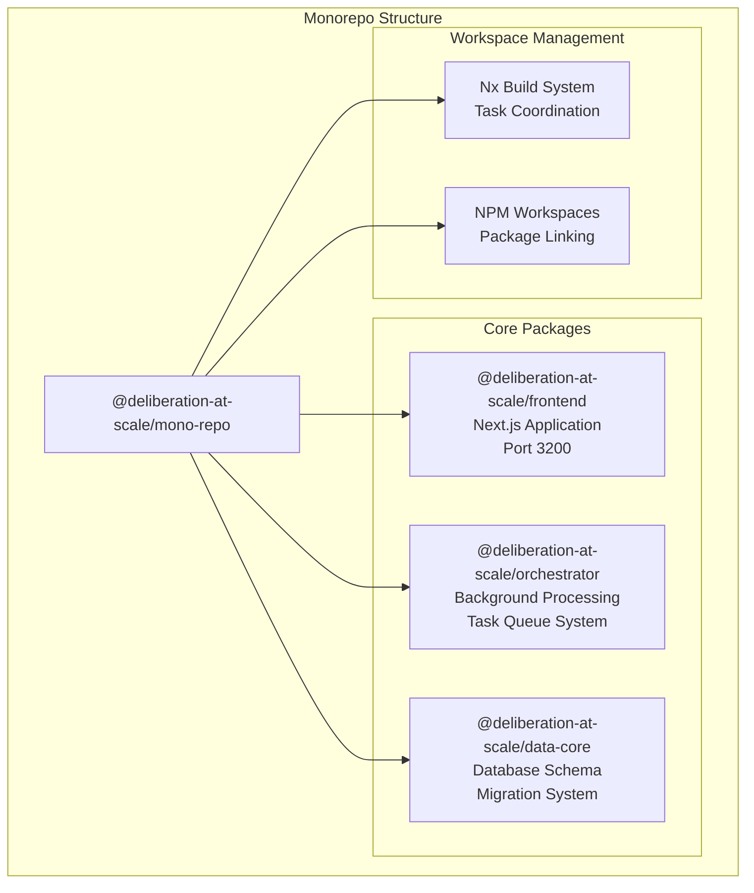

**Sources:** [projects/deliberation_at_scale/package.json:1-31](), [projects/deliberation_at_scale/package-lock.json:1-24]()

## Package Architecture

### Frontend Package

The frontend package implements a Next.js application serving as the user interface for deliberation sessions. It handles user registration, real-time chat, video integration, and voting interfaces.

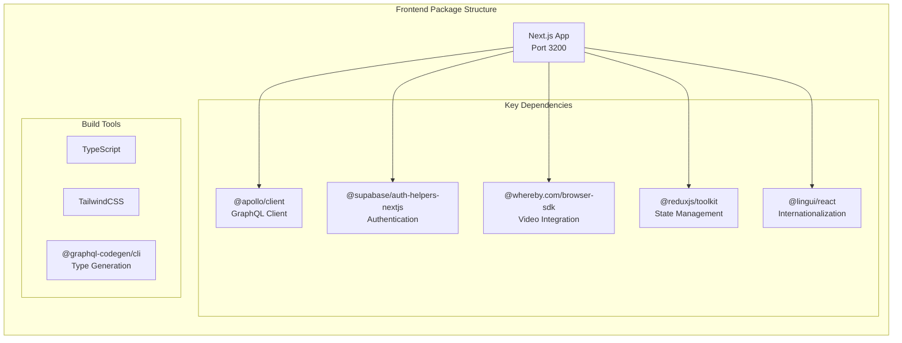

**Sources:** [projects/deliberation_at_scale/packages/frontend/package.json:1-98]()

### Orchestrator Package

The orchestrator package manages background task processing, AI integration, and conversation flow control through a sophisticated worker system built on Graphile Worker.

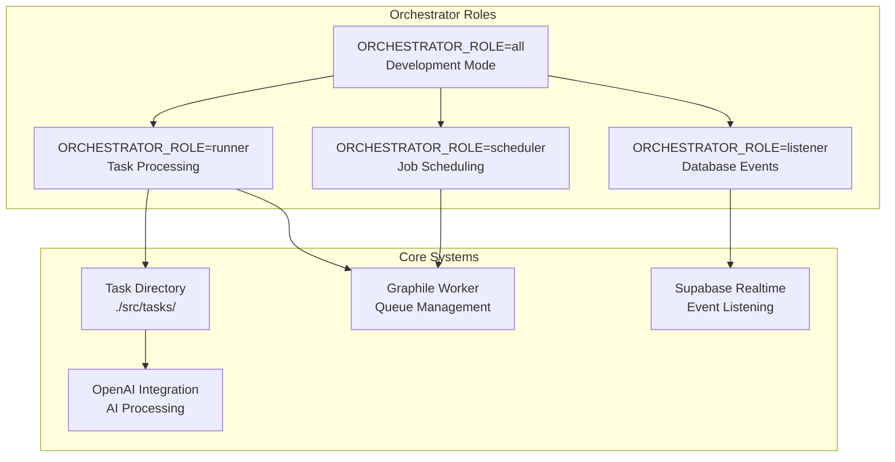

**Sources:** [projects/deliberation_at_scale/packages/orchestrator/package.json:1-50](), [projects/deliberation_at_scale/packages/orchestrator/src/index.ts:16-41]()

### Data Core Package

The data core package provides database schema management, migrations, and type generation for the entire platform using Drizzle ORM and Supabase.

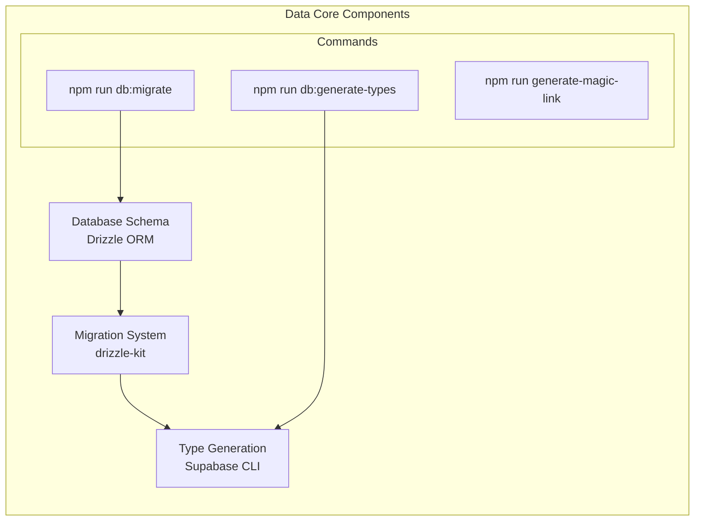

**Sources:** [projects/deliberation_at_scale/packages/data-core/package.json:1-48]()

## External Service Integration

The platform integrates with several external services to provide comprehensive functionality:

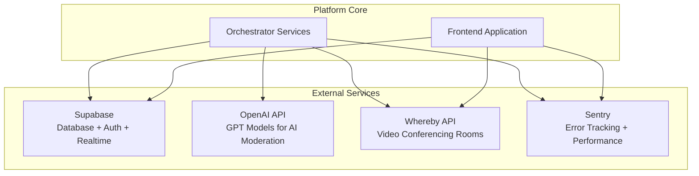

**Sources:** [projects/deliberation_at_scale/packages/orchestrator/.env.example:1-10](), [projects/deliberation_at_scale/packages/frontend/package.json:26-63]()

## Task Processing System

The orchestrator implements a sophisticated task processing system that manages the AI-powered conversation flow:

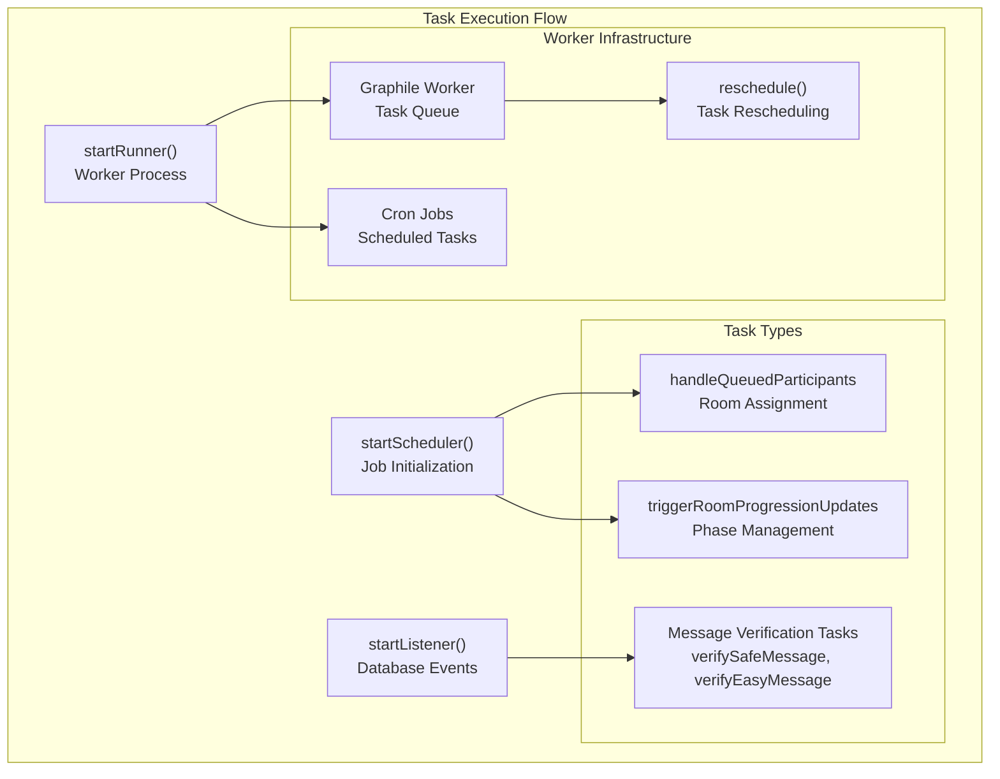

**Sources:** [projects/deliberation_at_scale/packages/orchestrator/src/scheduler.ts:6-16](), [projects/deliberation_at_scale/packages/orchestrator/src/runner.ts:9-37](), [projects/deliberation_at_scale/packages/orchestrator/src/listener.ts:10-57]()

## Real-time Data Flow

The platform implements a comprehensive real-time data synchronization system:

```mermaid
graph LR
    subgraph "Frontend State"
        APOLLO_CACHE["Apollo Client Cache<br/>GraphQL State"]
        REDUX_STORE["Redux Store<br/>Application State"]
    end
    
    subgraph "Real-time Layer"
        SUPABASE_RT["Supabase Realtime<br/>postgres_changes Events"]
        GRAPHQL_API["GraphQL API<br/>Queries + Mutations"]
    end
    
    subgraph "Background Processing"
        MESSAGE_LISTENER["Message INSERT Listener<br/>startMessageListener()"]
        TASK_QUEUE["Graphile Worker Queue<br/>quickAddJob()"]
        AI_TASKS["AI Processing Tasks<br/>verifySafeMessage, etc."]
    end
    
    APOLLO_CACHE --> GRAPHQL_API
    REDUX_STORE --> APOLLO_CACHE
    
    GRAPHQL_API --> SUPABASE_RT
    SUPABASE_RT --> MESSAGE_LISTENER
    MESSAGE_LISTENER --> TASK_QUEUE
    TASK_QUEUE --> AI_TASKS
```

**Sources:** [projects/deliberation_at_scale/packages/orchestrator/src/listener.ts:20-56](), [projects/deliberation_at_scale/packages/frontend/package.json:27-28]()

## Technology Stack Summary

| Component | Technology | Purpose |
|-----------|------------|---------|
| **Frontend Framework** | Next.js 13.5.9 | React-based web application |
| **State Management** | Redux Toolkit + Apollo Client | Client-side state and GraphQL caching |
| **Backend Processing** | Node.js + Graphile Worker | Background task processing |
| **Database** | PostgreSQL via Supabase | Primary data storage |
| **Real-time** | Supabase Realtime | Live data synchronization |
| **AI Integration** | OpenAI API (GPT models) | Conversation moderation and guidance |
| **Video** | Whereby Browser SDK | Video conferencing |
| **Build System** | Nx + TypeScript | Monorepo management |
| **Internationalization** | Lingui | Multi-language support |
| **Error Tracking** | Sentry | Production monitoring |

## Development and Deployment

The system supports multiple deployment configurations through environment-based role assignment:

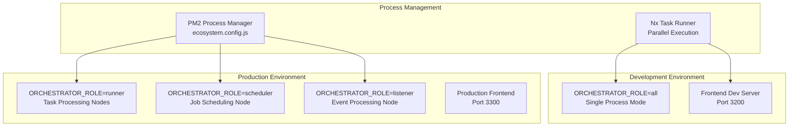

**Sources:** [projects/deliberation_at_scale/packages/orchestrator/src/index.ts:43-64](), [projects/deliberation_at_scale/packages/orchestrator/package.json:13-18](), [projects/deliberation_at_scale/package.json:6-13]()

---

# Page: Database Schema & Data Layer

# Database Schema & Data Layer

<details>
<summary>Relevant source files</summary>

The following files were used as context for generating this wiki page:

- [projects/deliberation_at_scale/packages/data-core/src/database/migrations/0000_tough_marten_broadcloak.sql](projects/deliberation_at_scale/packages/data-core/src/database/migrations/0000_tough_marten_broadcloak.sql)
- [projects/deliberation_at_scale/packages/data-core/src/database/migrations/0005_typical_mac_gargan.sql](projects/deliberation_at_scale/packages/data-core/src/database/migrations/0005_typical_mac_gargan.sql)
- [projects/deliberation_at_scale/packages/data-core/src/database/migrations/0027_spooky_sentinels.sql](projects/deliberation_at_scale/packages/data-core/src/database/migrations/0027_spooky_sentinels.sql)
- [projects/deliberation_at_scale/packages/data-core/src/database/migrations/0030_colorful_patriot.sql](projects/deliberation_at_scale/packages/data-core/src/database/migrations/0030_colorful_patriot.sql)
- [projects/deliberation_at_scale/packages/data-core/src/database/migrations/0036_real_ben_parker.sql](projects/deliberation_at_scale/packages/data-core/src/database/migrations/0036_real_ben_parker.sql)
- [projects/deliberation_at_scale/packages/data-core/src/database/migrations/0037_chemical_overlord.sql](projects/deliberation_at_scale/packages/data-core/src/database/migrations/0037_chemical_overlord.sql)
- [projects/deliberation_at_scale/packages/data-core/src/database/migrations/0041_free_talisman.sql](projects/deliberation_at_scale/packages/data-core/src/database/migrations/0041_free_talisman.sql)
- [projects/deliberation_at_scale/packages/data-core/src/database/migrations/meta/0000_snapshot.json](projects/deliberation_at_scale/packages/data-core/src/database/migrations/meta/0000_snapshot.json)
- [projects/deliberation_at_scale/packages/data-core/src/database/migrations/meta/0005_snapshot.json](projects/deliberation_at_scale/packages/data-core/src/database/migrations/meta/0005_snapshot.json)
- [projects/deliberation_at_scale/packages/data-core/src/database/migrations/meta/0027_snapshot.json](projects/deliberation_at_scale/packages/data-core/src/database/migrations/meta/0027_snapshot.json)
- [projects/deliberation_at_scale/packages/data-core/src/database/migrations/meta/0030_snapshot.json](projects/deliberation_at_scale/packages/data-core/src/database/migrations/meta/0030_snapshot.json)
- [projects/deliberation_at_scale/packages/data-core/src/database/migrations/meta/0041_snapshot.json](projects/deliberation_at_scale/packages/data-core/src/database/migrations/meta/0041_snapshot.json)
- [projects/deliberation_at_scale/packages/data-core/src/database/migrations/meta/_journal.json](projects/deliberation_at_scale/packages/data-core/src/database/migrations/meta/_journal.json)
- [projects/deliberation_at_scale/packages/data-core/src/database/schema.ts](projects/deliberation_at_scale/packages/data-core/src/database/schema.ts)
- [projects/deliberation_at_scale/packages/data-core/src/database/types.ts](projects/deliberation_at_scale/packages/data-core/src/database/types.ts)
- [projects/deliberation_at_scale/packages/frontend/components/ChatFlow/LobbyChatFlow.tsx](projects/deliberation_at_scale/packages/frontend/components/ChatFlow/LobbyChatFlow.tsx)
- [projects/deliberation_at_scale/packages/frontend/hooks/useProfile.ts](projects/deliberation_at_scale/packages/frontend/hooks/useProfile.ts)
- [projects/deliberation_at_scale/packages/frontend/state/queries/UpdateNickName.graphql](projects/deliberation_at_scale/packages/frontend/state/queries/UpdateNickName.graphql)
- [projects/deliberation_at_scale/packages/frontend/state/slices/profile.ts](projects/deliberation_at_scale/packages/frontend/state/slices/profile.ts)
- [projects/deliberation_at_scale/packages/frontend/types/database.ts](projects/deliberation_at_scale/packages/frontend/types/database.ts)

</details>


This document covers the database design, schema structure, and data access patterns for the deliberation platform. It focuses on the PostgreSQL database schema, entity relationships, migration system, and how the application layers interact with persistent data storage.

For information about real-time data synchronization and GraphQL queries, see [Real-time Data & GraphQL](#4.2). For details about AI-powered data processing workflows, see [AI Orchestration System](#5).

## Database Technology Stack

The platform uses PostgreSQL as the primary database with Supabase as the hosting provider. The data layer is built using:

- **Drizzle ORM** for schema definition and type-safe database operations
- **PostgreSQL** with Row Level Security (RLS) for data access control  
- **Supabase** for database hosting, authentication, and real-time subscriptions
- **GraphQL** via pg_graphql for API layer data access

Sources: [projects/deliberation_at_scale/packages/data-core/src/database/schema.ts:1-13]()

## Core Database Entities

### Entity Relationship Overview

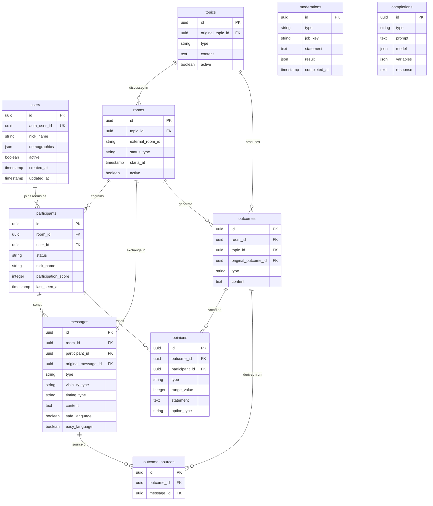

Sources: [projects/deliberation_at_scale/packages/data-core/src/database/schema.ts:115-358]()

### Primary Entity Types

The database schema is organized around several core entity types that represent different aspects of the deliberation process:

| Entity | Purpose | Key Relationships |
|--------|---------|-------------------|
| `users` | Authentication and user profiles | Links to Supabase auth, has many participants |
| `topics` | Discussion subjects | Can be original or remixed, used in rooms |
| `rooms` | Deliberation sessions | Contains participants, progresses through status phases |
| `participants` | User sessions in rooms | Bridges users and rooms, tracks participation |
| `messages` | Chat and bot communications | Sent by participants, can be moderated |
| `outcomes` | Discussion results and consensus | Generated from messages, can be voted on |
| `opinions` | Participant votes and feedback | Expressed on outcomes by participants |

Sources: [projects/deliberation_at_scale/packages/data-core/src/database/schema.ts:17-28]()

### Enumerated Types and Status Flows

The schema defines several enums that control entity state transitions:

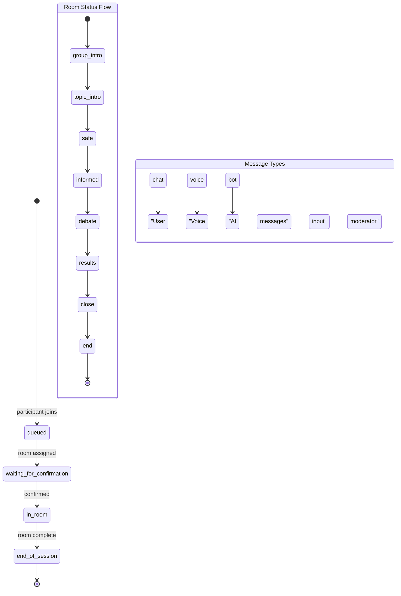

**Key Enums:**
- `participantStatusType`: `queued`, `waiting_for_confirmation`, `in_room`, `end_of_session`
- `roomStatusType`: `group_intro`, `topic_intro`, `safe`, `informed`, `debate`, `results`, `close`, `end`
- `messageType`: `chat`, `voice`, `bot`
- `outcomeType`: `milestone`, `consensus`, `off_topic`, `seed_statement`
- `opinionOptionType`: `agree`, `maybe`, `disagree`, `wrong`

Sources: [projects/deliberation_at_scale/packages/data-core/src/database/schema.ts:54-114]()

## Schema Evolution and Migration System

### Migration Architecture

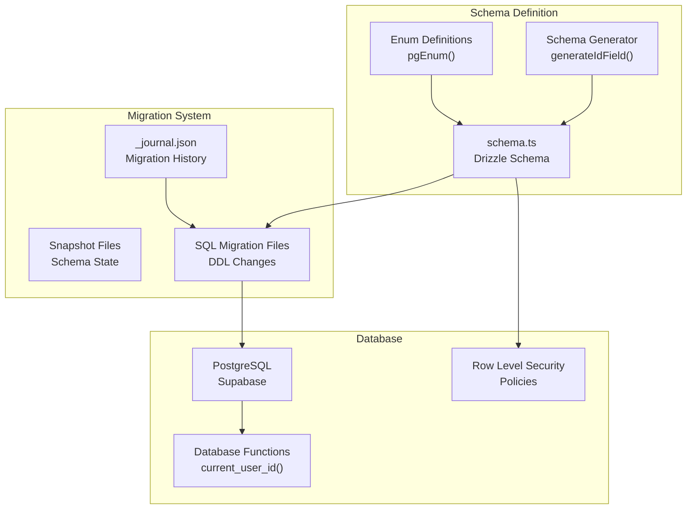

The migration system tracks 43 migrations from initial schema to current state, with each migration including:

- **DDL Changes**: Table creation, column additions, index creation
- **Security Policies**: RLS policy definitions for data access control
- **Helper Functions**: Database functions for user identification and data processing

**Migration Highlights:**
- Migration 0000: Initial schema with core entities
- Migration 0027: Addition of events table and participant demographics
- Migration 0036-0037: Help requests system for technical support
- Migration 0041: Seed statement outcome type addition

Sources: [projects/deliberation_at_scale/packages/data-core/src/database/migrations/meta/_journal.json:1-314](), [projects/deliberation_at_scale/packages/data-core/src/database/migrations/0000_tough_marten_broadcloak.sql:1-462]()

### Schema Generation Patterns

The schema uses consistent patterns for entity definition:

```typescript
// Example pattern from schema.ts
export const participants = pgTable(PARTICIPANTS_TABLE_NAME, {
    id: generateIdField(),
    active: generateActiveField(),
    status: participantStatusType("status").notNull().default("queued"),
    roomId: uuid(ROOM_ID_FIELD_NAME).references(() => rooms.id),
    userId: uuid(USER_ID_FIELD_NAME).references(() => users.id),
    nickName: generateNickNameField(),
    participationScore: integer("participation_score").notNull().default(0),
    ...generateTimestampFields(),
}, (table) => ({
    ...generateActiveFieldIndex(table),
    ...generateTimestampFieldIndexes(table),
}));
```

**Common Patterns:**
- `generateIdField()`: UUID primary keys with random defaults
- `generateActiveField()`: Boolean flags for soft deletion
- `generateTimestampFields()`: Created/updated timestamp tracking
- Comprehensive indexing on foreign keys and frequently queried fields

Sources: [projects/deliberation_at_scale/packages/data-core/src/database/schema.ts:360-426]()

## Data Access and Security Model

### Row Level Security Implementation

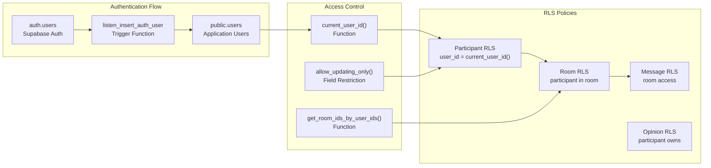

The database implements comprehensive Row Level Security with these key policies:

**User Data Access:**
- Users can only access their own profile data
- Participants can only see other participants in their rooms
- Messages are restricted to room participants

**Data Modification Controls:**
- Participants can only update specific fields (`last_seen_at`, `status`)
- Opinions can only be modified by their creators
- Service role has elevated permissions for AI operations

**Key Security Functions:**
- `current_user_id()`: Maps Supabase auth to internal user IDs
- `get_room_ids_by_user_ids()`: Determines accessible rooms per user
- `allow_updating_only()`: Restricts field-level modifications

Sources: [projects/deliberation_at_scale/packages/data-core/src/database/migrations/0027_spooky_sentinels.sql:18-209]()

### AI Integration and Background Processing

The schema includes specialized tables for AI-powered features:

| Table | Purpose | Integration |
|-------|---------|-------------|
| `moderations` | AI moderation results | Tracks safety and consensus analysis |
| `completions` | OpenAI API responses | Stores prompts and generated content |
| `help_requests` | Technical support | Facilitates human intervention |

**AI Data Flow:**
1. User messages trigger moderation jobs via `moderations` table
2. Completed analysis stored in `result` JSON field  
3. Consensus outcomes generated through `completions` table
4. Background workers process via Graphile Worker integration

Sources: [projects/deliberation_at_scale/packages/data-core/src/database/schema.ts:321-358]()

## Type Safety and Code Integration

### Generated Types and GraphQL

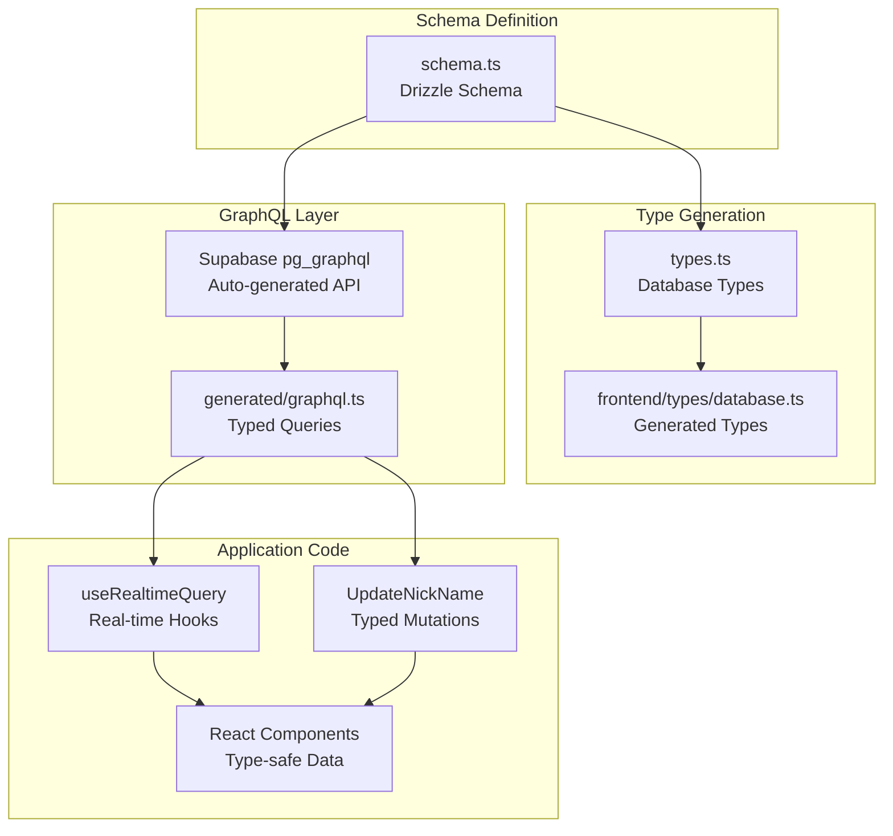

The type system ensures end-to-end type safety from database to UI:

**Database Type Definitions:**
- Complete TypeScript interfaces for all tables
- Insert/Update/Select type variants
- Relationship type definitions with foreign key constraints

**GraphQL Integration:**
- Auto-generated GraphQL schema from PostgreSQL schema
- Typed queries and mutations via code generation
- Real-time subscription types for live data updates

Sources: [projects/deliberation_at_scale/packages/data-core/src/database/types.ts:1-10](), [projects/deliberation_at_scale/packages/frontend/types/database.ts:1-804]()

## Performance and Indexing Strategy

The schema includes comprehensive indexing for query performance:

**Primary Index Categories:**
- **Entity Lookup**: Primary key and unique constraint indexes
- **Relationship Navigation**: Foreign key indexes on all references  
- **Status Filtering**: Indexes on enum fields (`status`, `type`, etc.)
- **Temporal Queries**: Indexes on timestamp fields (`created_at`, `updated_at`)
- **Business Logic**: Custom indexes on `participation_score`, `last_seen_at`

**Index Examples:**
```sql
-- Participant room filtering
CREATE INDEX room_id_index ON participants (room_id);
CREATE INDEX user_id_index ON participants (user_id);

-- Message chronological access  
CREATE INDEX created_at_index ON messages (created_at);
CREATE INDEX room_id_index ON messages (room_id);

-- Opinion aggregation
CREATE INDEX outcome_id_index ON opinions (outcome_id);
CREATE INDEX participant_id_index ON opinions (participant_id);
```

Sources: [projects/deliberation_at_scale/packages/data-core/src/database/migrations/0005_typical_mac_gargan.sql:1-88]()

---

# Page: Frontend Systems

# Frontend Systems

<details>
<summary>Relevant source files</summary>

The following files were used as context for generating this wiki page:

- [projects/deliberation_at_scale/packages/frontend/app/[lang]/page.tsx](projects/deliberation_at_scale/packages/frontend/app/[lang]/page.tsx)
- [projects/deliberation_at_scale/packages/frontend/app/globals.css](projects/deliberation_at_scale/packages/frontend/app/globals.css)
- [projects/deliberation_at_scale/packages/frontend/app/layout.tsx](projects/deliberation_at_scale/packages/frontend/app/layout.tsx)
- [projects/deliberation_at_scale/packages/frontend/components/LocalMedia/RequestPermissions.tsx](projects/deliberation_at_scale/packages/frontend/components/LocalMedia/RequestPermissions.tsx)
- [projects/deliberation_at_scale/packages/frontend/public/favicon.ico](projects/deliberation_at_scale/packages/frontend/public/favicon.ico)
- [projects/deliberation_at_scale/packages/frontend/public/favicon_io/android-chrome-192x192.png](projects/deliberation_at_scale/packages/frontend/public/favicon_io/android-chrome-192x192.png)
- [projects/deliberation_at_scale/packages/frontend/public/favicon_io/android-chrome-512x512.png](projects/deliberation_at_scale/packages/frontend/public/favicon_io/android-chrome-512x512.png)
- [projects/deliberation_at_scale/packages/frontend/public/favicon_io/apple-touch-icon.png](projects/deliberation_at_scale/packages/frontend/public/favicon_io/apple-touch-icon.png)
- [projects/deliberation_at_scale/packages/frontend/public/favicon_io/favicon-16x16.png](projects/deliberation_at_scale/packages/frontend/public/favicon_io/favicon-16x16.png)
- [projects/deliberation_at_scale/packages/frontend/public/favicon_io/favicon-32x32.png](projects/deliberation_at_scale/packages/frontend/public/favicon_io/favicon-32x32.png)
- [projects/deliberation_at_scale/packages/frontend/public/favicon_io/site.webmanifest](projects/deliberation_at_scale/packages/frontend/public/favicon_io/site.webmanifest)
- [projects/deliberation_at_scale/packages/frontend/state/slices/flow.ts](projects/deliberation_at_scale/packages/frontend/state/slices/flow.ts)

</details>


This document provides an overview of the Next.js frontend architecture that powers the deliberation platform's user-facing interface. It covers the application structure, state management, component organization, and core systems that enable users to participate in democratic deliberations.

For detailed information about the conversational user interface that guides users through registration and deliberation, see [Chat Flow System](#4.1). For real-time data synchronization and GraphQL integration, see [Real-time Data & GraphQL](#4.2). For the user interface components used during active deliberation sessions, see [Room Components](#4.3).

## Application Architecture Overview

The frontend is built as a Next.js 13+ application using the app router pattern with comprehensive internationalization support. The architecture follows a modular design with clear separation between presentation, state management, and data layers.

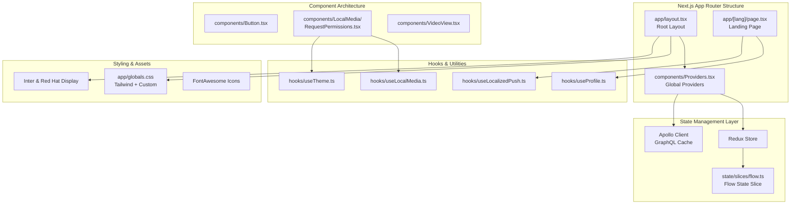

**Frontend Architecture Overview**
This diagram shows the high-level organization of the frontend codebase, from the Next.js app structure down to individual components and utilities.

Sources: [projects/deliberation_at_scale/packages/frontend/app/layout.tsx:1-46](), [projects/deliberation_at_scale/packages/frontend/app/[lang]/page.tsx:1-84](), [projects/deliberation_at_scale/packages/frontend/components/LocalMedia/RequestPermissions.tsx:1-100]()

## Next.js App Router Structure

The application uses Next.js 13's app router with internationalization support through dynamic route segments. The root layout establishes global providers and styling, while language-specific pages handle localized content.

| File | Purpose | Key Features |
|------|---------|--------------|
| `app/layout.tsx` | Root layout component | Font loading, global providers, metadata |
| `app/[lang]/page.tsx` | Internationalized landing page | Authentication flow, welcome content |
| `app/globals.css` | Global styles | Tailwind CSS, custom CSS variables |

The landing page implements a simple authentication flow that redirects logged-in users to their profile:

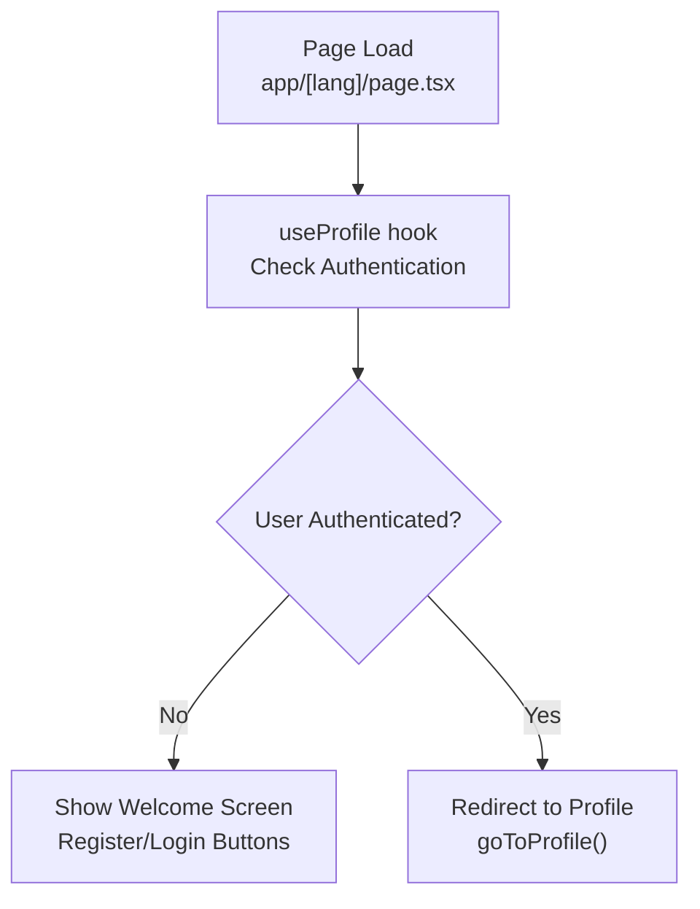

**Landing Page Authentication Flow**
This diagram shows how the main page determines whether to show the welcome screen or redirect authenticated users.

Sources: [projects/deliberation_at_scale/packages/frontend/app/[lang]/page.tsx:14-28]()

## State Management Architecture

The frontend uses Redux Toolkit for global state management, with specialized slices for different aspects of the application. The flow slice manages the conversational UI state across different user journeys.

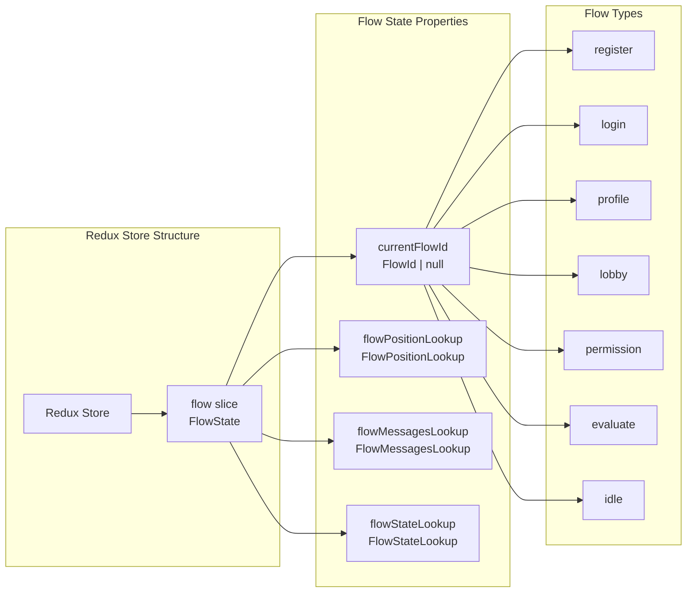

**Redux Flow State Management**
This diagram illustrates the structure of the flow state slice that manages different user interface flows throughout the application.

The flow slice provides actions for managing conversational UI state:

| Action | Purpose | Parameters |
|--------|---------|------------|
| `setCurrentFlow` | Switch between flows | `FlowId` |
| `setFlowPosition` | Navigate within a flow | `flowId`, `deltaPosition`, `maxPosition` |
| `addFlowMessages` | Add messages to flow | `flowId`, `messages[]` |
| `setFlowStateEntry` | Update flow state | `flowId`, `key`, `value` |

Sources: [projects/deliberation_at_scale/packages/frontend/state/slices/flow.ts:1-154]()

## Component Architecture

The frontend follows a component-based architecture with reusable UI elements and specialized components for media handling. Components leverage custom hooks for state management and side effects.

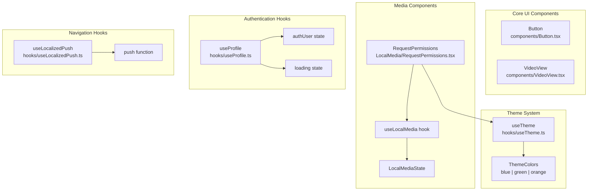

**Component and Hook Architecture**
This diagram shows the relationship between UI components and the custom hooks that provide their functionality.

The `RequestPermissions` component demonstrates the integration of multiple systems:

- **Media Management**: Uses `useLocalMedia` hook to request camera/microphone permissions
- **Theme Integration**: Applies theme-specific colors using `useTheme` hook  
- **State Control**: Manages local component state through the `request` prop
- **Animation**: Integrates Framer Motion for smooth UI transitions

Sources: [projects/deliberation_at_scale/packages/frontend/components/LocalMedia/RequestPermissions.tsx:20-99]()

## Internationalization System

The frontend implements comprehensive internationalization through Next.js dynamic routing and the LinguiJS library. The `[lang]` route segment enables language-specific URLs and content.

```mermaid
graph LR
    subgraph "I18n Implementation"
        LANGROUTE["[lang] route segment"]
        TRANS["Trans component<br/>@lingui/macro"]
        MSGSTRINGS["Message strings<br/>en.po / nl.po"]
    end
    
    subgraph "Navigation Integration"
        USELOCALIZEDPUSH["useLocalizedPush hook"]
        ROUTEPUSH["Localized push function"]
    end
    
    subgraph "Content Rendering"
        WELCOMETEXT["Welcome content<br/>Trans wrapped"]
        BUTTONS["Button labels<br/>Localized"]
        INSTRUCTIONS["User instructions<br/>Multilingual"]
    end
    
    LANGROUTE --> TRANS
    TRANS --> MSGSTRINGS
    USELOCALIZEDPUSH --> ROUTEPUSH
    WELCOMETEXT --> TRANS
    BUTTONS --> TRANS
    INSTRUCTIONS --> TRANS
```

**Internationalization Architecture**
This diagram shows how the frontend handles multiple languages through dynamic routing and localized content rendering.

Example usage in the landing page:

```typescript
<Trans>Experience and influence AI! Welcome to a conversation about AI in your city.</Trans>
```

Sources: [projects/deliberation_at_scale/packages/frontend/app/[lang]/page.tsx:32-62]()

## Styling System

The application uses a hybrid styling approach combining Tailwind CSS for utility classes with custom CSS for specific design requirements and font loading.

| Technology | Purpose | Configuration |
|------------|---------|---------------|
| Tailwind CSS | Utility-first styling | Base, components, utilities |
| Inter Font | Body text typography | Variable weight, Latin extended |
| Red Hat Display | Heading typography | Variable weight, Latin extended |
| FontAwesome | Icon system | SVG icons with tree shaking |

The global CSS establishes design system foundations:

```css
:root {
    --coloured-header-height: 10vh;
}

html, body {
    width: 100vw;
    height: 100vh;
    overflow: hidden;
    font-family: var(--font-inter);
}

h1,h2,h3,h4 {
    font-family: var(--font-red-hat-display);
}
```

Sources: [projects/deliberation_at_scale/packages/frontend/app/globals.css:1-32](), [projects/deliberation_at_scale/packages/frontend/app/layout.tsx:15-29]()

## Media Handling System

The frontend includes sophisticated media handling for video conferencing capabilities. The system requests and manages camera/microphone permissions with real-time preview and controls.

```mermaid
stateDiagram-v2
    [*] --> PermissionRequest
    PermissionRequest --> StreamAcquired: "Permissions granted"
    PermissionRequest --> PermissionDenied: "Permissions denied"
    
    StreamAcquired --> VideoPreview: "Display stream"
    VideoPreview --> MediaControls: "Show controls"
    
    state MediaControls {
        [*] --> AudioEnabled
        AudioEnabled --> AudioDisabled: "toggleMicrophoneEnabled()"
        AudioDisabled --> AudioEnabled: "toggleMicrophoneEnabled()"
        
        [*] --> VideoEnabled  
        VideoEnabled --> VideoDisabled: "toggleCameraEnabled()"
        VideoDisabled --> VideoEnabled: "toggleCameraEnabled()"
    }
    
    PermissionDenied --> [*]
    MediaControls --> [*]: "Component unmounted"
```

**Media Permission State Flow**
This diagram shows the state transitions for requesting and managing media permissions in the RequestPermissions component.

The media controls use theme-aware styling:

```typescript
const bgColorMap: Record<ThemeColors, string> = {
    'blue': 'text-blue-400 bg-blue-800/50',
    'green': 'text-green-400 bg-green-800/50', 
    'orange': 'text-orange-400 bg-orange-800/50',
};
```

Sources: [projects/deliberation_at_scale/packages/frontend/components/LocalMedia/RequestPermissions.tsx:10-82]()

---

# Page: Chat Flow System

# Chat Flow System

<details>
<summary>Relevant source files</summary>

The following files were used as context for generating this wiki page:

- [projects/deliberation_at_scale/packages/frontend/components/ChatFlow/EvaluateChatFlow.tsx](projects/deliberation_at_scale/packages/frontend/components/ChatFlow/EvaluateChatFlow.tsx)
- [projects/deliberation_at_scale/packages/frontend/components/ChatFlow/IdleChatFlow.tsx](projects/deliberation_at_scale/packages/frontend/components/ChatFlow/IdleChatFlow.tsx)
- [projects/deliberation_at_scale/packages/frontend/components/ChatFlow/InvalidChatFlow.tsx](projects/deliberation_at_scale/packages/frontend/components/ChatFlow/InvalidChatFlow.tsx)
- [projects/deliberation_at_scale/packages/frontend/components/ChatFlow/LoginChatFlow.tsx](projects/deliberation_at_scale/packages/frontend/components/ChatFlow/LoginChatFlow.tsx)
- [projects/deliberation_at_scale/packages/frontend/components/ChatFlow/PermissionChatFlow.tsx](projects/deliberation_at_scale/packages/frontend/components/ChatFlow/PermissionChatFlow.tsx)
- [projects/deliberation_at_scale/packages/frontend/components/ChatFlow/ProfileChatFlow.tsx](projects/deliberation_at_scale/packages/frontend/components/ChatFlow/ProfileChatFlow.tsx)
- [projects/deliberation_at_scale/packages/frontend/components/ChatFlow/RegisterChatFlow.tsx](projects/deliberation_at_scale/packages/frontend/components/ChatFlow/RegisterChatFlow.tsx)
- [projects/deliberation_at_scale/packages/frontend/components/ChatFlow/index.tsx](projects/deliberation_at_scale/packages/frontend/components/ChatFlow/index.tsx)
- [projects/deliberation_at_scale/packages/frontend/components/ChatInput.tsx](projects/deliberation_at_scale/packages/frontend/components/ChatInput.tsx)
- [projects/deliberation_at_scale/packages/frontend/components/ChatMessage.tsx](projects/deliberation_at_scale/packages/frontend/components/ChatMessage.tsx)
- [projects/deliberation_at_scale/packages/frontend/components/ChatMessageList.tsx](projects/deliberation_at_scale/packages/frontend/components/ChatMessageList.tsx)
- [projects/deliberation_at_scale/packages/frontend/components/ColouredHeader.tsx](projects/deliberation_at_scale/packages/frontend/components/ColouredHeader.tsx)
- [projects/deliberation_at_scale/packages/frontend/tailwind.config.js](projects/deliberation_at_scale/packages/frontend/tailwind.config.js)

</details>


## Purpose and Scope

The Chat Flow System is a conversational user interface framework that guides users through structured interactions using chat-like experiences. It handles user onboarding, device permission requests, deliberation participation, and post-conversation evaluation through configurable step-based flows.

This system manages the frontend conversation logic and user interaction patterns. For backend AI orchestration and room progression, see [AI Orchestration System](#5). For real-time data synchronization, see [Real-time Data & GraphQL](#4.2).

## Core Architecture

The Chat Flow System implements a step-based conversation engine where each flow consists of configurable steps that can display messages, handle user input, and trigger navigation actions.

### System Component Overview

```mermaid
graph TD
    subgraph "Chat Flow Components"
        ChatFlow["ChatFlow<br/>/components/ChatFlow/index.tsx"]
        ChatInput["ChatInput<br/>/components/ChatInput.tsx"]
        ChatMessageList["ChatMessageList<br/>/components/ChatMessageList.tsx"]
        ChatMessage["ChatMessage<br/>/components/ChatMessage.tsx"]
    end
    
    subgraph "Specialized Flows"
        PermissionFlow["PermissionChatFlow<br/>Device permissions"]
        ProfileFlow["ProfileChatFlow<br/>User dashboard"]
        RegisterFlow["RegisterChatFlow<br/>Account creation"]
        EvaluateFlow["EvaluateChatFlow<br/>Post-conversation"]
    end
    
    subgraph "State Management"
        FlowSlice["flow slice<br/>Redux state"]
        FlowState["flowStateLookup<br/>flowPositionLookup"]
        FlowMessages["flowMessages<br/>Message history"]
    end
    
    subgraph "Configuration"
        FlowConfig["ChatFlowConfig<br/>Flow definition"]
        FlowSteps["FlowStep[]<br/>Step sequence"]
        MessageOptions["MessageOptions<br/>Bot responses"]
        QuickReplies["QuickReply[]<br/>Button actions"]
    end
    
    ChatFlow --> ChatInput
    ChatFlow --> ChatMessageList
    ChatMessageList --> ChatMessage
    
    PermissionFlow --> ChatFlow
    ProfileFlow --> ChatFlow
    RegisterFlow --> ChatFlow
    EvaluateFlow --> ChatFlow
    
    ChatFlow --> FlowSlice
    FlowSlice --> FlowState
    FlowSlice --> FlowMessages
    
    FlowConfig --> FlowSteps
    FlowSteps --> MessageOptions
    FlowSteps --> QuickReplies
    ChatFlow --> FlowConfig
```

**Sources:** [projects/deliberation_at_scale/packages/frontend/components/ChatFlow/index.tsx:1-359](), [projects/deliberation_at_scale/packages/frontend/components/ChatInput.tsx:1-181](), [projects/deliberation_at_scale/packages/frontend/components/ChatMessageList.tsx:1-79]()

### Flow Configuration System

Each chat flow is defined using the `ChatFlowConfig` interface which specifies steps, message templates, and interaction handlers.

```mermaid
graph LR
    subgraph "Flow Definition"
        Config["ChatFlowConfig"]
        Steps["steps: FlowStep[]"]
        BotTemplate["botMessageTemplate"]
        UserTemplate["userMessageTemplate"]
    end
    
    subgraph "Step Properties"
        Name["name: string"]
        Messages["messageOptions"]
        Timeout["timeoutMs"]
        QuickReplies["quickReplies"]
        OnInput["onInput handler"]
        Skip["skip condition"]
        Active["active flag"]
    end
    
    subgraph "Message Types"
        StaticMessages["Static: string[][]"]
        DynamicMessages["Dynamic: function"]
        Variables["Template variables"]
    end
    
    subgraph "User Actions"
        TextInput["Text input"]
        ButtonClick["Quick reply buttons"]
        TimeoutAction["Automatic timeout"]
    end
    
    Config --> Steps
    Config --> BotTemplate
    Config --> UserTemplate
    
    Steps --> Name
    Steps --> Messages
    Steps --> Timeout
    Steps --> QuickReplies
    Steps --> OnInput
    Steps --> Skip
    Steps --> Active
    
    Messages --> StaticMessages
    Messages --> DynamicMessages
    Messages --> Variables
    
    OnInput --> TextInput
    OnInput --> ButtonClick
    OnInput --> TimeoutAction
```

**Sources:** [projects/deliberation_at_scale/packages/frontend/components/ChatFlow/index.tsx:43-52](), [projects/deliberation_at_scale/packages/frontend/components/ChatFlow/PermissionChatFlow.tsx:64-179]()

## Message Handling System

The system supports both automated bot messages and user-generated content with sophisticated templating and localization capabilities.

### Message Flow Processing

```mermaid
sequenceDiagram
    participant User
    participant ChatFlow
    participant MessageHandler
    participant StateManager
    participant Backend
    
    User->>ChatFlow: "Navigate to step"
    ChatFlow->>MessageHandler: "Process messageOptions"
    
    alt Static Messages
        MessageHandler->>MessageHandler: "Select from predefined options"
    else Dynamic Messages
        MessageHandler->>Backend: "Execute async function"
        Backend->>MessageHandler: "Return generated messages"
    end
    
    MessageHandler->>MessageHandler: "Apply template variables"
    MessageHandler->>StateManager: "addFlowMessages action"
    StateManager->>ChatFlow: "Update message list"
    ChatFlow->>User: "Display formatted messages"
    
    opt Timeout Configured
        ChatFlow->>ChatFlow: "Start timeout timer"
        ChatFlow->>ChatFlow: "Execute onTimeout or advance"
    end
```

**Sources:** [projects/deliberation_at_scale/packages/frontend/components/ChatFlow/index.tsx:143-166](), [projects/deliberation_at_scale/packages/frontend/components/ChatFlow/index.tsx:267-276]()

### Message Template System

| Template Type | Purpose | Example Usage |
|---------------|---------|---------------|
| `botMessageTemplate` | AI moderator messages | `name: _(msg'AI Moderator'), nameIcon: aiSolid` |
| `userMessageTemplate` | User contributions | `name: "[nickName]"` |
| Variable replacement | Dynamic content | `[nickName]` → actual user nickname |
| Markdown support | Rich formatting | Links, emphasis, lists in message content |

**Sources:** [projects/deliberation_at_scale/packages/frontend/components/ChatFlow/index.tsx:30-42](), [projects/deliberation_at_scale/packages/frontend/components/ChatMessage.tsx:66-77]()

## User Interaction Patterns

The system provides multiple interaction mechanisms including text input, quick reply buttons, and automatic progression.

### Input Handling Architecture

```mermaid
graph TD
    subgraph "Input Sources"
        TextInput["ChatInput text"]
        QuickReply["Quick reply button"]
        AutoTimeout["Timeout trigger"]
    end
    
    subgraph "Processing Pipeline"
        HandleInput["handleInput function"]
        OnInputHandler["step.onInput"]
        StateUpdate["State modifications"]
        Navigation["Flow navigation"]
    end
    
    subgraph "Helper Functions"
        PostMessages["postBotMessages<br/>postUserMessages"]
        FlowNavigation["goToNext<br/>goToPrevious<br/>goToName"]
        PageNavigation["goToPage"]
        StateHelpers["setFlowStateEntry<br/>flowStateEntries"]
    end
    
    subgraph "Validation & Guards"
        InputDisabled["inputDisabled flag"]
        SkipCondition["step.skip check"]
        EnabledCondition["quickReply.enabled"]
        HiddenCondition["quickReply.hidden"]
    end
    
    TextInput --> HandleInput
    QuickReply --> HandleInput
    AutoTimeout --> OnInputHandler
    
    HandleInput --> OnInputHandler
    OnInputHandler --> StateUpdate
    OnInputHandler --> Navigation
    
    OnInputHandler --> PostMessages
    OnInputHandler --> FlowNavigation
    OnInputHandler --> PageNavigation
    OnInputHandler --> StateHelpers
    
    HandleInput --> InputDisabled
    OnInputHandler --> SkipCondition
    QuickReply --> EnabledCondition
    QuickReply --> HiddenCondition
```

**Sources:** [projects/deliberation_at_scale/packages/frontend/components/ChatFlow/index.tsx:193-216](), [projects/deliberation_at_scale/packages/frontend/components/ChatFlow/index.tsx:167-189]()

### Quick Reply System

Quick replies provide structured button-based interactions with conditional visibility and state-dependent behavior.

| Property | Type | Purpose |
|----------|------|---------|
| `id` | string | Unique identifier for the reply |
| `content` | string | Button label text |
| `icon` | IconDefinition | Optional FontAwesome icon |
| `onClick` | function | Action handler with helper access |
| `enabled` | function | Dynamic enabled/disabled state |
| `hidden` | function | Dynamic visibility control |

**Sources:** [projects/deliberation_at_scale/packages/frontend/components/ChatFlow/index.tsx:309-343](), [projects/deliberation_at_scale/packages/frontend/components/ChatFlow/PermissionChatFlow.tsx:20-29]()

## State Management Integration

The Chat Flow System integrates deeply with Redux for state persistence and real-time synchronization.

### State Structure

```mermaid
graph TB
    subgraph "Flow State Schema"
        FlowState["flow state slice"]
        CurrentFlow["currentFlow: string"]
        PositionLookup["flowPositionLookup: Record<flowId, position>"]
        StateLookup["flowStateLookup: Record<flowId, stateEntries>"]
        MessagesLookup["flowMessagesLookup: Record<flowId, Message[]>"]
    end
    
    subgraph "State Actions"
        SetCurrentFlow["setCurrentFlow"]
        SetPosition["setFlowPosition"]
        ResetPosition["resetFlowPosition"]
        AddMessages["addFlowMessages"]
        ResetMessages["resetFlowMessages"]
        SetStateEntry["setFlowStateEntry"]
    end
    
    subgraph "Custom Hooks"
        ChatFlowMessages["useChatFlowMessages"]
        ChatFlowState["useChatFlowState"]
        ScrollHook["useScrollToBottom"]
    end
    
    FlowState --> CurrentFlow
    FlowState --> PositionLookup
    FlowState --> StateLookup
    FlowState --> MessagesLookup
    
    SetCurrentFlow --> FlowState
    SetPosition --> PositionLookup
    ResetPosition --> PositionLookup
    AddMessages --> MessagesLookup
    ResetMessages --> MessagesLookup
    SetStateEntry --> StateLookup
    
    ChatFlowMessages --> MessagesLookup
    ChatFlowState --> StateLookup
    ScrollHook --> MessagesLookup
```

**Sources:** [projects/deliberation_at_scale/packages/frontend/components/ChatFlow/index.tsx:59-66](), [projects/deliberation_at_scale/packages/frontend/components/ChatFlow/index.tsx:89-104]()

## Specialized Flow Implementations

The system includes several pre-built flows for specific use cases in the deliberation platform.

### Permission Flow Implementation

The `PermissionChatFlow` handles device permission requests and lobby integration.

| Step Name | Purpose | Navigation Logic |
|-----------|---------|------------------|
| `permission_ask` | Initial permission request | Timeout → verification step |
| `permission_verify_working` | Check permissions granted | Skip if no permissions → not_working |
| `permission_not_working` | Handle permission failures | Retry permission request |
| `waiting_for_room_1/2` | Room search states | Alternate between states until room found |
| `ask_to_enter_room` | Room entry confirmation | Direct navigation to room |

**Sources:** [projects/deliberation_at_scale/packages/frontend/components/ChatFlow/PermissionChatFlow.tsx:67-178](), [projects/deliberation_at_scale/packages/frontend/components/ChatFlow/PermissionChatFlow.tsx:219-241]()

### Evaluation Flow Integration

The `EvaluateChatFlow` handles post-conversation feedback collection with opinion voting integration.

```mermaid
graph LR
    subgraph "Evaluation Steps"
        Intro["intro<br/>Welcome message"]
        ProlificCheck["prolific_continue<br/>Conditional for Prolific users"]
        Survey["prolific_tally_questions<br/>External survey link"]
        ThankYou["thank_you_1<br/>Next action selection"]
        Opinion["overall_impression<br/>Opinion voting"]
        Thanks["overall_impression_thanks<br/>Confirmation"]
    end
    
    subgraph "Integration Points"
        OpinionAPI["useGiveOpinion hook"]
        OutcomeTypes["OutcomeType.OverallImpression"]
        RoomData["useRoom hook"]
        ProfileData["useProfile hook"]
    end
    
    Intro --> ProlificCheck
    ProlificCheck --> Survey
    Survey --> ThankYou
    ThankYou --> Opinion
    Opinion --> Thanks
    
    Opinion --> OpinionAPI
    Opinion --> OutcomeTypes
    OpinionAPI --> RoomData
    ThankYou --> ProfileData
```

**Sources:** [projects/deliberation_at_scale/packages/frontend/components/ChatFlow/EvaluateChatFlow.tsx:35-151](), [projects/deliberation_at_scale/packages/frontend/components/ChatFlow/EvaluateChatFlow.tsx:24-33]()

## Internationalization and Localization

The Chat Flow System provides comprehensive multi-language support through the LinguiJS framework.

### Localization Architecture

| Component | Localization Method | Example |
|-----------|-------------------|---------|
| Static messages | `_(msg\`text\`)` | `_(msg\`Welcome to Common Ground!\`)` |
| Template variables | Text replacement | `[nickName]` → localized user name |
| Quick reply content | Dynamic localization | Button text changes with locale |
| Error messages | Contextual messages | Locale-specific error handling |

**Sources:** [projects/deliberation_at_scale/packages/frontend/components/ChatFlow/index.tsx:35-42](), [projects/deliberation_at_scale/packages/frontend/components/ChatFlow/PermissionChatFlow.tsx:18-51]()

## Integration with Platform Systems

The Chat Flow System connects to multiple platform components for complete functionality.

### External System Integration

```mermaid
graph TB
    subgraph "Chat Flow System"
        ChatFlowCore["ChatFlow Component"]
        FlowConfig["Flow Configuration"]
        MessageSystem["Message System"]
    end
    
    subgraph "Media & Permissions"
        LocalMedia["useLocalMedia hook"]
        RequestPermissions["RequestPermissions component"]
        VideoState["isVideoEnabled"]
        AudioState["isAudioEnabled"]
    end
    
    subgraph "Room & Backend"
        RoomHook["useRoom hook"]
        GraphQLMutations["GraphQL mutations"]
        RealtimeSync["Real-time updates"]
        WaitingRoom["WaitingForRoom component"]
    end
    
    subgraph "Navigation & Routing"
        LocalizedPush["useLocalizedPush"]
        SearchParams["useSearchParams"]
        RouterParams["useParams"]
        PageRedirects["goToPage navigation"]
    end
    
    ChatFlowCore --> LocalMedia
    ChatFlowCore --> RoomHook
    ChatFlowCore --> LocalizedPush
    
    FlowConfig --> RequestPermissions
    FlowConfig --> GraphQLMutations
    FlowConfig --> SearchParams
    
    MessageSystem --> RealtimeSync
    MessageSystem --> WaitingRoom
    MessageSystem --> RouterParams
    
    LocalMedia --> VideoState
    LocalMedia --> AudioState
```

**Sources:** [projects/deliberation_at_scale/packages/frontend/components/ChatFlow/index.tsx:56-58](), [projects/deliberation_at_scale/packages/frontend/components/ChatFlow/PermissionChatFlow.tsx:210-214](), [projects/deliberation_at_scale/packages/frontend/components/ChatFlow/index.tsx:167-189]()

---

# Page: Real-time Data & GraphQL

# Real-time Data & GraphQL

<details>
<summary>Relevant source files</summary>

The following files were used as context for generating this wiki page:

- [projects/deliberation_at_scale/packages/frontend/components/RoomParticipants/controls.tsx](projects/deliberation_at_scale/packages/frontend/components/RoomParticipants/controls.tsx)
- [projects/deliberation_at_scale/packages/frontend/generated/graphql.tsx](projects/deliberation_at_scale/packages/frontend/generated/graphql.tsx)
- [projects/deliberation_at_scale/packages/frontend/generated/schema.graphql](projects/deliberation_at_scale/packages/frontend/generated/schema.graphql)
- [projects/deliberation_at_scale/packages/frontend/hooks/useLobby.ts](projects/deliberation_at_scale/packages/frontend/hooks/useLobby.ts)
- [projects/deliberation_at_scale/packages/frontend/hooks/useRealtimeQuery.ts](projects/deliberation_at_scale/packages/frontend/hooks/useRealtimeQuery.ts)
- [projects/deliberation_at_scale/packages/frontend/hooks/useRoom.ts](projects/deliberation_at_scale/packages/frontend/hooks/useRoom.ts)
- [projects/deliberation_at_scale/packages/frontend/hooks/useRoomMessages.ts](projects/deliberation_at_scale/packages/frontend/hooks/useRoomMessages.ts)
- [projects/deliberation_at_scale/packages/frontend/state/queries/GetLobbyParticipants.graphql](projects/deliberation_at_scale/packages/frontend/state/queries/GetLobbyParticipants.graphql)
- [projects/deliberation_at_scale/packages/frontend/state/slices/fetches.ts](projects/deliberation_at_scale/packages/frontend/state/slices/fetches.ts)
- [projects/deliberation_at_scale/packages/frontend/state/store.ts](projects/deliberation_at_scale/packages/frontend/state/store.ts)

</details>


## Purpose and Scope

This document covers the frontend's real-time data management system, which combines GraphQL queries with Supabase real-time subscriptions to provide live data updates across the deliberation platform. The system automatically generates TypeScript types and Apollo Client hooks from a GraphQL schema, then enhances them with custom real-time capabilities.

For information about the backend AI orchestration and task processing, see [AI Orchestration System](#5). For details about the database schema and entities, see [Database Schema & Data Layer](#3).

## GraphQL Schema and Type Generation

The platform uses a code-first approach where the GraphQL schema is automatically generated from the PostgreSQL database schema via Supabase, then TypeScript types and Apollo Client hooks are generated from that schema.

### Type System Architecture

```mermaid
graph TB
    subgraph "Database Layer"
        POSTGRES["PostgreSQL Database"]
        SUPABASE["Supabase GraphQL API"]
    end
    
    subgraph "Generated Code"
        SCHEMA["schema.graphql"]
        TYPES["graphql.tsx Types"]
        HOOKS["Apollo Client Hooks"]
    end
    
    subgraph "Application Code"
        CUSTOM_HOOKS["Custom Hooks<br/>useRoom, useLobby, useRealtimeQuery"]
        COMPONENTS["React Components"]
    end
    
    POSTGRES --> SUPABASE
    SUPABASE --> SCHEMA
    SCHEMA --> TYPES
    SCHEMA --> HOOKS
    HOOKS --> CUSTOM_HOOKS
    CUSTOM_HOOKS --> COMPONENTS
```

**Sources:** [projects/deliberation_at_scale/packages/frontend/generated/schema.graphql:1-835](), [projects/deliberation_at_scale/packages/frontend/generated/graphql.tsx:1-100]()

The generated types provide complete TypeScript coverage for all database entities:

| Entity Type | GraphQL Type | Key Fields |
|-------------|--------------|------------|
| Rooms | `Rooms` | `id`, `status_type`, `external_room_id` |
| Participants | `Participants` | `id`, `user_id`, `room_id`, `status` |
| Messages | `Messages` | `id`, `content`, `type`, `room_id` |
| Outcomes | `Outcomes` | `id`, `type`, `room_id`, `content` |
| Opinions | `Opinions` | `id`, `participant_id`, `option` |

**Sources:** [projects/deliberation_at_scale/packages/frontend/generated/graphql.tsx:697-730](), [projects/deliberation_at_scale/packages/frontend/generated/graphql.tsx:1482-1520]()

## Apollo Client Integration

The platform uses Apollo Client as the GraphQL client with automatic caching and normalized storage. Generated hooks follow the pattern `use{EntityName}{Operation}Query/Mutation`.

### Generated Hook Examples

```mermaid
graph LR
    subgraph "Query Hooks"
        GET_ROOMS["useGetRoomsQuery"]
        GET_PARTICIPANTS["useGetRoomParticipantsQuery"] 
        GET_MESSAGES["useGetRoomMessagesQuery"]
        GET_OUTCOMES["useGetRoomOutcomesQuery"]
    end
    
    subgraph "Mutation Hooks"
        CREATE_PARTICIPANT["useCreateParticipantMutation"]
        ENTER_ROOM["useEnterRoomMutation"]
        LEAVE_ROOM["useLeaveRoomMutation"]
    end
    
    subgraph "Apollo Cache"
        NORMALIZED_CACHE["Normalized Cache<br/>rooms:uuid, participants:uuid"]
    end
    
    GET_ROOMS --> NORMALIZED_CACHE
    GET_PARTICIPANTS --> NORMALIZED_CACHE
    GET_MESSAGES --> NORMALIZED_CACHE
    CREATE_PARTICIPANT --> NORMALIZED_CACHE
    ENTER_ROOM --> NORMALIZED_CACHE
```

**Sources:** [projects/deliberation_at_scale/packages/frontend/hooks/useRoom.ts:26-30](), [projects/deliberation_at_scale/packages/frontend/hooks/useLobby.ts:37-38](), [projects/deliberation_at_scale/packages/frontend/components/RoomParticipants/controls.tsx:29]()

## Real-time Query Hook System

The core innovation is the `useRealtimeQuery` hook, which wraps Apollo Client queries with Supabase real-time subscriptions to provide automatic live updates.

### useRealtimeQuery Architecture

```mermaid
graph TB
    subgraph "useRealtimeQuery Hook"
        APOLLO_QUERY["Apollo QueryResult"]
        SUPABASE_CHANNEL["Supabase RealtimeChannel"]
        SUBSCRIPTION_LOGIC["Subscription Management"]
        AUTO_REFETCH["Auto-refetch Logic"]
        CACHE_UPDATES["Cache Mutation Logic"]
    end
    
    subgraph "Database Events"
        INSERT_EVENT["INSERT Events"]
        UPDATE_EVENT["UPDATE Events"] 
        DELETE_EVENT["DELETE Events"]
    end
    
    subgraph "Cache Operations"
        WRITE_FRAGMENT["cache.writeFragment()"]
        WRITE_QUERY["cache.writeQuery()"]
        EVICT["cache.evict()"]
    end
    
    APOLLO_QUERY --> SUBSCRIPTION_LOGIC
    SUBSCRIPTION_LOGIC --> SUPABASE_CHANNEL
    SUPABASE_CHANNEL --> INSERT_EVENT
    SUPABASE_CHANNEL --> UPDATE_EVENT
    SUPABASE_CHANNEL --> DELETE_EVENT
    
    INSERT_EVENT --> CACHE_UPDATES
    UPDATE_EVENT --> WRITE_FRAGMENT
    DELETE_EVENT --> EVICT
    CACHE_UPDATES --> WRITE_QUERY
    
    AUTO_REFETCH --> APOLLO_QUERY
```

**Sources:** [projects/deliberation_at_scale/packages/frontend/hooks/useRealtimeQuery.ts:51-373]()

### Table Event Configuration

The hook accepts a `tableEventsLookup` configuration that defines how to handle different database operations:

```mermaid
graph LR
    subgraph "TableEventsLookup Configuration"
        LISTEN_OPS["listenOperations<br/>['INSERT', 'UPDATE', 'DELETE']"]
        REFETCH_OPS["refetchOperations<br/>['INSERT']"]
        FILTERS["listenFilters<br/>{INSERT: 'room_id=eq.uuid'}"]
        APPEND_PATHS["appendOnInsertEdgePaths<br/>['messagesCollection.edges']"]
    end
    
    subgraph "Subscription Behavior"
        LISTEN["Listen to DB Events"]
        REFETCH["Trigger Query Refetch"]
        CACHE_MUTATE["Direct Cache Mutation"]
        FILTER_EVENTS["Filter Relevant Events"]
    end
    
    LISTEN_OPS --> LISTEN
    REFETCH_OPS --> REFETCH
    APPEND_PATHS --> CACHE_MUTATE
    FILTERS --> FILTER_EVENTS
```

**Sources:** [projects/deliberation_at_scale/packages/frontend/hooks/useRealtimeQuery.ts:25-49](), [projects/deliberation_at_scale/packages/frontend/hooks/useRoomMessages.ts:40-52]()

## Custom Data Hooks

The platform provides specialized hooks that combine multiple queries and add business logic for specific UI needs.

### useRoom Hook

The `useRoom` hook orchestrates multiple related queries and provides computed values:

```mermaid
graph TB
    subgraph "useRoom Hook Dependencies"
        ROOM_QUERY["useGetRoomsQuery<br/>Room data & status"]
        PARTICIPANTS_QUERY["useGetRoomParticipantsQuery<br/>All room participants"]
        OUTCOMES_QUERY["useGetRoomOutcomesQuery<br/>Room outcomes & votes"]
        MESSAGES_HOOK["useRoomMessages<br/>Chat & bot messages"]
    end
    
    subgraph "Computed Values"
        ROOM_STATUS["roomStatus: RoomStatusType"]
        PARTICIPANT["participant: current user"]
        DEPARTED["departedParticipants[]"]
        EXTERNAL_ID["externalRoomId: for video"]
        OUTCOMES["outcomes: sorted by date"]
    end
    
    subgraph "Real-time Filters"
        PARTICIPANT_FILTER["participant_id=in.(participantIds)"]
        ROOM_FILTER["room_id=in.(roomId)"]
    end
    
    ROOM_QUERY --> ROOM_STATUS
    ROOM_QUERY --> EXTERNAL_ID
    PARTICIPANTS_QUERY --> PARTICIPANT
    PARTICIPANTS_QUERY --> DEPARTED
    OUTCOMES_QUERY --> OUTCOMES
    
    PARTICIPANTS_QUERY --> PARTICIPANT_FILTER
    ROOM_QUERY --> ROOM_FILTER
```

**Sources:** [projects/deliberation_at_scale/packages/frontend/hooks/useRoom.ts:42-151](), [projects/deliberation_at_scale/packages/frontend/hooks/useRoom.ts:69-81]()

### useLobby Hook

The `useLobby` hook manages participant queue state and room entry logic:

```mermaid
graph TB
    subgraph "useLobby State Management"
        PARTICIPANTS_QUERY["useGetLobbyParticipantsQuery"]
        CREATE_MUTATION["useCreateParticipantMutation"]
        ENTER_MUTATION["useEnterRoomMutation"]
        PING_HOOK["usePingParticipant"]
    end
    
    subgraph "Participant States"
        QUEUED["ParticipantStatusType.Queued"]
        WAITING_CONFIRM["ParticipantStatusType.WaitingForConfirmation"]
        END_SESSION["ParticipantStatusType.EndOfSession"]
    end
    
    subgraph "Auto-behaviors"
        AUTO_CREATE["Auto-create participant<br/>when none exists"]
        AUTO_PING["Auto-ping to stay alive"]
        AUTO_REDIRECT["Auto-redirect on timeout"]
    end
    
    PARTICIPANTS_QUERY --> QUEUED
    PARTICIPANTS_QUERY --> WAITING_CONFIRM
    CREATE_MUTATION --> AUTO_CREATE
    PING_HOOK --> AUTO_PING
    WAITING_CONFIRM --> AUTO_REDIRECT
    END_SESSION --> AUTO_REDIRECT
```

**Sources:** [projects/deliberation_at_scale/packages/frontend/hooks/useLobby.ts:16-132](), [projects/deliberation_at_scale/packages/frontend/hooks/useLobby.ts:75-95]()

## Auto-refetching and Cache Management

The system implements multiple layers of cache invalidation and data freshness:

### Auto-refetch System

```mermaid
graph TB
    subgraph "Auto-refetch Triggers"
        INTERVAL["setInterval(autoRefetchIntervalMs)"]
        SUBSCRIPTION_ERROR["Subscription Error State"]
        USER_ACTION["User Action Triggers"]
    end
    
    subgraph "Refetch Coordination"
        FETCH_TRACKER["fetchesSlice.autoFetchedAtLookup"]
        QUERY_HASH["objectHash(query + variables)"]
        LAST_FETCH_TIME["Math.abs(dayjs().diff(lastFetch))"]
    end
    
    subgraph "Cache Operations"
        APOLLO_REFETCH["queryResult.refetch()"]
        CACHE_EVICT["cache.evict({id: normalizedId})"]
        FRAGMENT_UPDATE["cache.writeFragment()"]
    end
    
    INTERVAL --> FETCH_TRACKER
    FETCH_TRACKER --> QUERY_HASH
    QUERY_HASH --> LAST_FETCH_TIME
    LAST_FETCH_TIME --> APOLLO_REFETCH
    
    SUBSCRIPTION_ERROR --> APOLLO_REFETCH
    USER_ACTION --> APOLLO_REFETCH
```

**Sources:** [projects/deliberation_at_scale/packages/frontend/hooks/useRealtimeQuery.ts:78-101](), [projects/deliberation_at_scale/packages/frontend/state/slices/fetches.ts:20-33]()

### Cache Mutation Strategies

The system uses different cache update strategies based on operation type:

| Operation | Strategy | Implementation |
|-----------|----------|----------------|
| INSERT | Append to edges array | `cache.writeQuery()` with updated edges |
| UPDATE | Fragment update | `cache.writeFragment()` with new field values |
| DELETE | Evict from cache | `cache.evict()` with normalized ID |

**Sources:** [projects/deliberation_at_scale/packages/frontend/hooks/useRealtimeQuery.ts:234-284](), [projects/deliberation_at_scale/packages/frontend/hooks/useRealtimeQuery.ts:304-314](), [projects/deliberation_at_scale/packages/frontend/hooks/useRealtimeQuery.ts:332-340]()

## State Management Integration

While most data flows through Apollo Client's cache, some state is managed through Redux for cross-component coordination:

### Redux Integration Points

```mermaid
graph LR
    subgraph "Redux Slices"
        PROFILE_SLICE["profileSlice<br/>User data"]
        ROOM_SLICE["roomSlice<br/>Current room state"]
        FLOW_SLICE["flowSlice<br/>UI flow state"]
        FETCHES_SLICE["fetchesSlice<br/>Auto-fetch tracking"]
    end
    
    subgraph "Apollo Cache"
        NORMALIZED_CACHE["Apollo Normalized Cache<br/>All GraphQL entities"]
    end
    
    subgraph "Component State"
        REALTIME_HOOKS["useRealtimeQuery hooks"]
        CUSTOM_HOOKS["useRoom, useLobby hooks"]
    end
    
    FETCHES_SLICE --> REALTIME_HOOKS
    PROFILE_SLICE --> CUSTOM_HOOKS
    NORMALIZED_CACHE --> CUSTOM_HOOKS
    CUSTOM_HOOKS --> COMPONENT_STATE["Component Props & State"]
```

**Sources:** [projects/deliberation_at_scale/packages/frontend/state/store.ts:9-16](), [projects/deliberation_at_scale/packages/frontend/hooks/useRealtimeQuery.ts:74-76]()

The auto-fetch tracking system prevents unnecessary refetches by storing timestamps in Redux:

**Sources:** [projects/deliberation_at_scale/packages/frontend/state/slices/fetches.ts:4-33](), [projects/deliberation_at_scale/packages/frontend/hooks/useRealtimeQuery.ts:92-95]()

---

# Page: Room Components

# Room Components

<details>
<summary>Relevant source files</summary>

The following files were used as context for generating this wiki page:

- [projects/deliberation_at_scale/packages/frontend/app/[lang]/layout.tsx](projects/deliberation_at_scale/packages/frontend/app/[lang]/layout.tsx)
- [projects/deliberation_at_scale/packages/frontend/app/[lang]/room/[roomId]/ai/page.tsx](projects/deliberation_at_scale/packages/frontend/app/[lang]/room/[roomId]/ai/page.tsx)
- [projects/deliberation_at_scale/packages/frontend/app/[lang]/room/[roomId]/chat/page.tsx](projects/deliberation_at_scale/packages/frontend/app/[lang]/room/[roomId]/chat/page.tsx)
- [projects/deliberation_at_scale/packages/frontend/app/[lang]/room/[roomId]/layout.tsx](projects/deliberation_at_scale/packages/frontend/app/[lang]/room/[roomId]/layout.tsx)
- [projects/deliberation_at_scale/packages/frontend/components/Button.tsx](projects/deliberation_at_scale/packages/frontend/components/Button.tsx)
- [projects/deliberation_at_scale/packages/frontend/components/LatestRoomOutcome.tsx](projects/deliberation_at_scale/packages/frontend/components/LatestRoomOutcome.tsx)
- [projects/deliberation_at_scale/packages/frontend/components/RoomChatMessages.tsx](projects/deliberation_at_scale/packages/frontend/components/RoomChatMessages.tsx)
- [projects/deliberation_at_scale/packages/frontend/components/RoomChatSummary.tsx](projects/deliberation_at_scale/packages/frontend/components/RoomChatSummary.tsx)
- [projects/deliberation_at_scale/packages/frontend/components/RoomOutcome.tsx](projects/deliberation_at_scale/packages/frontend/components/RoomOutcome.tsx)
- [projects/deliberation_at_scale/packages/frontend/components/RoomParticipants/index.tsx](projects/deliberation_at_scale/packages/frontend/components/RoomParticipants/index.tsx)
- [projects/deliberation_at_scale/packages/frontend/components/RoomTopic.tsx](projects/deliberation_at_scale/packages/frontend/components/RoomTopic.tsx)
- [projects/deliberation_at_scale/packages/frontend/hooks/useGiveOpinion.ts](projects/deliberation_at_scale/packages/frontend/hooks/useGiveOpinion.ts)
- [projects/deliberation_at_scale/packages/frontend/hooks/usePingParticipant.ts](projects/deliberation_at_scale/packages/frontend/hooks/usePingParticipant.ts)
- [projects/deliberation_at_scale/packages/frontend/hooks/useScrollToBottom.ts](projects/deliberation_at_scale/packages/frontend/hooks/useScrollToBottom.ts)

</details>


This document covers the user interface components that comprise active deliberation rooms in the frontend package. These components handle video conferencing, real-time chat, voting on AI-generated outcomes, and topic display during live deliberation sessions.

For information about the broader room progression system and AI orchestration, see [Room Progression Engine](#5.1). For details about real-time data synchronization, see [Real-time Data & GraphQL](#4.2).

## Purpose and Component Architecture

The room components system provides the interactive interface for participants engaged in structured deliberations. The system supports two primary views: a chat-focused interface for message exchange and an AI assistant interface for viewing AI-generated outcomes and voting.

### Room Component Hierarchy

```mermaid
graph TD
    RoomLayout["RoomLayout<br/>/room/[roomId]/layout.tsx"]
    ChatPage["Chat Page<br/>/room/[roomId]/chat/page.tsx"]
    AIPage["AI Page<br/>/room/[roomId]/ai/page.tsx"]
    
    RoomParticipants["RoomParticipants<br/>components/RoomParticipants/index.tsx"]
    RoomChatMessages["RoomChatMessages<br/>components/RoomChatMessages.tsx"]
    RoomChatSummary["RoomChatSummary<br/>components/RoomChatSummary.tsx"]
    RoomTopic["RoomTopic<br/>components/RoomTopic.tsx"]
    RoomOutcome["RoomOutcome<br/>components/RoomOutcome.tsx"]
    LatestRoomOutcome["LatestRoomOutcome<br/>components/LatestRoomOutcome.tsx"]
    
    RoomLayout --> ChatPage
    RoomLayout --> AIPage
    
    ChatPage --> RoomParticipants
    ChatPage --> RoomChatMessages
    
    AIPage --> RoomParticipants
    AIPage --> RoomChatSummary
    
    RoomChatSummary --> RoomTopic
    RoomChatSummary --> RoomOutcome
    RoomChatMessages --> LatestRoomOutcome
    LatestRoomOutcome --> RoomOutcome
```

Sources: [projects/deliberation_at_scale/packages/frontend/app/\[lang\]/room/\[roomId\]/layout.tsx:1-103](), [projects/deliberation_at_scale/packages/frontend/app/\[lang\]/room/\[roomId\]/chat/page.tsx:1-14](), [projects/deliberation_at_scale/packages/frontend/app/\[lang\]/room/\[roomId\]/ai/page.tsx:1-14]()

## Interactive Voting System

The `RoomOutcome` component serves as the primary interface for participants to vote on AI-generated statements and proposals. This component handles different outcome types and manages real-time opinion tracking.

### RoomOutcome Component Structure

```mermaid
graph LR
    RoomOutcome["RoomOutcome"]
    
    subgraph "Opinion System"
        OpinionOptions["OpinionOption[]<br/>AgreeConsensus<br/>DisagreeConsensus<br/>Wrong"]
        OpinionButtons["Button Components<br/>with progress tracking"]
        TimeProgressBar["TimeProgressBar<br/>Voting timeout"]
    end
    
    subgraph "Data Hooks"
        useGiveOpinion["useGiveOpinion<br/>Opinion management"]
        useCreateOpinionMutation["useCreateOpinionMutation<br/>GraphQL mutation"]
    end
    
    subgraph "Outcome Types"
        Consensus["OutcomeType.Consensus"]
        Milestone["OutcomeType.Milestone"] 
        OffTopic["OutcomeType.OffTopic"]
        CrossPollination["OutcomeType.CrossPollination"]
        SeedStatement["OutcomeType.SeedStatement"]
    end
    
    RoomOutcome --> OpinionOptions
    RoomOutcome --> useGiveOpinion
    OpinionOptions --> OpinionButtons
    OpinionButtons --> useCreateOpinionMutation
    RoomOutcome --> TimeProgressBar
    RoomOutcome --> Consensus
    RoomOutcome --> Milestone
    RoomOutcome --> OffTopic
    RoomOutcome --> CrossPollination
    RoomOutcome --> SeedStatement
```

The component supports multiple opinion option types through the `OpinionOptionType` enum and tracks voting progress across all participants. Timeout functionality prevents late voting using the `OUTCOME_OPINION_TIMEOUT_MS_LOOKUP` configuration.

Sources: [projects/deliberation_at_scale/packages/frontend/components/RoomOutcome.tsx:1-162](), [projects/deliberation_at_scale/packages/frontend/hooks/useGiveOpinion.ts:1-110]()

### Voting Mechanics

| Feature | Implementation | Purpose |
|---------|---------------|---------|
| **Opinion Types** | `AgreeConsensus`, `DisagreeConsensus`, `Wrong` | Standard voting options for consensus building |
| **Progress Tracking** | Real-time calculation of vote percentages | Visual feedback on group consensus |
| **Timeout System** | `TimeProgressBar` with configurable duration | Prevents indefinite voting delays |
| **Optimistic Updates** | Local state management before server confirmation | Responsive user experience |

The voting system uses the `useGiveOpinion` hook to manage opinion state and automatically handles duplicate vote prevention through existing opinion checking [projects/deliberation_at_scale/packages/frontend/hooks/useGiveOpinion.ts:44-48]().

Sources: [projects/deliberation_at_scale/packages/frontend/components/RoomOutcome.tsx:58-84](), [projects/deliberation_at_scale/packages/frontend/components/TimeProgressBar.tsx]()

## Chat and Messaging System

The messaging system provides two distinct interfaces: `RoomChatMessages` for full chat functionality and `RoomChatSummary` for AI-focused outcome display with limited chat history.

### Chat System Data Flow

```mermaid
sequenceDiagram
    participant User as "Participant"
    participant ChatInput as "ChatInput"
    participant useSendRoomMessageMutation as "useSendRoomMessageMutation" 
    participant useRoom as "useRoom"
    participant GraphQL as "GraphQL API"
    participant Database as "Supabase DB"
    participant ChatMessageList as "ChatMessageList"
    
    User->>ChatInput: "Types message"
    ChatInput->>useSendRoomMessageMutation: "sendRoomMessage()"
    useSendRoomMessageMutation->>GraphQL: "Mutation variables"
    GraphQL->>Database: "Insert message"
    Database->>useRoom: "Real-time update"
    useRoom->>ChatMessageList: "New message in messages[]"
    ChatMessageList->>User: "Display updated chat"
```

The `RoomChatMessages` component handles full message history display and real-time scrolling behavior through the `useScrollToBottom` hook. Chat input is managed through the `ChatInput` component with submission handled by the `useSendRoomMessageMutation`.

Sources: [projects/deliberation_at_scale/packages/frontend/components/RoomChatMessages.tsx:1-75](), [projects/deliberation_at_scale/packages/frontend/hooks/useScrollToBottom.ts:1-35]()

### Chat vs Summary Modes

| Component | Purpose | Message Display | Chat Input |
|-----------|---------|----------------|------------|
| **RoomChatMessages** | Full chat interface | Complete message history | Enabled |
| **RoomChatSummary** | AI-focused view | Last bot + participant messages only | Disabled by default |

The `RoomChatSummary` component prioritizes AI-generated outcomes and bot messages while showing limited recent participant messages. The `ENABLE_CHAT` constant controls input availability [projects/deliberation_at_scale/packages/frontend/components/RoomChatSummary.tsx:21]().

Sources: [projects/deliberation_at_scale/packages/frontend/components/RoomChatSummary.tsx:1-132](), [projects/deliberation_at_scale/packages/frontend/components/RoomChatMessages.tsx:16-40]()

## Video Participant Management

The `RoomParticipants` component manages video display for all participants with support for compact and spacious layout variants. The component integrates with the Whereby video conferencing system through the `useRoomConnection` hook.

### Video Component Architecture

```mermaid
graph TB
    RoomParticipants["RoomParticipants"]
    
    subgraph "Media Management"
        useLocalMedia["useLocalMedia<br/>Local video stream"]
        useRoomConnection["useRoomConnection<br/>Whereby integration"]
        VideoView["VideoView<br/>Whereby component"]
    end
    
    subgraph "Layout Variants"
        CompactLayout["Compact: h-[20vh] md:h-[30vh]<br/>Chat page layout"]
        SpaciousLayout["Spacious: h-[40vh]<br/>AI assistant layout"]
    end
    
    subgraph "Participant States"
        VideoEnabled["isVideoEnabled: true<br/>Show VideoView"]
        VideoDisabled["isVideoEnabled: false<br/>Show VideoSlash icon"]
        LocalParticipant["Local participant<br/>Muted video view"]
        RemoteParticipants["Remote participants<br/>Stream array"]
    end
    
    RoomParticipants --> useLocalMedia
    RoomParticipants --> useRoomConnection
    useRoomConnection --> VideoView
    
    RoomParticipants --> CompactLayout
    RoomParticipants --> SpaciousLayout
    
    VideoView --> VideoEnabled
    RoomParticipants --> VideoDisabled
    RoomParticipants --> LocalParticipant
    useRoomConnection --> RemoteParticipants
```

### Participant Display Logic

The component handles participant video streams through the Whereby SDK's `VideoView` component and provides fallback displays when video is disabled. Local participant controls are accessible through click interaction on the local video view.

| Layout | Dimensions | Use Case | Local Participant Position |
|--------|------------|----------|---------------------------|
| **Compact** | `h-[20vh] md:h-[30vh]` | Chat-focused interface | `bottom-0 right-2` |
| **Spacious** | `h-[40vh]` | AI assistant interface | `bottom-0 right-2` |

The component automatically positions remote participants in the available space and overlays local participant controls when `showLocalControls` is enabled [projects/deliberation_at_scale/packages/frontend/components/RoomParticipants/index.tsx:114-117]().

Sources: [projects/deliberation_at_scale/packages/frontend/components/RoomParticipants/index.tsx:1-121](), [projects/deliberation_at_scale/packages/frontend/hooks/useLocalMedia.ts]()

## Topic Display and Navigation

The `RoomTopic` component displays the current deliberation topic with theme-aware styling and responsive design for both compact and spacious layouts.

### Topic Component Integration

```mermaid
graph LR
    RoomTopic["RoomTopic"]
    
    subgraph "Data Sources"
        useRoom["useRoom<br/>topic.content"]
        useTheme["useTheme<br/>ThemeColors"]
    end
    
    subgraph "Display Elements"
        Pill["Pill component<br/>Desktop label"]
        ReactMarkdown["ReactMarkdown<br/>Topic content"]
        topicSolid["topicSolid icon<br/>Visual indicator"]
    end
    
    subgraph "Theme Mapping"
        BlueTheme["blue: bg-blue-400"]
        GreenTheme["green: bg-green-400"] 
        OrangeTheme["orange: bg-orange-400"]
    end
    
    RoomTopic --> useRoom
    RoomTopic --> useTheme
    useRoom --> ReactMarkdown
    useTheme --> BlueTheme
    useTheme --> GreenTheme  
    useTheme --> OrangeTheme
    RoomTopic --> Pill
    Pill --> topicSolid
```

The topic component provides responsive design with different layouts for mobile and desktop through conditional class application and icon rotation [projects/deliberation_at_scale/packages/frontend/components/RoomTopic.tsx:43-44]().

Sources: [projects/deliberation_at_scale/packages/frontend/components/RoomTopic.tsx:1-47](), [projects/deliberation_at_scale/packages/frontend/hooks/useTheme.ts]()

## Participant Lifecycle Management

Room components implement participant presence tracking through the `usePingParticipant` hook, which maintains active session state and handles disconnection scenarios.

### Ping System Architecture

```mermaid
sequenceDiagram
    participant Component as "Room Component"
    participant usePingParticipant as "usePingParticipant"
    participant SupabaseClient as "supabaseClient"
    participant Database as "Database RPC"
    
    Component->>usePingParticipant: "participant object"
    usePingParticipant->>SupabaseClient: "ping_participant RPC"
    SupabaseClient->>Database: "UPDATE participant SET last_ping_at"
    Database->>SupabaseClient: "affected rows count"
    SupabaseClient->>usePingParticipant: "success/failure response"
    
    alt "Failed pings >= MAX_FAILED_PINGS"
        usePingParticipant->>Component: "document.location.reload()"
    end
```

The ping system runs on a configurable interval defined by `PARTICIPANT_PING_INTERVAL_DELAY_MS` and automatically reloads the page after `MAX_FAILED_PINGS` consecutive failures to ensure participants don't remain in stale sessions.

Sources: [projects/deliberation_at_scale/packages/frontend/hooks/usePingParticipant.ts:1-54](), [projects/deliberation_at_scale/packages/frontend/components/RoomChatSummary.tsx:40](), [projects/deliberation_at_scale/packages/frontend/components/RoomChatMessages.tsx:60]()

## Component Integration and State Management

Room components are integrated through the room layout system which handles authentication, media initialization, and connection management before rendering the component tree.

### Room Layout Dependencies

```mermaid
graph TD
    RoomLayout["RoomLayout"]
    
    subgraph "Prerequisites"
        useAuth["useAuth<br/>Authentication check"]
        useLocalMedia["useLocalMedia<br/>Camera/microphone"]
        useRoomConnection["useRoomConnection<br/>Whereby connection"]
        useRoom["useRoom<br/>Room data loading"]
    end
    
    subgraph "Loading States"
        FindingRoom["roomId validation"]
        LoadingRoom["room data fetch"]
        LoadingMedia["media permissions"]
        ConnectingVideo["video call connection"]
        WaitingParticipants["participant joining"]
    end
    
    subgraph "Ready States"
        ChatInterface["Chat page ready"]
        AIInterface["AI page ready"]
    end
    
    RoomLayout --> useAuth
    RoomLayout --> useLocalMedia
    RoomLayout --> useRoomConnection
    RoomLayout --> useRoom
    
    useRoom --> FindingRoom
    FindingRoom --> LoadingRoom
    LoadingRoom --> LoadingMedia
    LoadingMedia --> ConnectingVideo
    ConnectingVideo --> WaitingParticipants
    
    WaitingParticipants --> ChatInterface
    WaitingParticipants --> AIInterface
```

The layout component implements comprehensive loading state management and automatic redirection to invalid room handling when prerequisites are not met within the `ROOM_JOINING_EXPIRY_TIME_MS` timeout period.

Sources: [projects/deliberation_at_scale/packages/frontend/app/\[lang\]/room/\[roomId\]/layout.tsx:22-102](), [projects/deliberation_at_scale/packages/frontend/hooks/useAuth.ts](), [projects/deliberation_at_scale/packages/frontend/hooks/useRoom.ts]()

---

# Page: AI Orchestration System

# AI Orchestration System

<details>
<summary>Relevant source files</summary>

The following files were used as context for generating this wiki page:

- [projects/deliberation_at_scale/packages/orchestrator/ecosystem.config.js](projects/deliberation_at_scale/packages/orchestrator/ecosystem.config.js)
- [projects/deliberation_at_scale/packages/orchestrator/src/config/constants.ts](projects/deliberation_at_scale/packages/orchestrator/src/config/constants.ts)
- [projects/deliberation_at_scale/packages/orchestrator/src/config/crontab.ts](projects/deliberation_at_scale/packages/orchestrator/src/config/crontab.ts)
- [projects/deliberation_at_scale/packages/orchestrator/src/tasks/enrichClosure.ts](projects/deliberation_at_scale/packages/orchestrator/src/tasks/enrichClosure.ts)
- [projects/deliberation_at_scale/packages/orchestrator/src/tasks/enrichConsensusProposal.ts](projects/deliberation_at_scale/packages/orchestrator/src/tasks/enrichConsensusProposal.ts)
- [projects/deliberation_at_scale/packages/orchestrator/src/tasks/enrichConsensusStimulation.ts](projects/deliberation_at_scale/packages/orchestrator/src/tasks/enrichConsensusStimulation.ts)
- [projects/deliberation_at_scale/packages/orchestrator/src/tasks/enrichEqualParticipation.ts](projects/deliberation_at_scale/packages/orchestrator/src/tasks/enrichEqualParticipation.ts)
- [projects/deliberation_at_scale/packages/orchestrator/src/tasks/enrichGroupIntroduction.ts](projects/deliberation_at_scale/packages/orchestrator/src/tasks/enrichGroupIntroduction.ts)
- [projects/deliberation_at_scale/packages/orchestrator/src/tasks/enrichSafeBehaviour.ts](projects/deliberation_at_scale/packages/orchestrator/src/tasks/enrichSafeBehaviour.ts)
- [projects/deliberation_at_scale/packages/orchestrator/src/tasks/enrichSmoothConversation.ts](projects/deliberation_at_scale/packages/orchestrator/src/tasks/enrichSmoothConversation.ts)
- [projects/deliberation_at_scale/packages/orchestrator/src/tasks/handleQueuedParticipants.ts](projects/deliberation_at_scale/packages/orchestrator/src/tasks/handleQueuedParticipants.ts)
- [projects/deliberation_at_scale/packages/orchestrator/src/tasks/reschedule.ts](projects/deliberation_at_scale/packages/orchestrator/src/tasks/reschedule.ts)
- [projects/deliberation_at_scale/packages/orchestrator/src/tasks/triggerRoomProgressionUpdates.ts](projects/deliberation_at_scale/packages/orchestrator/src/tasks/triggerRoomProgressionUpdates.ts)
- [projects/deliberation_at_scale/packages/orchestrator/src/tasks/verifyEasyLanguage.ts](projects/deliberation_at_scale/packages/orchestrator/src/tasks/verifyEasyLanguage.ts)
- [projects/deliberation_at_scale/packages/orchestrator/src/tasks/verifyEasyMessage.ts](projects/deliberation_at_scale/packages/orchestrator/src/tasks/verifyEasyMessage.ts)
- [projects/deliberation_at_scale/packages/orchestrator/src/tasks/verifyGroupIntroduction.ts](projects/deliberation_at_scale/packages/orchestrator/src/tasks/verifyGroupIntroduction.ts)
- [projects/deliberation_at_scale/packages/orchestrator/src/tasks/verifySafeMessage.ts](projects/deliberation_at_scale/packages/orchestrator/src/tasks/verifySafeMessage.ts)
- [projects/deliberation_at_scale/packages/orchestrator/src/tasks/verifySmoothConversation.ts](projects/deliberation_at_scale/packages/orchestrator/src/tasks/verifySmoothConversation.ts)

</details>


The AI Orchestration System is the backend engine that manages AI-powered conversation flows, task processing, and room progression in the deliberation platform. It coordinates between user interactions, AI moderation, and conversation state management through a distributed task processing architecture.

For information about the frontend room components and user interfaces, see [Room Components](#4.3). For details about the underlying database schema and data relationships, see [Database Schema & Data Layer](#3).

## System Architecture

The orchestrator operates as a distributed system with three distinct roles that can be deployed independently or together, managed through PM2 process configuration.

### Orchestrator Roles

```mermaid
graph TB
    subgraph "Process Management"
        PM2["PM2 Process Manager"]
    end
    
    subgraph "Orchestrator Roles"
        SCHEDULER["scheduler<br/>Single Instance<br/>Task Scheduling"]
        RUNNER["runner<br/>7 Cluster Instances<br/>AI Task Processing"]
        LISTENER["listener<br/>Single Instance<br/>Database Event Listening"]
    end
    
    subgraph "Task Queue System"
        GRAPHILE["graphile_worker.jobs<br/>PostgreSQL Task Queue"]
        CRON["Cron Scheduler<br/>Periodic Tasks"]
    end
    
    subgraph "External Services"
        OPENAI["OpenAI API<br/>AI Processing"]
        SUPABASE["Supabase<br/>Database & Realtime"]
        WHEREBY["Whereby API<br/>Video Room Creation"]
        SENTRY["Sentry<br/>Error Tracking"]
    end
    
    PM2 --> SCHEDULER
    PM2 --> RUNNER
    PM2 --> LISTENER
    
    SCHEDULER --> GRAPHILE
    CRON --> SCHEDULER
    
    RUNNER --> GRAPHILE
    RUNNER --> OPENAI
    RUNNER --> SUPABASE
    RUNNER --> WHEREBY
    RUNNER --> SENTRY
    
    LISTENER --> SUPABASE
    LISTENER --> GRAPHILE
```

**Sources:** [projects/deliberation_at_scale/packages/orchestrator/ecosystem.config.js:1-35](), [projects/deliberation_at_scale/packages/orchestrator/src/config/constants.ts:38-47]()

### Role Responsibilities

| Role | Instances | Primary Function | Key Tasks |
|------|-----------|------------------|-----------|
| `scheduler` | 1 | Schedules recurring tasks and room progression updates | `triggerRoomProgressionUpdates`, cron job management |
| `runner` | 7 | Processes AI tasks and handles heavy computation | AI moderation, content generation, room progression |
| `listener` | 1 | Monitors database changes and triggers reactive tasks | Database event handling, real-time updates |

**Sources:** [projects/deliberation_at_scale/packages/orchestrator/ecosystem.config.js:10-33]()

## Task Processing System

The orchestrator uses a sophisticated task queue system built on Graphile Worker that processes different types of AI-powered tasks for conversation management.

### Core Task Categories

```mermaid
graph TD
    subgraph "Room Management Tasks"
        QUEUED["handleQueuedParticipants<br/>Participant Assignment"]
        PROGRESSION["triggerRoomProgressionUpdates<br/>Room State Management"]
        UPDATE["updateRoomProgression<br/>Individual Room Processing"]
    end
    
    subgraph "Verification Tasks"
        SAFE["verifySafeMessage<br/>Content Safety Check"]
        EASY["verifyEasyMessage<br/>Language Clarity"]
        LANG["verifyEasyLanguage<br/>Language Difficulty"]
        INTRO["verifyGroupIntroduction<br/>Introduction Completion"]
        SMOOTH["verifySmoothConversation<br/>Flow Assessment"]
    end
    
    subgraph "Enrichment Tasks"
        CONSENSUS["enrichConsensusProposal<br/>Statement Generation"]
        CLOSURE["enrichClosure<br/>Session Closing"]
        GROUP["enrichGroupIntroduction<br/>Introduction Guidance"]
        EQUAL["enrichEqualParticipation<br/>Participation Balance"]
        STIM["enrichConsensusStimulation<br/>Consensus Building"]
        SAFE_ENR["enrichSafeBehaviour<br/>Safety Guidelines"]
        SMOOTH_ENR["enrichSmoothConversation<br/>Flow Improvement"]
    end
    
    subgraph "Utility Tasks"
        RESCHEDULE["reschedule<br/>Task Rescheduling"]
    end
    
    QUEUED --> UPDATE
    PROGRESSION --> UPDATE
    UPDATE --> SAFE
    UPDATE --> EASY
    UPDATE --> INTRO
    UPDATE --> CONSENSUS
    UPDATE --> CLOSURE
```

**Sources:** [projects/deliberation_at_scale/packages/orchestrator/src/tasks/]()

### Task Execution Flow

```mermaid
sequenceDiagram
    participant S as "scheduler"
    participant Q as "graphile_worker.jobs"
    participant R as "runner"
    participant AI as "OpenAI API"
    participant DB as "Supabase Database"
    
    S->>Q: "Schedule triggerRoomProgressionUpdates"
    Q->>R: "Pick up scheduled task"
    R->>DB: "Query active rooms and participants"
    R->>Q: "Schedule updateRoomProgression for each room"
    
    Q->>R: "Process updateRoomProgression"
    R->>DB: "Get room messages and state"
    R->>AI: "Send verification/enrichment prompt"
    AI->>R: "Return AI response"
    R->>DB: "Update room state and send bot messages"
    R->>Q: "Schedule follow-up tasks if needed"
```

**Sources:** [projects/deliberation_at_scale/packages/orchestrator/src/tasks/triggerRoomProgressionUpdates.ts:19-98](), [projects/deliberation_at_scale/packages/orchestrator/src/tasks/handleQueuedParticipants.ts:21-44]()

## Configuration Management

The system uses comprehensive environment-based configuration to manage external service integrations and operational parameters.

### Environment Variables

```typescript
// Required environment variables for orchestrator operation
const requiredEnvVars = [
    'DATABASE_URL',      // PostgreSQL connection
    'SUPABASE_URL',      // Supabase project URL
    'SUPABASE_KEY',      // Supabase service key
    'OPENAI_API_KEY',    // OpenAI API access
    'SENTRY_DSN',        // Error tracking
    'WHEREBY_BEARER_TOKEN' // Video room creation
];
```

**Sources:** [projects/deliberation_at_scale/packages/orchestrator/src/config/constants.ts:22-36]()

### Operational Constants

| Constant | Value | Purpose |
|----------|-------|---------|
| `PARTICIPANTS_PER_ROOM` | 3 | Standard room size |
| `MAX_ROOM_DURATION_MS` | 60 minutes | Room timeout |
| `HANDLE_QUEUED_PARTICIPANTS_INTERVAL_MS` | 5 seconds | Participant processing frequency |
| `UPDATE_ROOM_PROGRESSION_INTERVAL_MS` | 15 seconds | Room progression check frequency |
| `PARTICIPANT_PING_EXPIRY_TIME_MS` | 10 seconds | Participant activity timeout |

**Sources:** [projects/deliberation_at_scale/packages/orchestrator/src/config/constants.ts:72-84]()

## Participant Queue Management

The system manages participant flow from lobby queuing through room assignment and confirmation using sophisticated algorithms.

### Queue Processing Workflow

```mermaid
stateDiagram-v2
    [*] --> "deactivateDuplicateParticipants"
    "deactivateDuplicateParticipants" --> "deactivateInactiveParticipants"
    "deactivateInactiveParticipants" --> "deactivateExpiredRooms" 
    "deactivateExpiredRooms" --> "performDynamicGroupSlicing"
    "performDynamicGroupSlicing" --> "assignParticipantsToRoom"
    "assignParticipantsToRoom" --> "createExternalRoom"
    "createExternalRoom" --> "updateParticipantStatus"
    "updateParticipantStatus" --> [*]
    
    state "performDynamicGroupSlicing" {
        [*] --> "checkMinParticipants"
        "checkMinParticipants" --> "shuffleParticipants"
        "shuffleParticipants" --> "selectTopic"
        "selectTopic" --> "groupFormation"
    }
```

**Sources:** [projects/deliberation_at_scale/packages/orchestrator/src/tasks/handleQueuedParticipants.ts:156-271]()

### Dynamic Group Slicing Algorithm

The `performDynamicGroupSlicing` function implements participant assignment logic:

1. **Deduplication**: Removes duplicate participants per user using `unique()` function
2. **Shuffling**: Randomizes participant order using `shuffle()` from radash library  
3. **Topic Assignment**: Selects random topics using `draw()` function
4. **Room Creation**: Creates Whereby video rooms and database entries
5. **Status Updates**: Moves participants from `queued` to `waiting_for_confirmation`

**Sources:** [projects/deliberation_at_scale/packages/orchestrator/src/tasks/handleQueuedParticipants.ts:193-271]()

## AI Task Processing Framework

The orchestrator provides reusable task creation utilities that standardize AI interaction patterns for moderation and content generation.

### Moderated Task Types

```mermaid
graph LR
    subgraph "Task Creation Utilities"
        VERIFY["createModeratedVerifyTask<br/>Boolean verification"]
        ENRICH["createModeratedEnrichTask<br/>Content generation"]
        PROMPT["createModeratedEnrichPromptTask<br/>Prompted generation"]
    end
    
    subgraph "Common Pattern"
        INSTRUCTION["getTaskInstruction()<br/>AI prompt template"]
        CONTENT["getTaskContent()<br/>Input data"]
        COMPLETION["onTaskCompleted()<br/>Result processing"]
        BOT["getShouldSendBotMessage()<br/>Message sending"]
    end
    
    VERIFY --> INSTRUCTION
    ENRICH --> INSTRUCTION
    PROMPT --> INSTRUCTION
    
    INSTRUCTION --> CONTENT
    CONTENT --> COMPLETION
    COMPLETION --> BOT
```

**Sources:** [projects/deliberation_at_scale/packages/orchestrator/src/tasks/enrichConsensusProposal.ts:6-49](), [projects/deliberation_at_scale/packages/orchestrator/src/tasks/verifyEasyMessage.ts:7-43]()

### Message Safety Verification

The `verifySafeMessage` task demonstrates direct OpenAI Moderation API integration:

```typescript
const moderationResult = await openaiClient.moderations.create({
    input: content,
    model: 'text-moderation-stable',
});
const hasFlaggedContent = results.some(result => result.flagged);
```

This updates the message's `safe_language` field and stores moderation results in the database.

**Sources:** [projects/deliberation_at_scale/packages/orchestrator/src/tasks/verifySafeMessage.ts:14-46]()

## Scheduled Task Management

The system uses a cron-based scheduler for periodic task execution and automatic rescheduling of core processes.

### Cron Configuration

```typescript
const crontab: ToggleableCronItem[] = [
    {
        active: true,
        pattern: '* * * * *',  // Every minute
        task: 'reschedule',
        identifier: 'reschedule',
    },
];
```

The `reschedule` task maintains continuous operation by restarting the scheduler process and ensuring task queue processing continues.

**Sources:** [projects/deliberation_at_scale/packages/orchestrator/src/config/crontab.ts:8-17](), [projects/deliberation_at_scale/packages/orchestrator/src/tasks/reschedule.ts:1-5]()

### Task Interval Management

Core processes operate on fixed intervals:

- `handleQueuedParticipants`: Runs every 5 seconds to process lobby participants
- `triggerRoomProgressionUpdates`: Runs every 15 seconds to check room advancement
- Automatic rescheduling prevents task queue stagnation

**Sources:** [projects/deliberation_at_scale/packages/orchestrator/src/config/constants.ts:83-84]()

---

# Page: Room Progression Engine

# Room Progression Engine

<details>
<summary>Relevant source files</summary>

The following files were used as context for generating this wiki page:

- [projects/deliberation_at_scale/packages/orchestrator/src/lib/graphileWorker.ts](projects/deliberation_at_scale/packages/orchestrator/src/lib/graphileWorker.ts)
- [projects/deliberation_at_scale/packages/orchestrator/src/lib/openai.ts](projects/deliberation_at_scale/packages/orchestrator/src/lib/openai.ts)
- [projects/deliberation_at_scale/packages/orchestrator/src/lib/sentry.ts](projects/deliberation_at_scale/packages/orchestrator/src/lib/sentry.ts)
- [projects/deliberation_at_scale/packages/orchestrator/src/lib/supabase.ts](projects/deliberation_at_scale/packages/orchestrator/src/lib/supabase.ts)
- [projects/deliberation_at_scale/packages/orchestrator/src/tasks/updateRoomProgression.ts](projects/deliberation_at_scale/packages/orchestrator/src/tasks/updateRoomProgression.ts)
- [projects/deliberation_at_scale/packages/orchestrator/src/types.ts](projects/deliberation_at_scale/packages/orchestrator/src/types.ts)

</details>


The Room Progression Engine is a sophisticated system that manages how deliberation rooms advance through different phases of structured democratic conversation. It orchestrates AI-powered verification and enrichment tasks to ensure productive discussion flow while maintaining conversation quality and safety standards.

For information about the AI moderation tasks themselves, see [AI Moderation & Vote Management](#5.2). For details about the frontend room interface, see [Room Components](#4.3).

## System Overview

The Room Progression Engine operates as a state machine that transitions deliberation rooms through predefined phases based on configurable verification criteria. Each phase (called a "layer") contains verification tasks that must pass and optional enrichment tasks that enhance the conversation experience.

**Core Progression Flow**

```mermaid
graph TD
    trigger["updateRoomProgression Task"] --> guard["Guard Checks"]
    guard --> current["Get Current Layer"]
    current --> enrich1["Pre-Verification Enrichments"]
    enrich1 --> verify["Run Verification Tasks"]
    verify --> decision{"All Verifications Pass?"}
    decision -->|No| enrich2["Failed Verification Enrichments"]
    decision -->|Yes| attempts["Check Min Attempts"]
    attempts --> progress["Progress to Next Layer"]
    progress --> enrich3["Success Enrichments"]
    progress --> update["Update Room Status"]
    update --> schedule["Schedule Next Check"]
    enrich2 --> schedule
    enrich3 --> schedule
```

Sources: [projects/deliberation_at_scale/packages/orchestrator/src/tasks/updateRoomProgression.ts:30-61](), [projects/deliberation_at_scale/packages/orchestrator/src/tasks/updateRoomProgression.ts:64-209]()

## Progression Topology Structure

The system uses a configurable topology that defines the complete deliberation journey. Each layer represents a phase with specific verification requirements and enrichment opportunities.

**Topology Components**

```mermaid
graph LR
    topology["ProgressionTopology"] --> layers["ProgressionLayer[]"]
    layers --> layer["ProgressionLayer"]
    layer --> id["id: ProgressionLayerId"]
    layer --> status["roomStatus: RoomStatus"]
    layer --> verifications["verifications: VerificationTask[]"]
    layer --> enrichments["enrichments: EnrichmentTask[]"]
    
    verifications --> vtask["ProgressionVerificationTask"]
    vtask --> persistent["persistent: boolean"]
    vtask --> basetask["ProgressionTask"]
    
    enrichments --> etask["ProgressionEnrichmentTask"]
    etask --> execution["executionType: EnrichmentExecutionType"]
    etask --> waitfor["waitFor: boolean"]
    etask --> conditions["conditions: VerificationCondition[]"]
    etask --> basetask2["ProgressionTask"]
    
    basetask --> taskid["id: string"]
    basetask --> workerid["workerTaskId: WorkerTaskId"]
    basetask --> cooldown["cooldown: ProgressionTaskCooldown"]
    basetask --> attempts["minAttempts/maxAttempts"]
```

Sources: [projects/deliberation_at_scale/packages/orchestrator/src/types.ts:30-157]()

## Layer Progression Phases

The default topology includes these progression layer IDs, each corresponding to a specific room status:

| Layer ID | Purpose | Key Verifications |
|----------|---------|------------------|
| `groupIntro` | Participant introductions | Group introduction completion |
| `topicIntro` | Topic presentation | Topic understanding |
| `safe` | Safety establishment | Safe language verification |
| `informed` | Information sharing | Sufficient content verification |
| `debate` | Open discussion | Equal participation, consensus forming |
| `results` | Outcome generation | Consensus verification |
| `close` | Session closure | End request verification |
| `end` | Final state | Session completion |

Sources: [projects/deliberation_at_scale/packages/orchestrator/src/types.ts:36](), [projects/deliberation_at_scale/packages/orchestrator/src/types.ts:38]()

## Task Execution System

The engine supports two types of tasks that work together to manage conversation flow:

### Verification Tasks

Verification tasks determine whether a room can progress to the next layer. All active verifications must pass for progression to occur.

**Verification Process**

```mermaid
sequenceDiagram
    participant Engine as "updateRoomProgression"
    participant Filter as "filterVerifications"
    participant Execute as "executeVerificationTasks"
    participant OpenAI as "OpenAI API"
    participant DB as "Database"
    
    Engine->>Filter: Get current + persistent verifications
    Filter-->>Engine: Filtered verification tasks
    Engine->>Execute: Run verification tasks
    
    loop For each verification
        Execute->>OpenAI: createVerificationFunctionCompletion
        OpenAI-->>Execute: VerificationFunctionCompletionResult
        Execute->>DB: Store moderation record
    end
    
    Execute-->>Engine: Completed verification results
    Engine->>Engine: Check if all verifications passed
    
    alt All verifications pass
        Engine->>Engine: Progress to next layer
    else Any verification fails
        Engine->>Engine: Stay in current layer
    end
```

Sources: [projects/deliberation_at_scale/packages/orchestrator/src/tasks/updateRoomProgression.ts:269-306](), [projects/deliberation_at_scale/packages/orchestrator/src/tasks/updateRoomProgression.ts:308-327]()

### Enrichment Tasks

Enrichment tasks enhance the conversation experience through AI-generated guidance and moderation. They run based on execution types and conditions.

**Enrichment Execution Types**

| Execution Type | When It Runs |
|----------------|--------------|
| `alwaysBeforeVerification` | Before running verifications |
| `onNotVerified` | When verifications fail (default) |
| `onVerified` | When verifications pass |
| `alwaysAfterVerification` | After verification results |

Sources: [projects/deliberation_at_scale/packages/orchestrator/src/types.ts:122](), [projects/deliberation_at_scale/packages/orchestrator/src/tasks/updateRoomProgression.ts:343-421]()

## Cooldown and Timing Control

The system includes sophisticated timing controls to prevent spam and ensure appropriate pacing:

**Cooldown Mechanisms**

```mermaid
graph TD
    task["ProgressionTask"] --> cooldown["ProgressionTaskCooldown"]
    cooldown --> startDelay["startDelayMs"]
    cooldown --> duration["durationMs"] 
    cooldown --> minMsg["minMessageAmount"]
    cooldown --> maxMsg["maxMessageAmount"]
    cooldown --> block["blockProgression"]
    
    startDelay --> delayCheck{"Delay elapsed?"}
    duration --> cooldownCheck{"Cooldown elapsed?"}
    minMsg --> msgCheck{"Enough new messages?"}
    maxMsg --> msgCheck
    
    delayCheck -->|No| skip["Skip task"]
    cooldownCheck -->|No| skip
    msgCheck -->|No| skip
    
    delayCheck -->|Yes| execute["Execute task"]
    cooldownCheck -->|Yes| execute
    msgCheck -->|Yes| execute
    
    block -->|true| blockProgress["Block progression"]
    block -->|false| allowProgress["Allow progression"]
```

Sources: [projects/deliberation_at_scale/packages/orchestrator/src/types.ts:99-114](), [projects/deliberation_at_scale/packages/orchestrator/src/tasks/updateRoomProgression.ts:639-775]()

## AI Integration Architecture

The engine integrates with OpenAI for intelligent verification and enrichment:

**AI Function Calling**

```mermaid
graph LR
    task["Progression Task"] --> determine{"Task Type"}
    determine -->|Verification| verify["createVerificationFunctionCompletion"]
    determine -->|Enrichment| enrich["createEnrichFunctionCompletion"]
    
    verify --> schema1["verify_for_task_instruction schema"]
    enrich --> schema2["enrichment schema"]
    
    schema1 --> result1["VerificationFunctionCompletionResult"]
    schema2 --> result2["EnrichCompletionResult"]
    
    result1 --> verified["verified: boolean"]
    result1 --> reason["moderatedReason: string"]
    
    result2 --> enrichment["enrichment: string"]
    
    verified --> decision{"verified = true?"}
    decision -->|Yes| progress["Allow progression"]
    decision -->|No| block["Block progression"]
    
    enrichment --> send["Send bot message"]
```

Sources: [projects/deliberation_at_scale/packages/orchestrator/src/lib/openai.ts:47-81](), [projects/deliberation_at_scale/packages/orchestrator/src/lib/openai.ts:83-109]()

## Job Management and Persistence

All progression tasks are tracked in the database through the moderation system:

**Task Persistence Flow**

```mermaid
sequenceDiagram
    participant Engine as "updateRoomProgression"
    participant Tasks as "handleProgressionTasks"
    participant Executor as "progressionTaskExecutor"
    participant DB as "supabaseClient"
    
    Engine->>Tasks: Execute progression tasks
    Tasks->>DB: Insert moderation records
    
    loop For each task
        Tasks->>Executor: Execute specific task
        Executor->>DB: Update moderation with result
    end
    
    Tasks-->>Engine: Completed task results
    
    Note over DB: Moderations table tracks:<br/>- job_key (unique per room/task)<br/>- type (task ID)<br/>- result (AI completion)<br/>- completed_at timestamp
```

Sources: [projects/deliberation_at_scale/packages/orchestrator/src/tasks/updateRoomProgression.ts:512-558](), [projects/deliberation_at_scale/packages/orchestrator/src/tasks/updateRoomProgression.ts:534-545]()

## Configuration and Control

The system provides several configuration options for testing and deployment:

**Key Constants and Controls**

| Constant | Purpose |
|----------|---------|
| `ENABLE_ROOM_PROGRESSION` | Master switch for progression |
| `PRINT_ROOM_PROGRESSION` | Debug messages in chat |
| `UPDATE_ROOM_PROGRESSION_INTERVAL_MS` | Polling frequency |

**Job Key Generation**

The system uses structured job keys to ensure task uniqueness:
- Room progression: `updateRoomProgression-room-${roomId}-layer-${layerId}`
- Task execution: `room-${roomId}-progression-task-${progressionTaskId}`

Sources: [projects/deliberation_at_scale/packages/orchestrator/src/config/constants.ts:13](), [projects/deliberation_at_scale/packages/orchestrator/src/tasks/updateRoomProgression.ts:329-331](), [projects/deliberation_at_scale/packages/orchestrator/src/tasks/updateRoomProgression.ts:780-783]()

## Error Handling and Monitoring

The engine includes comprehensive error handling with Sentry integration for production monitoring:

```mermaid
graph TD
    error["Task Error"] --> capture["captureEvent"]
    capture --> sentry["Sentry.captureEvent"]
    capture --> log["helpers.logger.error"]
    
    timeout["Task Timeout"] --> fail["permanentlyFailJobs"]
    fail --> cleanup["Cleanup resources"]
    
    verification["Verification Failure"] --> block["Block progression"]
    block --> enrich["Trigger failure enrichments"]
    
    cooldown["Cooldown Active"] --> skip["Skip task execution"]
    skip --> continue["Continue other tasks"]
```

Sources: [projects/deliberation_at_scale/packages/orchestrator/src/tasks/updateRoomProgression.ts:52-60](), [projects/deliberation_at_scale/packages/orchestrator/src/lib/graphileWorker.ts:157-164]()

---

# Page: AI Moderation & Vote Management

# AI Moderation & Vote Management

<details>
<summary>Relevant source files</summary>

The following files were used as context for generating this wiki page:

- [projects/deliberation_at_scale/packages/orchestrator/src/config/test-1-topology.ts](projects/deliberation_at_scale/packages/orchestrator/src/config/test-1-topology.ts)
- [projects/deliberation_at_scale/packages/orchestrator/src/tasks/enrichModeratorIntroduction.ts](projects/deliberation_at_scale/packages/orchestrator/src/tasks/enrichModeratorIntroduction.ts)
- [projects/deliberation_at_scale/packages/orchestrator/src/tasks/enrichTopicIntroduction.ts](projects/deliberation_at_scale/packages/orchestrator/src/tasks/enrichTopicIntroduction.ts)
- [projects/deliberation_at_scale/packages/orchestrator/src/tasks/enrichVoteCheck.ts](projects/deliberation_at_scale/packages/orchestrator/src/tasks/enrichVoteCheck.ts)
- [projects/deliberation_at_scale/packages/orchestrator/src/tasks/verifyRequestedEnd.ts](projects/deliberation_at_scale/packages/orchestrator/src/tasks/verifyRequestedEnd.ts)

</details>


This document covers the AI-powered moderation and voting management systems that guide democratic deliberation conversations. These systems automatically monitor participant engagement, manage voting cycles, generate consensus proposals, and provide contextual guidance to maintain productive discussions.

For information about the broader room progression framework that coordinates these systems, see [Room Progression Engine](#5.1). For details about the user interface components that display voting results, see [Room Components](#4.3).

## System Overview

The AI moderation and vote management system operates as a continuous enrichment process that monitors conversation state and provides adaptive guidance. The core orchestration happens through the `enrichVoteCheck` task, which runs repeatedly during the `results` phase of conversations.

```mermaid
graph TD
    subgraph "Vote Management Core"
        enrichVoteCheck["enrichVoteCheck()"]
        attemptSendBotMessage["attemptSendBotMessage()"]
        sendNewCrossPollination["sendNewCrossPollination()"]
    end
    
    subgraph "State Analysis"
        getHasEveryoneVoted["getHasEveryoneVoted()"]
        getHasEveryoneVotedTheSame["getHasEveryoneVotedTheSame()"]
        contributionCheck["AI Contribution Verification"]
        consensusGeneration["AI Consensus Generation"]
    end
    
    subgraph "Message Generation"
        getVoteInviteMessageContent["getVoteInviteMessageContent()"]
        getNotEveryoneVotedTheSameMessageContent["getNotEveryoneVotedTheSameMessageContent()"]
        getVotedSameMessageContent["getVotedSameMessageContent()"]
        getNewContributionMessageContent["getNewContributionMessageContent()"]
    end
    
    subgraph "External Systems"
        supabaseClient["supabaseClient (Database)"]
        createVerificationFunctionCompletion["OpenAI Verification"]
        createPromptCompletion["OpenAI Prompt Completion"]
    end
    
    enrichVoteCheck --> getHasEveryoneVoted
    enrichVoteCheck --> getHasEveryoneVotedTheSame
    enrichVoteCheck --> contributionCheck
    enrichVoteCheck --> attemptSendBotMessage
    
    contributionCheck --> createVerificationFunctionCompletion
    consensusGeneration --> createPromptCompletion
    
    attemptSendBotMessage --> getVoteInviteMessageContent
    attemptSendBotMessage --> getNotEveryoneVotedTheSameMessageContent
    attemptSendBotMessage --> getVotedSameMessageContent
    
    sendNewCrossPollination --> supabaseClient
    enrichVoteCheck --> sendNewCrossPollination
    
    consensusGeneration --> getNewContributionMessageContent
```

**Sources:** [enrichVoteCheck.ts:71-439]()

## Vote Check Enrichment Process

The `enrichVoteCheck` function implements a sophisticated state machine that continuously monitors conversation progress and provides appropriate interventions. The system operates on multiple time-based triggers and participant state conditions.

```mermaid
flowchart TD
    Start[enrichVoteCheck Task Start] --> FetchData["Fetch Room Data:<br/>- getRoomById()<br/>- getLatestOutcomeByRoomId()<br/>- getParticipantsByRoomId()"]
    
    FetchData --> CheckInitial{Latest Outcome Exists?}
    CheckInitial -->|No| SendInitialOutcome["sendNewCrossPollination()<br/>Create first statement"]
    CheckInitial -->|Yes| AnalyzeState["Analyze Current State:<br/>- timeSinceLatestOutcome<br/>- contributingParticipantIds<br/>- presentParticipantIds"]
    
    AnalyzeState --> TimeoutCheck{shouldTimeoutConversation?}
    TimeoutCheck -->|Yes| TimeoutConversation["Send timeout message<br/>updateRoomStatus('end')"]
    TimeoutCheck -->|No| PresenceCheck{hasLeavingParticipants?}
    
    PresenceCheck -->|Yes| NotifyLeaving["Send leaving participants message<br/>Tag: 'leaving-participants'"]
    PresenceCheck -->|No| ContributionCheck{hasEveryoneContributed?}
    
    ContributionCheck -->|No| InviteContribution["getInviteContributionMessageContent()<br/>Tag: 'not-everyone-contributed'"]
    ContributionCheck -->|Yes| VerifyContribution["createVerificationFunctionCompletion()<br/>Check if contribution is valuable"]
    
    VerifyContribution --> ContributionValid{isContribution?}
    ContributionValid -->|No| NoValidContribution["getNoVerifiedContributionMessageContent()<br/>Tag: 'no-verified-contribution-yet'"]
    ContributionValid -->|Yes| GenerateConsensus["createPromptCompletion()<br/>Generate new consensus statement"]
    
    GenerateConsensus --> CreateOutcome["Insert new outcome to database<br/>Type: 'consensus'"]
    
    CreateOutcome --> VoteTimeoutCheck{shouldTimeoutVote?}
    VoteTimeoutCheck -->|Yes| VoteTimeout["Send timeout vote message<br/>sendNewCrossPollination()"]
    VoteTimeoutCheck -->|No| VoteAnalysis["Analyze voting state:<br/>getHasEveryoneVoted()<br/>getHasEveryoneVotedTheSame()"]
    
    VoteAnalysis --> VoteComplete{hasEveryoneVoted?}
    VoteComplete -->|No| InviteVote["getVoteInviteMessageContent()<br/>Tag: 'invite-to-vote'"]
    VoteComplete -->|Yes| CheckConsensus{hasEveryoneVotedTheSame?}
    
    CheckConsensus -->|Yes| SameVoteMessage["getVotedSameMessageContent()<br/>Tag: 'everyone-voted-the-same'"]
    CheckConsensus -->|No| DifferentVoteMessage["getNotEveryoneVotedTheSameMessageContent()<br/>Tag: 'not-everyone-voted-the-same'"]
    
    SendInitialOutcome --> End[Task Complete]
    TimeoutConversation --> End
    NotifyLeaving --> End
    InviteContribution --> End
    NoValidContribution --> End
    CreateOutcome --> End
    VoteTimeout --> End
    InviteVote --> End
    SameVoteMessage --> End
    DifferentVoteMessage --> End
```

**Sources:** [enrichVoteCheck.ts:71-439](), [enrichVoteCheck.ts:15-54]()

## AI Message Generation System

The system uses a sophisticated message generation approach with cooldown mechanisms and contextual awareness. The `attemptSendBotMessage` function implements throttling and deduplication logic to prevent message spam.

| Function | Purpose | Tags | Cooldown |
|----------|---------|------|----------|
| `getVoteInviteMessageContent()` | Remind participants to vote | `invite-to-vote` | 4x BOT_TAG_COOLDOWN_MS |
| `getNotEveryoneVotedTheSameMessageContent()` | Encourage discussion when votes differ | `not-everyone-voted-the-same` | BOT_TAG_COOLDOWN_MS |
| `getVotedSameMessageContent()` | Acknowledge consensus | `everyone-voted-the-same` | BOT_TAG_COOLDOWN_MS |
| `getInviteContributionMessageContent()` | Request input from silent participants | `not-everyone-contributed` | 2x BOT_TAG_COOLDOWN_MS |
| `getLeavingParticipantsMessageContent()` | Handle participant departures | `leaving-participants` | 3x BOT_TAG_COOLDOWN_MS |
| `getTimeKeepingMessageContent()` | Provide time awareness | `timekeeping-{timeMs}` | Room scope, send once |

The message generation system includes randomization through the `draw()` function to provide varied responses while maintaining consistent messaging intent.

**Sources:** [enrichVoteCheck.ts:169-212](), [enrichVoteCheck.ts:573-697]()

## Cross-Pollination and Consensus Building

The `sendNewCrossPollination` function implements the system's ability to introduce new statements and generate consensus proposals. This function operates in two modes: introducing external statements and creating participant-generated consensus.

```mermaid
sequenceDiagram
    participant EVC as enrichVoteCheck
    participant SCP as sendNewCrossPollination
    participant DB as supabaseClient
    participant AI as OpenAI API
    
    Note over EVC: Vote timeout or consensus reached
    EVC->>SCP: sendNewCrossPollination({roomId, topicId})
    
    SCP->>DB: Query candidate outcomes<br/>NOT IN skippedOutcomeIds<br/>TYPE IN ['milestone', 'consensus', 'seed_statement']
    DB-->>SCP: candidateOutcomes[]
    
    SCP->>SCP: draw(candidateOutcomes)<br/>Random selection
    
    alt No candidate found
        SCP->>EVC: Send "no new statements" message
    else Candidate found
        SCP->>EVC: getNewCrossPollinationMessageContent()
        SCP->>SCP: waitFor(NEW_OUTCOME_AFTER_OUTCOME_INTRODUCTION_MS)
        SCP->>DB: Insert outcome<br/>type: 'cross_pollination'<br/>original_outcome_id: candidateOutcomeId
        DB-->>SCP: newOutcome
    end
    
    Note over EVC: For consensus generation
    EVC->>AI: createVerificationFunctionCompletion<br/>getSummarisationPrompt(mode: 'verification')
    AI-->>EVC: {verified: boolean}
    
    alt Contribution verified
        EVC->>AI: createPromptCompletion<br/>getSummarisationPrompt(mode: 'completion')
        AI-->>EVC: synthesized statement
        EVC->>DB: Insert outcome<br/>type: 'consensus'<br/>content: synthesized statement
        EVC->>DB: Insert outcome_sources<br/>Link messages to outcome
    end
```

**Sources:** [enrichVoteCheck.ts:494-570](), [enrichVoteCheck.ts:264-348]()

## Consensus Generation and AI Prompting

The system uses sophisticated AI prompting for both verification and generation of consensus statements. The `getSummarisationPrompt` function creates context-aware prompts that follow democratic deliberation principles.

The AI prompting system operates in two modes:

### Verification Mode
Uses `createVerificationFunctionCompletion` to determine if participant messages contain valuable contribution content. The prompt instructs the AI to search for relevant content while ignoring meta-commentary and filler.

### Completion Mode  
Uses `createPromptCompletion` to generate normative statements following the structure: "(Who) (should/could/must) (not?) (do what) in order to (value)". The system enforces specific writing rules including active voice, conciseness, and standalone readability.

**Key Prompt Rules:**
- Don't use metaphors or similes
- Cut unnecessary words
- Use active voice over passive
- Avoid jargon when everyday equivalents exist
- Ensure statements are standalone and under two sentences
- Ignore meta-commentary and focus on societal discussion contributions
- Maintain neutrality across all viewpoints

**Sources:** [enrichVoteCheck.ts:699-741](), [enrichVoteCheck.ts:266-273](), [enrichVoteCheck.ts:293-301]()

## Time Management and Automatic Progression

The system implements multiple time-based triggers that ensure conversations progress even when participants are inactive. These timeouts prevent conversations from stalling indefinitely.

| Constant | Duration | Purpose |
|----------|----------|---------|
| `INVITE_VOTE_AFTER_MS` | 1 minute | Initial vote invitation |
| `INVITE_OPEN_DISCUSSION_AFTER_MS` | 3 minutes | Encourage discussion |
| `INVITE_PASS_AFTER_MS` | 5 minutes | Suggest skipping statement |
| `TIMEOUT_VOTE_AFTER_MS` | 10 minutes | Force new statement |
| `TIMEOUT_CONVSERSATION_AFTER_MS` | 40 minutes | End conversation |
| `NEW_CROSS_POLLINATION_COOLDOWN_MS` | 10 seconds | Prevent rapid statement changes |
| `TIMEKEEPING_MOMENTS` | 10, 20, 30 minutes | Progress notifications |

The system uses `BOT_OUTCOME_COOLDOWN_MS` (30 seconds) and `BOT_TAG_COOLDOWN_MS` (90 seconds) to prevent message flooding while ensuring responsive moderation.

**Sources:** [enrichVoteCheck.ts:15-57](), [enrichVoteCheck.ts:136-142](), [enrichVoteCheck.ts:241-251]()

## Integration with Topology System

The AI moderation system integrates with the broader room progression topology through the `test-1-topology.ts` configuration. The `enrichVoteCheck` task is configured to run continuously during the `results` phase with nearly unlimited attempts.

```mermaid
graph LR
    subgraph "Topology Configuration"
        resultsLayer["results layer"]
        enrichVoteCheckConfig["enrichVoteCheck config:<br/>minAttempts: 999999999999<br/>executionType: 'alwaysBeforeVerification'"]
    end
    
    subgraph "Task Execution"
        graphileWorker["Graphile Worker Queue"]
        enrichVoteCheckTask["enrichVoteCheck Task"]
    end
    
    subgraph "Related Tasks"
        enrichModeratorIntroduction["enrichModeratorIntroduction"]
        enrichTopicIntroduction["enrichTopicIntroduction"]
        verifyRequestedEnd["verifyRequestedEnd"]
    end
    
    resultsLayer --> enrichVoteCheckConfig
    enrichVoteCheckConfig --> graphileWorker
    graphileWorker --> enrichVoteCheckTask
    
    enrichModeratorIntroduction -.-> enrichTopicIntroduction
    enrichTopicIntroduction -.-> enrichVoteCheckTask
    enrichVoteCheckTask -.-> verifyRequestedEnd
```

The system coordinates with other enrichment tasks including `enrichModeratorIntroduction` for initial greetings and `enrichTopicIntroduction` for topic presentation, creating a comprehensive AI-guided conversation flow.

**Sources:** [test-1-topology.ts:63-74](), [enrichModeratorIntroduction.ts:6-24](), [enrichTopicIntroduction.ts:10-95]()

---

# Page: Localization System

# Localization System

<details>
<summary>Relevant source files</summary>

The following files were used as context for generating this wiki page:

- [projects/deliberation_at_scale/packages/frontend/locales/en.js](projects/deliberation_at_scale/packages/frontend/locales/en.js)
- [projects/deliberation_at_scale/packages/frontend/locales/en.po](projects/deliberation_at_scale/packages/frontend/locales/en.po)
- [projects/deliberation_at_scale/packages/frontend/locales/nl.js](projects/deliberation_at_scale/packages/frontend/locales/nl.js)
- [projects/deliberation_at_scale/packages/frontend/locales/nl.po](projects/deliberation_at_scale/packages/frontend/locales/nl.po)
- [projects/deliberation_at_scale/packages/orchestrator/locales/en.js](projects/deliberation_at_scale/packages/orchestrator/locales/en.js)
- [projects/deliberation_at_scale/packages/orchestrator/locales/en.po](projects/deliberation_at_scale/packages/orchestrator/locales/en.po)
- [projects/deliberation_at_scale/packages/orchestrator/locales/nl.js](projects/deliberation_at_scale/packages/orchestrator/locales/nl.js)
- [projects/deliberation_at_scale/packages/orchestrator/locales/nl.po](projects/deliberation_at_scale/packages/orchestrator/locales/nl.po)

</details>


The localization system provides multi-language support for both user interface elements and AI moderator messages across the deliberation platform. This system enables global accessibility by translating all user-facing content and AI-generated conversation guidance into multiple languages.

This documentation covers the translation infrastructure, message compilation, and runtime localization. For information about the AI moderation system that uses these translated messages, see [AI Moderation & Vote Management](#5.2).

## System Architecture

The localization system operates across two distinct domains within the monorepo structure, each serving different purposes in the deliberation experience.

```mermaid
graph TB
    subgraph "Translation Sources"
        FESRC["Frontend Source Code<br/>Components & Hooks"]
        ORSRC["Orchestrator Source Code<br/>AI Task Files"]
    end
    
    subgraph "Translation Files"
        FEPO["frontend/locales/*.po<br/>UI Messages"]
        ORPO["orchestrator/locales/*.po<br/>AI Messages"]
    end
    
    subgraph "Compiled Runtime"
        FEJS["frontend/locales/*.js<br/>Compiled UI Messages"]
        ORJS["orchestrator/locales/*.js<br/>Compiled AI Messages"]
    end
    
    subgraph "Runtime Systems"
        FECOMP["React Components<br/>Chat Flow, Room UI"]
        AITASKS["AI Task Runners<br/>enrichVoteCheck, enrichTopicIntroduction"]
    end
    
    FESRC -->|"Extract msgid"| FEPO
    ORSRC -->|"Extract msgid"| ORPO
    FEPO -->|"Compile"| FEJS
    ORPO -->|"Compile"| ORJS
    FEJS -->|"Load at runtime"| FECOMP
    ORJS -->|"Load at runtime"| AITASKS
```

**Message Extraction and Compilation Flow**

Sources: [projects/deliberation_at_scale/packages/frontend/locales/en.po:1-549](), [projects/deliberation_at_scale/packages/orchestrator/locales/en.po:1-183]()

## Frontend Localization

The frontend localization system handles all user interface text, including registration flows, conversation controls, and voting interfaces. Messages are extracted from React components and hooks using the LinguiJS framework.

### Supported Languages

| Language | Code | Frontend Support | Coverage |
|----------|------|------------------|----------|
| English | `en` | Complete | 100% |
| Dutch | `nl` | Complete | ~95% |

### Message Categories

The frontend localization covers several distinct user experience areas:

```mermaid
graph LR
    subgraph "ChatFlow Messages"
        REGISTER["RegisterChatFlow<br/>Welcome & Email"]
        LOGIN["LoginChatFlow<br/>Returning Users"]
        LOBBY["LobbyChatFlow<br/>Nickname & Setup"]
        PERMISSION["PermissionChatFlow<br/>Device Permissions"]
        EVALUATE["EvaluateChatFlow<br/>Post-conversation"]
    end
    
    subgraph "Room Interface"
        OUTCOME["RoomOutcome<br/>Voting Buttons"]
        MENU["RoomMenu<br/>Navigation"]
        PARTICIPANTS["RoomParticipants<br/>Video Controls"]
        TOPIC["RoomTopic<br/>Discussion Context"]
    end
    
    subgraph "Core Components"
        CHATINPUT["ChatInput<br/>Message Entry"]
        CHATMESSAGE["ChatMessage<br/>Message Display"]
        LOADING["Loading States<br/>Connection Status"]
    end
```

**Frontend Message Organization by Component**

Sources: [projects/deliberation_at_scale/packages/frontend/locales/en.po:16-549]()

### Key Message Patterns

The frontend uses several consistent message patterns for user guidance:

- **Action Prompts**: Messages like `"Check device permissions now"` and `"Start searching for a conversation"`
- **Status Updates**: Loading states such as `"Finding room..."` and `"Connecting to video call..."`
- **User Feedback**: Response messages like `"Great! Moving you to the waiting lobby... Hold on tight!"`
- **Tips and Guidance**: Helpful notes such as `"Tip: Share your opinions first. Then vote."`

Sources: [projects/deliberation_at_scale/packages/frontend/locales/en.po:62-464]()

## AI Moderator Localization

The orchestrator package maintains separate localization files for AI-generated messages that guide conversation flow. These messages are contextually inserted during deliberation sessions to encourage participation and manage voting cycles.

### AI Message Categories

```mermaid
graph TB
    subgraph "Conversation Phases"
        INTRO["enrichModeratorIntroduction<br/>Welcome & Role Explanation"]
        TOPIC["enrichTopicIntroduction<br/>Topic Presentation"]
        VOTE["enrichVoteCheck<br/>Voting Guidance"]
        CLOSURE["enrichClosure<br/>Session End"]
    end
    
    subgraph "Interaction Types"
        ENCOURAGE["Participation Encouragement<br/>Hey {nickNamesString}. Can you also share..."]
        CONSENSUS["Consensus Building<br/>You share the same opinion..."]
        SYNTHESIS["Content Synthesis<br/>I think I might've found a new statement..."]
        PROGRESS["Progress Updates<br/>You discussed and voted on {outcomeAmount}..."]
    end
    
    INTRO --> VOTE
    TOPIC --> VOTE
    VOTE --> ENCOURAGE
    VOTE --> CONSENSUS
    VOTE --> SYNTHESIS
    VOTE --> PROGRESS
    VOTE --> CLOSURE
```

**AI Moderator Message Flow Through Conversation Phases**

Sources: [projects/deliberation_at_scale/packages/orchestrator/locales/en.po:48-182]()

### Contextual AI Prompts

The AI moderator system uses sophisticated prompt templates that adapt based on conversation state:

- **Statement Synthesis Instructions**: Complex prompts for creating new consensus statements from participant input
- **Time-based Interventions**: Messages triggered after specific durations like `"I've been instructed to introduce a new statement after {0} minutes"`
- **Participant Management**: Handling disconnections and encouraging re-engagement
- **Voting Guidance**: Different messages based on voting patterns and consensus levels

Sources: [projects/deliberation_at_scale/packages/orchestrator/locales/en.po:106-139](), [projects/deliberation_at_scale/packages/orchestrator/locales/en.po:74-100]()

## Message Compilation System

The localization system compiles `.po` files into JavaScript modules for runtime consumption. This compilation process transforms gettext-formatted translation files into optimized JSON structures.

### Compilation Pipeline

```mermaid
graph LR
    subgraph "Source Format"
        PO["*.po Files<br/>msgid/msgstr pairs"]
    end
    
    subgraph "Compilation Process"
        EXTRACT["Message Extraction<br/>@lingui/cli"]
        COMPILE["JSON Compilation<br/>Optimized for runtime"]
    end
    
    subgraph "Runtime Format"
        JS["*.js Files<br/>JSON.parse() modules"]
    end
    
    subgraph "Message Structure"
        MSGKEY["Message Keys<br/>Hash-based identifiers"]
        MSGVAL["Message Values<br/>Translated strings with placeholders"]
    end
    
    PO --> EXTRACT
    EXTRACT --> COMPILE
    COMPILE --> JS
    JS --> MSGKEY
    JS --> MSGVAL
```

**Message Compilation and Runtime Loading**

### Compiled Message Format

The compiled `.js` files contain messages in a specific format optimized for runtime efficiency:

```javascript
// Example from compiled output
{
  "nKOIKk": "<0><1>Join a conversation</1> with two fellow participants</0>",
  "LD9pbe": ["Hey ", ["nickNamesString"], ". Can you also share your thoughts in the chat?"],
  "p4HLCp": ["You've been having a conversation for ", ["0"], " minutes. ", ["outcomeAmountMessage"], " ", ["invitation"]]
}
```

This format supports:
- **Rich Text Markup**: JSX-like tags for formatting
- **Variable Interpolation**: Dynamic content insertion using array structures  
- **Placeholder Substitution**: Named parameters for contextual data

Sources: [projects/deliberation_at_scale/packages/frontend/locales/en.js:1](), [projects/deliberation_at_scale/packages/orchestrator/locales/en.js:1]()

## Translation Workflow

The localization system follows a standard workflow for managing translations across multiple languages and maintaining consistency between frontend and orchestrator message sets.

### Message Lifecycle

| Stage | Process | Files Affected | Tools |
|-------|---------|----------------|-------|
| **Extraction** | Extract `msgid` from source code | `*.po` files | `@lingui/cli` |
| **Translation** | Add `msgstr` translations | `*.po` files | Manual/CAT tools |
| **Compilation** | Generate runtime modules | `*.js` files | Build process |
| **Runtime** | Load and display messages | Components/Tasks | LinguiJS runtime |

### Language Coverage Analysis

Comparing the Dutch translations with English sources reveals varying completion levels:

- **Frontend Dutch**: Most UI messages translated, some gaps in newer features
- **Orchestrator Dutch**: Partial translation with some English fallbacks
- **Contextual Accuracy**: AI messages require careful translation to maintain conversation flow

The Dutch translations show evidence of ongoing localization work, with some newer messages still requiring translation as indicated by empty `msgstr` values in the `.po` files.

Sources: [projects/deliberation_at_scale/packages/frontend/locales/nl.po:22-520](), [projects/deliberation_at_scale/packages/orchestrator/locales/nl.po:17-164]()

---

# Page: Grant Projects

# Grant Projects

<details>
<summary>Relevant source files</summary>

The following files were used as context for generating this wiki page:

- [README.md](README.md)
- [projects/collective_dialogues_for_democratic_input/README.md](projects/collective_dialogues_for_democratic_input/README.md)
- [projects/collective_dialogues_for_democratic_input/experiments/research_log.md](projects/collective_dialogues_for_democratic_input/experiments/research_log.md)
- [projects/inclusive_ai_a_chatgpt_plugin_and_dao_to_engage_marginalized_groups_in_ai/README.md](projects/inclusive_ai_a_chatgpt_plugin_and_dao_to_engage_marginalized_groups_in_ai/README.md)
- [projects/making_ai_transparent_and_accountable/README.md](projects/making_ai_transparent_and_accountable/README.md)
- [projects/vtaiwan_and_chatham_house_bridging_the_recursive_public/README.md](projects/vtaiwan_and_chatham_house_bridging_the_recursive_public/README.md)

</details>


This page documents the individual funded projects within OpenAI's Democratic Inputs to AI grant program, which awarded 10 teams to develop and test innovative processes for democratic governance of AI systems. Each project explores different methodological approaches to collecting and integrating public input into AI policy development.

For documentation of the core deliberation platform infrastructure that supports some of these projects, see [System Architecture](#2). For details on the collective dialogues methodology specifically, see [Collective Dialogues Project](#7.1).

## Program Overview

The Democratic Inputs to AI grant program represents a comprehensive exploration of democratic mechanisms for AI governance. The program funded diverse approaches ranging from deliberative processes to technical platforms, each addressing different aspects of the challenge of incorporating public input into AI policy.

```mermaid
graph TB
    subgraph "Grant Program Structure"
        PROGRAM["Democratic Inputs to AI<br/>Grant Program"]
        
        subgraph "Process-Focused Projects"
            COLLECTIVE["Collective Dialogues<br/>projects/collective_dialogues_for_democratic_input"]
            DELIBERATION["Deliberation at Scale<br/>projects/deliberation_at_scale"]
            VTAIWAN["vTaiwan & Chatham House<br/>projects/vtaiwan_and_chatham_house_bridging_the_recursive_public"]
            RAPPLER["Rappler Transparency<br/>projects/making_ai_transparent_and_accountable"]
        end
        
        subgraph "Platform-Focused Projects"
            INCLUSIVE["Inclusive.AI<br/>projects/inclusive_ai_a_chatgpt_plugin_and_dao_to_engage_marginalized_groups_in_ai"]
            ALIGNED["Aligned Platform<br/>projects/Aligned-Platform-EnergizeAI"]
            UBUNTU["Ubuntu-AI<br/>projects/Ubuntu_AI_a_platform_for_equitable_and_inclusive_model_training"]
        end
        
        subgraph "Technical-Focused Projects"
            DEMOCRATIC_FT["Democratic Fine-Tuning<br/>projects/democratic_fine_tuning"]
            GENERATIVE["Generative Social Choice<br/>projects/generative_social_choice"]
            CASELAW["Case Law for AI Policy<br/>projects/case_law_for_ai_policy"]
        end
    end
    
    PROGRAM --> COLLECTIVE
    PROGRAM --> DELIBERATION
    PROGRAM --> VTAIWAN
    PROGRAM --> RAPPLER
    PROGRAM --> INCLUSIVE
    PROGRAM --> ALIGNED
    PROGRAM --> UBUNTU
    PROGRAM --> DEMOCRATIC_FT
    PROGRAM --> GENERATIVE
    PROGRAM --> CASELAW
```

**Project Integration Overview**
This diagram shows how the 10 funded projects are organized by their primary methodological approach, with each project located in its respective directory within the monorepo structure.

Sources: [README.md:1-183]()

## Project Categories and Methodologies

### Process-Driven Democratic Input

These projects focus on developing scalable deliberative processes for collecting and synthesizing public opinion on AI governance questions.

| Project | Core Methodology | Technical Implementation | Key Outputs |
|---------|------------------|-------------------------|-------------|
| Collective Dialogues | Bridging-based consensus finding | GPT-4 policy generation pipeline | AI medical advice policies |
| Deliberation at Scale | Small group video conversations | AI-facilitated discussion management | Consensus through structured dialogue |
| vTaiwan & Chatham House | Recursive public methodology | Adapted vTaiwan platform | Connected participatory processes |
| Rappler Transparency | Offline-online hybrid processes | Text/audio synthesis via LLMs | Policy ideas from focus groups |

**Collective Dialogues Process Flow**
```mermaid
flowchart LR
    subgraph "Collective Dialogues Pipeline"
        CD1["CD1: Learn Public Views<br/>collective_dialogues_for_democratic_input/experiments"]
        POLICY_GEN["Policy Generation<br/>tools/policy generation/policy_gen.ipynb"]
        EXPERT["Expert Refinement<br/>Medical Professional Review"]
        CD2["CD2: Public Refinement<br/>CD2 collective dialogue"]
        CD3["CD3: Evaluation<br/>Large-scale public support assessment"]
        
        CD1 --> POLICY_GEN
        POLICY_GEN --> EXPERT
        EXPERT --> CD2
        CD2 --> CD3
    end
    
    subgraph "Technical Components"
        BRIDGING["Bridging-based Ranking<br/>Consensus Discovery"]
        GPT4["GPT-4 Pipeline<br/>Policy Clause Generation"]
        RIGHTS_CHECK["Human Rights Check<br/>tools/human rights consitency check"]
        
        POLICY_GEN --> BRIDGING
        POLICY_GEN --> GPT4
        CD3 --> RIGHTS_CHECK
    end
```

**Collective Dialogues Technical Implementation**
This shows the systematic process used by the collective dialogues project to transform public input into validated AI policies through multiple stages of refinement.

Sources: [projects/collective_dialogues_for_democratic_input/README.md:1-49](), [projects/collective_dialogues_for_democratic_input/experiments/research_log.md:1-500]()

### Platform-Based Democratic Mechanisms

These projects created technical platforms that enable democratic participation in AI governance decisions.

**Inclusive.AI Architecture**
```mermaid
graph TB
    subgraph "Inclusive.AI Platform"
        WEB3AUTH["Web3Auth<br/>Email SSO + MPC Wallet"]
        PROFILE["Profile Setup<br/>Quillforms Survey"]
        AICHAT["AI Chat Interface<br/>GPT-Powered Conversations"]
        
        subgraph "Voting Infrastructure"
            SNAPSHOT["Snapshot Voting<br/>Transparent Decision System"]
            INCLQ["INCLQ Token Contract<br/>Optimism Blockchain"]
            INCLR["INCLR Token Contract<br/>Optimism Blockchain"]
        end
        
        subgraph "Authentication Flow"
            SIGNUP["Sign Up/Sign In<br/>idToken JWT Storage"]
            DATABASE["User Database<br/>Email, appPubkey, Address"]
        end
    end
    
    WEB3AUTH --> SIGNUP
    SIGNUP --> DATABASE
    SIGNUP --> PROFILE
    PROFILE --> AICHAT
    AICHAT --> SNAPSHOT
    SNAPSHOT --> INCLQ
    SNAPSHOT --> INCLR
```

**Inclusive.AI Platform Components**
This diagram illustrates the technical architecture of the Inclusive.AI platform, showing how Web3 authentication integrates with democratic voting mechanisms through blockchain-based tokens.

The platform uses several key technical components:
- `Web3Auth` for generating MPC wallets while maintaining simple email-based authentication
- `Snapshot` spaces and proposals for transparent voting on value questions
- `INCLQ` and `INCLR` vote token contracts deployed on Optimism for gas-efficient voting
- `Quillforms` for profile data collection to ensure representative participation

Sources: [projects/inclusive_ai_a_chatgpt_plugin_and_dao_to_engage_marginalized_groups_in_ai/README.md:1-83]()

### Technical Innovation Projects

These projects focused on novel technical approaches to incorporating democratic input directly into AI model development and evaluation.

```mermaid
graph LR
    subgraph "Technical Innovation Approaches"
        
        subgraph "Democratic Fine-Tuning"
            CHAT_DIALOGUE["Chat Dialogues<br/>Value Elicitation"]
            MORAL_GRAPH["Moral Graph<br/>Value Relationships"]
            MODEL_TUNING["Model Fine-Tuning<br/>Alignment Process"]
            
            CHAT_DIALOGUE --> MORAL_GRAPH
            MORAL_GRAPH --> MODEL_TUNING
        end
        
        subgraph "Generative Social Choice"
            FREE_TEXT["Free-text Opinions<br/>Large-scale Collection"]
            DISTILLATION["Mathematical Distillation<br/>Social Choice Theory"]
            SLATE["Concise Slate<br/>Fair Representation"]
            
            FREE_TEXT --> DISTILLATION
            DISTILLATION --> SLATE
        end
        
        subgraph "Case Law Approach"
            SCENARIOS["AI Interaction Scenarios<br/>Case Repository"]
            EXPERT_JUDGMENT["Expert + Laypeople<br/>Democratic Engagement"]
            CASE_LAW["Case-Law Judgments<br/>AI Policy Framework"]
            
            SCENARIOS --> EXPERT_JUDGMENT
            EXPERT_JUDGMENT --> CASE_LAW
        end
    end
```

**Technical Innovation Methods**
This shows three distinct technical approaches to incorporating democratic input: value-based model fine-tuning, mathematical opinion synthesis, and case-law-inspired policy development.

Sources: [README.md:77-118]()

## Implementation Status and Results

### Completed Experiments

The most extensively documented project is the Collective Dialogues initiative, which completed full end-to-end policy development cycles for three domains:

**Medical Advice Policy Development**
```mermaid
timeline
    title Medical Advice Policy Development Timeline
    
    section Pre-testing
        8/15/23 : CD1 Pre-test A
                : General AI assistant guidelines
        8/16/23 : CD1 Pre-test C [med]
                : Medical advice focus
                : N=50, cost=$333
    
    section Live Collective Dialogues  
        8/18/23 : CD1 Live Session
                : N=200, cost=$3726
                : Real-time deliberation
        8/30/23 : CD2 Live Session
                : Policy refinement
                : N=228, cost=$3700
    
    section Policy Evolution
        8/22/23 : Initial Policy v0.1
                : 9 policy clauses
        8/23/23 : Expert Review v0.2
                : Medical professional feedback
        8/28/23 : Public Feedback v0.4
                : Pre-test integration
        8/31/23 : Final Policy v0.5
                : >80% public support
```

**Medical Advice Policy Evolution Timeline**
This timeline shows the systematic development of AI medical advice policies through multiple rounds of public input, expert review, and refinement.

The final policy (v0.5) includes specific guidelines for:
- Emergency situation assessment and response [projects/collective_dialogues_for_democratic_input/experiments/research_log.md:38-42]()
- Mental health crisis support protocols [projects/collective_dialogues_for_democratic_input/experiments/research_log.md:43-45]()
- Medical information sharing with source prioritization [projects/collective_dialogues_for_democratic_input/experiments/research_log.md:47-51]()
- Basic health advocacy and minor ailment assistance [projects/collective_dialogues_for_democratic_input/experiments/research_log.md:52-55]()

Sources: [projects/collective_dialogues_for_democratic_input/experiments/research_log.md:1-500]()

### Project Outcomes and Metrics

The grant program generated diverse outputs across methodological approaches:

| Project Type | Key Metrics | Technical Artifacts | Policy Outputs |
|--------------|-------------|-------------------|----------------|
| Collective Dialogues | N=1000+ participants, >80% policy support | 10+ Jupyter notebooks, GPT-4 pipelines | Medical, conflict, vaccine policies |
| Inclusive.AI | Web3Auth + Snapshot integration | Vote token contracts on Optimism | DAO governance mechanisms |
| Platform Projects | Multi-modal data synthesis | Custom platforms and interfaces | Process frameworks |
| Technical Projects | Novel algorithmic approaches | Mathematical models, fine-tuning methods | Alignment methodologies |

**Integration with Core Platform**

Several grant projects contributed components that integrate with the main deliberation platform documented elsewhere in this wiki:

```mermaid
graph TB
    subgraph "Grant Project Integration"
        GRANT_PROJECTS["Grant Projects<br/>Independent Methodologies"]
        
        subgraph "Core Platform Components"
            FRONTEND["Frontend Systems<br/>packages/frontend"]
            ORCHESTRATOR["AI Orchestration<br/>packages/orchestrator"] 
            DATABASE["Data Layer<br/>packages/data"]
        end
        
        subgraph "Shared Infrastructure"
            GRAPHQL["GraphQL API<br/>Real-time Data"]
            SUPABASE["Supabase<br/>Database & Auth"]
            OPENAI_API["OpenAI API<br/>AI Processing"]
        end
        
        GRANT_PROJECTS -.->|"Methodology Insights"| FRONTEND
        GRANT_PROJECTS -.->|"AI Processing Patterns"| ORCHESTRATOR
        GRANT_PROJECTS -.->|"Data Structures"| DATABASE
        
        FRONTEND --> GRAPHQL
        ORCHESTRATOR --> OPENAI_API
        DATABASE --> SUPABASE
    end
```

**Grant Project and Core Platform Integration**
This shows how insights and methodologies from grant projects inform the development of the main deliberation platform, while sharing common infrastructure components.

Sources: [README.md:1-183](), [projects/collective_dialogues_for_democratic_input/README.md:19-26]()

## Research Contributions and Future Directions

The grant projects collectively demonstrate several key findings for democratic AI governance:

### Methodological Insights

1. **Scalable Deliberation**: Projects like Collective Dialogues prove that structured deliberative processes can work at scale (N=1000+) while maintaining quality consensus outcomes
2. **Technical Integration**: Platforms like Inclusive.AI show how Web3 technologies can enable transparent, sybil-resistant democratic participation
3. **Multi-Modal Synthesis**: Projects demonstrate effective techniques for synthesizing diverse input types (text, audio, structured votes) into coherent policy outputs

### Technical Innovations

The projects contributed several reusable technical patterns:
- Bridging-based consensus algorithms for identifying widely-supported positions
- GPT-4 policy generation pipelines with human validation loops  
- Blockchain-based voting mechanisms with democratic token distribution
- Multi-stage refinement processes incorporating both expert and public feedback

### Open Questions and Future Work

The grant program identified several areas requiring further research:
- Scaling considerations for different democratic input mechanisms
- Integration between multiple democratic input methodologies
- Long-term evaluation of policy effectiveness and public acceptance
- Cross-cultural adaptation of democratic input processes

Sources: [projects/collective_dialogues_for_democratic_input/experiments/research_log.md:171-183](), [projects/collective_dialogues_for_democratic_input/README.md:1-49]()

---

# Page: Collective Dialogues Project

# Collective Dialogues Project

<details>
<summary>Relevant source files</summary>

The following files were used as context for generating this wiki page:

- [projects/collective_dialogues_for_democratic_input/experiments/research_log.md](projects/collective_dialogues_for_democratic_input/experiments/research_log.md)

</details>


## Purpose and Scope

The Collective Dialogues Project implements a systematic approach for democratic policy development using AI-moderated public deliberation. This project focuses specifically on generating AI governance policies through structured collective dialogues, expert consultation, and large-scale public evaluation. The system combines real-time public participation with automated policy synthesis to create democratically-informed AI safety guidelines.

This documentation covers the experimental framework, policy generation pipeline, and iterative refinement processes. For information about the broader deliberation platform architecture, see [System Architecture](#2). For details about AI moderation systems, see [AI Orchestration System](#5).

## System Overview

The Collective Dialogues Project operates as a multi-phase democratic input system that transforms public deliberation into actionable AI policies. The system cycles through collective dialogue sessions, expert review, policy refinement, and public evaluation to generate policies with measurable democratic support.

### Process Architecture

```mermaid
stateDiagram-v2
    [*] --> DiscussionGuideDesign
    DiscussionGuideDesign --> PreTest: "N=50 participants"
    PreTest --> PolicyGeneration: "Extract bridging responses"
    PolicyGeneration --> ExpertReview: "Generate initial policies"
    ExpertReview --> PolicyRefinement: "Medical/legal feedback"
    PolicyRefinement --> LiveCollectiveDialogue: "N=200 participants"
    LiveCollectiveDialogue --> PolicyUpdate: "Real-time feedback"
    PolicyUpdate --> LargeScalePoll: "N=1000 evaluation"
    LargeScalePoll --> OutputEvaluation: "Measure support metrics"
    OutputEvaluation --> [*]: "Process complete"
    
    state PolicyGeneration {
        [*] --> BridgingAnalysis
        BridgingAnalysis --> ConsensusExtraction
        ConsensusExtraction --> AutomatedPolicyGeneration
        AutomatedPolicyGeneration --> JustificationScoring
    }
```

**Sources:** [projects/collective_dialogues_for_democratic_input/experiments/research_log.md:171-184]()

### Core System Components

The project implements four primary output categories from its democratic process:

| Output Type | Description | Measurement |
|-------------|-------------|-------------|
| Proposed Policies | Specific AI governance rules | Text policies with justification scores |
| Public Support | Quantified democratic backing | Percentage support across demographics |
| Design Affordances | System capability requirements | Feature requests from participants |
| New Policy Questions | Emergent governance issues | Topics requiring separate processes |

**Sources:** [projects/collective_dialogues_for_democratic_input/experiments/research_log.md:85-90]()

## Policy Development Pipeline

### Bridging Response Analysis

The system identifies consensus through "bridging agreement" - responses that maintain strong overall support without being objectionable to minority demographic segments. The bridging threshold typically ranges from 39% to 50% depending on participant diversity.

```mermaid
flowchart TD
    CollectiveResponses["Collective Response Data"] --> BridgingAnalysis["Bridging Analysis Engine"]
    BridgingAnalysis --> ThresholdFiltering["Filter by Bridging Threshold"]
    ThresholdFiltering --> ConsensusExtraction["Extract Consensus Points"]
    ConsensusExtraction --> PolicyGeneration["GPT-4 Policy Generation"]
    PolicyGeneration --> EntailmentScoring["Entailment-based Evidence Retrieval"]
    EntailmentScoring --> JustificationMetric["Justification Score = Support × Entailment"]
    JustificationMetric --> RankedPolicies["Ranked Policy Candidates"]
    
    subgraph "Evidence Validation"
        EntailmentScoring --> GPT4Entailment["GPT-4 Entailment Analysis"]
        GPT4Entailment --> EvidenceMapping["Map Policies to Supporting Responses"]
    end
```

**Sources:** [projects/collective_dialogues_for_democratic_input/experiments/research_log.md:204-206](), [projects/collective_dialogues_for_democratic_input/experiments/research_log.md:232-243]()

### Policy Synthesis Methodology

The system converts bridging responses into structured policies through automated summarization and synthesis. Initial policy generation uses GPT-4 to extract actionable clauses from consensus points, which are then refined through expert feedback and public iteration.

**Example Policy Evolution:**

From bridging response: *"AI should always clarify its limitations and advise seeking a professional doctor"*

To structured policy: *"**Not a doctor**: The AI should always clarify that it's not a qualified medical professional, that it can sometimes make mistakes, and that any medical information it gives should not replace a consultation with a healthcare professional."*

**Sources:** [projects/collective_dialogues_for_democratic_input/experiments/research_log.md:33-55](), [projects/collective_dialogues_for_democratic_input/experiments/research_log.md:142-167]()

## Experimental Framework

### Multi-Scale Testing Architecture

```mermaid
graph LR
    PreTest["Pre-test<br/>N=50<br/>$333<br/>25min async"] --> LiveDialogue["Live Collective Dialogue<br/>N=200<br/>$3726<br/>45min live"]
    LiveDialogue --> LargeScalePoll["Large Scale Poll<br/>N=1000<br/>$3000<br/>10min async"]
    
    subgraph "Cost Analysis"
        TotalCost["Total: ~$11k per cycle"]
        TimeFrame["~1 week end-to-end"]
    end
    
    subgraph "Participant Sampling"
        USCensus["US Census Balanced"]
        Demographics["Race, Religion, Gender, Political Affiliation"]
        Prolific["Prolific Platform Recruitment"]
    end
    
    PreTest --> TotalCost
    LiveDialogue --> USCensus
    LargeScalePoll --> Demographics
```

**Sources:** [projects/collective_dialogues_for_democratic_input/experiments/research_log.md:171-184]()

### Iterative Refinement Process

The project implements systematic iteration across multiple dimensions:

1. **Discussion Guide Refinement**: Testing different prompts and contexts to generate more nuanced responses
2. **Policy Scope Narrowing**: Moving from general AI safety to specific domains like medical advice
3. **Evidence Retrieval Improvement**: Transitioning from semantic similarity to entailment-based evidence mapping

**Sources:** [projects/collective_dialogues_for_democratic_input/experiments/research_log.md:316-320](), [projects/collective_dialogues_for_democratic_input/experiments/research_log.md:204-206]()

## Medical Advice Policy Case Study

### Problem Formulation

The project focused on developing policies for "how AI assistants should handle medical advice" as a concrete test case for the democratic input process. This domain provided sufficient complexity to generate nuanced policies while remaining bounded enough for effective deliberation.

### Generated Policy Framework

The final policy (v0.5) structured medical advice governance into five categories:

```mermaid
graph TD
    MedicalAdvicePolicy["Medical Advice Policy v0.5"]
    
    MedicalAdvicePolicy --> OverallGuideline["Overall Guideline<br/>Dynamic framework for regular updates"]
    MedicalAdvicePolicy --> EmergencyResponse["Emergency Situations<br/>Life-threatening assessment & response"]
    MedicalAdvicePolicy --> SensitiveHandling["Sensitive Situations<br/>Mental health & fatal outcome avoidance"]
    MedicalAdvicePolicy --> InfoSharing["Medical Information<br/>Scientific knowledge with disclaimers"]
    MedicalAdvicePolicy --> BasicHealth["Basic Health<br/>Lifestyle advice & minor ailments"]
    
    EmergencyResponse --> QuickAssess["Quickly assess potential emergencies"]
    EmergencyResponse --> DirectServices["Direct to emergency services"]
    EmergencyResponse --> TimeSensitive["Time sensitive treatment instructions"]
    
    SensitiveHandling --> MentalHealthSupport["Mental health support with empathy"]
    SensitiveHandling --> AvoidFatalImplications["Avoid implying fatal outcomes"]
    
    InfoSharing --> NotDoctor["Clarify AI is not a doctor"]
    InfoSharing --> ShareScience["Share scientific knowledge"]
    InfoSharing --> TrustworthySources["Prioritize trustworthy sources"]
```

**Sources:** [projects/collective_dialogues_for_democratic_input/experiments/research_log.md:33-55]()

### Public Support Metrics

The refined policy achieved >80% public support in large-scale testing, with specific citizen statements documenting both supporting and opposing arguments. The system captured quantified reasoning for policy positions, enabling evidence-based refinement.

**Citizens' Statement Structure:**
- **Reasons to support**: Foundation for assistance, safety focus, consistent framework, harm prevention
- **Reasons to not support**: Misinformation risks, privacy concerns, empathy limitations, over-restraint

**Sources:** [projects/collective_dialogues_for_democratic_input/experiments/research_log.md:10-27]()

## Data Processing and Analysis

### Response Classification System

The system processes collective dialogue responses through multiple analytical layers:

```mermaid
flowchart TB
    RawResponses["Raw Participant Responses"] --> SafetyVerification["Safety & Content Verification"]
    SafetyVerification --> ClarityAssessment["Language Clarity Assessment"]
    ClarityAssessment --> BridgingCalculation["Bridging Agreement Calculation"]
    BridgingCalculation --> ConsensusGrouping["Consensus Point Grouping"]
    ConsensusGrouping --> PolicySynthesis["Automated Policy Synthesis"]
    
    subgraph "Demographic Analysis"
        MinoritySegments["Protected Minority Segments"]
        OverallSupport["Overall Population Support"]
        BridgingMetric["Bridging = High Overall + Low Minority Objection"]
    end
    
    BridgingCalculation --> MinoritySegments
    BridgingCalculation --> OverallSupport
    MinoritySegments --> BridgingMetric
    OverallSupport --> BridgingMetric
```

**Sources:** [projects/collective_dialogues_for_democratic_input/experiments/research_log.md:213-214](), [projects/collective_dialogues_for_democratic_input/experiments/research_log.md:232-243]()

### Quality Assessment Framework

The project implements multiple quality metrics for evaluating democratic input effectiveness:

- **Deliberation Quality**: Measured by view changes (e.g., 30% of AI pessimists becoming optimists)
- **Response Nuance**: Assessed by policy specificity compared to baseline discussions
- **Justification Strength**: Product of bridging support and entailment degree
- **Expert Validation**: Medical professional feedback on policy feasibility

**Sources:** [projects/collective_dialogues_for_democratic_input/experiments/research_log.md:186-191](), [projects/collective_dialogues_for_democratic_input/experiments/research_log.md:95-118]()