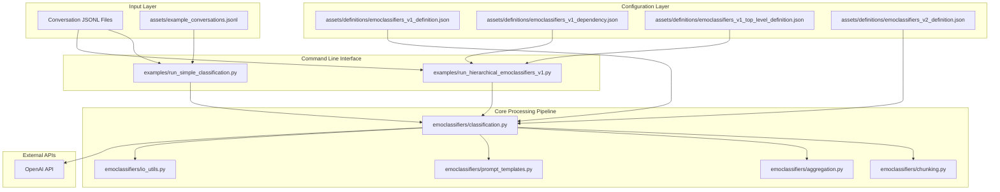
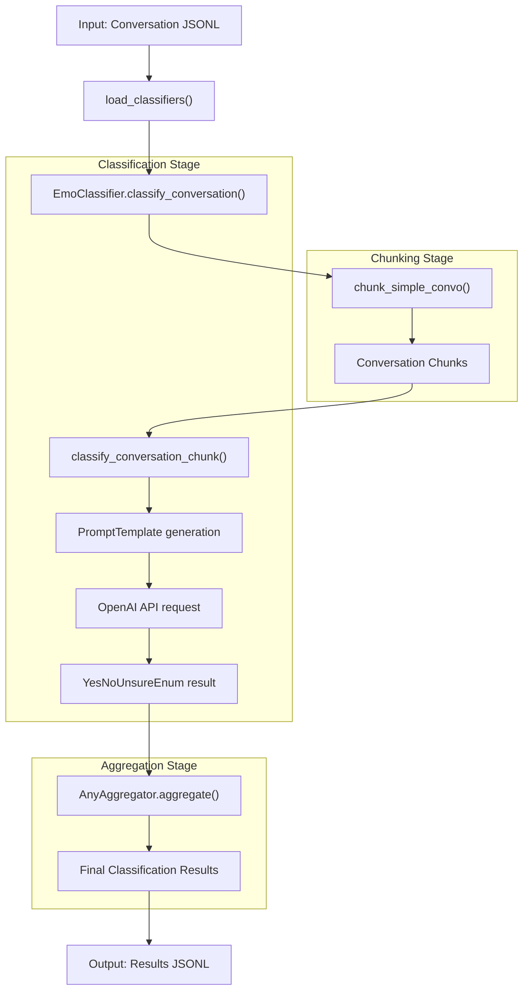

<!-- source: DeepWiki mcp.deepwiki.com · repo openai/emoclassifiers · page 1 Overview · fetched 2026-10-26 -->

# Overview

Relevant source files

The following files were used as context for generating this wiki page:

- [LICENSE](LICENSE)
- [README.md](README.md)
- [requirements.txt](requirements.txt)

## Purpose and Scope

The EmoClassifiers repository provides LLM-based automatic classifiers for detecting affective cues in user-chatbot conversations. This system enables researchers and practitioners to analyze conversations at scale to identify patterns of emotional dependency, vulnerability, and problematic usage behaviors in human-AI interactions.

This overview covers the high-level system architecture, core components, and classification approaches. For detailed installation and usage instructions, see [Getting Started](#2). For information about specific classifier versions and their capabilities, see [Classifier Versions](#4).

Sources: [README.md:1-5]()

## System Architecture

The EmoClassifiers system follows a modular pipeline architecture that processes conversations through chunking, classification, and aggregation stages:

**System Architecture Overview**

Sources: [README.md:112-119](), [emoclassifiers/classification.py](), [examples/run_simple_classification.py](), [examples/run_hierarchical_emoclassifiers_v1.py]()

## Data Flow Pipeline

The system processes conversations through a structured pipeline that transforms raw conversation data into classified emotional indicators:

**Classification Data Flow**

Sources: [emoclassifiers/classification.py](), [emoclassifiers/chunking.py](), [emoclassifiers/aggregation.py](), [README.md:26-50]()

## Core Components

The system consists of five primary modules that handle different aspects of the classification pipeline:

| Component | File Path | Primary Classes/Functions | Purpose |
|-----------|-----------|---------------------------|---------|
| **Classification Engine** | `emoclassifiers/classification.py` | `EmoClassifier`, `load_classifiers()` | Core classifier logic and loading |
| **Conversation Processing** | `emoclassifiers/chunking.py` | `chunk_simple_convo()` | Breaking conversations into analyzable segments |
| **Result Aggregation** | `emoclassifiers/aggregation.py` | `AnyAggregator`, `AllAggregator`, `AdjustedAggregator` | Combining chunk-level results into conversation-level classifications |
| **Prompt Engineering** | `emoclassifiers/prompt_templates.py` | Template classes for V1 and V2 | Generating LLM prompts for different classifier types |
| **Data I/O** | `emoclassifiers/io_utils.py` | JSON/JSONL utilities | Loading and saving conversation data |

The `EmoClassifier` class in [emoclassifiers/classification.py]() serves as the central orchestrator, coordinating between chunking strategies, prompt generation, API calls, and result aggregation.

Sources: [README.md:114-118](), [emoclassifiers/classification.py](), [emoclassifiers/chunking.py](), [emoclassifiers/aggregation.py](), [emoclassifiers/prompt_templates.py](), [emoclassifiers/io_utils.py]()

## Classification System Versions

The repository implements two distinct approaches to emotion classification, each optimized for different analysis scenarios:

**EmoClassifiers V1 (Hierarchical System)**
- **Architecture**: Dependency-based hierarchical classification
- **Scope**: 20 emotional indicators across 5 top-level categories
- **Configuration**: [assets/definitions/emoclassifiers_v1_definition.json](), [assets/definitions/emoclassifiers_v1_dependency.json]()
- **Execution**: Uses `run_hierarchical_emoclassifiers_v1.py` for dependency-aware processing
- **Focus**: Emotional dependency detection (loneliness, vulnerability, attachment)

**EmoClassifiers V2 (Behavioral Indicators)**  
- **Architecture**: Flat classification system
- **Scope**: 47+ behavioral indicators
- **Configuration**: [assets/definitions/emoclassifiers_v2_definition.json]()
- **Execution**: Uses `run_simple_classification.py` for parallel processing
- **Focus**: Broad behavioral pattern detection (user behaviors, assistant responses, exchange patterns)

Both versions support multiple aggregation modes (`any`, `all`, `adjusted`) and process conversations through the same core pipeline with different prompt templates and classifier definitions.

Sources: [README.md:80-110](), [assets/definitions/emoclassifiers_v1_definition.json](), [assets/definitions/emoclassifiers_v2_definition.json](), [examples/run_simple_classification.py](), [examples/run_hierarchical_emoclassifiers_v1.py]()

## Usage Patterns

The system supports both programmatic and command-line usage patterns:

**Programmatic Usage**: Load classifiers via `load_classifiers(classifier_set="v1"|"v2")` and call `classify_conversation()` methods directly, with support for async processing for parallel execution.

**Command-Line Usage**: Batch processing through provided scripts that handle JSONL input/output, rate limiting, and result aggregation automatically.

The async design enables efficient parallel processing of multiple conversations and classifiers simultaneously, making the system suitable for large-scale conversation analysis.

Sources: [README.md:24-72](), [requirements.txt:1](), [LICENSE:1-21]()

---

