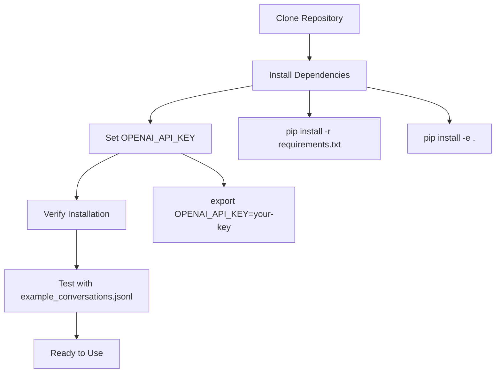
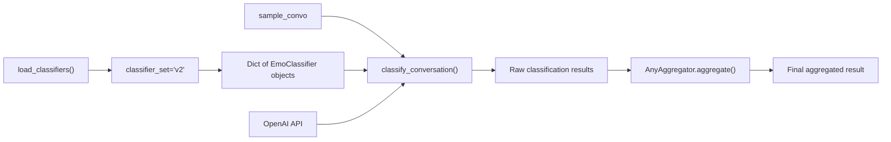
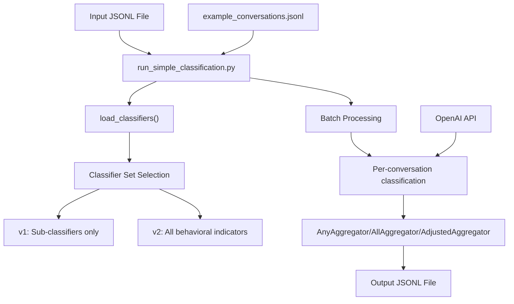

<!-- source: DeepWiki mcp.deepwiki.com · repo openai/emoclassifiers · page 2 Getting Started · fetched 2026-10-26 -->

# Getting Started

<details>
<summary>Relevant source files</summary>

The following files were used as context for generating this wiki page:

- [README.md](README.md)
- [assets/example_conversations.jsonl](assets/example_conversations.jsonl)
- [requirements.txt](requirements.txt)

</details>


This guide walks you through installing EmoClassifiers, configuring your environment, and running your first emotion classification on user-chatbot conversations. You'll learn to use both the Python API and command-line tools to classify conversations using the pre-trained LLM-based classifiers.

For detailed information about the classification system internals, see [Core Classification System](#3). For comprehensive configuration options, see [Configuration System](#5).

## Prerequisites

EmoClassifiers requires Python 3.7+ and an OpenAI API key. The system uses OpenAI's language models to perform emotion classification on conversation data.

| Requirement | Purpose |
|-------------|---------|
| Python 3.7+ | Runtime environment |
| OpenAI API Key | Access to OpenAI language models |
| Internet Connection | API calls to OpenAI services |

## Installation

### Basic Installation

Install the required dependencies and the EmoClassifiers package:

```bash
pip install -r requirements.txt
pip install -e .
```

Alternatively, you can skip package installation by modifying your `PYTHONPATH` or running code directly from the repository root.

**Installation Workflow**



Sources: [README.md:7-23](), [requirements.txt:1]()

### Environment Configuration

Set your OpenAI API key as an environment variable:

```bash
export OPENAI_API_KEY=<your-openai-api-key>
```

The system will automatically use this environment variable when making API calls through the OpenAI client.

Sources: [README.md:18-22]()

## Your First Classification

### Python API Usage

**Basic Classification Example**

```python
import asyncio
from emoclassifiers.classification import load_classifiers
from emoclassifiers.aggregation import AnyAggregator

# Load EmoClassifiers V2 (behavioral indicators)
classifiers = load_classifiers(classifier_set="v2")

# Sample conversation data
sample_convo = [
    {"role": "user", "content": "I'm so sad."},
    {"role": "assistant", "content": "Oh no! Tell me what happened."},
    {"role": "user", "content": "My code doesn't run. I'm so frustrated."},
    {"role": "assistant", "content": "Let me take a look at it. It will be okay."},
]

# Single classifier execution
raw_result = asyncio.run(classifiers["encourage_sharing"].classify_conversation(sample_convo))
result = AnyAggregator.aggregate(raw_result)
print(result)
```

**Classification Workflow**



Sources: [README.md:24-52]()

### Understanding Results

The `classify_conversation()` method returns raw results per conversation chunk, while `AnyAggregator.aggregate()` combines these into a final conversation-level classification. The result structure varies based on the classifier's target (user messages, assistant messages, or exchanges).

**Parallel Classification**

For processing multiple classifiers simultaneously:

```python
# Run all V2 classifiers in parallel
futures = asyncio.gather(*[
    classifier.classify_conversation(sample_convo)
    for classifier in classifiers.values()
])

raw_results = asyncio.run(futures)
results = {
    name: AnyAggregator.aggregate(raw_results[i])
    for i, name in enumerate(classifiers.keys())
}
```

Sources: [README.md:54-72]()

## Command Line Tools

EmoClassifiers provides two command-line scripts for batch processing conversations stored in JSONL format.

### Simple Classification

Use `run_simple_classification.py` for straightforward batch processing with either V1 or V2 classifiers:

```bash
python examples/run_simple_classification.py \
    --input_path ./assets/example_conversations.jsonl \
    --output_path ./example_results.jsonl \
    --classifier_set v2 \
    --aggregation_mode any
```

**Command Line Tool Architecture**



Sources: [README.md:74-97]()

### Hierarchical Classification (V1)

For V1's dependency-based hierarchical approach:

```bash
python examples/run_hierarchical_emoclassifiers_v1.py \
    --input_path ./assets/example_conversations.jsonl \
    --output_path ./hierarchical_results.jsonl \
    --aggregation_mode any
```

This tool first runs top-level classifiers, then conditionally executes sub-classifiers based on dependency relationships defined in the V1 configuration files.

Sources: [README.md:99-110]()

## Test with Example Data

The repository includes sample conversations for testing:

| File | Contents |
|------|----------|
| `assets/example_conversations.jsonl` | Three sample conversations with varying emotional content |

Each line contains a conversation array with `role` and `content` fields following the OpenAI chat format.

Sources: [assets/example_conversations.jsonl:1-4]()

## Available Classifier Sets

| Classifier Set | Description | Usage |
|---------------|-------------|--------|
| `v1` | 20 hierarchical emotional indicators | `load_classifiers(classifier_set="v1")` |
| `v2` | 47+ flat behavioral indicators | `load_classifiers(classifier_set="v2")` |

For detailed information about classifier differences, see [Classifier Versions](#4).

## Aggregation Modes

| Mode | Behavior | Use Case |
|------|----------|----------|
| `any` | Positive if any chunk is positive | High sensitivity detection |
| `all` | Positive if all chunks are positive | High specificity detection |
| `adjusted` | Weighted combination based on chunk confidence | Balanced approach |

## Next Steps

After completing your first classification:

- Explore [Core Classification System](#3) to understand chunking and aggregation strategies
- Review [EmoClassifiers V1](#4.1) and [V2](#4.2) to choose the appropriate version
- Learn about [Configuration System](#5) to customize classifiers
- See [Command Line Tools](#6) for advanced batch processing options

Sources: [README.md:1-127]()

---

