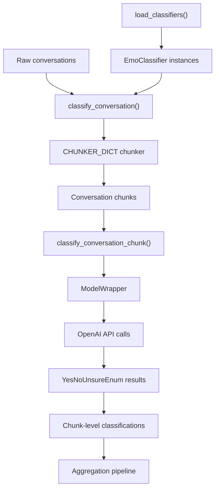
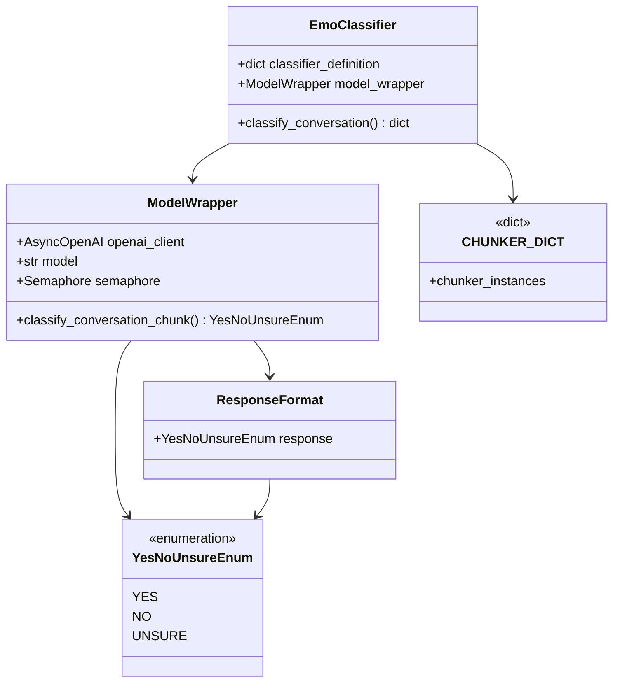
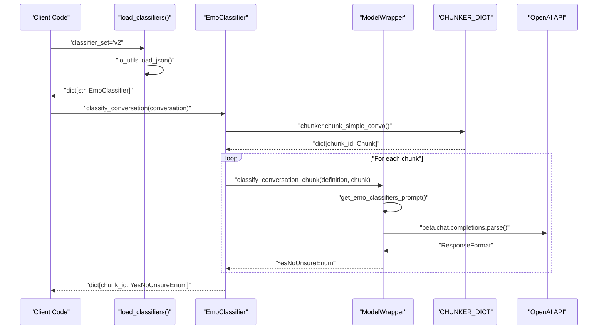

<!-- source: DeepWiki mcp.deepwiki.com · repo openai/emoclassifiers · page 3 Core Classification System · fetched 2026-10-26 -->

# Core Classification System

Relevant source files

The following files were used as context for generating this wiki page:

- [README.md](README.md)
- [emoclassifiers/classification.py](emoclassifiers/classification.py)

This document covers the core classification pipeline that processes conversations and applies emotion classifiers to detect affective cues. The system handles the end-to-end flow from raw conversations through chunking, classification, and result aggregation. For details on specific chunking strategies, see [Conversation Chunking](#3.1). For result aggregation methods, see [Result Aggregation](#3.2). For prompt engineering details, see [Prompt Templates](#3.3).

## Overview

The core classification system provides a unified interface for applying multiple emotion classifiers to conversational data. It supports both EmoClassifiers V1 (hierarchical) and V2 (behavioral indicators) through a common pipeline that handles:

- Loading classifier definitions from JSON configuration files
- Chunking conversations into analyzable segments  
- Orchestrating asynchronous classification requests to OpenAI's API
- Managing concurrency and rate limiting
- Returning structured classification results

## Core Pipeline Architecture

**Classification Pipeline Flow**

*Sources: [emoclassifiers/classification.py:145-201](), [emoclassifiers/classification.py:157-176]()*

## Key System Components

**Core Classes and Their Relationships**

*Sources: [emoclassifiers/classification.py:106-142](), [emoclassifiers/classification.py:145-177](), [emoclassifiers/classification.py:17-31]()*

### ModelWrapper Class

The `ModelWrapper` class [emoclassifiers/classification.py:106-142]() encapsulates OpenAI API interactions with built-in concurrency control:

| Property | Type | Purpose |
|----------|------|---------|
| `openai_client` | `AsyncOpenAI` | Async OpenAI client instance |
| `model` | `str` | Model name (default: "gpt-4o-mini-2024-07-18") |
| `semaphore` | `asyncio.Semaphore` | Limits concurrent API requests (default: 5) |

The `classify_conversation_chunk()` method [emoclassifiers/classification.py:122-141]() handles individual chunk classification by:
1. Generating the appropriate prompt using `get_emo_classifiers_prompt()`
2. Making structured completion requests with `ResponseFormat` 
3. Parsing responses into `YesNoUnsureEnum` values

### EmoClassifier Class

The `EmoClassifier` class [emoclassifiers/classification.py:145-177]() orchestrates conversation-level classification:

- Takes a `classifier_definition` dict containing classifier configuration
- Uses a `ModelWrapper` instance for API calls
- Implements `classify_conversation()` which chunks conversations and classifies each chunk
- Returns a dictionary mapping chunk IDs to `YesNoUnsureEnum` results

## Classification Process Flow

**Detailed Classification Sequence**

*Sources: [emoclassifiers/classification.py:157-176](), [emoclassifiers/classification.py:122-141](), [emoclassifiers/classification.py:179-200]()*

## Classifier Loading and Configuration

The system supports multiple classifier versions through the `CLASSIFIER_DEFINITION_PATH_DICT` [emoclassifiers/classification.py:10-14]():

| Classifier Set | Path | Purpose |
|----------------|------|---------|
| `"v1"` | `assets/definitions/emoclassifiers_v1_definition.json` | V1 sub-classifiers |
| `"v1_top_level"` | `assets/definitions/emoclassifiers_v1_top_level_definition.json` | V1 top-level classifiers |
| `"v2"` | `assets/definitions/emoclassifiers_v2_definition.json` | V2 behavioral indicators |

The `load_classifiers()` function [emoclassifiers/classification.py:179-200]() creates `EmoClassifier` instances from JSON definitions, with each classifier containing:
- Version-specific prompt templates
- Chunking strategy specification  
- Classification criteria and instructions

## Prompt Generation System

The system uses version-specific prompt generators [emoclassifiers/classification.py:42-103]():

- `get_emo_classifiers_v1_prompt()` - For V1 sub-classifiers
- `get_emo_classifiers_v1_top_level_prompt()` - For V1 top-level classifiers  
- `get_emo_classifiers_v2_prompt()` - For V2 behavioral indicators

All prompt functions take a `classifier_definition` dict and `Chunk` object, returning formatted prompts that include classifier names, criteria, and conversation context.

## Asynchronous Processing

The system is designed for concurrent processing:

- `ModelWrapper.semaphore` limits concurrent OpenAI API requests
- `EmoClassifier.classify_conversation()` uses `asyncio.gather()` for parallel chunk processing
- All classification methods are async-compatible

This enables efficient batch processing of conversations while respecting API rate limits.

*Sources: [emoclassifiers/classification.py:106-142](), [emoclassifiers/classification.py:157-176]()*

---

