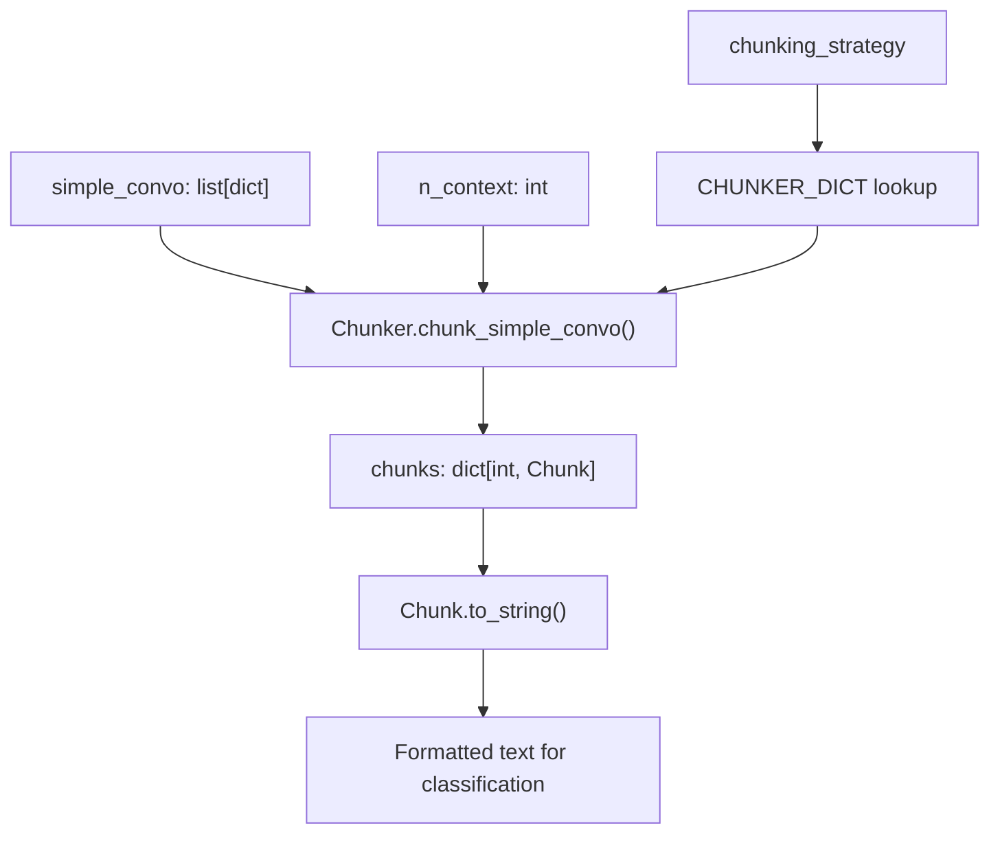
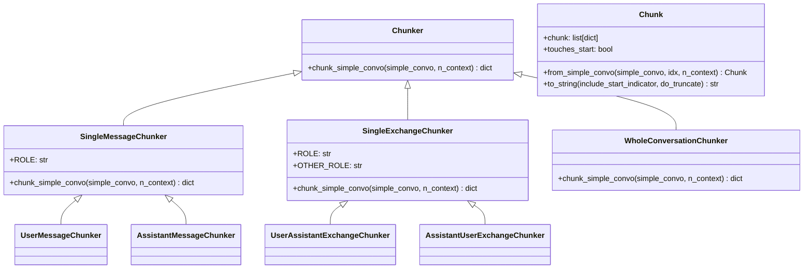
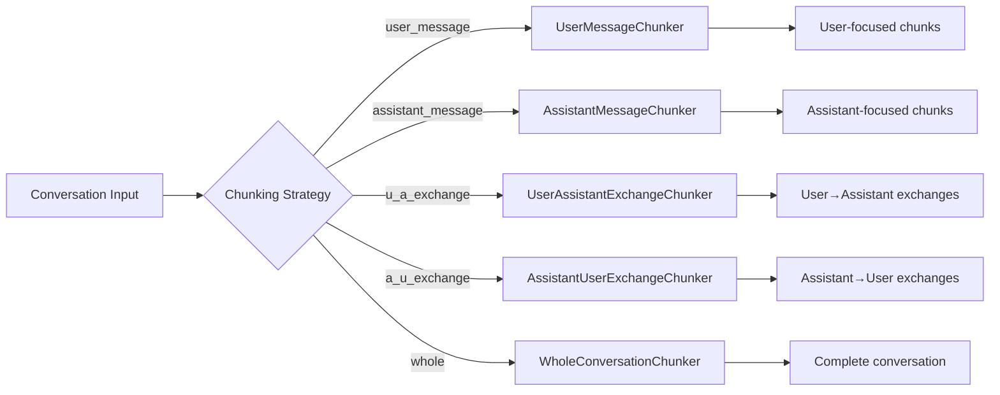

<!-- source: DeepWiki mcp.deepwiki.com · repo openai/emoclassifiers · page 3.1 Conversation Chunking · fetched 2026-10-26 -->

# Conversation Chunking

Relevant source files

The following files were used as context for generating this wiki page:

- [emoclassifiers/chunking.py](emoclassifiers/chunking.py)

## Purpose and Scope

This document explains the conversation chunking system in EmoClassifiers, which segments conversations into analyzable pieces before classification. Chunking is a preprocessing step that determines how conversations are divided for individual classifier analysis. For information about how chunk classifications are combined into final results, see [Result Aggregation](#3.2). For details on the overall classification pipeline, see [Core Classification System](#3).

## Overview

The chunking system transforms input conversations into smaller, contextual segments that can be efficiently processed by emotion classifiers. Each conversation is broken down according to configurable strategies that focus on different message patterns - individual user messages, assistant responses, conversational exchanges, or entire conversations.

The system supports multiple chunking strategies to accommodate different analysis needs. Some classifiers may need to analyze individual user messages to detect emotional states, while others require full conversational exchanges to understand interaction patterns.

## Core Architecture

### Chunking Pipeline

**Chunking Pipeline Flow**
Sources: [emoclassifiers/chunking.py:15-19](), [emoclassifiers/chunking.py:150-156]()

### Core Components

The chunking system consists of two primary classes:

| Component | Purpose | Key Methods |
|-----------|---------|-------------|
| `Chunker` | Abstract base class defining chunking interface | `chunk_simple_convo()` |
| `Chunk` | Container for conversation segments with context | `from_simple_convo()`, `to_string()` |

**Class Hierarchy and Relationships**
Sources: [emoclassifiers/chunking.py:11-20](), [emoclassifiers/chunking.py:22-41](), [emoclassifiers/chunking.py:73-101](), [emoclassifiers/chunking.py:103-137](), [emoclassifiers/chunking.py:139-148]()

## Chunking Strategies

The system provides five distinct chunking strategies accessible through the `CHUNKER_DICT` mapping:

### Message-Based Chunking

**UserMessageChunker** (`"user_message"`)
- Focuses on individual user messages
- Includes up to `n_context` previous messages for context
- Used for analyzing user emotional states and behaviors

**AssistantMessageChunker** (`"assistant_message"`)  
- Focuses on individual assistant responses
- Includes conversational context leading to each response
- Used for analyzing assistant behavior patterns

### Exchange-Based Chunking

**UserAssistantExchangeChunker** (`"u_a_exchange"`)
- Creates chunks containing user message + assistant response pairs
- Requires both roles to be present in the contextual window
- Analyzes complete conversational turns

**AssistantUserExchangeChunker** (`"a_u_exchange"`)
- Creates chunks containing assistant message + user response pairs  
- Useful for analyzing user reactions to assistant behavior

### Conversation-Level Chunking

**WholeConversationChunker** (`"whole"`)
- Treats entire conversation as a single chunk
- Used for classifiers requiring full conversational context
- Most computationally intensive but provides complete context

**Chunking Strategy Selection**
Sources: [emoclassifiers/chunking.py:89-100](), [emoclassifiers/chunking.py:123-136](), [emoclassifiers/chunking.py:139-147](), [emoclassifiers/chunking.py:150-156]()

## Technical Implementation Details

### Context Window Management

All chunking strategies support a configurable context window (`n_context` parameter, default=3) that includes previous messages to provide conversational context. The `Chunk.from_simple_convo()` method handles context extraction:

- Calculates `start_idx = max(0, idx - n_context)` to include context
- Sets `touches_start = True` when chunk begins at conversation start
- Maintains message ordering and role information

### Chunk Formatting

The `Chunk.to_string()` method converts chunks into formatted text for classifier consumption:

- Prefixes conversation start with `"(This is the start of the conversation.)"`
- Formats messages as `[ROLE] "content"` or `[*ROLE*] "content"` for target messages
- Supports optional content truncation via `truncate_string()` function
- Maintains role capitalization (`USER`, `ASSISTANT`)

### String Truncation

Long messages are handled by the `truncate_string()` function:
- Default maximum length: 1500 characters
- Preserves beginning and end of long messages
- Inserts separator (`"[...]"` or custom) in the middle
- Ensures important content from both ends is retained

Sources: [emoclassifiers/chunking.py:31-40](), [emoclassifiers/chunking.py:42-61](), [emoclassifiers/chunking.py:63-71]()

## Integration with Classification Pipeline

Chunking operates as the first stage in the classification pipeline. Each chunker produces a dictionary mapping chunk IDs to `Chunk` objects, which are then processed individually by classifiers before aggregation.

The chunking strategy is typically specified in classifier configuration files and selected via the `CHUNKER_DICT` lookup. This allows different classifiers to use different chunking approaches based on their analytical requirements.

Sources: [emoclassifiers/chunking.py:150-156](), [emoclassifiers/chunking.py:80-86](), [emoclassifiers/chunking.py:111-120](), [emoclassifiers/chunking.py:144-147]()

---

